<table>
  <tr>
    <td width="35%" valign="middle">
      
    </td>
    <td width="65%" valign="middle">
      <h1>Cholera Genomics Guidance</h1>
    </td>
  </tr>
</table>

**Authors:** Emma Doughty, Justice Ohene Amofa, Dana Itani, Peter van Heusden, Rekha Satyan, Palesa Makoti, Catherine Rossouw, Tracey Calvert-Joshua

## Guidance at a Glance

This infographic provides an overview of the key topics covered in this guidance, from cholera surveillance and genomic data generation to genome characterisation, comparative analysis, data sharing and interpretation. Each topic is linked to the relevant section of the document to help readers identify the guidance most relevant to their work.

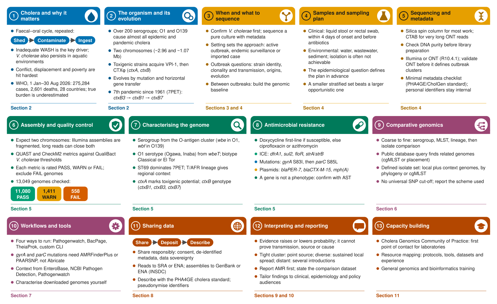

<small><strong>Figure 1. Overview of the Cholera Genomics Guidance.</strong> Summary of the main topics and corresponding sections covered in this document.</small>

&nbsp;

[1 Introduction and Scope](#1-introduction-and-scope)

[1.1 Purpose and Target Audience](#11-purpose-and-target-audience)

[1.2 Document Scope and How to Use This Guide](#12-document-scope-and-how-to-use-this-guide)

[1.3 The Role of PHA4GE and Its Initiatives](#13-the-role-of-pha4ge-and-its-initiatives)

[1.4 Values and Principles in Genomic Implementation](#14-values-and-principles-in-genomic-implementation)

[2 Cholera Background in a Public Health Context](#2-cholera-background-in-a-public-health-context)

[2.1 Cholera: Disease, Burden and Public Health Significance](#21-cholera-disease-burden-and-public-health-significance)

[2.2 Cholera Epidemiological Settings and Their Implications for Surveillance](#22-cholera-epidemiological-settings-and-their-implications-for-surveillance)

[2.3 *Vibrio cholerae*: Biological Background](#23-vibrio-cholerae-biological-background)

[2.4 Pandemic History and the Seventh Pandemic El Tor Lineage](#24-pandemic-history-and-the-seventh-pandemic-el-tor-lineage)

[3 Cholera Genomics Applications and Questions to Address in Public Health](#3-cholera-genomics-applications-and-questions-to-address-in-public-health)

[3.1 Outbreak Investigation](#31-outbreak-investigation)

[3.1.1 Initial Characterisation](#311-initial-characterisation)

[3.1.2 Clonality and Transmission Structure](#312-clonality-and-transmission-structure)

[3.1.3 Understanding Origins and Context](#313-understanding-origins-and-context)

[3.1.4 Monitoring Within-Outbreak Evolution](#314-monitoring-within-outbreak-evolution)

[3.2 Inter-outbreak and Endemic Surveillance](#32-inter-outbreak-and-endemic-surveillance)

[4 V. cholerae Genomic Data Generation](#4-v-cholerae-genomic-data-generation)

[4.1 Sample Types, Collection and Transport](#41-sample-types-collection-and-transport)

[4.1.1 Clinical Samples](#411-clinical-samples)

[4.1.2 Environmental Samples](#412-environmental-samples)

[4.2 Culture, Enrichment and Preservation](#42-culture-enrichment-and-preservation)

[4.3 DNA Extraction, Sequencing, and Minimum Genomic Data Requirements](#43-dna-extraction-sequencing-and-minimum-genomic-data-requirements)

[4.3.1 DNA Extraction](#431-dna-extraction)

[4.3.2 Sequencing](#432-sequencing)

[4.3.3 Minimum Genomic Data Requirements](#433-minimum-genomic-data-requirements)

[4.4 Metadata Collection](#44-metadata-collection)

[5 V. cholerae Genome Characterisation and Bioinformatics](#5-v-cholerae-genome-characterisation-and-bioinformatics)

[5.1 Data Quality Improvement and Genome Assembly](#51-data-quality-improvement-and-genome-assembly)

[5.2 Genomic Data Quality Control](#52-genomic-data-quality-control)

[5.3. V. cholerae Phenotypic Subtype Prediction](#53-v-cholerae-phenotypic-subtype-prediction)

[5.3.1 Serogroup Identification](#531-serogroup-identification)

[5.3.2 Serotype Identification](#532-serotype-identification)

[5.3.3 Biotype Identification](#533-biotype-identification)

[5.4 V. cholerae Genomic Subtype Identification](#54-v-cholerae-genomic-subtype-identification)

[5.4.1 Multilocus Sequence Typing](#541-multilocus-sequence-typing)

[5.4.2 Lineage Classification](#542-lineage-classification)

[5.5 Virulence Prediction](#55-virulence-prediction)

[5.5.1 Cholera Toxin Gene Detection and ctxB Genotyping](#551-cholera-toxin-gene-detection-and-ctxb-genotyping)

[5.5.2 Toxin Co-regulated Pilus and Pathogenicity Islands](#552-toxin-co-regulated-pilus-and-pathogenicity-islands)

[5.6. Antimicrobial Resistance](#56-antimicrobial-resistance)

[5.6.1 Clinical and Public Health Context](#561-clinical-and-public-health-context)

[5.6.2 Key Resistance Patterns Relevant to Contemporaneous V. cholerae Surveillance](#562-key-resistance-patterns-relevant-to-contemporaneous-v-cholerae-surveillance)

[5.6.3 Tools for Genomic AMR Detection](#563-tools-for-genomic-amr-detection)

[5.6.4 Interpretation of AMR Determinants, Genotype–Phenotype Discordances, and the Limits of Genomic Prediction](#564-interpretation-of-amr-determinants-genotypephenotype-discordances-and-the-limits-of-genomic-prediction)

[5.6.5 Mobile Genetic Elements](#565-mobile-genetic-elements)

[6 Comparative Genomics Analysis](#6-comparative-genomics-analysis)

[6.1 The Purpose of Comparative Genomic Analyses](#61-the-purpose-of-comparative-genomic-analyses)

[6.1.1 Assessment of Relationships Amongst a Defined Set of Isolates](#611-assessment-of-relationships-amongst-a-defined-set-of-isolates)

[6.1.2 Identification of Closely Related Genomes Within Large (Public) Databases	73](#612-identification-of-closely-related-genomes-within-large-public-databases)

[6.2 Comparative Genomic Analysis Methods](#62-comparative-genomic-analysis-methods)

[6.2.1 Phylogenetic Inference](#621-phylogenetic-inference)

[6.2.2 cgMLST](#622-cgmlst)

[6.2.3 Phylogenetic Placement](#623-phylogenetic-placement)

[7 Bioinformatics Implementation](#7-bioinformatics-implementation)

[7.1 Bioinformatics Platforms and Compatible Workflows](#71-bioinformatics-platforms-and-compatible-workflows)

[7.2 Genome Characterisation Workflows](#72-genome-characterisation-workflows)

[7.3 Comparative Genomics Workflows](#73-comparative-genomics-workflows)

[7.3.1 Phylogenetic inference and cgMLST](#731-phylogenetic-inference-and-cgmlst)

[7.3.2 Identifying Contextual Genomes from Public Databases](#732-identifying-contextual-genomes-from-public-databases)

[8 V. cholerae Public Data Sharing](#8-v-cholerae-public-data-sharing)

[8.1 Ethical Considerations](#81-ethical-considerations)

[8.2 Data Repositories](#82-data-repositories)

[8.3 Metadata Standards](#83-metadata-standards)

[9 Interpretation of Genomic Data](#9-interpretation-of-genomic-data)

[9.1 Interpreting Outbreak Genomics](#91-interpreting-outbreak-genomics)

[9.1.1 Interpreting Outbreak Characteristics](#911-interpreting-outbreak-characteristics)

[9.1.2 Interpreting Outbreak Clonality and Transmission Structure](#912-interpreting-outbreak-clonality-and-transmission-structure)

[9.1.3 Interpreting Outbreak Origins and Context](#913-interpreting-outbreak-origins-and-context)

[9.1.4 Interpreting Within-Outbreak Evolution](#914-interpreting-within-outbreak-evolution)

[9.2. Interpreting Endemic and Surveillance Genomics](#92-interpreting-endemic-and-surveillance-genomics)

[10\. Reporting and Communication of Genomic Findings](#10-reporting-and-communication-of-genomic-findings)

[10.1. Modes of Reporting](#101-modes-of-reporting)

[10.2. Visual Reporting Formats and Dashboards](#102-visual-reporting-formats-and-dashboards)

[10.3. Presenting Phylogenetic Trees](#103-presenting-phylogenetic-trees)

[11\. Capacity Building and Training Resources](#11-capacity-building-and-training-resources)

[12\. References and Citations](#12-references-and-citations)

[13\. Glossary](#13-glossary)

# 1 Introduction and Scope

## 1.1 Purpose and Target Audience

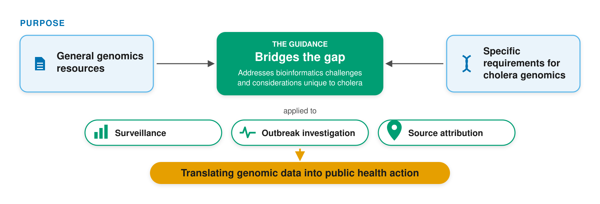  
<small><strong>Figure 2. Purpose of the guidance document.</strong> Practical, actionable recommendations for implementing *V. cholerae* genomic analysis in public health settings.</small>

&nbsp;

This guidance document provides practical, actionable recommendations for implementing *Vibrio cholerae* (*V. cholerae*) genomic analysis in public health settings. It addresses the specific bioinformatics challenges and considerations unique to cholera surveillance, outbreak investigation, and source attribution. The guidance is designed to bridge the gap between general genomics resources and the specific requirements for cholera genomics implementation, with a focus on translating genomic data into public health action.

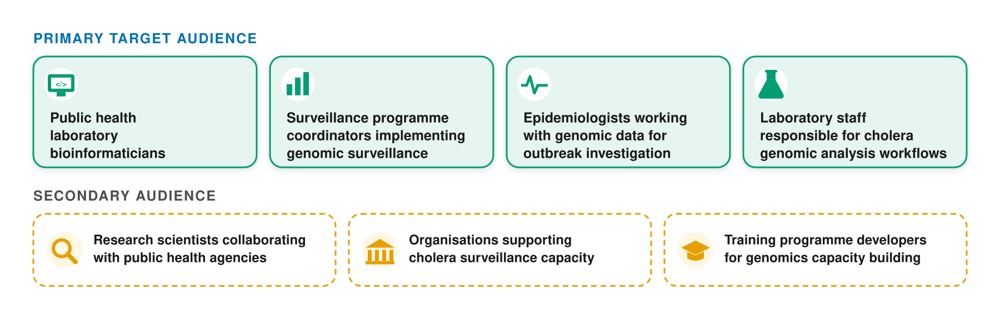  
<small><strong>Figure 3. Target audience of the guidance document.</strong></small>

&nbsp;

**Primary Target Audience:**

* Public health laboratory bioinformaticians  
* Surveillance programme coordinators implementing genomic surveillance  
* Epidemiologists working with genomic data for outbreak investigation  
* Laboratory staff responsible for cholera genomic analysis workflows

**Secondary Audience:**

* Research scientists collaborating with public health agencies  
* Organisations supporting cholera surveillance capacity  
* Training programme developers for genomics capacity building

## 1.2 Document Scope and How to Use This Guide

This document focuses specifically on the bioinformatics analysis of *Vibrio cholerae* genomic data for public health applications, covering broader cholera context and considerations for analysing and interpreting data. It addresses pathogen-specific considerations that are absent in general genomics guidance documents. 

The guidance document has been developed through collaborative input from the international cholera genomics community, including public health practitioners, researchers, and tool developers. The content reflects real-world implementation experiences and addresses practical challenges identified by the user community. Readers striving to implement cholera genomics are directed to Section 4 for wet-lab considerations, Section 5 to understand the characterisation outputs 

relevant to their setting and the tools that produce them; Section 6 to plan their comparative analysis approach; and Section 7 to select the platform or workflow that delivers these analyses within their operational constraints. Tables 2–3 in Section 7 offer a practical starting point for workflow selection.  
Contributions to the document are very welcome. To propose a change, edit the   
source files and open a pull request with the proposed changes. If you are interested in participating in further discussions, please feel free to join the [Working Group](https://pha4ge.org/bioinformatics-pipelines-and-visualization/).

## 1.3 The Role of PHA4GE and Its Initiatives

The Public Health Alliance for Genomic Epidemiology (PHA4GE) is a global coalition that is actively working to establish consensus standards, document and share best practices, improve the availability of critical bioinformatics tools and resources, and advocate for greater openness, interoperability, accessibility and reproducibility in public health microbial bioinformatics. This cholera-specific guidance is part of PHA4GE's series of pathogen-specific bioinformatics guidance documents, designed to complement general genomics resources with practical, implementation-focused content.

## 1.4 Values and Principles in Genomic Implementation

The implementation of genomic surveillance for cholera should ensure ethical, equitable, and effective use of genomic data for public health benefit. The following figure summarises the values and principles that should guide decisions about generating, analysing, sharing and using cholera genomic data. These considerations apply throughout the surveillance process, alongside the technical recommendations in this guidance.

<small><strong>Figure 4. Values and Principles in Genomic implementation.</strong></small>

&nbsp;

# 2 Cholera Background in a Public Health Context

## 2.1 Cholera: Disease, Burden and Public Health Significance

Cholera is an acute diarrhoeal disease caused by toxigenic strains of *Vibrio cholerae*, primarily serogroup O1 or O139. The disease is characterised by profuse watery diarrhoea. Symptoms appear very quickly, ranging from 12 hours to 5 days after exposure and can lead to severe dehydration and death within hours if left untreated. Most infections are mild or asymptomatic, but severe disease characterised by the rice-water appearance of stools caused by intestinal fluid secretion driven by cholera toxin carries a case fatality rate that can exceed 50 % without treatment. This can be reduced to below 1% with prompt oral or intravenous rehydration (Chowdhury et al. 2022). 

Cholera is transmitted primarily via the faecal-oral route through contaminated drinking water or food, and is closely associated with inadequate access to safe water, sanitation, and hygiene (Kaper et al., 1995). It disproportionately affects populations in settings characterised by conflict, displacement, poverty, and limited public health infrastructure. Since *V. cholerae* can persist in aquatic environments, this facilitates seasonal and epidemic transmission.

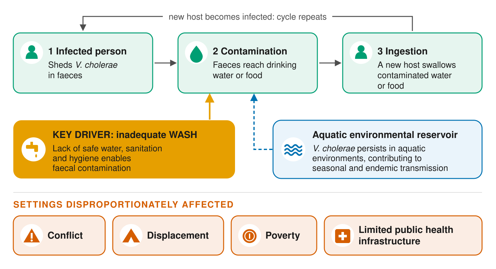  
<small><strong>Figure 5. How cholera spreads, and who is most at risk.</strong> Cholera is transmitted by the faecal–oral route.</small>

&nbsp;

Despite being preventable and treatable, cholera continues to impose a substantial and worsening global burden. In 2023, 535,321 cases and 4,007 deaths were reported to WHO from 45 countries, representing a 13% increase in cases and a 71% increase in deaths compared with 2022 (WHO, 2024). In 2024, more than 560,000 cases and over 6,000 deaths were reported across 60 countries, with the African continent accounting for 46% of cases and nearly 83% of deaths (WHO, 2025). In 2025, 47 countries reported 451,499 cases and 7,870 deaths: fewer cases than the previous year, but a 30% rise in deaths and the highest annual cholera mortality reported to WHO since 1999 (WHO, 2026). This divergence, with reported cases falling while deaths continue to climb, is itself significant, and underlines that case counts alone are a poor measure of cholera's impact. Notably, these figures represent reported cases only; the true burden is estimated to be substantially higher due to underdiagnosis and underreporting; modelling estimates suggest 1.3–4.0 million cases and 21,000–143,000 deaths each year in endemic countries (Ali et al., 2015).   
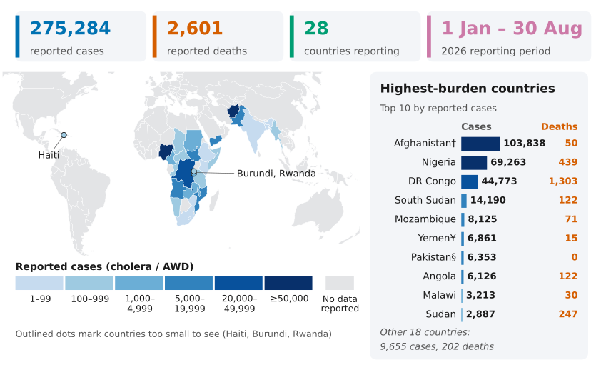  
<small><strong>Figure 6. Reported cholera and AWD cases, 1 January – 30 August 2026.</strong> Cumulative cholera and acute watery diarrhoea (AWD) cases reported to WHO, by country.</small>

&nbsp;

Disclaimer: The boundaries and names shown and the designations used on this map do not imply the expression of any opinion whatsoever on the part of WHO concerning the legal status of any country, territory, city or area or of its authorities, or concerning the delimitation of its frontiers or boundaries.

Antimicrobial treatment is recommended as an adjunct to oral rehydration therapy for patients with severe dehydration or high purging, where it can shorten the duration and volume of diarrhoea and reduce the period of pathogen shedding (Leibovici-Weissman et al., 2014\) Resistance to key antibiotics is therefore a consistent public health concern for cholera, and identification of antibiotic resistance determinants makes genomic AMR surveillance a valuable complement to phenotypic susceptibility testing. The tools for genomic AMR detection and the specific interpretive challenges they present for *V. cholerae* are described in detail in Section 5.6. 

## 2.2 Cholera Epidemiological Settings and Their Implications for Surveillance

The burden of cholera is disproportionately concentrated in sub-Saharan Africa, the Middle East and South Asia (WHO, 2024). It is shaped by water, sanitation and hygiene factors, population density and mobility; the presence of conflict, displacement, or humanitarian crises; climate and environmental conditions, particularly in coastal and riverine settings where environmental *V. cholerae* reservoirs are established; and the capacity of the health system for rapid case detection and response. As such, the epidemiology of cholera differs markedly between settings in ways that fundamentally shape public health management, including use of genomics.

Outbreak-prone settings experience cholera as periodic events rather than sustained endemic disease. Outbreaks are typically associated with the introduction of a clonal strain, often following environmental or humanitarian triggers such as flooding, population displacement, or disruption of water and sanitation infrastructure. The primary genomic surveillance questions in these settings are those of outbreak response: characterising the introduced strain, determining its likely origin, and monitoring its spread. The AMR profile of the outbreak strain is a clinical priority, but the long-term AMR evolution that characterises endemic settings is less relevant. Outbreaks may resolve completely between events, leaving no endemic reservoir. 

In cholera-endemic settings, cholera is persistently present, typically with seasonal peaks associated with environmental conditions favourable for *V. cholerae* proliferation. Multiple cholera lineages may co-circulate, and specific lineages may persist for decades in the same country or region. The public health challenge in such settings is sustained rather than episodic: monitoring of lineage composition, tracking of AMR evolution over time, and understanding the environmental and social determinants of persistence are as important as responding to discrete outbreak events. AMR is frequently a chronic and evolving concern, where prolonged antibiotic use exerts sustained selective pressure on circulating strains, and different lineages bring different established resistance profiles. The boundary between outbreak and endemic transmission is often indistinct. 

Settings with only sporadic imported cases, primarily high-income countries with robust water and sanitation infrastructure, experience cholera almost exclusively in returning travellers with no sustained onward transmission. The surveillance context here is fundamentally different: characterising the imported strain, determining its likely geographic origin, and contributing data to global surveillance databases are the primary functions of genomic analysis. These settings are unlikely to face the outbreak investigation challenges described in this guidance, but their sequencing data can contribute meaningfully to the global genomic record.

## 2.3 *Vibrio cholerae*: Biological Background

*V. cholerae* is a Gram-negative, curved rod-shaped bacterium of the Vibrionaceae family, naturally found in aquatic environments worldwide. The species encompasses more than 200 serogroups based on variation in the O-antigen of the lipopolysaccharide, but epidemic and pandemic cholera is caused almost exclusively by serogroups O1 and O139. Within O1, two serotypes (Ogawa and Inaba) and two biotypes (Classical and El Tor) are recognised; all currently circulating O1 pandemic strains are O1 El Tor. In-depth discussion of these phenotypes may be found in Section 5.3.

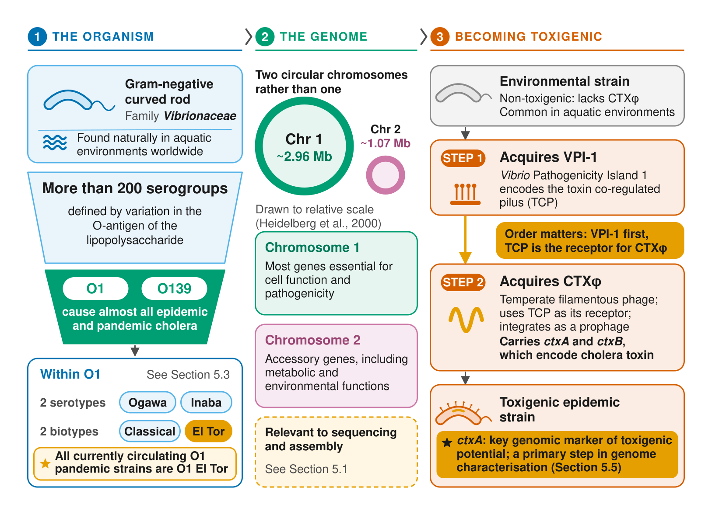  
<small><strong>Figure 7. Organism, genome and toxigenicity of *Vibrio cholerae*: serogroup classification, the two-chromosome genome, and the stepwise acquisition of VPI-1 and CTXφ.
</strong> Panel 1 (the organism). *V. cholerae* is a Gram-negative, curved rod-shaped bacterium of the family Vibrionaceae that occurs naturally in aquatic environments worldwide.</small>

&nbsp;

*V. cholerae* possesses an unusual genomic architecture for a bacterium, comprising two circular chromosomes rather than one. The larger chromosome (approximately 2.96 Mb) carries most genes essential for cell function and pathogenicity; the smaller chromosome (approximately 1.07 Mb) carries accessory genes including those for metabolic and environmental functions (Heidelberg et al., 2000). This two-chromosome structure is relevant to sequencing and assembly, as described in Section 5\.1. 

Toxigenicity, the capacity to cause epidemic cholera, depends on the acquisition of two key mobile genetic elements. The cholera toxin is encoded by the *ctxA* and *ctxB* genes, which are carried on the CTXφ filamentous bacteriophage, a temperate phage that integrates into the *V. cholerae* chromosome as a prophage (Waldor and Mekalanos, 1996). CTXφ uses the toxin co-regulated pilus (TCP) as its cellular receptor; TCP is itself encoded within Vibrio Pathogenicity Island 1 (VPI-1). Non-toxigenic *V. cholerae* strains lacking CTXφ are common in aquatic environments; the emergence of toxigenic epidemic strains depends on the sequential acquisition of VPI-1 and CTXφ. The presence of *ctxA* is therefore a key genomic marker of toxigenic potential and is a primary step in genome characterisation (see Section 5.5).

*V. cholerae* evolves through two principal mechanisms, mutation, and horizontal gene transfer, which interact to generate genetic diversity and enable rapid adaptation to changing selective pressures, including antimicrobial exposure and the human host environment.

* Mutation is the accumulation of heritable changes in the DNA sequence arising during replication. Mutations may be neutral, beneficial, or harmful; those that confer a selective advantage, such as resistance to antibiotics or improved capacity to colonise the human intestine, tend to spread through bacterial populations over time.   
* Horizontal gene transfer (HGT) enables *V. cholerae* strains to acquire genetic material, through two distinct processes:   
  * Recombination, where segments of the core genome are exchanged between co-circulating strains, shuffling existing diversity and generating new combinations beyond what mutation alone would produce.   
  * Mobile element-mediated transfer, where new genetic content, such as resistance cassettes, virulence factors and pathogenicity islands, is acquired from other strains or the environment via plasmids, phages, ICEs, and integrons (discussed throughout Section 5), enabling the rapid transfer of beneficial traits.

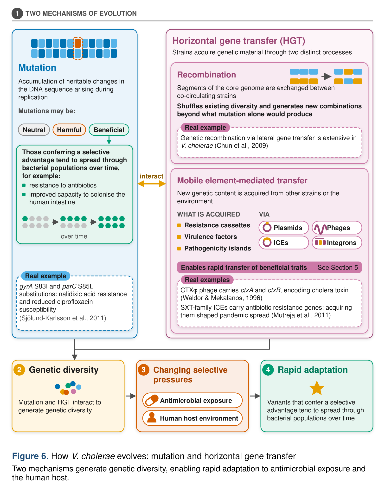

<small><strong>Figure 8. How *V. cholerae* evolves: mutation and horizontal gene transfer.</strong> Two mechanisms generate genetic diversity, enabling rapid adaptation to antimicrobial exposure and the human host. Sources: PHA4GE Cholera Genomics Guidance, Section 2.3; Sjölund-Karlsson et al. (2011); Chun et al. (2009); Mutreja et al. (2011); Waldor and Mekalanos (1996).</small>

&nbsp;

## 2.4 Pandemic History and the Seventh Pandemic El Tor Lineage

Seven pandemic waves of cholera have been documented since the early nineteenth century. The first six pandemics, are generally attributed to the Classical biotype of *V. cholerae* O1, spread from the Indian subcontinent (Devault et al., 2014\) to cause global epidemics over more than a century. The seventh and ongoing pandemic, which began in 1961, is caused by the El Tor biotype and remains responsible for the contemporary global burden of cholera disease.

Using whole-genome phylogenetics, Mutreja et al. (2011) demonstrated that the seventh pandemic comprises at least three independent waves of global transmission, each originating in the Bay of Bengal and spreading across Asia, Africa, and the Americas. This landmark study established the power of WGS to reconstruct pandemic history at a resolution unachievable by conventional typing methods, and provided the framework for the phylogenomic classification of contemporary 7PET strains.

The T-lineage framework, established by Weill et al. (2017) through genomic analysis of 1,070 *V. cholerae* isolates from 45 African countries spanning 49 years, provides the primary classification system for pandemic strains used in cholera genomics. The study showed that 7PET had been introduced into Africa at least 11 times since 1970, and defined sublineages T1–T12 (now usually written AFR1–AFR12). AFR13 was added by Weill et al. (2019), AFR14 and AFR15 by subsequent outbreak studies, and AFR16–AFR17 have so far been proposed only in preprint (Xiao et al., 2024). These lineages represent discrete subpopulations with distinct geographic distributions, introduction histories, and antimicrobial resistance profiles. West and Central Africa have been dominated by long-persisting lineages, particularly AFR10 (formerly T10) in the Democratic Republic of the Congo and the Great Lakes region, and AFR12 in Nigeria and Cameroon, whilst East and Southern Africa show greater lineage diversity, with multiple lineages co-circulating. Understanding which T-lineage is circulating in a given setting is directly relevant to distinguishing apparently separate outbreaks from ongoing transmission, and to anticipating the likely AMR profile of circulating strains. T-lineage assignment is therefore a central analytical step in cholera genome characterisation and is described in Section 5.4.2.

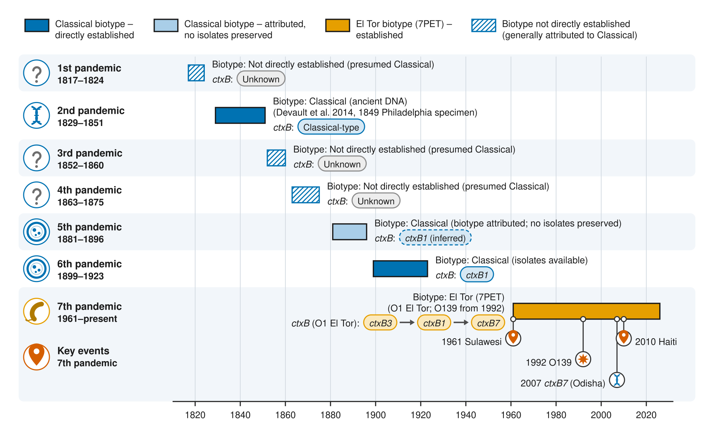

<small><strong>Figure 9. Timeline of the seven cholera pandemics: biotype and cholera toxin B-subunit (ctxB) allele.</strong></small>

&nbsp;

The *ctxB* gene, encoding the B subunit of cholera toxin, has undergone significant evolutionary change through the seventh pandemic. The prototype El Tor *ctxB* genotype (*ctxB3*) that characterised early 7PET strains has been largely displaced among contemporary circulating strains by *ctxB7*, a variant associated with altered toxin properties and now predominant among contemporary 7PET lineages. El Tor strains carrying a classical-type *ctxB* allele (*ctxB1*), first reported from Bangladesh and India in the 1990s-2000s, and later *ctxB7*, are termed atypical, hybrid or variant El Tor strains; these now dominate globally (Ghosh-Banerjee et al., 2010; Naha et al., 2020). *ctxB* genotyping is an informative component of genome characterisation, described in Section 5.5.1.

# 3 Cholera Genomics Applications and Questions to Address in Public Health

Use of genomics is not routine for *V. cholerae* in most settings, and resource allocation priorities should be strongly considered before implementing genomic investigation of cholera. In this guidance document, confirmation of *V. cholerae* is considered a prerequisite before implementation of genomics. Discussion of cholera diagnosis falls outside the scope of this guidance but further information may be found in [GTFCC guidance](https://www.gtfcc.org/wp-content/uploads/2025/04/public-health-surveillance-for-cholera-guidance-document-2024.pdf).

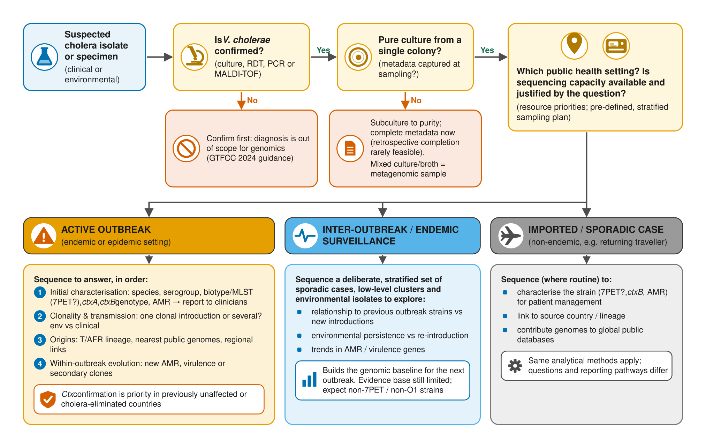  
<small><strong>Figure 10. Decision tree for when to sequence a *V. cholerae* isolate: outbreak, endemic and imported-case settings.</strong> The figure describes the decision pathway for any suspected cholera isolate or specimen (clinical or environmental).</small>

&nbsp;

Genomic sequencing of *V. cholerae* occurs in three broad public health contexts: during active outbreaks in endemic or epidemic settings; between outbreaks as part of sustained surveillance programmes; and in non-endemic countries where imported cases are sometimes sequenced as part of routine travel surveillance and to contribute to global genomic databases. The first two scenarios are not mutually exclusive – in endemic countries, inter-outbreak surveillance directly informs the interpretation of subsequent outbreak findings. This document focuses primarily on these first two scenarios, which represent the settings where genomic data is most likely to directly inform public health decision-making. The analytical approaches described are largely applicable to imported case sequencing, though the epidemiological questions and reporting pathways will differ.

Addressing questions in all scenarios requires both genomic data and high-quality epidemiological, clinical, and laboratory metadata collected at the time of sampling. Retrospective completion of metadata is rarely feasible and substantially reduces the interpretive value of genomic findings and ability to address epidemiological questions.

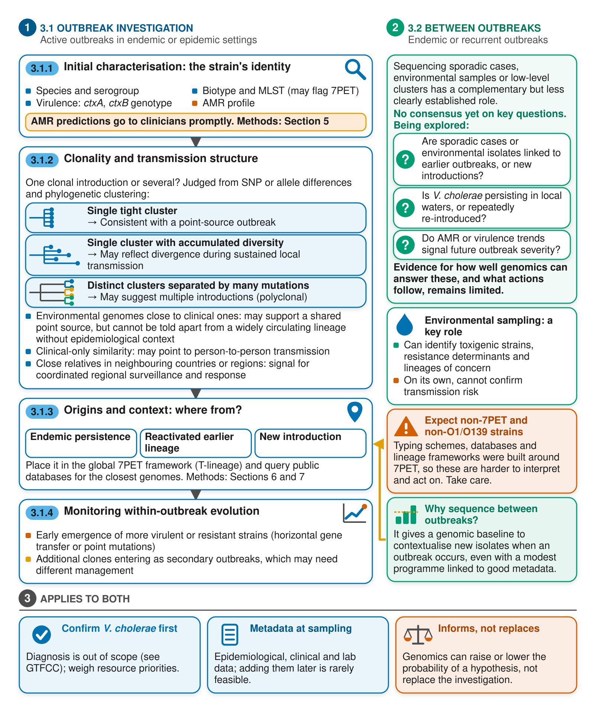

<small><strong>Figure 11. Cholera genomics: during and between outbreaks.</strong> The figure shows and describes the questions *V. cholerae* genomic data can address in outbreak investigation and inter-outbreak surveillance.</small>

&nbsp;

## 3.1 Outbreak Investigation

During an active cholera outbreak, genomics supports rapid characterisation of the causative strain(s) and may inform the immediate public health response. Genomic data analysis addresses a sequence of questions that build on one another as the outbreak evolves. 

### 3.1.1 Initial Characterisation

The first priority using genomic data is often to establish the identity and characteristics of strains involved in an outbreak, especially those which have not been established by other laboratory methods. This may include confirming species identity and serogroup, determining the biotype and MLST that may indicate an outbreak with the 7PET strain, detecting key virulence determinants – particularly the presence of *ctxA* and genotype of the cholera toxin B subunit (*ctxB*) – and characterising the antimicrobial resistance profile. These findings may have direct implications for clinical management and public health response. In particular, AMR predictions should be communicated promptly to treating clinicians, complementing any available phenotypic susceptibility data, since treatment recommendations depend on the resistance profile of the circulating strain. The methods for genome characterisation are described in detail in Section 5\.

### 3.1.2 Clonality and Transmission Structure

High-resolution comparative analysis of similar genomes can first address whether they represent an outbreak, and if so, which genomes may be included in that outbreak. It may also be determined whether this outbreak likely results from a single clonal introduction or multiple independent introductions of distinct strains based on the number of differences (SNPs or alleles) between genomes and patterns of phylogenetic clustering. This has direct implications for the epidemiological investigation: a single tight cluster is consistent with a point-source outbreak, a single cluster that has accumulated mutational diversity may be consistent with divergence during sustained local transmission, and distinct clusters separated by many mutations may suggest multiple introduction events and a polyclonal outbreak. Such genomic analyses should always be interpreted alongside epidemiological data (e.g. case timelines, exposure histories, and geographic distribution) rather than in isolation, perhaps helping to refine the case definition for an outbreak, and elucidate transmission pathways and timelines.

* Where environmental samples (such as water, sediment, or food) have been collected alongside clinical isolates, genomic comparison between environmental and clinical genomes can further support source attribution as part of understanding transmission pathways. High genomic similarity between environmental and clinical isolates may support the hypothesis of a shared environmental point source, but cannot distinguish this from a widely circulating lineage without supporting epidemiological context. Similarity concentrated among clinical isolates without a corresponding environmental signal may be more indicative of sustained person-to-person transmission.   
* Where genomic analysis indicates close relationships between local outbreak strains and isolates circulating in neighbouring countries or regions, this is a signal for coordinated regional surveillance and response, and findings should be communicated to relevant national and regional public health authorities in a timely manner. 

Importantly, genomic evidence may raise or lower the probability of a given transmission hypothesis as part of epidemiological investigation, but it does not replace the investigation.

### 3.1.3 Understanding Origins and Context

Once the outbreak strain is characterised, genomic comparison with publicly available historical and geographic isolates allows assessment of its likely origin – whether the outbreak strain represents ongoing endemic persistence, reactivation of a previously circulating lineage, or a new introduction from elsewhere. Situating the outbreak strain within the global 7PET framework (assigning its T-lineage and comparing it to other circulating lineages) is central to this question, and public databases may be queried to find the most closely related genomes. The methods and tools for comparative genomic analysis are described in Sections 6 and 7\.

### 3.1.4 Monitoring Within-Outbreak Evolution

Continued monitoring during an outbreak may identify early emergence of strains that have become more virulent or resistant to antimicrobial agents, through horizontal gene transfer or acquisition of point mutations. It may also identify additional clones that enter a setting as secondary outbreaks that may require different management approaches.

## 3.2 Inter-outbreak and Endemic Surveillance

In settings where cholera is endemic or where repeated outbreaks occur, sequencing between outbreaks of sporadic cases, environmental samples, or low-level case clusters serves a different, complementary, and perhaps less well-defined purpose. Unlike outbreak investigation, where the epidemiological questions and value of genomics are well defined, the role of genomics in inter-outbreak surveillance is less clearly established. Much of this rests on whether building a (genomic-informed) understanding of which *V. cholerae* strains are circulating in the environment and population allows us to anticipate and ultimately reduce future outbreak risk, and if so, how to do that. 

The field of cholera genomics does not yet have consensus on which epidemiological questions are most important to address during inter-outbreak or endemic surveillance. The questions being explored include:

* whether sporadic cases or environmental isolates are related to strains from previous outbreaks or represent new introductions;   
* whether *V. cholerae* is persisting in local aquatic environments between outbreaks or whether recurrences are repeatedly re-introduced;   
* whether evolutionary trends in AMR or virulence gene profiles carry implications for future outbreak severity.

Currently, the evidence base for how well genomics can answer them and what actions the answers should prompt remains limited.

Environmental sampling plays a particularly important role in inter-outbreak surveillance, and the interpretation of environmental isolates requires careful consideration of their relationship to clinical cases, both contemporaneous and historical. Genomic findings from environmental sources alone cannot confirm transmission risk but can identify the presence of toxigenic strains, resistance determinants, and lineages of concern. A further complication is that inter-outbreak and environmental surveillance is likely to detect *V. cholerae* strains that fall outside the 7PET lineage, and potentially outside O1 serogroup altogether. Non-7PET and non-O1/O139 strains are substantially harder to characterise with the genomic tools currently available, as most typing schemes, reference databases, and lineage frameworks have been developed around 7PET and findings from other genomes are correspondingly harder to interpret and act upon. Laboratories undertaking inter-outbreak surveillance should anticipate encountering this diversity and approach findings from non-7PET isolates with appropriate caution.

Despite these uncertainties, there is a strong practical argument for sustained genomic surveillance between outbreaks where capacity allows. The findings from inter-outbreak surveillance can directly inform the interpretation of new outbreak events when they occur, providing a genomic baseline against which new isolates can be contextualised. Even a modest programme of inter-outbreak sequencing, linked to well-collected metadata, can substantially increase the interpretive value of genomic findings when an outbreak does occur.

The public health questions posed in this Section form the interpretive framework for this guidance document. Sections 5–7 describe the laboratory and bioinformatics methods used to generate the data needed to answer them. Section 9 returns to each question in turn, providing specific guidance on how to interpret genomic outputs in the context of the three epidemiological settings described above.

# 4 *V. cholerae* Genomic Data Generation

## 4.1 Sample Types, Collection and Transport

*V. cholerae* genomic surveillance draws on both clinical and environmental samples, each serving distinct public health purposes. Which isolates are sequenced, and how many, should be decided from the epidemiological question to be addressed. A sampling strategy defined in advance, specifying the time period, geographic units, and case or site types to be covered, and the proportion of isolates to be sequenced from each, protects against the two most common failure modes: sequencing too few isolates to resolve the question, and sequencing a convenience set that over-represents one hospital, one district or one point in time. Where sequencing capacity is limited, a smaller but deliberately stratified set is more informative than a larger opportunistic one, and the sampling frame actually achieved should be recorded and reported alongside any findings derived from it (see Section 6.2.1.1).

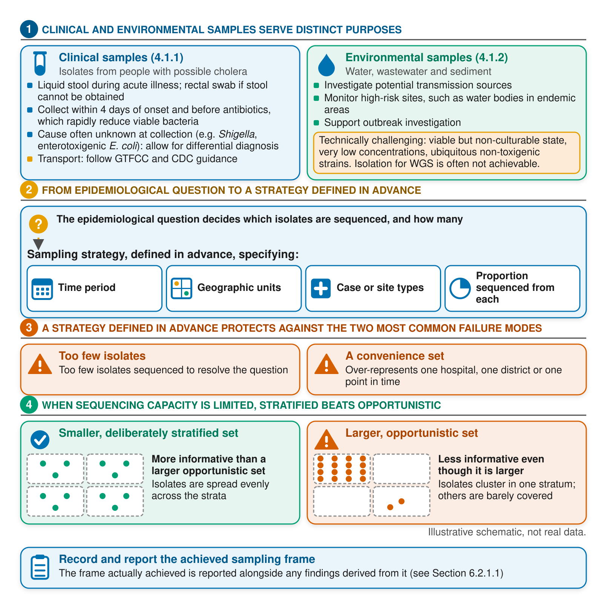  
<small><strong>Figure 12. Which samples to sequence: collection and sampling strategy.</strong> The figure describes the different kinds of samples (clinical and environmental), as well as a sampling plan defined from the epidemiological questions.</small>

&nbsp;

### **4.1.1 Clinical Samples**

The primary source of isolates from humans with possible cholera is liquid stool collected during acute illness, or rectal swabs where liquid stool cannot be obtained. It is important to note that stool samples are frequently collected before a specific causative pathogen has been identified so diarrhoeal illness may result from *V. cholerae*, *Shigella*, enterotoxigenic *E. coli*, or other enteric pathogens, and clinical and laboratory workflows must therefore accommodate differential diagnosis. Samples for cholera diagnosis should ideally be collected within the first four days of symptom onset and prior to the initiation of antimicrobial therapy as antibiotic treatment rapidly reduces viable bacterial counts. 

Proper sample collection, then prompt and appropriate sample transport is essential for successful culture and downstream genomic analysis. Specific guidance on clinical sample collection methods, transport media, transport timeframes, and specimen packaging requirements is provided by GTFCC amongst the specimen collection, preparation and packaging for transport resources (Global Task Force on Cholera Control, Specimen collection, preparation and packaging for transport); and by CDC in Chapter 2 of the CDC Laboratory Methods for the Diagnosis of *Vibrio cholerae* (US Centers for Disease Control and Prevention, Laboratory methods for the diagnosis of epidemic dysentery and cholera, Chapter 2).

### 4.1.2 Environmental Samples

*V. cholerae* is well adapted to aquatic environments, which it may colonise or transiently contaminate. This environmental persistence underpins the role of contaminated water sources in outbreak transmission, and the potential for environmental reservoirs to maintain the pathogen between human outbreaks.  Environmental samples, including water, wastewater, and sediment, may be collected to investigate potential cholera transmission sources, monitor high-risk sites such as water bodies in cholera-endemic areas, or support outbreak investigation.   
Environmental surveillance of cholera is technically challenging: 

* Whilst *V. cholerae* is naturally present in aquatic environments, it can exist in a viable but non-culturable state in conditions unfavourable for growth (Colwell et al., 1996).   
* Pathogen concentrations in environmental samples are typically very low relative to background microbial load. Culture-based methods are often insufficiently sensitive for direct environmental detection without prior enrichment steps.   
* Non-toxigenic strains are also ubiquitous, making the detection and confirmation of toxigenic strains specifically a significant analytical challenge. 

Many laboratories report that in practice, cholera cannot be detected and isolated for WGS or captured via metagenomic approaches from environmental sources. These limitations should be considered when designing environmental surveillance programmes and interpreting results. Current guidance on approaches and their utility in the context of broader cholera surveillance is provided by WHO in a Wastewater and Environmental Surveillance Summary for Cholera (World Health Organization, 2024) and by the GTFCC in Environmental surveillance for cholera control Technical Guidance (Global Task Force on Cholera Control, Environmental surveillance for cholera control). 

## 4.2 Culture, Enrichment and Preservation

Whole genome sequencing requires a pure, clonal culture of *V. cholerae* and laboratories should ensure that a single presumptive *V. cholerae* colony is subcultured to purity before performing DNA extraction. Isolates should already have been confirmed or strongly suspected as *V. cholerae* by culture-based methods, RDT, or perhaps MALDI-TOF.  Sequencing from enrichment broth or mixed culture would need to be treated as metagenomic samples for assembly and analysis. 

Selecting a single colony per sample means that each patient is represented in the analysis by one strain. Where multiple *V. cholerae* strains co-circulate, patients with mixed infections will be only partially captured, and if one strain grows more readily under laboratory conditions, a polyclonal outbreak may appear monoclonal. Sequencing multiple colonies per sample addresses this but is rarely undertaken in routine surveillance; where it is not feasible, the limitation should be borne in mind when interpreting clonality (Section 9.1.2).

Clinical specimens may be prepared by plating directly onto culture medium with or without enrichment in alkaline peptone water, which selectively favours *Vibrio* species. Enrichment is particularly useful when bacterial counts in the sample may be low, for example, in samples collected after several days of illness or after rehydration therapy (Global Task Force on Cholera Control, Isolation and presumptive identification of *V. cholerae* O1/O139 from faecal specimens). Following primary culture, presumptive colonies may be confirmed as *V. cholerae*, possibly including O1 or O139 serogroup, using agglutination or molecular (PCR) methods, and may be assessed for cholera toxin production where required. Full, step-by-step procedures for isolation, enrichment, and identification of *V. cholerae* O1 and O139 from faecal specimens are provided by the GTFCC in the Isolation & presumptive identification of *Vibrio cholerae* O1/O139 from faecal specimens Job Aid and Fact Sheet (Global Task Force on Cholera Control, Isolation and presumptive identification of *V. cholerae* O1/O139 from faecal specimens), and by CDC in the CDC Laboratory Methods for the Diagnosis of *Vibrio cholerae*, Chapter 6 (US Centers for Disease Control and Prevention, Laboratory methods for the diagnosis of epidemic dysentery and cholera, Chapter 6).  Where isolates cannot be processed immediately, appropriate preservation is essential to maintain viability for both phenotypic characterisation and subsequent DNA extraction. Guidance on preservation and conditioning of isolates for international transport is provided by the GTFCC Strain Conditioning for International Transportation guide (Global Task Force on Cholera Control, Isolation and presumptive identification of *V. cholerae* O1/O139 from faecal specimens).

## 4.3 DNA Extraction, Sequencing, and Minimum Genomic Data Requirements

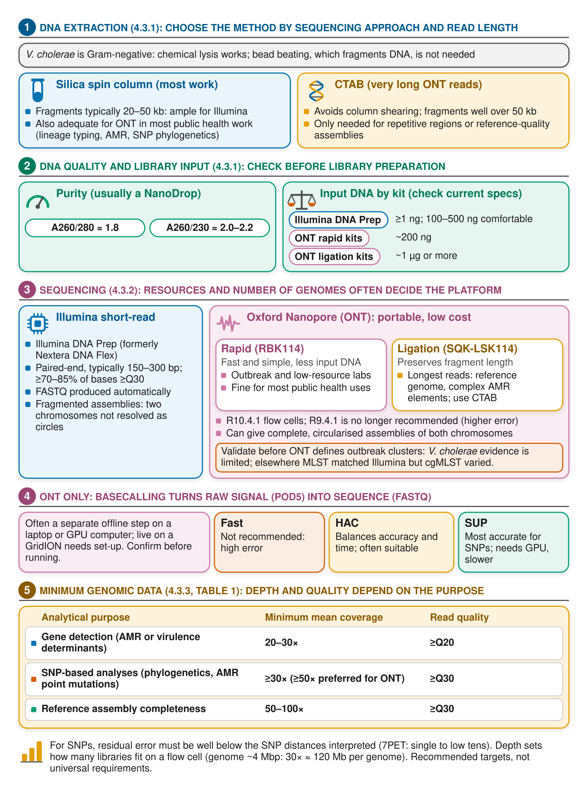

<small><strong>Figure 13. From DNA to sequence data.</strong> The diagram illustrates the laboratory workflow processes, including DNA extraction, quality control, sequencing platform choices and minimum data requirements.</small>

&nbsp;

### 4.3.1 DNA Extraction

*V. cholerae* is a Gram-negative bacterium, and its outer membrane is generally amenable to standard chemical lysis approaches without the need for mechanical disruption such as bead beating, which can fragment DNA. 

The choice of DNA extraction method should be guided primarily by the sequencing approach and read length being targeted (see Section 4.3.2). For Illumina short-read sequencing, a commercial silica spin column kit is appropriate and convenient as spin column-based methods yield DNA fragments typically in the range of 20–50 kb, more than sufficient for short-read library preparation. For Oxford Nanopore Technologies (ONT) sequencing, read length is largely determined by the length of the input DNA fragments alongside the library preparation kit used, so the extraction method therefore has a direct bearing on the data obtained. A CTAB (cetyltrimethylammonium bromide)-based extraction protocol, which avoids the shearing associated with column binding and centrifugation, can yield high molecular weight DNA fragments well in excess of 50 kb and is the recommended approach when very long reads are required. However, very long reads are only necessary when the aim is to fully resolve highly repetitive genomic regions or to produce a complete reference-quality genome assembly. For the majority of public health analytical purposes, including lineage typing, AMR profiling, and SNP-based phylogenetics, DNA fragments of 20–50 kb from a spin column extraction are entirely adequate for ONT sequencing.

Extracted DNA quality should be assessed spectrophotometrically prior to library preparation. Absorbance ratios at 260/280 nm and 260/230 nm are used to evaluate purity (usually with a NanoDrop instrument), with acceptable values of approximately 1.8 and 2.0–2.2, respectively (Thermo Scientific, 260/280 and 260/230 ratios). DNA input quantities required for library preparation vary considerably by platform and kit: Illumina library preparation kits are compatible with inputs as low as 1 ng, though inputs of 100–500 ng provide a comfortable margin for reliable performance (Illumina DNA Prep Reference Guide, doc. 1000000025416 v12, 2026). ONT rapid library preparation kits are typically specified for approximately 200 ng input, while ligation-based kits requiring high molecular weight DNA for long-read applications typically specify 1 μg or more. Manufacturers' current specifications should be consulted for each kit, as input requirements have decreased substantially with successive kit generations.

### 4.3.2 Sequencing

Both Illumina short-read and ONT long-read platforms are used for *V. cholerae* genomic surveillance, and both are capable of supporting the core public health analytical objectives described in Section 5 (Foster-Nyarko et al., 2025; Fuesslin, 2022). The choice between platforms is often driven by resource availability and the number of genomes ready to be sequenced, rather than analytical requirements alone. Illumina sequencing produces short paired-end reads (typically 150–300 bp) with high base accuracy (typically ≥70–85% of bases above Q30, i.e. 99.9% per-base accuracy, depending on read length and kit) and is well-established for routine genome characterisation including AMR gene detection, lineage classification, and phylogenetic analysis. Assemblies produced from short reads alone are typically fragmented, particularly across repetitive regions, and will not fully resolve the two chromosomes of *V. cholerae* as complete circular contigs; however, this does not limit the analytical utility of the data for most public health purposes. Illumina sequencing for *V. cholerae* may be achieved using the Illumina DNA Prep (formerly Nextera DNA Flex) kit for library preparation, and sequencing may be undertaken on an Illumina platform with appropriate throughput for the sequencing volume in the laboratory. Protocols for Illumina sequencing should be followed according to kit instructions.

Long-read sequencing can produce complete, circularised assemblies of both *V. cholerae* chromosomes providing a more complete view of plasmid content, mobile genetic elements, and structural genomic features. The portability, low capital cost and small-batch flexibility of ONT instruments, particularly the MinION, make the platform particularly valuable in resource-limited and field-based settings (Foster-Nyarko et al., 2025). 

For ONT library preparation, two main approaches are available: the Rapid Barcoding Kit (RBK114 series) and the Ligation Sequencing Kit (SQK-LSK114 series). The rapid kit is fast, simple, and requires less input DNA, making it well-suited to outbreak conditions and resource-limited laboratories, and is appropriate for most public health analytical purposes. Direct comparative evidence for *V. cholerae* is limited, but a recent evaluation in other bacterial pathogens using R10.4.1 flowcells found complete concordance with Illumina for MLST across all ONT kits and software configurations tested; cgMLST concordance was complete for *Corynebacterium diphtheriae* but varied with strain, library kit and analytical parameters for vancomycin-resistant enterococci (Neuenschwander et al., 2026). Laboratories adopting ONT for cluster-level work should validate allele calls against Illumina data for their own organism and workflow before relying on them to define outbreak clusters. The ligation kit preserves DNA fragment length and is recommended when the longest possible reads are required, for example to produce a complete reference genome or resolve complex structural arrangements in novel AMR elements, and should be paired with CTAB extraction as described in Section 4.3.1. ONT sequencing for *V. cholerae* should be performed using R10.4.1 flowcells, which at the time of writing remain the current standard chemistry; older R9.4.1 flowcells have substantially higher per-base error rates that compromise SNP-level analyses and are no longer recommended for new work (Sanderson et al., 2023). Protocols for ONT library preparation and sequencing are available for each kit from Oxford Nanopore.

Whilst Illumina data is provided in FASTQ file format automatically, raw ONT data consists of electrical signal data (POD5 file format) that must be converted to nucleotide sequence by a basecalling algorithm. Depending on the instrument, this may not occur during or immediately after the run. Instead, basecalling may require a separate offline step on a laptop or GPU-equipped computer, or on instruments such as the GridION, automatic live basecalling may be available but require configuration. Critically, basecalling can be performed in fast, high-accuracy (HAC), or super-accuracy (SUP) mode, and the choice of mode has a substantial impact on data quality and downstream usability. Fast mode is not recommended due to the high error rate in data at the time of writing. HAC mode balances accuracy and processing time and is often suitable for cholera analytic applications. SUP mode delivers the highest accuracy, including substantially improved performance for SNP-level analyses, but requires GPU hardware and significantly longer processing times. Laboratories using ONT should confirm their basecalling infrastructure and mode prior to generating data.

### 4.3.3 Minimum Genomic Data Requirements

Appropriate minimum depth of coverage and per-base quality depend on the analytical purpose. For detection of genes, e.g., AMR or virulence determinants, a minimum mean genome coverage of approximately 20 \- 30× is generally considered sufficient (see Table 1). For SNP-based analyses such as phylogenetics and outbreak attribution, where accurate calling of individual nucleotide variants is essential, a minimum of 30× coverage is recommended and higher coverage (\~50×) is preferable, particularly with ONT data where per-base error rates are higher than Illumina, even with HAC or SUP basecalling (Fuesslin, 2022). The target depth of coverage will determine the number of sequencing libraries that may be loaded onto a flowcell, which may be calculated using the cholera genome size of \~4Mbp.

**Table 1\. Recommended target sequencing quality for different analytical purposes. The values below are recommended targets rather than universal requirements, suitability for the analytical purpose must be validated.** 

| <small>Analytical Purpose</small> | <small>Minimum Mean Genome Coverage</small> | <small>Typical Recommended  Read Quality</small> | <small>Notes / Comments</small> |
| :---- | :---- | :---- | :---- |
| <small>**Gene detection  (e.g. AMR  virulence or  determinants)**</small> | <small>20–30×</small> | <small>≥Q20</small> | <small>Requires consensus accuracy sufficient to resolve  gene presence/ absence</small> |
| <small>**SNP-based analyses (phylogenetics,  point mutations for AMR determinants)**</small> | <small>≥30×  (≥50×  preferred  for ONT)</small> | <small>≥Q30</small> | <small>Accurate calling of individual nucleotide variants is essential; residual error must be well below the SNP distances being interpreted (for 7PET, single to low-tens of SNPs across the genome); for ONT SUP basecalling, polishing, and masking of ambiguous/strand-biased sites improve accuracy, and phylogenetics may use assemblies rather than read inputs</small> |
| <small>**Reference assembly completeness**</small> | <small>50–100x</small> | <small>≥Q30</small> | <small>Consensus accuracy sufficient for the structural features being reported</small> |

## 4.4 Metadata Collection

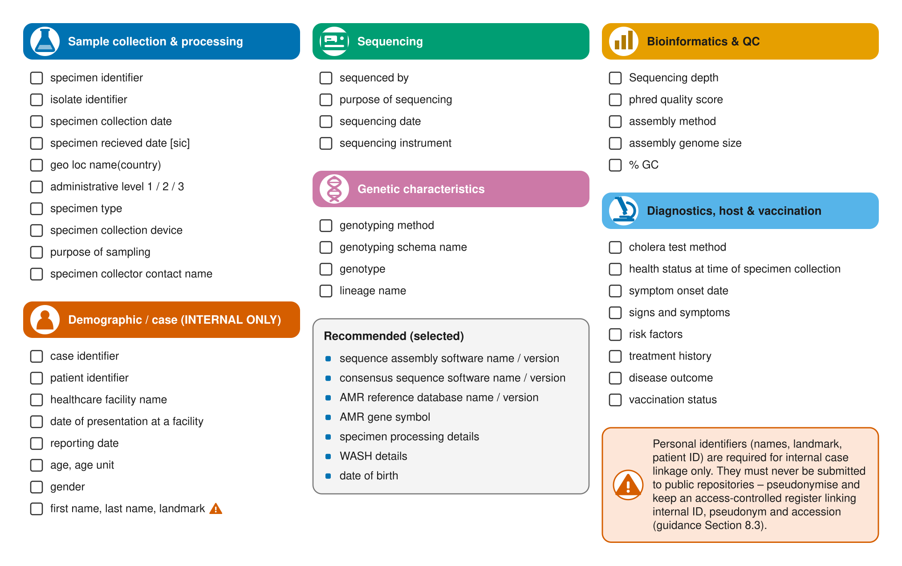  
<small><strong>Figure 14. Minimal metadata checklist for cholera genomic surveillance.</strong></small>

&nbsp;

High-quality, standardised metadata are essential for meaningful interpretation of genomic data. Without reliable information about when, where, and from whom an isolate was collected, even the best bioinformatics cannot reliably inform outbreak attribution, transmission chain reconstruction, or AMR trend monitoring. Through conversations with public health labs, incomplete metadata was consistently identified as one of the most significant practical barriers to genomic epidemiology of cholera, and metadata collection should be considered an integral part of any sequencing programme rather than an afterthought.

At a minimum, each sequenced isolate should be associated with the following metadata fields: a unique sample identifier, collection date, geographic location (at a minimum country and sub-national administrative unit), sample type (clinical or environmental), host information (for clinical samples), sequencing platform and library preparation method, and any accession numbers assigned upon public data submission. Additional fields relevant to public health interpretation, including patient epidemiological information, clinical outcome, travel history, and antimicrobial treatment, should be captured where possible and consent permits. The PHA4GE *Vibrio cholerae* Community Metadata Standard, developed in collaboration with Africa CDC, provides the recommended framework for structuring and recording this information. It defines harmonised, interoperable metadata fields that support outbreak investigation, surveillance, and research use cases across diverse settings, and includes a data dictionary, reference data dictionary, and data collection template available at the [PHA4GE *Vibrio cholerae* Community Metadata Standard repository](https://github.com/pha4ge/Vibrio-Cholera-Community-Metadata-Standard). Guidance on metadata capture under outbreak conditions, where data collection infrastructure may be under strain, is provided within the standard documentation. Standards for formatting and submitting metadata to public repositories are described in Section 8.3.

# 5 *V. cholerae* Genome Characterisation and Bioinformatics

Characterisation of *V. cholerae* genomes requires good quality genomic data and assemblies (Sections 5.1 and 5.2). Once this is established, the characterisation steps described in Sections 5.3–5.6 may be undertaken to address the objectives of the study/surveillance programme and answer scientific questions. These are what a complete cholera bioinformatics analysis should produce; Section 7 describes which platforms and workflows deliver each of these in practice.

It should be noted that the majority of tools, databases, and reference frameworks described in this Section were developed around the 7PET lineage. This introduces systematic bias when analysing non-7PET strains, non-O1 isolates, or environmental *V. cholerae*: reference mapping may fail or produce misleading results, typing tools may generate invalid outputs, and lineage assignment tools will not apply. Analysts should use tools only for the genomes they were designed to address, and should state explicitly where a result falls outside a tool's intended scope. Specific limitations are noted in the relevant subsections below.

## 5.1 Data Quality Improvement and Genome Assembly

Sequence data need to be assembled into approximations of the original genome. First, raw sequencing reads should undergo quality improvement processes, such as adapter trimming, removal of very short reads and possibly removal of low-quality bases. These approaches are not specific to *V. cholerae* and standard approaches may be applied in line with existing protocols for other pathogens or pipelines. ONT read assembly quality control has recently (Feb 2026\) been reviewed by Ryan Wick (Wick, 2026).

*Vibrio cholerae* possesses an unusual genome architecture for a bacterium, comprising two circular chromosomes rather than one. The larger chromosome (chromosome I, \~2.96 Mb) encodes most housekeeping and virulence functions, whilst the smaller chromosome (chromosome II, \~1.07 Mb) carries genes involved in adaptation and secondary metabolism, totalling approximately 3,885 predicted protein-coding sequences (Heidelberg et al., 2000). Chromosome II is believed to have originated from a large plasmid that was taken up by an ancestral *Vibrio species* and evolved into a stable chromosome.

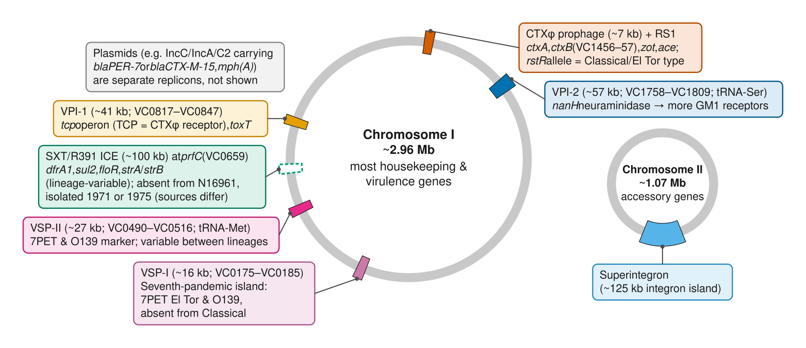  
<small><strong>Figure 15. Key mobile genetic elements on the two chromosomes of the *Vibrio* cholerae O1 El Tor reference genome (N16961) used in genomic surveillance.</strong></small>

&nbsp;

For downstream characterisation, a *de novo* assembly that reconstructs the genome without prior knowledge of the sequence provides complete or near-complete genome resolution. It is particularly beneficial for characterisation of novel sequence structures, including mobile genetic elements and plasmids. Despite *V. cholerae* having two chromosomes, the genome assemblers used for this data are standard for bacterial genome assembly. For Illumina short-read data, **Shovill** (Seemann, 2016), which uses **SPAdes** by default and offers **SKESA** (Souvorov et al., 2018\) as a selectable alternative, and direct use of SPAdes (Bankevich et al., 2012\) have been widely used to produce assemblies of sufficient contiguity for public health characterisation. For ONT long-read data, the recommendation of the assembler **Flye** (Kolmogorov et al., 2019\) has been widely applied, with the **dragonflye** pipeline (Petit, dragonflye) providing a convenient wrapper, and assemblies should subsequently be polished to reduce residual error. For hybrid assemblies combining short- and long-read data, **Hybracter** (Bouras et al., 2024\) provides an automated approach used in recent *V. cholerae* surveillance work (Foster-Nyarko et al., 2025). Recommendations for bacterial genome assemblers have also been reviewed by Ryan Wick (Wick, 2020).

## 5.2 Genomic Data Quality Control

Poor data quality produces misleading results. Following assembly, all genomes should undergo systematic quality assessment to generate quality metrics for both reads and assemblies, and confirm the genome is from *Vibrio cholerae*. All genomes should be subject to quality control (QC) against validated thresholds, and only results from genomes that pass QC should be used. 

The quantity and quality of reads should meet the requirements for the intended analyses. Read or base quantity should support the target depth of coverage across the genome and read quality should meet minimum Q scores as outlined in Section 4.3.3. 

The two-chromosome structure of *V. cholerae* should be borne in mind when evaluating assembly outputs. A high-quality Illumina *de novo* assembly will typically yield two major scaffold groups corresponding to chromosome I (\~2.96 Mb) and chromosome II (\~1.07 Mb) respectively, while a complete long-read assembly will resolve both as closed circular contigs (Heidelberg et al., 2000). Species-specific quality thresholds for *V. cholerae* assemblies have been empirically derived by **[QualiBact](https://qualibact.org)**, which provides a curated reference for commonly used assembly metrics. Such metrics may be generated using standard quality assessment tools, **QUAST** (Gurevich et al., 2013), and **CheckM2** (Chklovski et al., 2023). Quality thresholds for *Vibrio cholerae* are maintained on the platform at [QualiBact *V. cholerae* quality thresholds](https://qualibact.org/Vibrio/Vibrio_cholerae/). Assemblies falling outside the FAIL thresholds should be excluded from further analysis; assemblies in the WARN range should be interpreted with caution and flagged for manual review. 

To ensure that all genome data are derived from *Vibrio cholerae*, species identity should be confirmed computationally before downstream analyses. This verification can be performed using either raw sequencing reads or assembled contigs by applying established bacterial taxonomic identification approaches such as Average Nucleotide Identity (ANI), **Sourmash**, or **GAMBIT** (Jain et al., 2018; Pierce et al., 2019; Lumpe et al., 2023). Species confirmation helps prevent misinterpretation of genomic data in cases where contaminating organisms have been inadvertently assembled, a commonly reported source of error in multi-step laboratory and sequencing workflows (Pierce et al., 2019; Lumpe et al., 2023).

> [!WARNING]
> * Public genomes downloaded for use as contextual sequences may not have been subject to the same — or any — quality standards as those generated within a surveillance programme and should be quality-checked before inclusion.
> * Analysts must remember that even good-quality genome data, and particularly assemblies, represent estimates of a biological genome, not definitive truth about a genome.

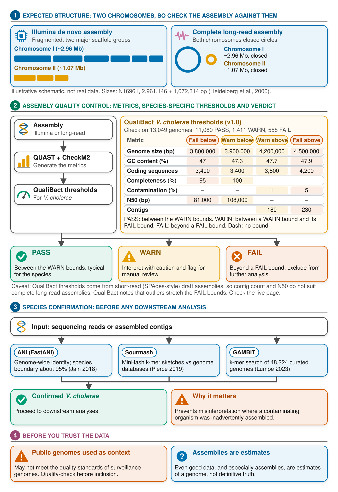  
<small><strong>Figure 16. Assembly quality control and species confirmation.</strong> Diagram shows the expected two-chromosome structure, species-specific QC thresholds, species identity and the limits of assemblies.</small>

&nbsp;

## 5.3. *V. cholerae* Phenotypic Subtype Prediction

*V. cholerae* has been subtyped into serogroups, serotypes, and biotypes using phenotypic methods, which can be predicted from genomic data. 

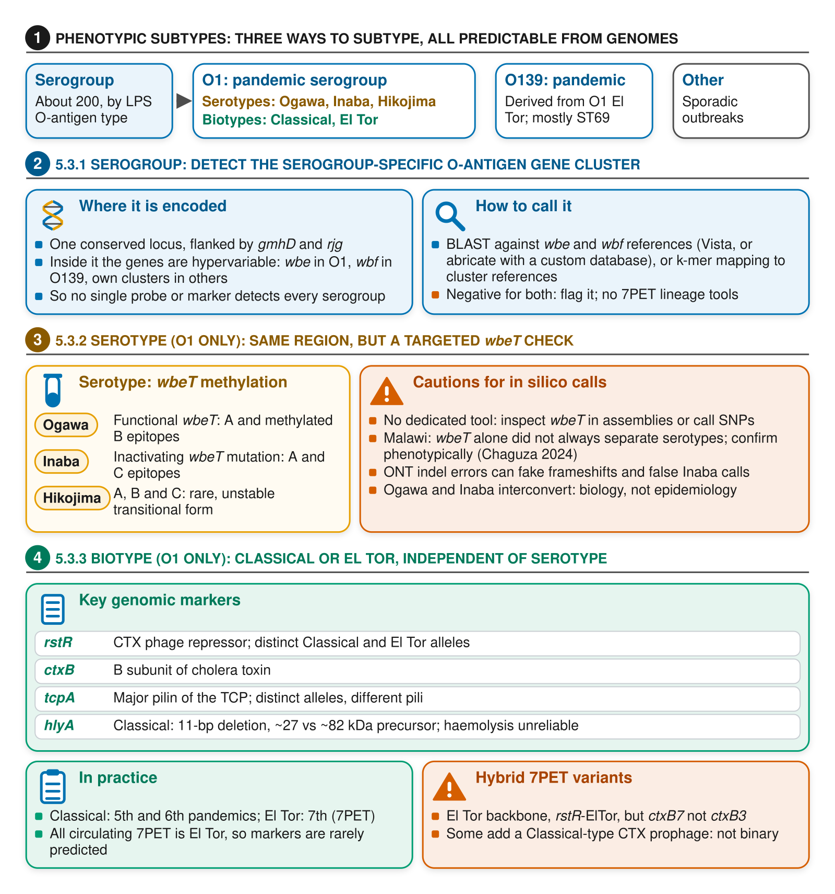  
<small><strong>Figure 17. Phenotypic subtype prediction from genomes.</strong> Serogroup, serotype and biotype: a description of what to detect, how to call it and what to watch for.</small>

&nbsp;

### **5.3.1 Serogroup Identification**

There are approximately 200 different serogroups of *V. cholerae* based on agglutination testing to identify the O-antigen type in the lipopolysaccharide (LPS) layer. The specific O-antigen is encoded by the *wbe* gene cluster (historically designated *rfb*), which occupies a conserved chromosomal locus flanked by *gmhD* and *rjg* and is hypervariable between *V. cholerae* O-serogroups (Li et al., 2002; Murase et al., 2022). Two serogroups, O1 and O139, have been associated with cholera pandemics and are the focus of public health investigations, though outbreaks of other serogroups occur sporadically. The O1 antigen is encoded by the *wbe* gene cluster (terminating at *wbeW*, immediately upstream of *rjg*) at the *rfb* locus, which encodes the enzymes needed to synthesise and assemble the O1 O-antigen. The O139 antigen is encoded by the *wbf* gene cluster. Other (non-O1 and non-O139) serogroups each carry their own distinct O-antigen gene clusters in the *rfb* gene cluster region, encoding chemically diverse O-antigens. The flanking housekeeping genes are conserved, but the internal O-antigen-specific genes differ for each serogroup, which is why no single probe or marker detects all of them.

The distinction between O1, O139, and other serogroups is predicted bioinformatically by detection of serogroup-specific O-antigen biosynthesis gene clusters within the *rfb* gene cluster locus, rather than the full locus. Detection can be performed by BLAST-based comparison against *wbe* and *wbf* reference sequences for O1 and O139, respectively, for example by using **Vista (Yeats et al., Centre for Genomic Pathogen Surveillance; no associated publication)** (Yeats et al., Vista) or using a custom database with **abricate** (Seemann, Abricate). Alternatively, k-mer mapping against O-antigen gene cluster references can be used, as applied in the Malawi outbreak study (Chaguza et al., 2024). Strains negative for both clusters should be flagged as such (it is unclear whether they are O1 or O139 and there was a detection issue, or whether they are non-O1/non-O139) and should not receive lineage assignments from tools intended for 7PET strains. To our knowledge, no bioinformatics tools are available to predict non-O1/O139 serogroups, though O-antigen biosynthetic gene clusters have been comprehensively characterised from whole-genome sequence data by Murase et al. (2022). The O139 serogroup evolved directly from an O1 El Tor ancestor, and is not further subtyped with biotyping or serotyping, though it retained the El Tor biotype genomic markers. It clusters phylogenetically within the 7PET lineage, and the majority of O139 isolates are ST69 (Ramamurthy et al., 2019), the same multi-locus sequence type as 7PET O1.

### 5.3.2 Serotype Identification

Within the O1 serogroup there are three distinct serotypes, Ogawa, Inaba, and Hikojima, which are distinguished by the methylation status of the O1 antigen. This methylation is determined by the presence or absence of an inactivating mutation in the *wbeT* gene. Deletions, insertions, nonsense and missense substitutions and IS element insertions have all been reported (Lee et al., 2021; Paisie et al., 2023), which is located within the *wbe* gene cluster. As such, both serogroup and serotype assignment derive from analysis of the same genomic region but require distinct analytical approaches: broad *rfb* locus (*wbe*/*wbf*/other) comparison for serogroup, and targeted *wbeT* mutation detection for serotype. 

* Ogawa: Carries a functional *wbeT* and expresses the A and methylated B epitopes.   
* Inaba: Carries an inactivating frameshift mutation in *wbeT*, abolishing methylation so the A and C epitopes are expressed (Stroeher et al., 1992).  
* Hikojima: Expresses O antigens A, B, and C, but is a rare, unstable transitional form.

Though to our knowledge no tools have been specifically designed for serotype prediction, detection of the frameshift is possible by examining assemblies or calling SNPs in the gene. The 2022–2024 Malawi outbreak analysis (Chaguza et al., 2024\) found that comparison of the *wbeT* gene alone did not reliably discriminate serotypes in all cases, and flagged the need for caution when interpreting *in silico* serotype assignments without parallel phenotypic serotyping data. In particular, in ONT assemblies, residual indel errors can create artefactual frameshifts and produce false Inaba calls. Ogawa and Inaba serotypes are known to co-circulate and can interconvert within clonal populations, so serotype should be interpreted as a biological feature rather than an epidemiological signal.

### 5.3.3 Biotype Identification

The O1 serogroup is also sub-classified into two biotypes, Classical and El Tor, independent of serotype. The O1 Classical biotype was responsible for the fifth and sixth cholera pandemics and is generally attributed to the earlier pandemics of the nineteenth century, although the biotype of the first, third and fourth pandemics is not directly established (Devault et al., 2014). The O1 El Tor biotype has caused the current ongoing pandemic and is known as the seventh pandemic El Tor lineage (7PET). At the genomic level, the key distinguishing markers between Classical and El Tor are:

* *rstR,* which encodes the repressor regulating CTX phage replication. There are distinct alleles in Classical (*rstR*\-Classical) and El Tor (*rstR*\-ElTor) strains.  
* *ctxB,* which encodes the B subunit of cholera toxin.   
* *tcpA,* which encodes the major pilin subunit of the toxin-coregulated pilus (TCP). Classical and El Tor biotypes carry distinct *tcpA* alleles encoding structurally different pili.  
* *hlyA*, in which Classical strains carry an 11-bp deletion yielding a truncated precursor (\~27 kDa, versus \~82 kDa in El Tor) (Rader and Murphy, 1988). Haemolytic phenotype itself is not a reliable biotype discriminator, however, as non-haemolytic epidemic El Tor strains are common (Fan et al., 2019).

In practice, all circulating 7PET strains are El Tor by definition and these distinguishing markers of El Tor are often not predicted.  Some modern strains have mutated to express features of both the Classical and El Tor biotypes (such as carrying the Classical cholera toxin gene). The hybrid variants currently dominant in 7PET carry an El Tor genomic backbone with *rstR*\-ElTor, but harbour *ctxB7* rather than the prototype El Tor *ctxB3*, and in some cases carry a Classical-type CTX prophage alongside an El Tor prophage. This makes strict biotype assignment from genomic data more nuanced than a simple binary Classical/El Tor call. Biotype and *ctxB* genotype can be detected by *in silico* comparison of assembled sequences against reference genes in the same manner as the serogroups.

## 5.4 *V. cholerae* Genomic Subtype Identification

WGS data support classification of *V. cholerae* isolates based on genomic identifiers at multiple levels of resolution, from broad sequence type assignment by multilocus sequence typing (MLST) through to fine-grained lineage placement within the T/AFR lineage framework. For current public health surveillance, where virtually all epidemic isolates belong to the 7PET lineage, MLST provides limited discriminatory power within 7PET but may confirm pandemic lineage membership, whilst lineage classification connects individual isolates to regional and global transmission networks and provides actionable epidemiological context.

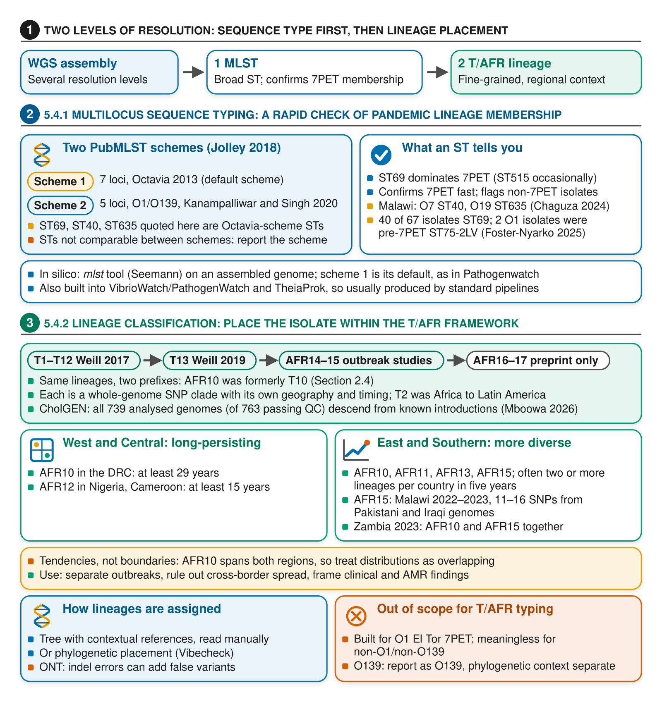

<small><strong>Figure 18. Genomic subtype identification: MLST and lineage.</strong> Description of what MLST can and cannot tell you, and how T/AFR lineages place an isolate.</small>

&nbsp;

### 5.4.1 Multilocus Sequence Typing

[MLST](https://pubmlst.org/multilocus-sequence-typing) is a commonly applied approach for population classification within bacterial species that was initially undertaken by Sanger sequencing and classification assignment of defined housekeeping loci. Two distinct MLST schemes for *V. cholerae* are maintained on [**PubMLST**](https://pubmlst.org/organisms/vibrio-cholerae) (Jolley et al., 2018): a scheme for O1/O139 strains (Kanampalliwar and Singh, 2020\) and a separate scheme for non-O1/non-O139 strains (Octavia et al., 2013). *In silico* MLST may be performed with genome sequence data and users must ensure the appropriate scheme is applied based on the serogroup of the isolate being typed, and applying the wrong scheme will produce absent or misleading assignments. Results are not comparable between schemes.

Within the 7PET lineage, the dominant sequence type is ST69. ST69 encompasses the entire T/AFR lineage diversity (see Section 5.4.2) within 7PET meaning MLST provides no within-pandemic discrimination. As such, the role of MLST in genomic surveillance is as a rapid, widely interoperable confirmation of pandemic lineage membership, and to flag non-7PET isolates for further characterisation. Non-7PET isolates carry distinct STs: in the Malawi dataset, serogroup O7 and O19 isolates were ST40 and ST635 respectively (Chaguza et al., 2024), illustrating that MLST retains value for broadly discriminating non-7PET strains from epidemic isolates. Similarly, a multinational genomic study of cholera in Africa found that of 43 genomes identified as O1, 40 (93 %) were ST69 (Foster-Nyarko et al., 2025).

*In silico* MLST with genome sequence data can be performed at the command line using the mlst tool (Seemann, 2016), which queries a snapshot of the **PubMLST** database directly with an assembled genome. It is also integrated into **VibrioWatch**/**PathogenWatch** and the **TheiaProk** workflow, meaning it is typically generated as part of standard surveillance pipelines without additional effort.

### 5.4.2 Lineage Classification

Within the 7PET lineage, the T-lineage framework was established by Weill et al. (2017), which designated T1–T12 as transmission events of 7PET — most of them independent introductions into Africa from Asia, though T2 instead represents onward spread from Africa to Latin America. The series was extended to T13 by Weill et al. (2019), and subsequently to AFR14 and AFR15 by later outbreak studies; AFR16 and AFR17 have so far been proposed only in preprint. The same lineages are written in the literature with either prefix, and the two numbering systems correspond directly (AFR10 was formerly T10); see Section 2.4.

Each lineage represents a distinct phylogenetic clade defined by whole-genome SNP data, with characteristic geographic distributions and temporal dynamics. The CholGEN consortium sequenced 1,220 isolates across seven African Union Member States, of which 763 genomes passed quality control; all were found to descend from previously described introduction noevents within this framework, indicating that it accounts well for currently circulating diversity in the countries sampled (Mboowa et al., 2026).

The current epidemiological landscape in Africa is characterised by distinct regional patterns:

* **West and Central Africa** are dominated by long-persisting lineages, particularly AFR10 in the Democratic Republic of the Congo and AFR12 in Nigeria and Cameroon. CholGEN sequencing extends the documented persistence of these lineages in the region to at least 29 and 15 years respectively (Mboowa et al., 2026).  
* **East and Southern Africa** show greater lineage diversity, with AFR10, AFR11, AFR13 and AFR15 all circulating and two or more lineages often present in a single country over a five-year period (Mboowa et al., 2026). AFR15 is associated with the unusually large and severe outbreak in Malawi in 2022–2023, where isolates sat 11–16 SNPs from contemporaneous Pakistani and Iraqi genomes, consistent with recent introduction from Asia (Chaguza et al., 2024). It has since been detected in Mozambique and the Democratic Republic of the Congo, and may represent multiple independent introductions rather than a single event (Mboowa et al., 2026). Zambia's 2023 epidemic involved two clades circulating concurrently, AFR10 and AFR15 (Ng'ombe et al., 2025), illustrating that a single national outbreak may draw on more than one lineage.

These regional patterns are tendencies rather than boundaries. AFR10 appears in both lists, extending across the Congo basin into the Great Lakes region, and lineage distributions should be treated as overlapping rather than mutually exclusive when interpreting local findings.

Understanding which lineage is circulating in a given setting is directly relevant to distinguishing apparently separate outbreaks, ruling out cross-border transmission, and contextualising clinical and AMR observations within the known characteristics of that lineage.

Approaches to T-lineage assignment rely on phylogenetic assessment of genomes, either by building a tree of query genomes with a set of contextual references and assigning lineages through manual interpretation, or by phylogenetic placement as undertaken in the **Vibecheck** tool (Matteson et al., CholGen consortium; no associated publication) (CholGen consortium; Matteson et al., CholGen consortium). For ONT-derived assemblies, lineage assignment requires care because the higher indel error rate of long-read sequencing can introduce artefactual variants. T-lineage typing is designed for O1 El Tor strains within the 7PET framework. Non-O1/non-O139 strains will not receive meaningful T-lineage assignments; O139 strains, whilst sharing an El Tor genomic background, are not included in the T/AFR classification system and should be reported as O139 with phylogenetic context provided separately where resources allow.

## 5.5 Virulence Prediction

Virulence profiling provides genomic evidence for the pathogenic potential of an isolate and contributes to both clinical interpretation and epidemiological context. The key virulence determinants include cholera toxin, the toxin-co-regulated pilus and the Vibrio Pathogenicity Islands and Vibrio Seventh Pandemic Islands. Other virulence factors exist and may be identified with virulence typing tools such as **AMRFinderPlus**.

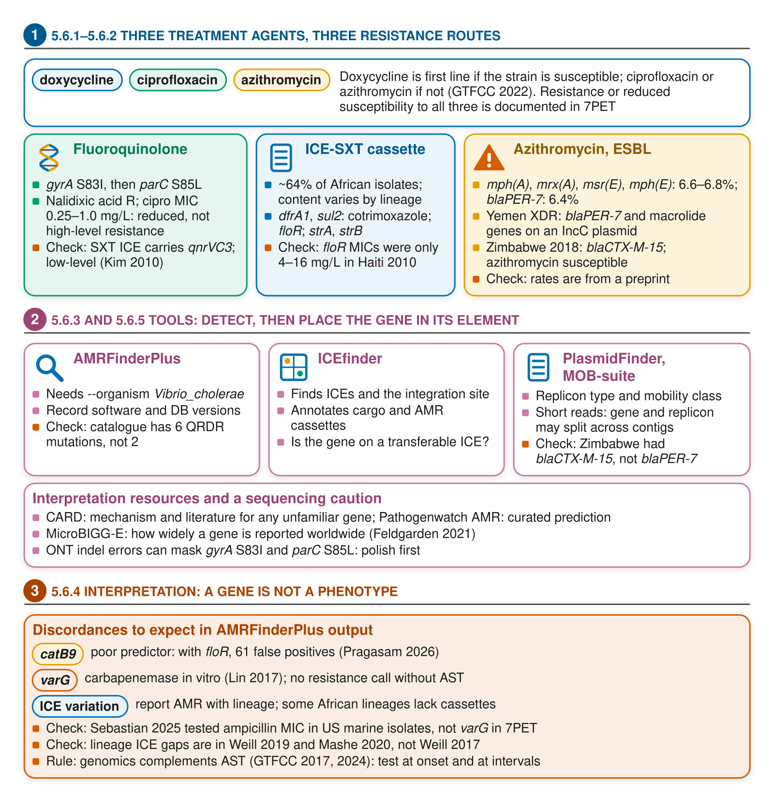  
<small><strong>Figure 19. Antimicrobial resistance: agents, genes and tools.</strong> Resistance to the three agents used to treat cholera, how to detect it and how far to trust a genotype (Section 5.6).</small>

&nbsp;

### 5.5.1 Cholera Toxin Gene Detection and *ctxB* Genotyping

Cholera toxin (CT) is the principal virulence determinant of epidemic *V. cholerae* and is encoded by the CTXφ prophage, a filamentous bacteriophage integrated into chromosome I. CTXφ carries two structural toxin genes, *ctxA* and *ctxB*. The CTXφ element is flanked by the RS1 satellite phage, which carries the replication and integration machinery (*rstA*, *rstB*) and a regulatory gene (*rstR*) that represses CTX phage replication; the *rstR* allele distinguishes Classical and El Tor CTX phage types and is closely co-inherited with *ctxB* genotype (Waldor and Mekalanos, 1996).

Detection of *ctxA* is a primary genomic indicator of toxigenic potential: its presence indicates that an isolate carries the genetic capacity to produce cholera toxin. Non-O1/non-O139 strains and some environmental O1 isolates lack *ctxA* and are non-toxigenic, and the GTFCC (2024) recommends that *ctx* gene detection be used to confirm the toxigenic status of isolates in previously unaffected countries or in countries that have eliminated the disease. Whilst gene presence does not guarantee expression, a principle that applies across virulence and resistance gene detection (GTFCC, 2017), in the context of epidemic O1 El Tor strains, *ctxA* carriage is strongly predictive of clinical disease potential.

Beyond simple presence/absence of *ctxA*, genotyping of *ctxB* is highly informative. Several *ctxB* variants have been described, defined by specific nucleotide differences at key positions within the gene that result in amino acid substitutions in the B subunit (Ramamurthy et al., 2019). The three variants of primary public health relevance are:

* *ctxB1*: the Classical biotype-associated variant, responsible for the first six cholera pandemics. It is also carried by some 7PET lineages on an El Tor genomic backbone, in so-called altered El Tor strains, so its detection is not by itself evidence of a pre-seventh-pandemic strain or of laboratory contamination.  
* *ctxB3: the prototype El Tor variant, carried by wave-1 (early) seventh pandemic strains (Ramamurthy et al., 2019).* Present in some historical isolates and in geographically restricted lineages.  
* *ctxB7*: the dominant variant in contemporary 7PET strains globally, including the lineages currently active in Africa and Asia. It carries a histidine-to-asparagine substitution at residue 20 of the cholera toxin B precursor (H20N), within the signal peptide, relative to the Classical *ctxB1* allele; the mature B subunit is otherwise of Classical type (Naha et al., 2020; Satchell et al., 2016).

The epidemiological significance of the *ctxB* genotype is considerable with the shift from *ctxB3* to *ctxB7* marking the transition to the currently dominant and more clinically severe form of 7PET. Detection of *ctxB7* in a new isolate supports affiliation with contemporary wave 3 7PET lineages, though lineage assignment should rest on whole-genome phylogenetic analysis or phylogenetic placement rather than on *ctxB* genotype alone. Conversely, detection of *ctxB1* in a clinical isolate would suggest either a Classical-background strain, which is rare in the current era or possible laboratory contamination.

Not all tools that detect *ctxB* will distinguish between variants. BLAST-based presence/absence screening will confirm *ctxB* carriage, but *ctxB* genotyping requires nucleotide-level comparison at the discriminating positions within the gene against allele-specific reference sequences. The CTXφ element can also be present in tandem arrays (multiple integrated copies) in some strains, which may cause fragmentation of this region in short-read assemblies and should be considered when interpreting assembly-based detection results.

### 5.5.2 Toxin Co-regulated Pilus and Pathogenicity Islands

The toxin co-regulated pilus (TCP), encoded by the *tcp* operon within Vibrio Pathogenicity Island 1 (VPI-1), is the second major virulence determinant required for epidemic disease. TCP mediates intestinal colonisation of the small intestinal epithelium and is additionally the receptor for CTXφ, meaning TCP expression is a prerequisite for CTX phage integration and therefore for the acquisition of toxigenicity in environmental strains (Kaper et al., 1995). The key gene commonly detected is *tcpA*, which encodes the major pilin subunit with Classical and El Tor strains carrying distinct *tcpA* alleles, providing an additional genomic marker of biotype background, though contemporary 7PET isolates carry El Tor-type *tcpA*. VPI-1 also encodes *toxT*, the master transcriptional regulator of both TCP and CT expression.

VPI-2, a second pathogenicity island, encodes additional colonisation factors and a neuraminidase cluster (*nanH*) that converts higher-order sialogangliosides into GM1, increasing the number of cholera toxin receptors available on the enterocyte surface (Kumar et al., 2020). Its presence alongside VPI-1 is characteristic of toxigenic pandemic strains.

The Vibrio seventh pandemic islands VSP-I and VSP-II are genomic elements specific to El Tor and O139 strains and absent from Classical strains, making them genomic markers of 7PET affiliation (Ramamurthy et al., 2019; Chaguza et al., 2024). VSP-II in particular shows diversity between lineages and has been used as a lineage marker in some analyses.

Detection of VPI-1, VPI-2, and VSP genomic islands can be achieved by BLAST-based screening of assembled genomes against reference island sequences or marker genes. Virulence-associated genes within these islands may also be identified using **AMRFinderPlus**, although confirmation of complete island presence generally requires assessment of genomic context (Feldgarden et al., 2021). In practice, the combination of *ctxA*, *tcpA*, VPI-1, and VSP-II detection provides a comprehensive genomic virulence profile. Isolates carrying *ctxA* and *tcpA* within intact VPI-1, together with VSP-II, are consistent with toxigenic 7PET strains. Isolates lacking *ctxA* but retaining *tcpA* and VPI-1 may be pre-toxigenic environmental strains capable of CTX phage acquisition and represent an epidemiological concern in the context of environmental surveillance.

## 5.6. Antimicrobial Resistance

### 5.6.1 Clinical and Public Health Context

Antimicrobial treatment is recommended as an adjunct to oral rehydration therapy in patients with severe dehydration or high purging, where antibiotics reduce stool volume, shorten the duration of illness, and decrease the excretion period of *V. cholerae*. The three agents currently recommended by the GTFCC and WHO for cholera treatment are doxycycline (tetracycline), ciprofloxacin (fluoroquinolone), and azithromycin (macrolide). Resistance or reduced susceptibility to all three has now been documented in circulating 7PET strains, and resistance to other antibiotic classes, including those not routinely used to treat cholera, is not unusual. Monitoring the AMR profile of circulating strains is an integral component of genomic surveillance, both to inform clinical guidance at the outbreak level and to detect the emergence of resistance to the remaining effective agents before it becomes widespread.

### 5.6.2 Key Resistance Patterns Relevant to Contemporaneous *V. cholerae* Surveillance

For comprehensive accounts of the mechanisms of resistance and the mobile genetic elements (MGEs) responsible for their dissemination, see Das et al. (2020) and De (2021). For large-scale genomic epidemiology of AMR across Africa, Olowo-okere et al. (2026) provide the most extensive recent dataset, covering 3,076 isolates from 29 African countries between 1949 and 2025\. 

**Fluoroquinolone resistance**  
The primary mechanism is the sequential accumulation of chromosomal point mutations in the quinolone resistance-determining regions (QRDRs) of two topoisomerase genes: the Ser83Ile substitution in *gyrA* and the Ser85Leu substitution in *parC*. Together, these two substitutions confer nalidixic acid resistance and reduced ciprofloxacin susceptibility (MIC 0.25–1.0 mg/L); they do not by themselves confer high-level ciprofloxacin resistance, and isolates carrying both have tested ciprofloxacin-susceptible (Sjölund-Karlsson et al., 2011; Shah et al., 2023). A second mechanism is provided by the *qnr* gene family, conventionally described as plasmid-mediated quinolone resistance (PMQR) determinants. The *qnrVC* alleles *qnrVC1* and *qnrVC3* have been documented in *V. cholerae*, where they are reported on the SXT integrative and conjugative element rather than on plasmids; PMQR is therefore a gene-family designation here rather than a statement about genomic location, and detection of *qnrVC* should not be taken to imply plasmid carriage. These determinants may contribute to reduced ciprofloxacin susceptibility independently of QRDR mutations (Das et al., 2020).

**ICE-SXT-mediated multidrug resistance**  
A specific family of integrative and conjugative elements (ICEs), SXT/R391, is the primary vehicle for multidrug resistance in 7PET strains and was found in approximately 64% of African isolates in the most recent large-scale analysis (Olowo-okere et al., 2026). The canonical ICE-SXT resistance cassette encodes resistance to four drug classes: trimethoprim via *dfrA1*, sulfamethoxazole via *sul2* (together conferring cotrimoxazole resistance), chloramphenicol via *floR*, and streptomycin via *strA* and *strB*. The precise gene content of the ICE varies by lineage, and some African 7PET lineages carry ICEs with differing resistance gene complements (Weill et al., 2017). The absence of specific ICE resistance genes in a genome requires interpretation in lineage context and cannot be assumed to reflect phenotypic susceptibility. For details on ICE biology and the diversity of SXT/R391 family elements, see Das et al. (2020) and De (2021).

**Azithromycin and extended-spectrum beta-lactam resistance**  
Azithromycin currently remains a largely effective treatment option, but macrolide resistance genes, including *mph(A)*, *mrx(A)*, *msr(E)*, and *mph(E)*, are an emerging concern. These genes were detected in 6.6–6.8% of African isolates in the Olowo-okere et al. (2026) analysis and heavily distributed in clinical isolates. Extended-spectrum beta-lactam resistance mediated by *bla*PER-7, a plasmid-borne extended-spectrum beta-lactamase conferring resistance to third-generation cephalosporins, was detected in 6.4% of African clinical genomes (Olowo-okere et al., 2026). *bla*PER-7 and the macrolide resistance genes were key plasmid-associated components of the XDR strains documented in Yemen from 2018–2019 onwards (Rouard et al., 2024; Lassalle et al., 2023). The 2018 Zimbabwe outbreak strain carried a comparable IncA/C2 multidrug-resistance plasmid, but a different extended-spectrum beta-lactamase, *bla*CTX-M-15, and remained azithromycin-susceptible (Mashe et al., 2020). Together these demonstrated the potential for rapid plasmid-mediated acquisition of resistance to multiple WHO-recommended cholera treatments. 

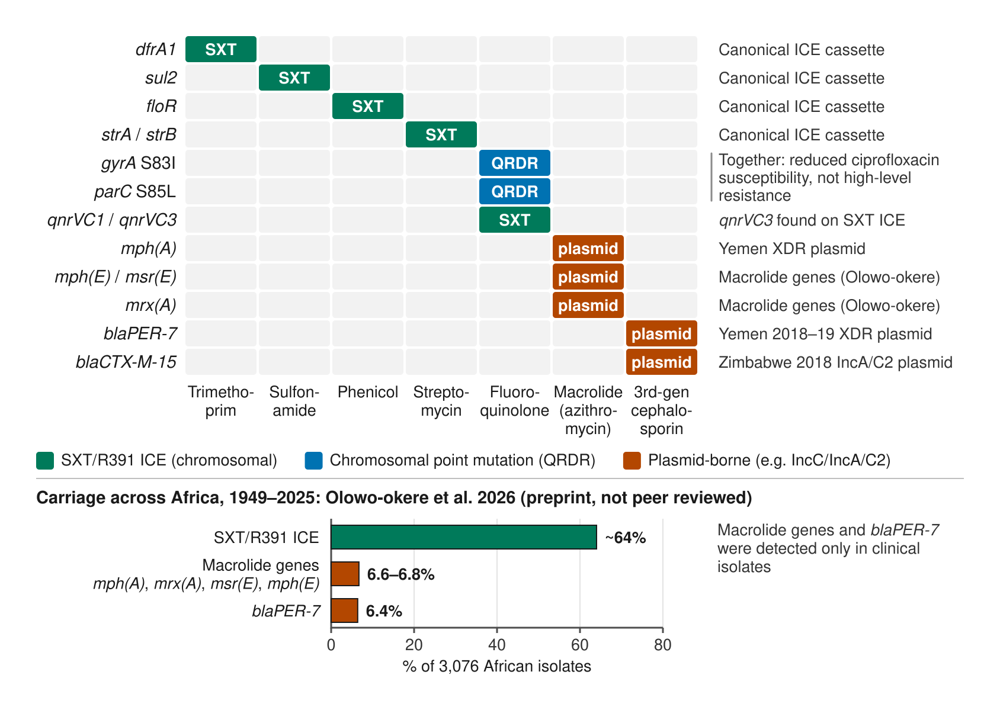  
<small><strong>Figure 20. Key antimicrobial resistance determinants in seventh-pandemic *Vibrio cholerae*: drug class affected and genetic vehicle.</strong> Matrix of acquired resistance genes and chromosomal mutations (rows) against the antibiotic class each one affects (columns).</small>

&nbsp;

### 5.6.3 Tools for Genomic AMR Detection

The recommended command-line tool for AMR detection in *V. cholerae* genomic surveillance is [**AMRFinderPlus**](https://bio.tools/amrfinderplus), developed and maintained by NCBI. Critically, the flag \--organism Vibrio\_cholerae must be specified to enable detection of chromosomal QRDR point mutations, *gyrA* S83I and *parC* S85L  conferring resistance to ciprofloxacin. The AMRFinderPlus database and software are updated regularly; the version and database release date should always be recorded and reported alongside results, as gene and mutation calls can differ between versions. Within the [**PathogenWatch**](https://vibriowatch.readthedocs.io/) platform, AMR detection is performed using a bespoke antimicrobial resistance (AMR) prediction module, with a curated database of known *V. cholerae* resistance determinants to predict resistance phenotypes alongside gene and mutation evidence. 

The Comprehensive Antibiotic Resistance Database [**CARD**](card.mcmaster.ca) (Alcock et al., 2023\) is not a pipeline analysis tool but is an essential reference resource for interpretation. When AMRFinderPlus or **PathogenWatch** reports a gene or mutation that the analyst is unfamiliar with, CARD provides mechanistic detail on the resistance mechanism, the antibiotic class or specific drug affected, known allelic variants, and the curated scientific literature. It is the appropriate first resource for contextualising any unexpected or novel resistance finding before it is acted upon or reported.

[**MicroBIGG-E**](ncbi.nlm.nih.gov/pathogens/microbigge\_map) (the Microbial Browser for Identification of Genomic and Genetic Elements) (Feldgarden et al., 2021\) is a complementary NCBI resource that visualises the geographic and temporal distribution of specific AMR genes and mutations across all bacterial isolates in the NCBI Pathogen Detection database. For *V. cholerae* analysts, this is useful for situating a finding from a local dataset within the global genomic record. For example, if *mphA* is detected in an isolate from a country where it has not previously been reported, MicroBIGG-E can be used to determine how widely it has been reported in other *V. cholerae* genomes globally, its geographic distribution across sampled countries, and the years in which it has appeared. This contextualisation supports interpretation of whether a resistance gene represents a locally novel emergence or has been circulating more broadly in the global population. A specific caution applies to QRDR point mutation detection from Oxford Nanopore Technologies (ONT) assemblies. ONT sequencing is prone to indel errors in homopolymeric regions, which can introduce artefactual frameshifts or mask true single-nucleotide substitutions in chromosomal target genes. The *gyrA* S83I and *parC* S85L calls from uncorrected or insufficiently polished ONT assemblies should therefore be treated with greater caution than the same calls from Illumina assemblies, particularly at low coverage. Where QRDR mutations are clinically significant and the data are ONT-derived, confirmatory phenotypic susceptibility testing is advisable.

### 5.6.4 Interpretation of AMR Determinants, Genotype–Phenotype Discordances, and the Limits of Genomic Prediction

A fundamental principle underlying the interpretation of genomic AMR data is that the presence of a resistance gene or mutation in an assembly does not guarantee phenotypic resistance, and its absence does not guarantee susceptibility. This is a general caveat to AMR prediction, and the GTFCC interim technical note on DNA-based identification and typing methods (2017) and the GTFCC public health surveillance guidance (2024) explicitly address it. Both recommend that whole-genome sequencing-based AMR prediction complement, rather than replace, antimicrobial susceptibility testing, particularly at the onset of an outbreak and at defined intervals during sustained transmission, because genotype–phenotype models remain incomplete and expression cannot be inferred from gene presence alone.

Two specific discordances are well documented in 7PET strains and will affect the interpretation of routine AMRFinderPlus output: 

* *catB9*, a chloramphenicol acetyltransferase gene variant, is frequently detected in O1/7PET genomes but is often silent in this genomic background and is therefore a poor predictor of phenotypic chloramphenicol resistance: catB9-positive isolates frequently test susceptible, so reporting it as clinically actionable resistance would be misleading (Pragasam et al., 2026; Sebastian et al., 2025).   
* *varG*, which encodes a predicted metallo-beta-lactamase associated with carbapenem resistance in *V. cholerae*, is β-lactam-inducible and encodes a functional carbapenemase (Lin et al., 2017), but its presence in 7PET genomes has not been shown to predict a carbapenem-resistant phenotype under standard susceptibility testing (Sebastian et al., 2025). 

Analysts encountering *catB9* and/or *varG* in 7PET genomes may note their presence in the genomic record but should not translate it into a clinical or public health resistance call without phenotypic confirmation. 

A third interpretive challenge arises from the lineage-dependent variation in ICE-SXT gene content. The resistance cassettes carried within the ICE—*dfrA1* (trimethoprim), *sul2* (sulfamethoxazole), *floR* (chloramphenicol), and *strA/strB* (streptomycin)—are not uniformly present across all 7PET lineages, and some African lineages carry ICEs from which some or all resistance cassettes are absent (Weill et al., 2017). This means that AMR profiles should always be reported alongside the lineage designation, so that apparently unusual resistance or susceptibility profiles can be correctly attributed to lineage-associated ICE variation rather than to local selection or novel acquisition events. 

For any resistance finding that is unexpected, clinically significant, or inconsistent with the expected profile for the circulating lineage, phenotypic AST data are needed before clinical or public health action is taken on the basis of genomic prediction alone. Please see the GTFCC interim technical note on DNA-based identification and typing methods (2017) and the GTFCC public health surveillance guidance (2024) for the operational framework governing the integration of genomic and phenotypic AMR surveillance data.

### 5.6.5 Mobile Genetic Elements

For a mechanistic account of the MGEs that carry AMR determinants in *V. cholerae*, including the biology of ICE integration and excision, the diversity of SXT/R391 family elements, the role of integrons and superintegrons, and the contribution of plasmids, please see Das et al. (2020) and De (2021). This subsection addresses only the practical tools required to characterise MGEs from assembled genomic data.

**ICEfinder** is the recommended tool (Liu et al., 2019; Wang et al., 2024\) for identifying and characterising integrative and conjugative elements from genomic assemblies. It predicts the presence of ICEs, identifies the integration site, and annotates the accessory module gene content including AMR gene cassettes. ICEfinder output complements AMRFinderPlus by confirming the genetic context of resistance genes, specifically, whether they are carried within an ICE and therefore potentially transferable by conjugation, rather than simply recording their presence.

**PlasmidFinder** identifies plasmid replicon sequences from assembled genomes and **MOB-suite** (Robertson and Nash, 2018\) complements PlasmidFinder by reconstructing plasmid sequences from draft assemblies, predicting whether contigs are plasmid-derived or chromosomal, and characterising plasmid mobility, classifying them as conjugative, mobilisable, or non-mobilisable. This distinction matters for surveillance interpretation: conjugative plasmids, which may carry resistance genes, can transfer between cells independently, which has different implications for outbreak dynamics and spread than resistance encoded on mobilisable or non-mobilisable elements. In the Zimbabwe 2018 and Yemen XDR strains, resistance genes including *blaPER-7* and the macrolide resistance cassette were carried on large conjugative *IncC* plasmids (Mashe et al., 2020; Rouard et al., 2024). Running both PlasmidFinder and MOB-suite, particularly when resistance genes are detected, provides replicon typing alongside a mobility assessment, both of which should be included in the outbreak report. It should be noted that in assemblies of short-read data, contigs typically break in repeated regions of the genome, meaning that plasmids and chromosomes are often in many contigs and AMR genes may not sit on the same contig as the plasmid identifier gene. As such, it may be difficult to determine which plasmid or chromosome the ARGs are located on.

# 6 Comparative Genomics Analysis

## 6.1 The Purpose of Comparative Genomic Analyses

Comparative genomics assesses relationships between isolates beyond the resolution available through genome characteristics such as serogrouping, MLST or lineage assignment. It can help to answer epidemiological questions such as whether isolates share a transmission chain, whether a strain represents a new introduction or ongoing local circulation, or how local findings relate to regional or global spread.

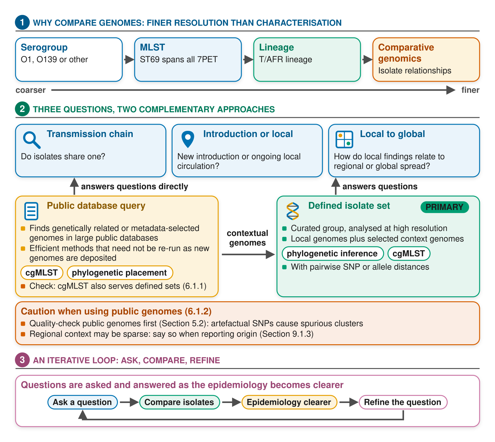  
<small><strong>Figure 22. Comparative genomics: purpose and approaches.</strong> Why and how isolates are compared beyond serogroup, multilocus sequence typing (MLST) and lineage (Section 6.1).</small>

&nbsp;

Comparative analyses are often undertaken in an iterative manner, asking and addressing questions as epidemiology becomes clearer. There are two broad analytical approaches used in public health surveillance and outbreak analysis, which are often complementary but have distinct goals and typically distinct methodological approaches (see Section 6.2): assessment of relationships amongst a defined set of isolates, and identification of closely related genomes within large (public) databases. The assessment of relationships amongst a defined set of isolates is often the primary analytical approach. Querying public databases is used both as a means of answering epidemiological questions directly and as a way of identifying contextual genomes to incorporate into those closer defined-dataset analyses.

### 6.1.1 Assessment of Relationships Amongst a Defined Set of Isolates

Assessment of relationships amongst a defined set of isolates provides high-resolution genomic analysis of a curated group of sequences, typically locally sequenced genomes together with any selected contextual sequences identified from public databases (Section 6.1.2). This approach addresses epidemiological questions about population dynamics, for example, whether isolates from different patients, locations, or time points are likely to share a transmission chain; how an outbreak has spread geographically or over time; whether genomically related isolates share clinically or epidemiologically relevant characteristics such as AMR profiles or virulence determinants; and how local findings relate to regional or historical strain diversity. The results may be integrated with genome characterisation outputs (Sections 5.3–5.5) and epidemiological metadata, enabling genomic findings to be interpreted alongside clinical and contextual information.

For *V. cholerae*, assessment of relationships within a defined set of isolates is typically implemented using phylogenetics or cgMLST supplemented with pairwise SNP or cgMLST allele distance analyses; these methods and their considerations are described in Section 6.2.

### 6.1.2 Identification of Closely Related Genomes Within Large (Public) Databases

Querying public genome databases allows identification of genomes that are genomically or epidemiologically related to the isolates under investigation. This approach addresses questions about the broader context of strains circulating in a given setting, for example identifying potential external sources of strains that were newly introduced into a geographic area, and whether local strains have been found elsewhere and how they are distributed geographically and through time. Database queries also provide the geographically and temporally diverse contextual genomes needed to calibrate SNP distances and phylogenetic relationships in defined-dataset analyses (see Section 6.2.1). 

Related public genomes fall into two distinct categories:

* **Genetically related genomes**: sequences that have similar genomes to your isolates, identified by allele-based or SNP-based similarity searching. These help place your isolates in evolutionary context and support inferences about introduction sources and transmission links. This requires querying databases containing thousands of genomes that are continuously updated as new sequences are deposited, so must use computationally efficient methods that do not need to be re-run as the dataset changes. As such, this rarely uses phylogenetic inference, which is often used for assessments of relationships amongst a defined set of isolates, instead using phylogenetic placement, cgMLST or other approaches, described in Section 6.2.  
* **Metadata-selected genomes**: sequences chosen on the basis of shared epidemiological criteria, for example, geographic region, time period, sampling source, or AMR profile, perhaps regardless of genomic relationship. These help characterise the diversity and distribution of genomes circulating in a relevant setting and support spatiotemporal comparisons.

> [!WARNING]
> Public genomes are often not subject to stringent quality control before public sharing, so users should undertake their own quality assessments and use only contextual genomes that meet quality thresholds for further analyses (see section 5.2). Low-quality contextual sequences may introduce artefactual SNPs that can distort phylogenetic relationships and produce spurious clustering.

Contextual genomes may simply not exist for the setting of interest. Public genome data repositories under-represent many cholera-affected regions, and limited availability of contemporaneous genomes from neighbouring countries was identified as a practical barrier by laboratories consulted during development. Where regional context is sparse, analysts should say so explicitly when reporting, since conclusions about origin and introduction are constrained by what is available to compare against rather than by the analysis itself (see Section 9.1.3). Regional sequencing networks and consortium datasets are often a better source of contextual genomes than public repositories alone, and depositing local genomes improves the context available to neighbouring programmes in turn.

## 6.2 Comparative Genomic Analysis Methods

There are two principal methods used to undertake comparative genomics: phylogenetic inference (Section 6.2.1) and cgMLST (Section 6.2.2), though other methods such as phylogenetic placement (Section 6.2.3) may be employed. These methods may be chosen by bioinformaticians or platform developers to allow users to assess relationships amongst a defined set of isolates or large databases. It is valuable to understand their application to cholera genomics.

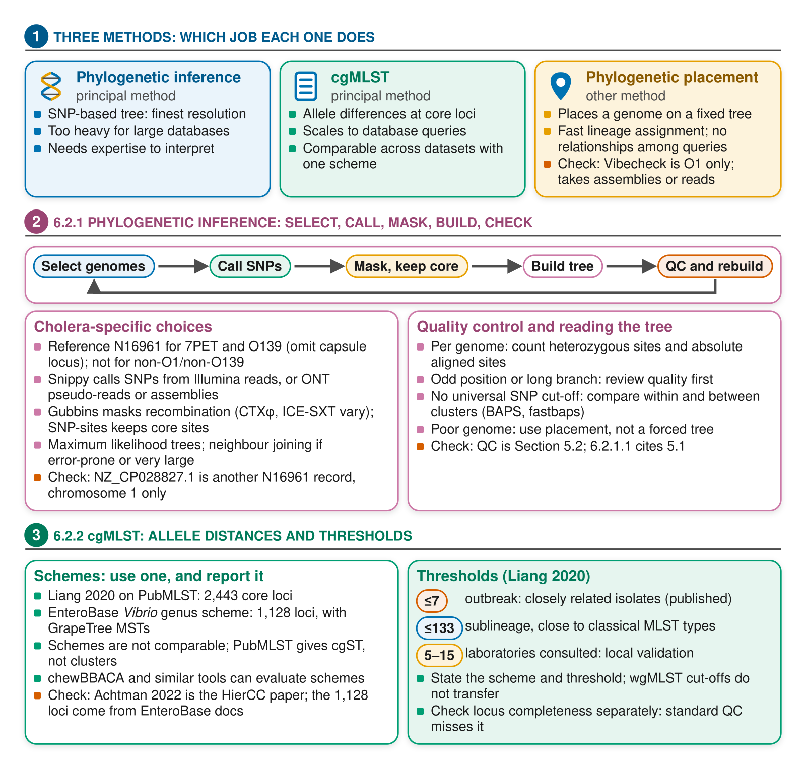  
<small><strong>Figure 23. Comparative methods: trees, alleles and placement.</strong> What each comparative method answers, how to run it and where it stops (Section 6.2).</small>

&nbsp;

### 6.2.1 Phylogenetic Inference

SNP-based phylogenetic inference is an evolutionary analysis method that builds evolutionary trees (phylogenies) by comparing Single Nucleotide Polymorphisms (SNPs). These evolutionary relationships can be used to indicate the epidemiological relationships between genome sources. It provides the ultimate resolution for relationship analysis, but is computationally intensive and is therefore inappropriate for querying large (public) databases, and relationships between genomes require significant expertise for interpretation. Phylogenetic approaches may be supplemented with pairwise SNP-distance calculations that quantify difference between genomes in a dataset, however those SNP distances are only comparable amongst the genomes analysed together and may vary significantly depending on the dataset composition and methods used. As such, it is difficult to use universally-defined SNP-distance thresholds or cut-offs to interpret the relationships between genomes (and in turn, identify outbreak-associated genomes). Instead, it is recommended to assess within the dataset that has been analysed together looking at SNP distances within- and between-phylogenetic clusters, which may be identified visually by assessment of a phylogenetic tree, or using computational approaches to clustering, such as BAPS (Cheng et al., 2013; see also fastbaps, Tonkin-Hill et al., 2019).

Phylogenetic analysis is often undertaken many times as an iterative process: as dataset composition changes with the removal of low-quality or less related genomes, the addition of contextual sequences, or the restriction to a particular cluster, the tree must be rebuilt. The following sections describe the key considerations for *V. cholerae* phylogenetic analysis.

**6.2.1.1 Sample selection**

The genomes included in a phylogenetic analysis should be determined by the epidemiological question being addressed. Typically, this requires selection of related genomes, perhaps initially those with the same serogroup, MLST and/or lineage. A dataset may be refined with subsequent trees, perhaps with addition of genomes to provide the context needed to interpret relationships (see 6.1.2); or refinement to a more closely related set of genomes since core-genome analyses are typically used (see Section 6.2.1.2) since a dataset that is too broad compresses fine-scale transmission structure that may be essential for answering the question. All genomes that are included in a phylogenetic tree should pass robust quality control (see Section 5.1), and the dataset may require additional refinement to improve data quality (see Section 6.2.1.3). Most analyses include some combination of the following:

* **The isolates under investigation:** the primary genomes whose relationships you seek to understand  
* **T-lineage representative genomes:** a curated set of reference genomes spanning the T/AFR lineage framework (Weill et al., 2017, 2019), enabling direct lineage placement from tree topology, in addition to or instead of lineage placement with **Vibecheck**  
* **Genetically related public genomes** to contextualise potential introduction events and transmission links to other settings  
* **Metadata-selected public genomes:** sequences from the same region, time period, or epidemiological context, to characterise the broader diversity circulating in a relevant setting and, when using historical genomes, to distinguish new introductions from ongoing local transmission. 

The conclusions that can be drawn from a phylogenetic analysis are bounded by the completeness of the dataset. An analysis that includes only a subset of cases may miss relevant diversity and give a biased picture of population structure, and a relationship can only be detected if genomes representing it are included. The composition of the dataset should be recorded and reported alongside any findings derived from it.

> [!WARNING]
> Only genomes that have passed quality control thresholds, including exceeding the minimum data quantity for phylogenetics, as discussed in Section 5.2, should be included in phylogenetic analyses.

**6.2.1.2 Building the phylogenetic tree**

Phylogenetic analysis for *V. cholerae* may be undertaken by applying the same principles as for most other bacteria, which are beyond the scope of this cholera-focused guidance. Typically, core-genome recombination-masked maximum likelihood trees are used to analyse high-quality datasets. When the datasets have greater likelihood of error, or for large datasets where ML trees become too computationally resource intensive, neighbour joining trees are often used. The key cholera-specific considerations are: 

* **Reference selection for alignment of reads to call SNPs.** In most surveillance analyses of 7PET, studies use the N16961 reference genome (Heidelberg et al., 2000; accessions AE003852 and AE003853), or perhaps more recent complete assemblies, such as NZ\_CP028827.1. For O139 strains, which share the same core genome as O1 El Tor but differ at the *rfb* locus, N16961 can also be used for core genome analysis provided the capsule locus is excluded or treated with care. For non-O1/non-O139 *V. cholerae*, N16961 is not an appropriate reference due to substantial genomic divergence; a representative genome of the relevant serogroup or lineage should be selected instead. The selected reference must be sufficiently similar to the dataset for alignment-based analysis to be meaningful. Similarity may be assessed after alignment by examining the proportion of sites in each genome that align to the reference; genomes aligning poorly should prompt either reconsideration of the reference or their exclusion from the analysis.  
* **Variant-calling:** Amongst published studies and workflows undertaking *V. cholerae* phylogenetics, **Snippy** is widely used for genome alignment and SNP-calling, using either Illumina read data, or pseudo-reads or assemblies from ONT data.  
* **Recombination masking**: Tools such as **Gubbins (Croucher et al., 2015\)** identify and mask regions of the alignment where SNPs have been introduced through horizontal gene transfer rather than vertical inheritance. Masking is particularly important in *V. cholerae* because horizontally acquired regions such as the CTXφ prophage and ICE-SXT are variably present between genomes. If these are not masked they will inflate apparent distances between genomes and distort tree topology. Recombination masking combined with restriction to core-genome positions largely mitigates this.  
* **Restriction to core genome positions**: Only high-quality SNP positions within the defined core genome, with adequate coverage across the dataset, should be used for phylogenetic inference. For *V. cholerae*, this is important because mobile elements are variably present across genomes; including positions from accessory elements absent in some genomes would introduce artificial signals of divergence and distort phylogenetic inference. Bioinformatics tools such as **SNP-sites** are commonly used for removal of non-core sites.	

**6.2.1.3 Quality control and iterative refinement**

Phylogenetic trees are statistical estimates based on the data and methods available, not a direct representation of evolutionary or epidemiological history. Quality control is therefore necessary to ensure the best possible statistical estimates and appropriate interpretations are made. In particular, genomes carrying high proportions of missing data, contamination, or sequencing error introduce artefactual SNPs or gaps that distort the inferred relationships and may produce spurious clustering, and must be addressed. 

Post-alignment quality control should be undertaken before tree building as an assessment of whether each genome is contributing reliable signal to this analysis. Two metrics are particularly informative for *V. cholerae*: the number of heterozygous site calls per genome, which may indicate mixed or contaminated samples; and the number of sites in each genome aligning to the reference. The absolute number of aligned sites is preferable to the proportion of the genome aligned, since the latter is biased by the variable accessory content and horizontally acquired regions characteristic of *V. cholerae*. Genomes aligning poorly should prompt reconsideration of whether the reference is appropriate for the dataset (Section 6.2.1.2), or exclusion of those genomes from the analysis.

Once a tree has been built, genomes with significant missing data will reduce the resolution of core-genome phylogenies, whilst those with contamination or elevated SNP calls arising from poor assembly or erroneous sequencing approaches may produce anomalously long branches or appear artificially divergent from their true relatives. Any genome producing an unexpected tree position should prompt review of its quality metrics before the result is interpreted biologically, and potentially its removal from further analyses. Very high SNP distances relative to the rest of the dataset should trigger review of contamination, sample identity, sequencing quality and reference suitability before being interpreted as genuine biological divergence.

The statistical support for the tree's structure should also be assessed, for example through bootstrap resampling or posterior probabilities. Nodes with low support indicate that the relationships in that part of the tree are uncertain, and epidemiological interpretations resting on them should be qualified accordingly when reported (Section 9.1.2).

Where a genome is of insufficient quality for reliable inclusion in a core-genome tree but its position remains of interest, phylogenetic placement (Section 6.2.3) is preferable to forcing it into a *de novo* analysis. Placement positions the genome on a fixed reference tree without allowing its errors to influence the topology, so the relationships amongst the remaining genomes are preserved.

Phylogenetic analysis is an iterative process: as dataset composition changes with the removal of low-quality or distantly related genomes, the addition of contextual sequences, or restriction to a particular cluster, the tree must be rebuilt. Analysts should verify that tree topology is broadly consistent across scales and, where multiple analytical methods are used, that results are concordant before drawing epidemiological conclusions from specific relationships.

### 6.2.2 cgMLST

cgMLST is a genomic typing method in which a defined set of core loci (genes found in all or nearly all members of a species, making up a cgMLST scheme) are compared between isolates at the allele level, with each unique sequence at a locus assigned a distinct allele number. Relationships between isolates are quantified by counting the number of loci at which they carry different alleles, giving a numeric pairwise allele difference. Unlike SNP-based phylogenetics, cgMLST does not infer evolutionary history from nucleotide variants, but pairwise allele differences are more readily interpretable than phylogenetic trees and, critically, are directly comparable between datasets when the same scheme is used, making cgMLST a standardised and interoperable approach to assessing genomic relationships across laboratories. For *V. cholerae*, cgMLST is used primarily for two purposes: querying large public genome databases (Section 6.1.2), where phylogenetic analysis is computationally impractical at scale, and as a standardised method for determining outbreak-associated *V. cholerae* clusters and relationships between genomes.  
Whilst the threshold or cut-off used to define an outbreak-associated cluster varies between laboratories and MLST schemes, the published threshold for the Liang et al. (2020) cgMLST scheme is ≤7 allelic differences, with ≤133 delineating sublineages. In practice, laboratories consulted during development reported cut-offs ranging from 5 to 15 allelic differences. Cut-offs other than ≤7 reflect local validation rather than a published figure, and thresholds derived for wgMLST schemes are not comparable with cgMLST thresholds because the locus sets differ. Any threshold adopted locally should be stated explicitly alongside the scheme used. For within-dataset relationship analysis requiring maximum resolution, phylogenetic analysis (Section 6.2.1) remains the preferred approach.

> [!WARNING]
> Standard genome QC does not assess cgMLST locus completeness. A genome that passes coverage and assembly thresholds (see Section 5.2) may still return valid allele calls for only a fraction of scheme loci, producing unreliable cluster assignments or exclusion from analysis. Check locus completeness as a distinct QC step before cgMLST interpretation. Tools such as **Pathogenwatch** apply minimum completeness thresholds for cluster assignment, and the threshold used should be documented and applied consistently across the dataset.

Multiple cgMLST schemes are available for *V. cholerae* which may be evaluated with cgMLST typing tools such as **chewBBACA** (Silva et al., 2018). Two principal schemes are:

* The **EnteroBase** genus-level Vibrio cgMLST scheme (1,128 core loci; Achtman et al., 2022\) underpins the allele-based clustering within the **EnteroBase** platform ([source website](https://enterobase.warwick.ac.uk/species/index/vibrio)). Allele assignments are generated automatically for genomes submitted to the database, and selected genomes can be visualised as minimum spanning trees (MSTs) using **GrapeTree** within the platform.   
* The **Liang et al. (2020)** scheme, also hosted on **PubMLST** (pubmlst.org/vcholerae/), comprises 2,443 core loci and defines two standardised clustering thresholds: an outbreak threshold of ≤7 allelic differences, identifying closely related isolates, and a sublineage threshold of ≤133 allelic differences, delineating broader sublineages. Note that PubMLST performs allele calling and cgST assignment for individual submitted genomes but does not itself perform clustering or MST construction. 

Distinct cgMLST schemes use different locus sets and are not directly comparable; cluster designations cannot be cross-referenced between them. Users should apply one scheme consistently within a dataset and report which scheme was used. Section 7.3 describes the platforms through which each scheme can be accessed and used.

### 6.2.3 Phylogenetic Placement

Phylogenetic placement positions a query genome on a fixed reference phylogeny without rebuilding the entire tree, enabling rapid, scalable lineage assignment. Unlike a full phylogenetic analysis (Section 6.2.1), placement does not assess relationships within a set of query genomes; it assigns each genome individually to a position in a pre-defined reference tree. This makes it well suited to understanding the closest relatives to a genome of interest but less appropriate for resolving fine-scale relationships between novel isolates.

For *V. cholerae*, phylogenetic placement is primarily used for T-lineage assignment within the 7th pandemic El Tor (7PET) framework (Section 5.4.2). **Vibecheck** is the recommended tool for this purpose, assigning Illumina assemblies to a T-lineage by placement against a curated reference tree. It is available as a command-line tool and is implemented within **TheiaProk** on **Terra** (Section 7.2). 

# 7 Bioinformatics Implementation

Bioinformatics tasks for analysis of *V. cholerae* genomes seek to characterise individual genomes to identify key biological attributes including serogroup, biotype, lineage, antimicrobial resistance profile, virulence determinants, and MLST sequence type, and compare genomes with methods such as phylogenetics, cgMLST, or phylogenetic placement to address epidemiological questions about relationships between isolates and their broader context as described in Sections 5 and 6\. Implementation of the bioinformatics tasks for *V. cholerae* genome analysis may be undertaken using a variety of workflows delivered via different infrastructure platforms (e.g., a command line interface (CLI) and different types of web-based graphical user interfaces (GUIs)) described here in Section 7\.

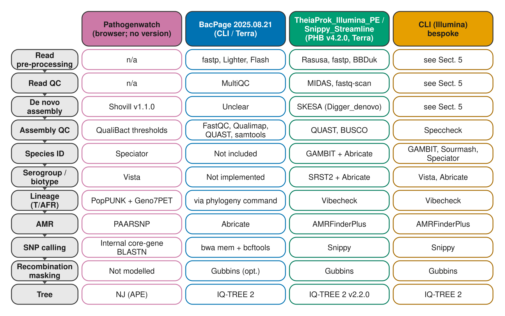

<small><strong>Figure 25. Bioinformatics workflows for cholera genomic analysis: tools and versions at each step.</strong></small>

&nbsp;

## 7.1 Bioinformatics Platforms and Compatible Workflows

The platforms and workflows described in this Section were identified through community consultation with public health laboratories, national reference centres, and organisations focused on cholera surveillance. They represent tools in active use across this community and in three major networks, the Africa CDC CholGen programme, the PulseNet international surveillance network, and the Community of Practice for Cholera Genomics ([source website](https://www.linkedin.com/groups/11805196/)), as well as a cholera-focused command line workflow. Inclusion does not constitute an endorsement of any individual tool; rather, these workflows represent a practical and realistic set of options for laboratories working on cholera surveillance. Platform functionality, usage limits, reference datasets and database contents described in this Section are current as of October 2026 and should be confirmed against the current documentation of each platform before use. 

The workflows available for cholera genomic analysis are each compatible with different platforms, and it is often the operational characteristics of these platforms, such as infrastructure requirements, personnel capacity, and data governance frameworks, that determine which to use. Table 2 summarises the key operational trade-offs across three broad access models, command-line interface (CLI), cloud-based platforms (**Terra**), and **PathogenWatch** as an example of a browser-based tool, and should be the starting point for workflow decisions. Table 3 summarises which analytical tasks, as described in Sections 5 and 6, are available across the platforms and their compatible workflows described in this Section. Further prose summaries in Section 7.2 and 7.3 provide additional interpretive context. No single platform or workflow option is universally superior, and in practice many laboratories use more than one platform in combination.

**Table 2\. Comparison of implementation platforms for *V. cholerae* genomic analysis**

| <small>Criterion</small> | <small>CLI (local/HPC)</small> | <small>Terra</small> | <small>PathogenWatch</small> |
| :---- | ----- | ----- | ----- |
| <small>**Access model**</small> | <small>Command-line interface; local installation of tools (conda / Docker)</small> | <small>Web browser GUI</small> | <small>Web browser GUI</small> |
| <small>**Infrastructure required**</small> | <small>Local workstation, HPC, or cloud compute account</small> | <small>Google and **Terra** accounts</small> | <small>**PathogenWatch** account</small> |
| <small>**Internet required**</small> | <small>For installation and database downloads only</small> | <small>For data upload/download and to start analyses</small> | <small>For data upload/download and to start analyses</small> |
| <small>**Skillset requirements**</small> | <small>Advanced (command-line bioinformatics, possibly scripting and use of a workflow language such as WDL or **Snakemake**)</small> | <small>Intermediate (GUI but requires some configuration of parameters)</small> | <small>Low (intuitive GUI)</small> |
| <small>**Customisation**</small> | <small>Maximum</small> | <small>Workflows are customisable within the parameters set by developers; they are fully customisable in WDL</small> | <small>None</small> |
| <small>**Cost**</small> | <small>Purchase/use of compute infrastructure; personnel for maintenance</small> | <small>Free use of **Terra**; Google Cloud charges apply for compute</small> | <small>Free</small> |
| <small>**Data leaves institution**</small> | <small>Not if using local hardware</small> | <small>Yes (Google Cloud; to location of Google data servers, which user may choose)</small> | <small>Yes (**PathogenWatch** servers; Sanger/Oslo)</small> |
| <small>**Data sovereignty**</small> | <small>Full institutional control, as locally configured</small> | <small>User-controlled data access and use settings</small> | <small>External research infrastructure</small> |
| <small>**Support and documentation**</small> | <small>Tool- or language-specific GitHub repositories and community forums</small> | <small>**Terra** documentation ([source website](https://support.terra.bio/hc/en-us/categories/360001399872-Terra-on-Google-Cloud)) and community forum ([source website](https://support.terra.bio/hc/en-us/community/topics))</small> | <small>Published documentation; **PathogenWatch** forum</small> |
| <small>**Maintenance / readiness**</small> | <small>User-maintained</small> | <small>Actively maintained</small> | <small>Actively maintained</small> |

Table 3\. Analytical tasks available across bioinformatics platforms and their compatible workflows

| <small>Platform / workflow</small> | <small>PathogenWatch</small> | <small>TheiaProk (Terra)</small> | <small>BacPage (Terra/CLI)</small> | <small>CholeraSeq (CLI)</small> | <small>Snippy\_ Streamline (Terra)</small> | <small>EnteroBase</small> | <small>NCBI Pathogen Detection</small> | <small>CLI (bespoke)</small> |
| :---: | :---: | :---: | :---: | :---: | :---: | :---: | :---: | :---: |
| <small>**Assembly QC**</small> | <small>✓</small> | <small>✓</small> | <small>✓</small> | <small>✓</small> | <small>–</small> | <small>✓</small> | <small>–</small> | <small>✓</small> |
| <small>**Species ID**</small> | <small>✓</small> | <small>✓</small> | <small>–</small> | <small>–</small> | <small>–</small> | <small>✓</small> | <small>–</small> | <small>✓</small> |
| <small>**Serogroup**</small> | <small>✓</small> | <small>✓</small> | <small>in development</small> | <small>–</small> | <small>–</small> | <small>–</small> | <small>–</small> | <small>✓</small> |
| <small>**MLST**</small> | <small>✓</small> | <small>✓</small> | <small>in development</small> | <small>–</small> | <small>–</small> | <small>✓</small> | <small>✓</small> | <small>✓</small> |
| <small>**T-lineage**</small> | <small>✓</small> | <small>✓ Illumina only</small> | <small>–</small> | <small>–</small> | <small>–</small> | <small>–</small> | <small>–</small> | <small>✓</small> |
| <small>**AMR**</small> | <small>✓</small> | <small>✓</small> | <small>✓</small> | <small>–</small> | <small>–</small> | <small>–</small> | <small>✓</small> | <small>✓</small> |
| <small>**cgMLST**</small> | <small>✓</small> | <small>–</small> | <small>–</small> | <small>–</small> | <small>–</small> | <small>✓</small> | <small>–</small> | <small>✓</small> |
| <small>**SNP phylogenetics**</small> | <small>✓ NJ only</small> | <small>–</small> | <small>✓</small> | <small>✓ with global reference cohort</small> | <small>✓</small> | <small>✓</small> | <small>✓ pre-computed</small> | <small>✓</small> |
| <small>**Contextual DB querying**</small> | <small>✓</small> | <small>–</small> | <small>–</small> | <small>–</small> | <small>–</small> | <small>✓</small> | <small>✓</small> | <small>–</small> |

**Terra**  
**Terra** (terra.bio) is a cloud-based platform-as-a-service (PaaS) running on Google Cloud Platform (GCP). Users can import workflows written in Workflow Description Language (WDL) from the **Dockstore** workflow repository (Yuen et al., 2021\) and run them at scale. Access requires a Google account and a Google Cloud billing account. Compute costs are charged to the user's GCP project, whilst use of the platform is free. Data are stored in user-managed GCP workspace buckets, and storage and compute regions may be selected to support data-residency requirements, although Terra’s control plane and some workspace metadata remain hosted in the United States. Users may choose who accesses their data and how it may be used, and laboratories should assess these arrangements against their national and institutional data-governance requirements (Terra Support, accessed October 2026). Use of the platform is via a point-and-click GUI requiring an internet connection and, often, guidance for initial use. Workflows written in WDL are available to import from Dockstore, linked to GitHub repositories where the workflows have been developed, making them findable, accessible and reusable with FAIR guidelines, and versioned according to the GitHub repository. Many **Terra**\-compatible workflows exist for common microbial-genomics applications, including for download from and upload to public data repositories.

**PathogenWatch** 

[**PathogenWatch**](pathogen.watch) is a free, browser-based platform for microbial genomics developed by the [**Centre for Genomic Pathogen Surveillance**](http://pathogensurveillance.net). The platform supports a variety of pathogens and includes *V. cholerae*\-specific analysis tools. Access to the platform is provided via a free account which is open to anyone. Data must be uploaded to the platform’s remote servers, but may be kept within private folders or collections. Users report that the platform is very intuitive to use but requires an internet connection and analyses cannot be customised, methodological transparency is limited, and the analyses are not versioned, so they cannot be considered reproducible.

**Command-line interface**

Bioinformatics has traditionally been undertaken via command line interfaces to Linux operating systems running on a variety of computer infrastructure which users must typically supply themselves. This may range from use of the compute resource on the user’s own computer without reliance on regular internet access, to institutionally-owned or cloud servers, or high-performance clusters. Typically, this infrastructure requires set up and maintenance either by the user or a systems administrator who manages data storage, access, privacy, bioinformatics package installation and maintenance, across software and possibly hardware. A full review of this bioinformatics infrastructure is beyond the scope of this document, but recommendations are available from the PHA4GE Infrastructure group (PHA4GE Infrastructure group). Beyond set-up and management of the infrastructure itself, use of the command line for bioinformatics requires a specialist skillset including familiarity with the Unix operating system, Bash, and command line tools. Whilst bioinformatics tools may be run individually for each sample, scalable, standardised and reproducible bioinformatics on the command line often involves use of bioinformatics workflows, written in workflow languages such as **Nextflow**, **Snakemake**, or perhaps WDL (Di Tommaso et al., 2017; Mölder et al., 2021; OpenWDL). Sections 7.2 and 7.3 describe the individual bioinformatics tools that support *Vibrio cholerae* analysis, and readily available workflows.

## 7.2 Genome Characterisation Workflows

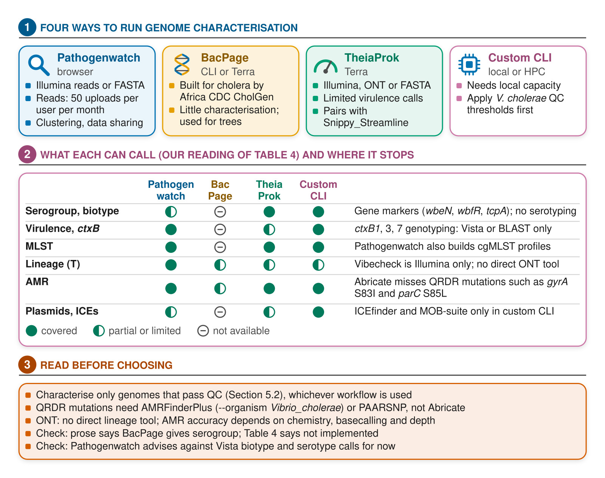  
<small><strong>Figure 26. Genome characterisation workflows: who covers what.</strong> Four ways to characterise a genome and what each leaves out (Section 7.2).</small>

&nbsp;

There are a number of genome characterisation workflows that provide some or all of the characterisation tasks that are important to *V. cholerae* genome analysis:

* serogroup identification,   
* biotype identification,   
* lineage identification,   
* antimicrobial resistance prediction,   
* virulence prediction,   
* MLST sequence typing.

The details of how these workflows undertake the key bioinformatics steps can be found in Table 4, with further considerations about these in prose below. Regardless of workflow choice, only genomes that pass quality control criteria described in Section 5.2 should be further analysed.

**Table 4\. Characterisation workflow comparison**

| <small>Step</small> | <small>PathogenWatch (no version)</small> | <small>BacPage (2025.08.21)</small> | <small>TheiaProk\_Illumina PE v4.2.0</small> | <small>TheiaProk\_ONT v4.2.0</small> | <small>CLI (Illumina)</small> | <small>CLI (ONT)</small> |
| :---- | ----- | ----- | ----- | ----- | ----- | ----- |
| <small>**Implementation Platform**</small> | <small>Browser-based (pathogen.watch)</small> | <small>CLI (**Snakemake**) or **Terra** (WDL)</small> | <small>**Terra**</small> | <small>**Terra**</small> | <small>CLI (local/HPC)</small> | <small>CLI (local/HPC)</small> |
| <small>**Input data type**</small> | <small>Illumina FASTQ or FASTA assembly</small> | <small>Illumina paired-end FASTQ or FASTA assembly</small> | <small>Paired-end Illumina FASTQ (a separate workflow for single-end Illumina is available)</small> | <small>ONT FASTQ</small> | <small>Illumina paired-end FASTQ</small> | <small>ONT FASTQ</small> |
| <small>**Read Preprocessing**</small> | <small>*Not applicable*</small> | <small>**Tool:** fastp (Chen et al., 2018\) (quality trimming); Lighter (Song et al., 2014\) (read correction); Flash (Magoč and Salzberg, 2011\) (read stitching) **Output:** *Cleaned reads*</small> | <small>**Tool:** Rasusa (Hall, 2022\) (optional subsampling); **Trimmomatic** (default) or fastp (alternative; read trimming); BBDuk (adapter trimming) **Output:** *"Clean" reads*</small> | <small>**Tool:** Rasusa (read subsampling); Nanoq (Steinig and Coin, 2022\) (read filtering); Porechop (Wick, Porechop; no associated publication) (optional adapter trimming) **Output:** *"Clean" reads*</small> | <small>*See Section 5*</small> | <small>*See Section 5*</small> |
| <small>**Read QC**</small> | <small>*Not applicable*</small> | <small>**Tool: FastQC** **Output:** *MultiQC (Ewels et al., 2016\) report*</small> | <small>**Tool:** MIDAS (Nayfach et al., 2016\) (optional taxonomic assignment); fastq-scan (Petit, fastq-scan; no associated publication) (default) or **FastQC** (alternative; quantification); CG-Pipeline (quality assessment) **Output:** *Read QC metrics for raw and clean reads*</small> | <small>**Tool:** Metabuli (Kim and Steinegger, 2024\) (taxonomic classification); fastq-scan; Nanoplot (De Coster and Rademakers, 2023\) **Output:** *Read QC metrics for raw and clean reads*</small> | <small>*See Section 5*</small> | <small>*See Section 5*</small> |
| <small>**De novo Assembly**</small> | <small>**Tool: Shovill** v1.1.0 **Output:** *FASTA assembly* *Note: Fair usage limit of 50 read-based (FASTQ) analyses per user per month; upload and analysis of pre-assembled genomes is unlimited*</small> | <small>**Tool:** Unclear</small> | <small>**Tool:** Digger\_denovo using **SKESA** (default); or alternatively **SPAdes** or MEGAHIT (Li et al., 2015\) **Output:** *FASTA assembly*</small> | <small>**Tool: Flye**\-denovo (custom **Flye** wrapper) **Output:** *FASTA assembly and assembly graph*</small> | <small>*See Section 5*</small> | <small>*See Section 5*</small> |
| <small>**Assembly QC**</small> | <small>**Tool:** Internal (metrics evaluated against **QualiBact** thresholds) **Output:** *Basic QC summary*</small> | <small>**Tool: FastQC** (raw read QC); Qualimap (Okonechnikov et al., 2016\) bamqc (alignment QC); **QUAST** (*de novo* assembly QC); samtools (Danecek et al., 2021\) stats / samtools idxstats (alignment statistics); plot\_coverage.py (coverage plots); MultiQC (aggregates all outputs) **Output:** *Aggregated QC report (results/reports/qc\_report.html)*</small> | <small>**Tool: QUAST**; **BUSCO** **Output:** *Assembly QC metrics (evaluated relative to user-defined pass/fail thresholds)*</small> | <small>**Tool: QUAST**; **BUSCO** **Output:** *Assembly QC metrics (evaluated relative to user-defined pass/fail thresholds)*</small> | <small>**Tool:** Speccheck (Alikhan, Speccheck; no associated publication) **Output:** *Interactive HTML report; pass/fail against QC thresholds*</small> | <small>**Tool:** Speccheck **Output:** *Interactive HTML report; pass/fail against QC thresholds*</small> |
| <small>**Species Identification**</small> | <small>**Tool:** Speciator **Output:** *Species classification*</small> | <small>*Not included*</small> | <small>**Tool: GAMBIT**; SRST2 and **Abricate** (detection of *toxR* and *ompW* for *V. cholerae* confirmation) **Output:** *Species/genus classification and confirmation*</small> | <small>**Tool: GAMBIT**; **Abricate** (detection of *toxR* and *ompW* for *V. cholerae* confirmation) **Output:** *Species classification and confirmation*</small> | <small>**Tool: GAMBIT**; **Sourmash**; Speciator **Output:** *Species classification*</small> | <small>**Tool: GAMBIT**; **Sourmash**; Speciator **Output:** *Species classification*</small> |
| <small>**Serogroup / Serotype / Biotype**</small> | <small>**Tool: Vista** **Output:** *O1, O139, or non-O1/O139 assignment; serogroup markers*</small> | <small>*Not implemented*</small> | <small>**Tool:** SRST2 and **Abricate**; detects *wbeN* (O1), *wbfR* (O139), *tcpA*\_ElTor (El Tor biotype), *tcpA*\_classical (Classical biotype); no serotyping available **Output:** *Presence or absence of diagnostic genes*</small> | <small>**Tool: Abricate**; detects *wbeN* (O1), *wbfR* (O139), *tcpA*\_ElTor (El Tor biotype), *tcpA*\_classical (Classical biotype); no serotyping available **Output:** *Presence or absence of diagnostic genes*</small> | <small>**Tool: Vista**; **Abricate** **Output:** *O1, O139, or non-O1/O139 assignment and serogroup markers (**Vista**); gene presence/absence (**Abricate**)*</small> | <small>**Tool: Vista**; **Abricate** **Output:** *O1, O139, or non-O1/O139 assignment and serogroup markers (**Vista**); gene presence/absence (**Abricate**)*</small> |
| <small>**Virulence (incl. ctxB genotyping)**</small> | <small>**Tool: Vista** **Output:** *Virulence genes and gene clusters; ctxB genotype (ctxB1, ctxB3, ctxB7)*</small> | <small>*Not implemented; virulence\_factor\_profiling rule present in codebase but commented out*</small> | <small>**Tool: AMRFinderPlus**; SRST2 and **Abricate** (detection of *ctxA*) **Output:** *Virulence determinants (limited range); no ctxB-specific genotyping*</small> | <small>**Tool: AMRFinderPlus**; **Abricate** (detection of *ctxA*) **Output:** *Virulence determinants (limited range); no ctxB-specific genotyping*</small> | <small>**Tool: Vista**; BLAST **Output:** *Virulence genes and gene clusters (**Vista**); ctxB genotype (*ctxB1, ctxB3, ctxB7*)*</small> | <small>**Tool: Vista**; BLAST **Output:** *Virulence genes and gene clusters (**Vista**); ctxB genotype (*ctxB1, ctxB3, ctxB7*)*</small> |
| <small>**MLST**</small> | <small>**Tool:** In-house tool: assembly searched for exact allele matches then BLAST against representative allele set per locus; allele calls combined and filtered by similarity and match length; novel alleles assigned unique SHA-1 hash identifiers; profiles assigned from unique allele combinations; schemes provided by Enterobase, **PubMLST**, Pasteur Institute, and cgMLST.org Nomenclature Server; cgMLST profiles computed in parallel and used as basis for cluster analysis **Output:** *ST designation (downloadable); cgMLST allele profile (not displayed directly; downloadable from collection and genome menus)*</small> | <small>*Not currently implemented; mlst\_profiling rule present in codebase but commented out (intended to scan consensus sequences against **PubMLST** schemes)*</small> | <small>**Tool:** mlst (Torsten Seemann; auto-scheme detection) **Output:** *ST designation*</small> | <small>**Tool:** mlst (Torsten Seemann; auto-scheme detection) **Output:** *ST designation*</small> | <small>**Tool:** mlst (Torsten Seemann; \--scheme flag) **Output:** *ST designation*</small> | <small>**Tool:** mlst (Torsten Seemann; \--scheme flag) **Output:** *ST designation*</small> |
| <small>**Lineage (T-lineage)**</small> | <small>**Tools: PopPUNK (Lees et al., 2019\) (species-wide lineage clustering) and Geno7PET (7PET sublineage genotyping)** **Output: PopPUNK cluster (VC1 corresponds to 7PET) and Geno7PET hierarchical genotype class corresponding to named sublineages such as AFR10 and AFR15**</small> | <small>Via phylogeny command (see Table 3\)</small> | <small>**Tool: Vibecheck** **Output:** *Predicted T lineage and confidence score*</small> | <small>*Not available*</small> | <small>**Tool: Vibecheck** **Output:** *Predicted T lineage and confidence score*</small> | <small>Not directly available; consider building a tree with contextual genomes with known T-lineages, or use PopPUNK and Geno7PET (methods not well documented for ONT data)</small> |
| <small>**AMR (incl. QRDR mutations)**</small> | <small>**Tool:** PAARSNP (Centre for Genomic Pathogen Surveillance, AMRsearch; no associated publication) (**Pathogenwatch** AMR Libraries) **Output:** *Resistance determinants including QRDR point mutations*</small> | <small>**Tool: Abricate** **Output:** *AMR gene table* *Note: QRDR point mutations (e.g. gyrA S83I, parC S85L) are not detected by **abricate**; **abricate** identifies gene presence only*</small> | <small>**Tool: AMRFinderPlus** (--organism Vibrio\_cholerae; default); optionally **ResFinder**, GAMMA (Stanton et al., 2022), **abricate**, or AMRsearch **Output:** *Resistance determinants and predicted resistance classes*</small> | <small>**Tool: AMRFinderPlus** (--organism Vibrio\_cholerae; default); optionally **ResFinder**, GAMMA, **abricate**, or AMRsearch **Output:** *Resistance determinants and predicted resistance classes* *Note: Accuracy depends on chemistry, basecalling model and depth rather than on the platform itself.*</small> | <small>**Tool: AMRFinderPlus** (--organism Vibrio\_cholerae) **Output:** *AMR genes and QRDR point mutation table*</small> | <small>**Tool: AMRFinderPlus** (--organism Vibrio\_cholerae) **Output:** *AMR genes and QRDR point mutation table* *Note: Accuracy depends on chemistry, basecalling model and depth rather than on the platform itself.*</small> |
| <small>**MGE / ICE characterisation**</small> | <small>**Tool: PlasmidFinder** **Output:** *Plasmid replicon types identified*</small> | <small>*Not implemented*</small> | <small>**Tool: PlasmidFinder** **Output:** *Replicon types*</small> | <small>**Tool: PlasmidFinder** **Output:** *Replicon types*</small> | <small>**Tool: ICEfinder**; **PlasmidFinder**; MOBsuite **Output:** *ICE characterisation; replicon types; mobility classification*</small> | <small>**Tool: ICEfinder**; PlasmidFinder; MOBsuite **Output:** *ICE characterisation; replicon types; mobility classification*</small> |

**PathogenWatch**

**PathogenWatch** provides genome characterisation for target pathogens, including *Vibrio cholerae*. Analysis may be undertaken from pre-assembled genomes without this limit, or from Illumina read data, which is subject to a fair usage limit of 50 analyses per user per month.  In addition to genome characterisation, **PathogenWatch** provides options for comparative genomic analysis and public data sharing.

**TheiaProk**  
The **TheiaProk** workflow series developed by Theiagen Genomics encompasses general bacterial genomic characterisation workflows which include a *V. cholerae*\-specific subworkflow. The workflows support paired-end Illumina short-read data (using **TheiaProk\_Illumina\_PE**) and Oxford Nanopore Technologies long-read (using **TheiaProk\_ONT**) data, or direct use of assembly files (**TheiaProk\_FASTA**). The choice of workflow depends on the type of sequencing data available. All workflows undertake genome assembly, quality control, species confirmation, serogroup, biotype and AMR prediction, limited *V. cholerae* virulence characterisation, MLST, T-lineage typing (Illumina only), and plasmid detection. TheiaProk may be paired with **Snippy\_Streamline** (see Section 7.3) for phylogenetic analysis. 

**BacPage**   
**BacPage** is a **Snakemake**\-based bioinformatics workflow developed by the Africa CDC CholGen programme, available as a command-line tool that may be installed from GitHub ([source website](https://github.com/CholGen/bacpage)) and as a workflow on **Terra**. It was designed specifically for cholera genomics, and currently provides *de novo* assembly and AMR profiling with serogroup identification, with MLST tasks reported to be in development. Though offering minimal genomic characterisation, BacPage is included here as it also provides functions for *V. cholerae* phylogenetic analysis.

**Custom CLI Bioinformatics Workflows**  
Users with sufficient bioinformatics capacity may implement the characterisation analyses described in Section 5, via use of individual bioinformatics tools or self-developed workflows. Read processing and assembly of *Vibrio cholerae* genomes may follow standard practices for other bacterial genomes. These may then be evaluated against *V. cholerae*\-specific quality control thresholds, and the genomes that pass QC can be characterised with the following *V. cholerae* specific tools:

* Serogroup and virulence determinant identification using **Vista**, or identification of a custom gene panel using **Abricate**   
* Lineage typing using **Vibecheck**   
* AMR profiling with **AMRFinderPlus** since this facilitates identification of V. cholerae-specific curated AMR determinants using *\--organism Vibrio\_cholerae*

## 7.3 Comparative Genomics Workflows

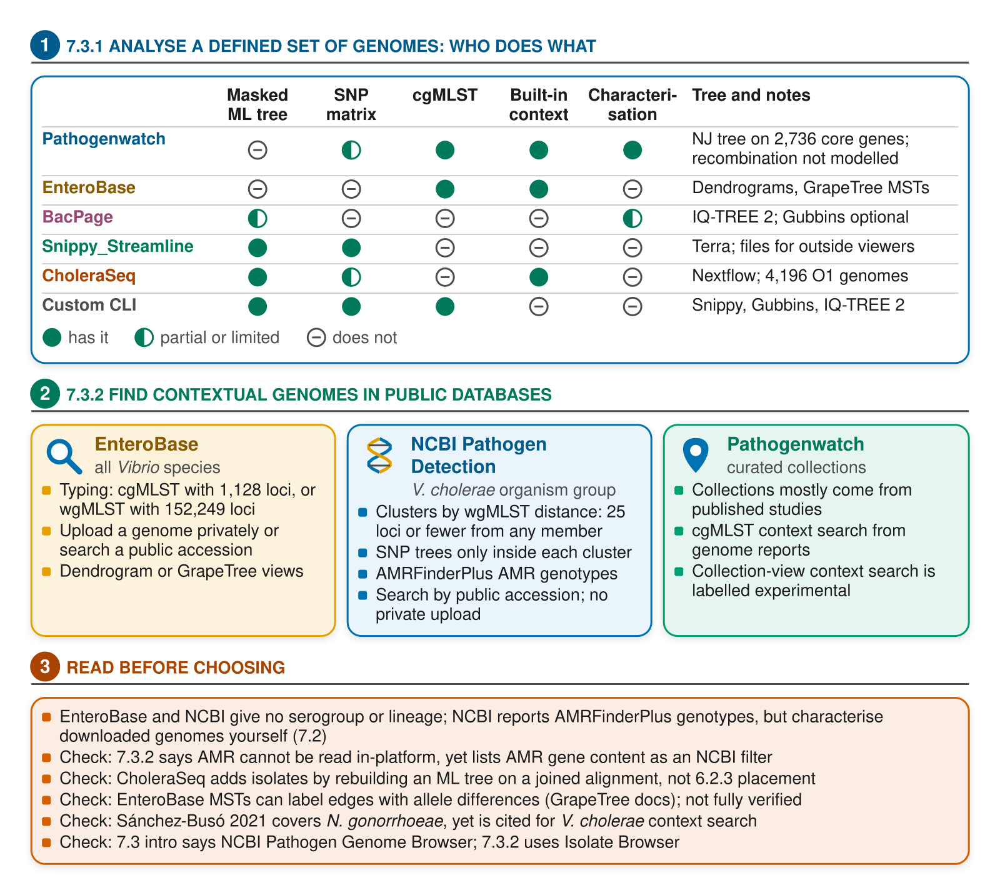  
<small><strong>Figure 27. Comparative genomics workflows: which tool does what.</strong> Which tool does what in comparative genomics (Section 7.3).</small>

&nbsp;

Sources: PHA4GE Cholera Genomics Guidance, Section 7.3, Tables 5 and 6 (symbols are the authors’ reading of the tables); CholeraSeq paper; Pathogenwatch, EnteroBase and NCBI documentation.

Comparative analysis of *V. cholerae* genomes may be undertaken to understand their relationships, as described in Section 6\. A number of workflows and platforms provide access to phylogenetic inference, cgMLST and methods for identifying contextual genomes from public databases or collections; these are listed below:

* BacPage (phylogenetic inference)  
* Snippy\_Streamline  
* CholeraSeq   
* Custom CLI Bioinformatics Workflows  
* PathogenWatch  
* EnteroBase  
* NCBI Pathogen Genome Browser

Regardless of workflow choice, only genomes that pass quality control criteria described in Section 5.2 should be further analysed.

### 7.3.1 Phylogenetic inference and cgMLST

The following workflows and platforms support phylogenetic inference and cgMLST analysis of a defined set of genomes, as described in Sections 6.2.1 and 6.2.2. They vary considerably in the methods they implement, and the platforms on which they are available. Table 5 provides a comparison of phylogenetic workflow methods. 

**Table 5\. Phylogenetic workflow comparison**

| <small>Step</small> | <small>PathogenWatch (no version)</small> | <small>BacPage (2025.08.21)</small> | <small>Snippy\_Streamline (v4.2.0)</small> | <small>CholeraSeq (Nextflow)</small> | <small>CLI (Illumina)</small> | <small>CLI (ONT)</small> |
| :---- | ----- | ----- | ----- | ----- | ----- | ----- |
| <small>**Implementation Platform**</small> | <small>Browser-based (pathogen.watch)</small> | <small>CLI (**Snakemake**) or **Terra** (WDL)</small> | <small>**Terra**</small> | <small>CLI (**Nextflow**)</small> | <small>CLI (local/HPC)</small> | <small>CLI (local/HPC)</small> |
| <small>**Input data type**</small> | <small>Illumina FASTQ or FASTA assembly</small> | <small>Illumina paired-end reads or FASTA assemblies</small> | <small>Illumina paired-end FASTQ or FASTA assemblies</small> | <small>Illumina paired-end FASTQ, single-end FASTQ, or FASTA assemblies (supplied via sample sheet); long reads not currently supported</small> | <small>Illumina paired-end FASTQ or pre-assembled FASTA</small> | <small>ONT FASTQ or pre-assembled FASTA</small> |
| <small>**Reference Genome / Core Scheme**</small> | <small>Internal core library derived from 17 *V. cholerae* reference genomes (2,736 core gene families; 3,075,173 nt); not user-configurable</small> | <small>AE003852 (*Vibrio cholerae* O1 biovar El Tor str. N16961; chromosome I; hard-coded default FASTA; user-configurable)</small> | <small>User-provided; or auto-selected via ReferenceSeeker (closest RefSeq match)</small> | <small>GCF\_003063785 / N16961 (*Vibrio cholerae* O1 biovar El Tor str. N16961; GenBank format; default hard-coded reference); user-configurable</small> | <small>*User-provided; see Section 6*</small> | <small>*User-provided; see Section 6*</small> |
| <small>**SNP Calling / Core Profiling**</small> | <small>**Tool:** Internal pipeline — query assemblies searched against core gene BLASTN database (2,736 *V. cholerae* core gene families); substitutions extracted per locus; indels excluded; pairwise distances scaled to expected core size (3,075,173 nt) **Output:** *Scaled pairwise SNP distance matrix (internal intermediate)*</small> | <small>**Tool:** bwa mem (reference mapping); samtools sort/index; bcftools mpileup \+ call (variant calling); bcftools filter and norm; depth-based masking via samtools depth; bcftools consensus (masked per-sample consensus FASTA) **Output:** *Per-sample masked consensus FASTAs (results/consensus/\*.consensus.fasta)*</small> | <small>**Tool: Snippy** (reference mapping and variant calling) **Output:** *VCF file; whole-genome and core-genome SNP alignments*</small> | <small>**Tool:** fastp (read trimming and QC); **Snippy** (reference-based variant calling and mapping); samtools consensus (per-sample consensus FASTA generation); seq\_cleaner.py (alignment filtering for missing data) **Output:** *Per-sample consensus FASTAs concatenated into cohort alignment; BAM files*</small> | <small>**Tool: Snippy** (reference mapping and variant calling; accepts paired-end FASTQ or FASTA assembly via \--ctgs flag) **Output:** *VCF; whole-genome and core-genome SNP alignments*</small> | <small>**Tool: Snippy** (--ctgs flag for assembly-based variant calling from ONT FASTA assemblies) **Output:** *VCF; SNP alignment* *Note: ONT assemblies carry higher base-call error rates than Illumina; may introduce spurious SNP calls; pre-polish assemblies before use*</small> |
| <small>**Recombination Masking**</small> | <small>Not modelled; paralogue filter and Poisson-based variance filter (Core Filter) remove loci with anomalously high variant rates prior to tree construction; documentation notes the tree is sensitive to recombination</small> | <small>**Tool:** Optional: **Gubbins** (recombination region detection; executed via run\_gubbins.py); alternatively a user-provided GFF mask may be applied in place of **Gubbins** **Output:** *Recombination-masked SNP alignment; recombinant regions GFF (results/phylogeny/recombinant\_regions.gff)*</small> | <small>**Tool: Gubbins** (on by default) **Output:** *Recombination-masked SNP alignment; recombination visualisation files*</small> | <small>**Tool: Gubbins** (recombinant region detection); mask\_gubbins\_aln.py (masks recombinant regions in alignment); optional r-fastbaps clustering support (not the primary tree-building path) **Output:** *Recombination-masked SNP alignment*</small> | <small>**Tool: Gubbins** (recommended) **Output:** *Recombination-masked SNP alignment; recombination visualisation files*</small> | <small>**Tool: Gubbins** (optional; sensitivity may be reduced with ONT-derived assemblies) **Output:** *Recombination-masked SNP alignment* *Note: **Gubbins** cannot distinguish recombination from other causes of elevated polymorphism density, including assembly or alignment errors (**Gubbins** manual), so systematic assembly error can generate false-positive recombination blocks.*</small> |
| <small>**Tree Method**</small> | <small>**Tool:** Neighbour-joining (NJ; APE R package, Paradis et al.); midpoint-rooted (phangorn R package, Schliep); not user-configurable **Output:** *Midpoint-rooted NJ dendrogram; viewable within **VibrioWatch** collection; not exportable as standalone Newick file* *Note: Sensitive to recombination, systemic genome errors and hypermutators (**Pathogenwatch** documentation)*</small> | <small>**Tool:** Concatenated consensus FASTAs converted to BCF/VCF via **snp-sites** \+ bcftools; optional background VCF/BCF merged via bcftools merge/index; sparse SNP alignment extracted via **snp-sites**; **IQ-TREE** (ML; user-configurable substitution model) **Output:** *Maximum-likelihood phylogeny (results/phylogeny/phylogeny.tree)*</small> | <small>**Tool: snp-sites** (extracts recombination-masked core-genome positions); **IQ-TREE 2** (ML; **ModelFinder** selects best-fit substitution model; 1,000 ultrafast bootstrap replicates by default) **Output:** *Recombination-masked core-genome alignment; Newick tree*</small> | <small>**Tool:** varcodons.py (converts recombination-masked alignment to variable-site and codon-aware SNP input); **IQ-TREE 2** v2.2.0 (ML; automatic nucleotide substitution model selection; ASC correction; 1,000 ultrafast bootstrap replicates) **Output:** *Maximum-likelihood phylogeny (Newick); recombination-masked variable-site alignment; variant codon alignment; MultiQC report (QC and workflow metadata)*</small> | <small>**Tool: snp-sites** (SNP extraction from recombination-masked whole-genome alignment); **IQ-TREE 2** (ML; **ModelFinder** model selection; 1,000 ultrafast bootstrap replicates) **Output:** *Maximum-likelihood phylogeny (Newick); recombination-masked SNP alignment*</small> | <small>**Tool: snp-sites**; **IQ-TREE 2** (ML; **ModelFinder**; 1,000 ultrafast bootstrap replicates) **Output:** *Maximum-likelihood phylogeny (Newick)* *Note: Phylogenetic accuracy may be reduced due to higher error rates in ONT assemblies; interpret trees with caution and consider Illumina confirmation of key SNPs*</small> |
| <small>**Contextual Genomes**</small> | <small>**VibrioWatch** curated reference collection (built-in); assigned to nearest reference genome from a taxonomically representative set *Note: Complementary cgMLST-based context search also available: retrieves the nearest genomes from public and accessible **Pathogenwatch** projects within a user-defined allele difference threshold, with project, country and time filters (see Table 3, MLST row for details)*</small> | <small>Optional user-provided background dataset; FASTA sequences concatenated into alignment; VCF/BCF merged via bcftools merge/index; no built-in reference collection</small> | <small>User-selected and uploaded (no built-in collection)</small> | <small>Global *V. cholerae* O1 reference cohort (4,196 publicly available genomes, 1961–2024; Zenodo; quarterly updated); supports iterative addition of new isolates without full re-analysis via sub-workflow</small> | <small>*User-selected; see Section 6*</small> | <small>*User-selected; see Section 6*</small> |
| <small>**SNP Distance Matrix**</small> | <small>Pairwise scaled SNP distance matrix computed as internal intermediate; not directly accessible or exportable to users</small> | <small>*Not implemented*</small> | <small>**Tool: SNP-dists** **Output:** *Pairwise SNP distance matrix (CSV)*</small> | <small>No dedicated tool within the pipeline; the parsimony-informative sites (PIS) alignment output can be used for external SNP distance calculation</small> | <small>**Tool: SNP-dists** **Output:** *Pairwise SNP distance matrix (CSV)*</small> | <small>**Tool: SNP-dists** **Output:** *Pairwise SNP distance matrix (CSV)* *Note: Distances may be inflated by base-call errors in ONT assemblies*</small> |

**PathogenWatch**  
**PathogenWatch** provides an integrated pipeline for genome characterisation (see Section 7.2), phylogenetics, and core genome MLST (cgMLST), all accessible via a web browser without local software installation (see Section 7.1).  Phylogenetic inference is undertaken with a core genome neighbour-joining (NJ) tree inferred from alignments across 2,736 core gene families identified using 17 reference genomes (3,075,173 nt alignment). Trees are rendered interactively in the platform alongside epidemiological metadata, enabling rapid visual exploration. PathogenWatch additionally provides cgMLST using the scheme drawn from PubMLST (Liang et al) and may provide cgMLST trees.  cgMLST is also used to provide a context search function, which retrieves genomes from the Pathogenwatch database within a specified allele-distance threshold using single-linkage clustering (Sánchez-Busó et al., 2021). This is available from single-genome reports; the Context Search panel within the Interactive Collection View is labelled experimental by Pathogenwatch and did not return results for broad searches in our hands.

**EnteroBase**  
**EnteroBase** (enterobase.warwick.ac.uk) is a browser-based platform providing curated genome databases and comparative genomics tools for several bacterial pathogens, including *V. cholerae*. Users may generate phylogenetic trees and undertake cgMLST using the platform’s own scheme for genomes in its public database or those that they privately upload. This enables both analysis of a defined dataset and searches for public genomes (see Sections 6.1.2 and 7.3.2). Phylogenetic trees and minimum spanning trees constructed from cgMLST profiles may be visualised interactively in the platform as dendrograms or GrapeTrees. EnteroBase does not provide pairwise SNP distances nor cgMLST allele distances between genomes, nor does it offer genomic characterisation of the genomes, which must be undertaken separately (though results may be uploaded for visualisation). To analyse your own data within the platform, (private) genome upload is required, raising data sovereignty concerns for some institutions. Computational turnaround for large submission batches can be slow and some users find the interface is not intuitive. 

**PubMLST**

The Liang et al. (2020) *V. cholerae* cgMLST scheme, comprising 2,443 core loci, is hosted on **PubMLST** (pubmlst.org/vcholerae/). Genomes submitted to the database are automatically assigned allele calls and a core genome sequence type (cgST). PubMLST does not perform clustering or visualisation; allele profiles must be exported and a minimum spanning tree (MST) constructed separately before results can be explored in **GrapeTree** (Zhou et al., 2018). The Liang et al. scheme and the **EnteroBase** *V. cholerae* cgMLST scheme use different locus sets and are not directly comparable; cluster designations cannot be cross-referenced between them, and the scheme used should always be stated explicitly in methods and publications.

**BacPage**

**BacPage** is a **Snakemake**\-based workflow developed by the Africa CDC CholGen programme that may be implemented on the command line or via **Terra**. Alignment-based assembly and phylogenetics use the default reference genome AE003852 (*V. cholerae* O1 El Tor N16961; user-configurable) with optional **Gubbins** for recombination masking, **snp-sites** for core SNP extraction, and **IQ-TREE 2** for ML phylogenetic inference. User-supplied background genomes can be incorporated for phylogenetic contextualisation. BacPage does not produce pairwise SNP distances and does not include T-lineage assignment or comprehensive characterisation outputs; it should therefore be paired with **TheiaProk** or a CLI approach for complete characterisation.

**Snippy\_Streamline**   
Three similar SNP-based phylogenetics workflows are available on **Terra** that are broadly applicable to bacterial phylogenomics including *V. cholerae*: Snippy\_Streamline (Illumina reads input), **Snippy\_Streamline\_FASTA** (assembly or ONT assembled-data input), and the modular **Snippy\_variants** \+ **Snippy\_Tree** combination for more flexible use cases. The workflows all generate a core-genome recombination-masked maximum-likelihood phylogeny as often required for *V. cholerae* analysis, and a pairwise SNP distance matrix. The workflow and **Terra** platform do not offer phylogenetic visualisation, but instead, output standard phylogenetic file formats that are compatible with phylogenetic visualisation platforms (e.g. **Phandango**, **Microreact**) (Hadfield et al., 2018; Argimón et al., 2016). Contextual genomic data and a reference genome for building the phylogeny are not available by default for the **Snippy** workflows, but users may upload their own.

**CholeraSeq**

**CholeraSeq** is a **Nextflow**\-based pipeline focused on contextualising *V. cholerae* isolates within a large curated global reference collection: a dataset of 4,196 *V. cholerae* genomes is available via Zenodo, enabling phylogenetic placement of new isolates within a comprehensive global context. Phylogenetic analysis produces a recombination-masked maximum likelihood tree using N16961 (*V. cholerae* O1 El Tor; user-configurable) as the default reference. **CholeraSeq** performs no genome characterisation and should be paired with **PathogenWatch**, **TheiaProk**, or a bespoke CLI approach for complete genomic characterisation. The curation status and update frequency of the reference cohort are uncertain; users should verify the current release before use. 

**Custom CLI Bioinformatics Workflows**

Users with sufficient bioinformatics capacity may implement the phylogenetic methods described in Section 6.2.1 using individual tools assembled into a custom workflow, offering maximum flexibility in dataset composition, bioinformatics tools and parameter choices. Infrastructure requirements for CLI use are described in Section 7.1. Methods may include:

* **Illumina-based phylogenetics:** **Snippy** (reference-based SNP calling) → **Gubbins** (recombination masking) → **snp-sites** (core SNP extraction) → **IQ-TREE 2** (ML phylogenetics with **ModelFinder** and ultrafast bootstrap) → **SNP-dists** (pairwise SNP distance matrix).  
* **ONT-based phylogenetics:** as above using **Snippy** with the `--ctgs` flag for assembly input. Note that ONT assemblies introduce additional sequencing noise that can inflate SNP-based phylogenetic distances; users should interpret ONT-derived phylogenies with appropriate caution (see Section 6).  
* **cgMLST:** Users may perform cgMLST analysis via the command line using allele profiles exported from **PubMLST** based on the Liang et al. (2020) publication. Profiles are clustered at the outbreak threshold (≤7 allelic differences) or sublineage threshold (≤133 allelic differences), and MSTs can be constructed and visualised using **GrapeTree** (Zhou et al., 2018). Note that the Liang et al. scheme and the **EnteroBase** scheme are not directly comparable; see **PubMLST** entry above. 

### 7.3.2 Identifying Contextual Genomes from Public Databases

The principal resources for contextual genome identification are [**EnteroBase**](https://enterobase.warwick.ac.uk/) and [**NCBI Pathogen Detection Isolate Browser**](https://www.ncbi.nlm.nih.gov/pathogens/isolates/), described in Table 6. Both support searching for closely related genomes and metadata-based searching to identify genomes by spatiotemporal criteria or sample type; facilitate visualisation of relationships between genomes; and allow users to download (publicly available) genomes and their metadata. The absence of *V. cholerae*\-specific characterisation in both platforms is an important limitation for cholera surveillance: users can identify genomically similar sequences but cannot immediately determine their serogroup, lineage, or AMR from within the platform. Instead, these genomes would need to be downloaded and subjected to genome characterisation approaches described in Section 7.2. **PathogenWatch** also contains collections of publicly available *V. cholerae* genomes which are accompanied by their genomic characteristics, but each collection is typically limited to datasets used in research papers, rather than a comprehensive representation of public genomes. It additionally offers cgMLST-based context search, which retrieves the nearest genomes within a user-defined allele-difference threshold with project, country and time filters. This is available from single-genome reports and is used operationally, for example within PulseNet Africa; the equivalent Context Search panel in the Interactive Collection View is labelled experimental by **Pathogenwatch** and did not return results for broad searches in our hands (Centre for Genomic Pathogen Surveillance, Pathogenwatch documentation). 

Table 6\. Comparison of public database resources for identifying contextual *V. cholerae* genomes

|  | <small>EnteroBase</small> | <small>NCBI Pathogen Detection Isolate Browser</small> |
| :---: | :---: | :---: |
| <small>Scope</small> | <small>All *Vibrio* spp.</small> | <small>*Vibrio cholerae*</small> |
| <small>**No. genomes  available  (5 June 2026\)**</small> | <small>26,445 of which \~13,000 have metadata for species as “*Vibrio cholerae*”</small> | <small>20,735</small> |
| <small>**Typing method**</small> | <small>[cgMLST with 1,128 core gene loci or wgMLST with 152,249 loci](https://enterobase.readthedocs.io/en/latest/pipelines/vibrio-statistics.html)</small> | <small>[wgMLST though the scheme is not clear, followed by SNP clustering](https://www.ncbi.nlm.nih.gov/pathogens/docs/data_processing/#data-processing-clustering)</small> |
| <small>**Cluster type**</small> | <small>cgMLST or wgMLST</small> | <small>NCBI-defined SNP cluster</small> |
| <small>**Search process**</small> | <small>Upload your genome privately or search for your public genome accession, then filter for other genomes with the same cgMLST, wgMLST or metadata of interest</small> | <small>Search for your genome by public accession, then filter for other genomes with the same SNP cluster or metadata of interest</small> |
| <small>**Visualisation**</small> | <small>Any selection of genomes can be visualised in an interactive dendrogram or **GrapeTree**; effective customisable visualisation of relationships with metadata using GrapeTrees</small> | <small>SNP clusters can be visualised in an interactive phylogenetic tree where tips are pre-labelled with some metadata</small> |
| <small>**Access**</small> | <small>Zhou et al., 2020</small> | <small>[ncbi.nlm.nih.gov/pathogens/isolates/\#taxgroup\_name%3A"Vibrio%20cholerae](http://ncbi.nlm.nih.gov/pathogens/isolates/#taxgroup_name%3A%22Vibrio%20cholerae)"</small> |

**NCBI Pathogen Detection Isolate Browser**

The NCBI Pathogen Detection Isolate Browser is a publicly accessible resource that continuously clusters *V. cholerae* genomes deposited in NCBI/SRA using NCBI-defined SNP clusters. As of June 2026, it contains over 20,000 *V. cholerae* genomes. Users can search by public accession to identify which SNP cluster their genome belongs to and retrieve other genomes in the same cluster, or filter by metadata including geography, collection date, and AMR gene content. SNP clusters can be visualised as pre-computed phylogenetic trees with metadata labels. Genomes must be submitted to NCBI/SRA before they can be searched; the platform does not accept direct uploads for private analysis.

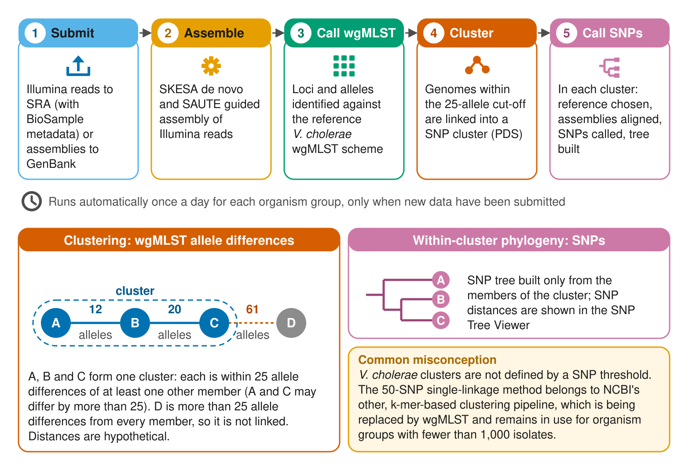

<small><strong>Figure 28. How NCBI Pathogen Detection clusters *Vibrio cholerae* genomes.</strong></small>

&nbsp;

**EnteroBase**

**EnteroBase** additionally functions as a public database for contextual genome identification, supporting cgMLST-based and metadata-based searching of its curated *V. cholerae* genome collection. Its capabilities and limitations are described in Section 7.3.1.

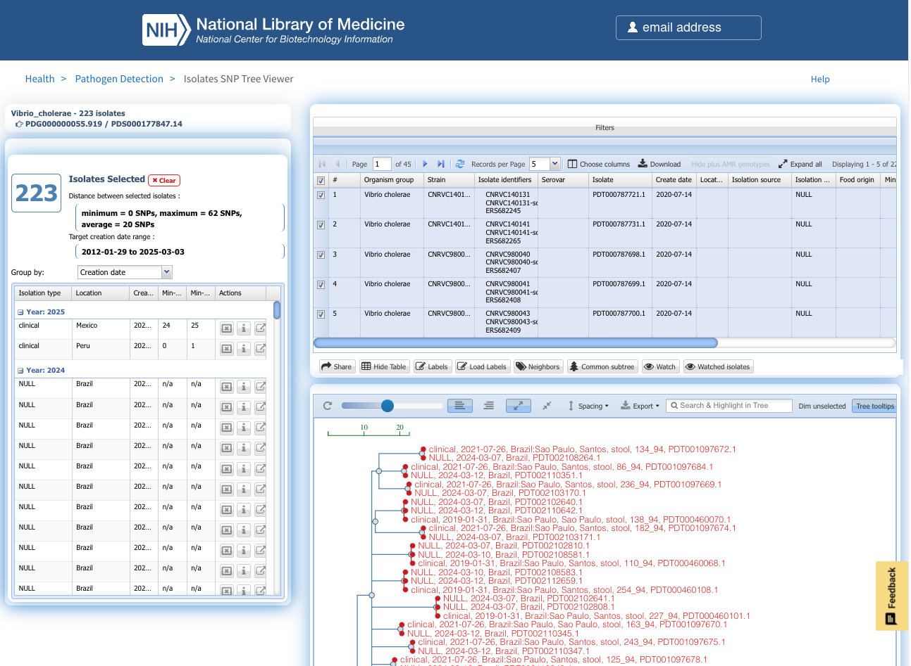

<small><small><strong>Figure 29A. NCBI Pathogen Detection Isolates SNP Tree Viewer for a *Vibrio* *cholerae* SNP cluster.</strong> Screenshot of the NCBI Pathogen Detection Isolates SNP Tree Viewer for *Vibrio* *cholerae* (223 isolates; organism group PDG000000055.919, SNP cluster PDS000177847.14).</small></small>

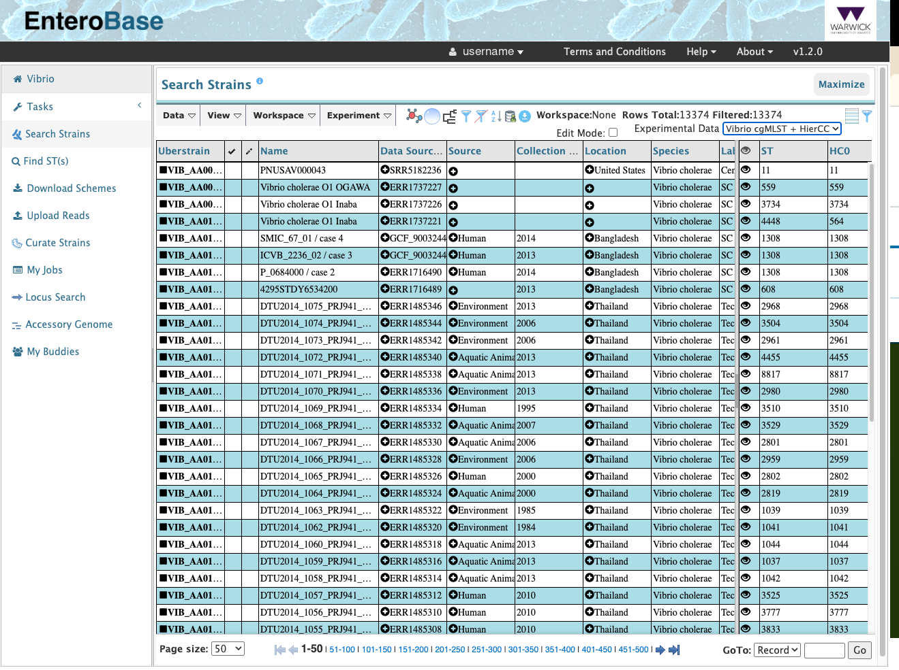

<small><small><strong>Figure 29B. EnteroBase Vibrio Search Strains page showing cgMLST and HierCC data.</strong></small></small>

# 8 *V. cholerae* Public Data Sharing

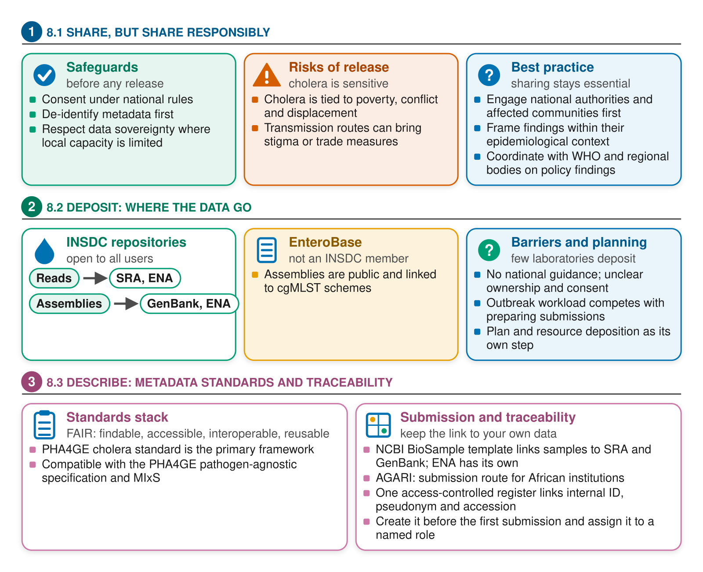  
<small><strong>Figure 30. Public data sharing: responsibly, openly and traceably.</strong> Public sharing of cholera genomic data (Section 8\) in three steps.</small>

&nbsp;

## 8.1 Ethical Considerations

Data sharing in public health genomics raises important ethical considerations that apply to all pathogens, including *V. cholerae*. These include ensuring that:

* samples are collected with appropriate informed consent and in accordance with national regulatory frameworks;   
* patient privacy is protected through de-identification of associated metadata before public deposit;   
* principles of data sovereignty are respected, particularly where samples are collected in settings with limited local analytical capacity. 

Laboratories and research teams are encouraged to engage with institutional ethics committees and relevant national authorities early in project design, and to ensure data sharing plans are reviewed as part of that process.

Cholera has a unique historical and ongoing association with poverty, conflict, and displacement. Genomic data may therefore carry significant political and economic consequences when it enters the public domain. Genomic epidemiology can reveal cross-border transmission pathways with high resolution, and this information, whilst scientifically valuable, may in some contexts prompt responses that affect communities and countries beyond the immediate public health situation or intent. These can include trade or travel measures under the International Health Regulations (IHR 2005\) that carry economic implications for affected regions, or reputational impacts on countries or communities identified in transmission analyses. There is a recognised risk of stigmatisation when transmission data is communicated without adequate epidemiological context. The weight of these considerations varies considerably by setting and circumstance, but they are particularly relevant for a disease with cholera's social and geopolitical history.

These risks do not argue against sharing cholera genomic data, which remains essential for effective global surveillance and outbreak response. Rather, they highlight the importance of how and with whom data is shared, and the responsibility of those generating and publishing genomic data to consider the downstream impacts on the communities from which it was collected. Best practice includes 

* early engagement with national public health authorities and affected communities before public release;   
* framing transmission findings within their epidemiological context to avoid misinterpretation;   
* ensuring that those most affected by an outbreak have meaningful access to and agency over the data generated from it. 

Where genomic findings have potential policy implications, coordination with the WHO and relevant regional bodies prior to publication is strongly advisable.

## 8.2 Data Repositories

Whole-genome sequencing data from *V. cholerae* should be deposited in publicly accessible repositories to support open science, outbreak response, and retrospective analysis. In practice, routine deposition remains the exception rather than the rule: among laboratories consulted during development, few deposited all or most sequences routinely, with the remainder depositing selectively, rarely, or not at all. Barriers reported included the absence of national guidance on what may be shared, uncertainty over data ownership and prior consent, and the practical difficulty of preparing submissions alongside outbreak workload. Programmes should plan for deposition as a resourced step rather than assuming it will follow analysis. *V. cholerae* genomic data are accepted by all major nucleotide repositories operating under the International Nucleotide Sequence Database Collaboration (INSDC): the National Center for Biotechnology Information (NCBI), which accepts raw reads via the Sequence Read Archive (SRA) and assembled sequences via GenBank; and the European Nucleotide Archive (ENA). Assembled genomes submitted to **EnteroBase** are also publicly accessible and linked to the cholera-relevant cgMLST schemes described in Section 6\. Laboratories should follow their institutional and national data sharing policies when selecting a repository and determining whether open or controlled-access submission is appropriate.

## 8.3 Metadata Standards

Consistent, structured metadata is essential for cholera genomic data to be reusable for surveillance, outbreak investigation, and epidemiological analysis; this reflects the core principle of  FAIR data (Findable, Accessible, Interoperable, Reusable; GO FAIR, FAIR Principles). For cholera, where genomic data are frequently generated across multiple countries and outbreak contexts, standardised shared metadata are particularly important for enabling coordinated regional and global analyses.

The PHA4GE Cholera Community Metadata Standard (PHA4GE and CholGen, *Vibrio cholerae* Community Metadata Standard) provides the primary cholera-specific reporting framework, defining a harmonised set of metadata elements covering epidemiological, clinical, environmental, and laboratory context relevant to *V. cholerae* isolates. It is designed to be compatible with two broader frameworks: the PHA4GE Minimal Pathogen-Agnostic Contextual Data Specification (PHA4GE, Minimal Pathogen Agnostic Contextual Data Specification) and the Minimum Information about any Sequence (MIxS) standard (Yilmaz et al., 2011) maintained by the Genomic Standards Consortium, which provides structured reporting checklists applicable to clinical, environmental, and host-associated samples. Aligning with these standards maximises interoperability with global databases and analytical platforms, including [AGARI](https://agari.openup.org.za/), which provides a standardised submission interface for pathogen genomic data from African institutions.  
Metadata should accompany submissions of genomic data to public repositories (see Section 8.2). Laboratories submitting data to NCBI should complete the relevant NCBI BioSample metadata template (National Center for Biotechnology Information, BioSample submission templates) which links sample records to SRA and GenBank submissions, and those submitting to ENA should use the corresponding ENA sample submission template. Sequence accession numbers obtained at submission should be recorded internally with the original sample record to maintain traceability.

Where institutional privacy requirements oblige laboratories to pseudonymise internal sample identifiers before submission, this link requires deliberate management. Laboratories consulted during development reported losing the ability to retrieve their own data from public repositories because the key mapping original identifiers to pseudonymised identifiers and accessions had been maintained inconsistently. A single, durable, access-controlled register linking internal sample identifier, pseudonymised identifier, and repository accession should be established before the first submission and maintained as a programme asset rather than a project file, with responsibility for it assigned to a named role. Without it, retrospective analysis, data correction and withdrawal requests all become impractical.

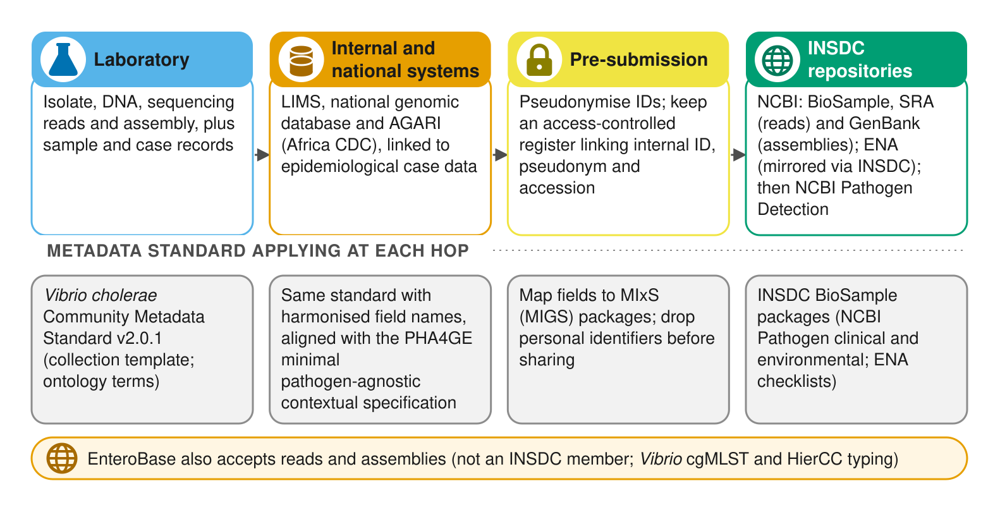  
<small><strong>Figure 31. Cholera genomic data flow and the metadata standard at each hop.</strong> Flow of cholera genomic data from isolate to public repository, with the metadata standard that applies at each step.</small>

&nbsp;

# 9 Interpretation of Genomic Data

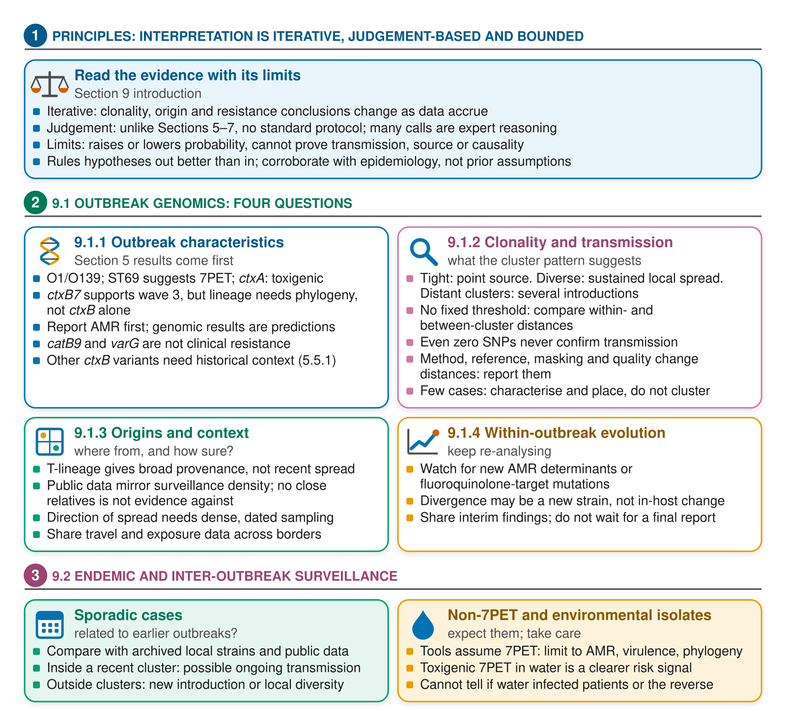  
<small><strong>Figure 32. Interpreting cholera genomic data: what the evidence can say.</strong> Principles and applications for interpreting cholera genomic data (Section 9).</small>

&nbsp;

Bioinformatic outputs, as discussed throughout Sections 5–7, must be interpreted to address epidemiological questions. This Section on interpretation follows the same structure as Section 3, which introduced the questions, addressing the outbreak investigation (Sections 3.1 and 9.1) and non-outbreak surveillance (Section 3.2 and 9.2) separately. Interpretation is not a discrete step that follows analysis; instead, it is an iterative process that evolves as the outbreak develops, as more genomes are added, and as the epidemiological picture becomes clearer. Conclusions about clonality, transmission structure, and origin may evolve, new introductions may be detected, and resistant variants may emerge. Genomic data and epidemiological metadata must be interpreted together; neither is sufficient alone. 

Unlike the bioinformatics steps described in Sections 5–7, where established tools, quality thresholds, and workflows exist, interpretation of genomic findings is not governed by standardised protocols or universal frameworks. The epidemiological questions being addressed are inherently contextual and unique, the evidence base for specific interpretive rules is limited, and the field has not yet reached consensus on many of the decisions that analysts routinely face. Whilst this section provides guidance on the principles and considerations that should inform interpretation, many of the judgments described remain matters of expert reasoning rather than established rules.

It must be noted that genomic analysis may raise or lower the probability of an epidemiological hypothesis, but it cannot prove transmission between specific individuals, confirm the source of an outbreak, or establish causality. It generally provides much stronger evidence for ruling a hypothesis out than for confirming one. Conclusions are most powerful when corroborated by independent evidence sources, particularly conventional epidemiological investigation alongside genomics, and this nuance should be communicated explicitly, particularly where genomic findings inform high-stakes decisions.

Emphasis must be placed on analysts drawing conclusions from the data in front of them rather than from prior expectation. Established interpretive paradigms concerning strain reservoirs, environmental persistence, and transmission dynamics are not always supported by genomic evidence and may not hold across all geographic and epidemiological settings. Analysts should remain alert to findings that challenge an established paradigm rather than defaulting to a conventional explanation.

## 9.1 Interpreting Outbreak Genomics

### 9.1.1 Interpreting Outbreak Characteristics

In an outbreak investigation, the first bioinformatic outputs to interpret and report are the genome characterisation results described in Section 5\. Species identity and serogroup confirmation establish whether the isolate is a *V. cholerae* O1 or O139, and MLST assignment (particularly identification of ST69) indicates likely membership of the 7PET lineage. Virulence profiling begins with *ctxA* detection, which confirms the presence of the cholera toxin gene and therefore toxigenic potential. The *ctxB* genotype carries further interpretive significance: *ctxB7* is the dominant variant among contemporary 7PET strains, and its presence supports affiliation with contemporary wave 3 pandemic lineages, though lineage assignment should rest on whole-genome phylogenetic analysis or phylogenetic placement rather than on *ctxB* genotype alone. Alternative *ctxB* variants, where encountered, require careful interpretation in their historical and epidemiological context (see Section 5.5.1).

Antimicrobial resistance characterisation (Section 5.6) should be interpreted and communicated as a priority, since the AMR profile has direct implications for treatment recommendations. Genomic AMR predictions should be shared alongside any available phenotypic susceptibility data. Interpretation must bear in mind that genomic results are predictions, and the presence of an AMR determinant does not confirm expression or clinical phenotype. Analysts should be alert to the cholera-specific interpretation pitfalls described in Section 5.6.4: the non-functional *catB9* variant and the *varG* gene are routinely detected in 7PET strains but do not confer clinically relevant resistance, and misreporting them as active determinants can cause unnecessary confusion in clinical settings and undermine confidence in genomic reporting.

### 9.1.2 Interpreting Outbreak Clonality and Transmission Structure

High-resolution comparative analysis of genome sequences can address whether isolates represent a single outbreak and, if so, what the likely pattern of transmission has been. The resulting phylogenetic or allele-distance structure carries specific implications depending on its topology: a single tight cluster is consistent with a point-source outbreak; a single cluster with accumulated mutational diversity may be consistent with divergence during sustained local transmission; and distinct clusters separated by many mutations may suggest multiple independent introduction events and a polyclonal outbreak. Where environmental samples have been collected alongside clinical isolates, high genomic similarity between environmental and clinical genomes may support the hypothesis of a shared environmental point source, and clinical clustering without a corresponding environmental signal may be more consistent with person-to-person transmission. These interpretations must always be made considering case metadata, for example, shared exposure histories, location, and timing. Interpretation of clonality should also take account of the fact that each patient is typically represented by a single sequenced colony, so co-infection with more than one strain will not be visible in the dataset (Section 4.2).

SNP distances or cgMLST allele differences are the principal approaches used to describe the genomic relatedness between strains. Interpreting these genomic distances requires careful consideration of the low mutation rate of *V. cholerae* 7PET, which accumulates approximately 3.3 SNPs per genome per year (Taylor-Brown et al., 2023, who report 3.0–3.9 SNPs per genome per year across 7PET clades). A longer time between sampling points naturally facilitates accumulation of more SNPs between ancestrally related samples than those collected at the same time, but with a low mutation rate isolates from geographically unrelated and epidemiologically independent events may be separated by very few SNPs simply because the strain has been circulating with limited evolution. Even an absence of SNPs between two isolates does not confirm transmission, and neither do small distances confirm it. 

In settings with very few cases, clustering may not be an available signal at all. Laboratories handling a handful of cholera isolates a year may never observe a cluster, and the absence of one carries little information. Where case numbers are low, genomic analysis is better framed around characterisation and placement (confirming toxigenicity and serogroup, assigning lineage, and identifying the closest publicly available relatives) than around cluster detection. A single isolate placed confidently within a known lineage and compared with contextual genomes can support a conclusion about likely origin; the same isolate assessed for clustering against a local dataset of two or three genomes cannot.

SNP distances and cgMLST allele differences are a product of the methods used to generate them as well as the biology of the isolates. Analysts should document their methods and report them alongside any distances quoted, and should interpret distances in light of these dependencies. Genomic distances and clustering must also be interpreted relative to genome quality considerations: isolates from a genuinely linked transmission chain could appear more divergent than expected due to artefactual variant calls from poor sequencing quality. Conversely, distances that are very high relative to the rest of the dataset may reflect contamination or mislabelling rather than genuine divergence (Section 6.2.1.3). Additionally, for SNP distances the choice of reference genome, whether recombination masking has been applied, and whether distances are restricted to core positions all affect the values obtained, which means distances are comparable only among genomes analysed together. Horizontally acquired regions such as CTXφ and ICE-SXT will inflate apparent distances if they are not masked. 

Rather than applying a fixed SNP threshold to define an outbreak cluster, the most reliable approach is to compare within-cluster pairwise distances against between-cluster distances for either:

* A representative set of contemporaneous strains from the same region, assessing whether the separation of the putative outbreak cluster is meaningful relative to local circulating diversity, or  
* A set of genomes with the same genomic background (e.g. same T-lineage) but from geographically (and temporally) distinct sampling to understand whether the putative cluster is in fact a representation of a broader circulating cluster.

cgMLST-based cluster definitions are often offered as a standardised reference point, though these should be verified against local data before adoption. Fixed thresholds (whether for SNPs or cgMLST) established for other pathogens or other settings should not be applied to cholera without verification. 

### 9.1.3 Interpreting Outbreak Origins and Context

Comparison of genomes of interest with (publicly available) historical and geographic isolates allows assessment of their origin, using the approaches described in Section 7.3.2. 

In Africa, each T-lineage assignment (Section 5.4.2) is central to contextualisation. Most T/AFR lineages represent distinct introductions of seventh-pandemic El Tor *V. cholerae* into Africa from South Asia, although the framework also includes onward transmission events such as T2; lineage assignment therefore establishes the broad historical and geographic provenance of circulating strains, placing local findings within a global phylogenetic context and indicating whether an outbreak represents continuation of established regional transmission or a new importation event. Detection of a lineage not previously observed locally warrants particular attention. It should be noted, however, that T lineages are defined over decades and broad geographic scales; they are not sufficiently granular to resolve recent cross-border transmission or within-outbreak spread, which requires comparative analysis of contemporaneous sequences from the settings in question. 

When assessing contemporaneous introduction events, a higher resolution analysis of the relationship between local, historical and geographically distinct genomes is needed, which may be addressed using contextual genomes from outside the location and time of interest, perhaps by querying public databases (see Sections 6.1.2 and 7.3.2). A genome that falls within an established local cluster and is closely related to historical local isolates is consistent with ongoing endemic persistence or reactivation of a previously circulating lineage. A genome that is phylogenetically distant from prior local genomes but closely related to contemporaneous genomes from another setting suggests a recent external introduction.

Care should be taken when interpreting that a closely related external genome location is the source of *V. cholerae* introduction: genome sequencing is not undertaken for all cholera cases or environmental samples, and implementation of sequencing is globally heterogeneous, so the most closely related genome in a public database may be quite distantly related in absolute terms, and epidemiological links should be confirmed independently. The absence of closely related genomes from a candidate source population in public databases should never be taken as evidence against that source since a putative source can only be identified if genomes from it are available: if closely related strains are circulating in a neighbouring country from which no genomes have been deposited, the analysis cannot detect the relationship, as the source is simply invisible to it. Settings with high sequencing density dominate public databases and will therefore tend to appear as sources of transmission even where they are not. Apparent phylogeographic signal is heavily confounded by these sampling choices, and claims about transmission sources are often, in practice, claims about where surveillance is strongest rather than where a strain originated. Analysts should state the limitations of the available comparison dataset explicitly when reporting, and avoid definitive statements about strain origins where reference data are sparse.

Epidemiological information held outside the laboratory is often the limiting factor in attributing an introduction. Travel history, exposure history and case interview data are routinely collected by epidemiological teams but are rarely exchanged between jurisdictions alongside genomic data, which laboratories consulted during development identified as a missed opportunity. Where a putative introduction crosses a border, the genomic comparison is rarely decisive on its own, and establishing in advance what epidemiological information can be shared, with whom, and in what form will do more to resolve direction of transmission than additional sequencing.

Establishing that two settings share a strain is substantially easier than determining which direction transmission flowed between them. Inferring directionality with confidence requires dense, well-dated sampling from both settings and careful phylogenetic reasoning; it is not a straightforward conclusion from genomic proximity alone. Over-interpreting directionality is a well-recognised pitfall in cholera genomics that has in some cases led to conclusions that stigmatised specific regions or populations and produced misleading claims about environmental reservoirs, particularly when analysts have reverted to prior assumptions rather than following the genomic and epidemiological evidence. Analysts should be explicit about uncertainty around source and directionality when reporting.

### 9.1.4 Interpreting Within-Outbreak Evolution

Continued monitoring during a sustained outbreak using genomics may identify evolutionary change in the circulating strain. This requires periodic sampling, sequencing and re-analysis throughout the outbreak, and the interpretive picture and conclusions may evolve as new genomes are added. For example, acquisition of new AMR determinants through horizontal gene transfer or the emergence of point mutations in fluoroquinolone target genes may signal a change in the resistance profile with direct treatment implications. Changes in virulence gene content, though less common, are also possible during sustained transmission. Apparent genomic divergence within an ongoing outbreak may also reflect the introduction of a new strain rather than in-host evolution, and distinguishing between these two explanations requires careful comparison with contextual genomes and epidemiological data. Though the genomic process is ongoing, interim findings should be communicated as they emerge, particularly any that change the clinical or epidemiological assessment, rather than withheld for a final report.

## 9.2. Interpreting Endemic and Surveillance Genomics

The most fundamental interpretive question is whether isolates detected during inter-outbreak surveillance, from sporadic cases or environmental samples, are related to strains from previous outbreaks or represent something new. This requires direct genomic comparison with archived local strains and with the broader public database.

* A sporadic case whose genome falls within a cluster of recent outbreak strains may suggest residual or ongoing transmission.  
* A genome that falls outside existing clusters may represent a distinct introduction or reflect the local diversity of *V. cholerae* that has not yet been sequenced.

It is more likely to encounter non-7PET strains (Section 3.2) in inter-outbreak surveillance. Standard typing tools, lineage frameworks, and reference databases are built around 7PET, and findings from non-7PET, particularly non-O1 and non-O139 isolates must be interpreted with explicit acknowledgement of these limitations. T-lineage assignment tools will not produce valid outputs for non-7PET strains, and reference-based SNP calling using N16961 may be uninformative for distantly related isolates. Where non-7PET strains are detected, interpretation should be restricted to what the available resources support: AMR profile, virulence gene profile, and phylogenetic analysis.

Environmental isolates, which are also less likely to be 7PET, require particular care in interpretation. Genomic characterisation confirming serogroup, MLST, *ctxA*, and T-lineage where assignable should be integrated with the location, season, and any associated case data from the outset, and these are essential to drawing conclusions about the public health significance of any environmental finding. For example, the presence of a toxigenic, 7PET-lineage *V. cholerae* in a water source is a clearer and more actionable signal of public health risk than the presence of a non-toxigenic environmental strain. Care must be taken when drawing conclusions about environmental isolates that closely resemble strains from a previous outbreak; these may represent long-term persistence of that strain in the environment, or result from ongoing low-level transmission from cases that were never detected. Genomics also cannot determine whether the water source contaminated patients or patients contaminated the water source through shedding. 

# 10. Reporting and Communication of Genomic Findings

The value and impact of genomic findings on public health action depend not only on the analysis itself, but also on how results are communicated. Effective reporting should be tailored to the unique analyses and epidemiology being communicated, but also to the needs and interests of the audience and their understanding of genomics. Even the same findings may need to be framed very differently for a clinical team who are interested in the implications for patient management, relative to an epidemiological team leading outbreak investigation, or a national authority making policy decisions. Reporting practice in cholera genomics is evolving and standardised frameworks are an area of active development within the community.  
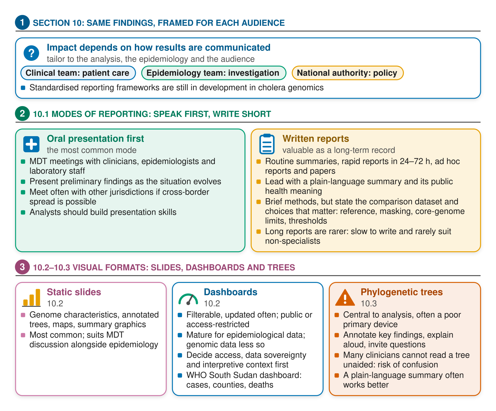  
<small><strong>Figure 33. Reporting genomic findings clearly and honestly.</strong> Reporting genomic findings in cholera (Section 10).</small>

&nbsp;

### 10.1. Modes of Reporting

From consultation with practitioners across cholera genomics settings, often the primary mode of reporting is through oral presentations and discussions, particularly where there is an urgent need for communication. This is typically within multidisciplinary team (MDT) meetings that may involve clinicians, epidemiologists, and laboratory staff. In scenarios where cross-border transmission is a possibility, it is also valuable to hold frequent meetings with stakeholders across jurisdictions. Meetings may involve presentation of preliminary or evolving findings, particularly during ongoing public health situations. This oral presentation mode reflects the pace of outbreak response, the value of interactive discussion for complex findings, and the need for iterative data analysis aligned with evolving priorities. Genomic analysts should plan to communicate findings verbally in the first instance and should develop the presentation skills to do so effectively.

Laboratories consulted during development reported producing routine surveillance summaries, rapid outbreak reports within 24–72 hours of a finding, ad hoc investigation reports, and peer-reviewed publications, with ministries of health and national epidemiology teams the most common audiences. Longer formal reports are produced less often, given the time required to develop them and since they rarely serve non-specialist audiences without considerable additional interpretation work. Written reports are valuable for long-term records, including as evidence of the value of genomics. Where written reports are produced, they should lead with a plain-language summary of findings and their public health implications before presenting analytical detail. Methods sections should be sufficient for reproducibility but should not dominate a document intended for operational use.  Reports should also state the composition and limitations of the comparison dataset, and the methodological choices on which the findings depend such as reference genome, recombination masking, core-genome restriction, and any cluster thresholds applied.

### 10.2. Visual Reporting Formats and Dashboards

Formal presentations typically deliver genomic findings as slides containing static figures quantifying genome characteristics, annotated phylogenetic trees, maps of case distribution, or summary graphics of outbreak structure. These remain the most common visual format for communicating genomic results in clinical and public health settings and are well suited to structured MDT meetings where findings are being actively discussed and interpreted alongside epidemiological data.

Interactive dashboards that display data dynamically, often allowing users to filter, explore, and update views, and may be updated frequently or in near-real time, are increasingly being used alongside or in place of static reporting, particularly for ongoing surveillance. Dashboards may be publicly accessible, supporting transparency and open science, or access-restricted for use within a programme, institution, or response team. For cholera, dashboarding is currently more established for non-genomic epidemiological data, such as this public example from South Sudan ([source website](https://worldhealthorg.shinyapps.io/cholera_dashboard/)): case counts, geographic distribution of outbreaks, and mortality and treatment outcomes. The integration of genomic data into cholera surveillance dashboards may cover genome characterisation, outbreak cluster assignment, T-lineage designation, and phylogenetic context; this is less mature but the need for it is increasingly recognised. Programmes designing or adopting dashboard tools should consider carefully whether data will be publicly accessible or access-restricted, the implications for data sovereignty, and how to ensure genomic findings are presented with sufficient interpretive context to avoid misuse or misinterpretation by audiences not directly involved in the analysis.

### 10.3. Presenting Phylogenetic Trees

Phylogenetic trees deserve special mention given their central role in genomic analysis. They are a powerful analytical tool, but in our community consultations, it was consistently reported that they are often a poor primary communication device for most audiences. Many clinicians and public health practitioners are unable to read a standard phylogenetic tree without significant guidance, and presenting one without substantial contextualisation risks confusion or misplaced confidence. Where trees are shown in presentations, they should be clearly annotated with key findings highlighted, accompanied by verbal explanation of what the structure means, and ample opportunity for the audience to ask questions. In many settings, a plain-language summary of which isolates are closely related and what this implies was considered more effective for communicating findings than a tree.

# 11. Capacity Building and Training Resources

The primary community resource for cholera genomics practitioners is the Cholera Genomics Community of Practice (linkedin.com/groups/11805196/), a forum connecting public health laboratories, researchers, and capacity-building organisations involved in *V. cholerae* genomic surveillance globally. The community is undertaking a mapping initiative of *V. cholerae* genomics resources, including protocols, tools, datasets, and experience, and is the recommended first point of contact for laboratories implementing or expanding cholera genomics capacity. 

General genomics and bioinformatics training is valuable for understanding *V. cholerae* genomics and has recently been mapped by the PHA4GE Training and Workforce Development Working Group (Matimba et al., 2026\).

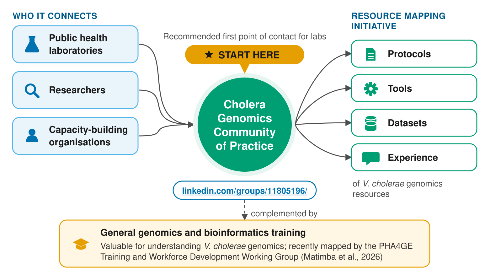  
<small><strong>Figure 34. Capacity building and training resources for cholera genomics.</strong> Where laboratories implementing or expanding *V. cholerae* genomic surveillance can start.</small>

&nbsp;

# 12. References and Citations

Achtman M, Zhou Z, Charlesworth J, Baxter L. EnteroBase: hierarchical clustering of 100,000s of bacterial genomes into species/subspecies and populations. Philosophical Transactions of the Royal Society B. 2022;377:20210240. doi:10.1098/rstb.2021.0240    
Africa Centres for Disease Control and Prevention. Africa CDC launches AGARI, a continent-wide genomic data platform to strengthen outbreak response. Press release, 21 November 2025\. [Website](https://africacdc.org/news-item/africa-cdc-launches-agari-a-continent-wide-genomic-data-platform-to-strengthen-outbreak-response/)    
Alcock BP, Huynh W, Chalil R, et al. CARD 2023: expanded curation, support for machine learning, and resistome prediction at the Comprehensive Antibiotic Resistance Database. Nucleic Acids Research. 2023;51(D1):D690–D699. doi:10.1093/nar/gkac920    
QualiBact: Species-specific quality control of bacterial de novo genome assemblies. [QualiBact website](https://qualibact.org).    
Alikhan N-F. Speccheck: species-criteria-based genome quality control. [Website](https://github.com/happykhan/speccheck) \[software; no associated publication\]    
Ali M, Nelson AR, Lopez AL, Sack DA. Updated global burden of cholera in endemic countries. PLoS Neglected Tropical Diseases. 2015;9(6):e0003832. doi:10.1371/journal.pntd.0003832  
Andrews S. FastQC: a quality control tool for high throughput sequence data. Babraham Bioinformatics. [Website](https://www.bioinformatics.babraham.ac.uk/projects/fastqc/) \[software; no associated publication\]    
Argimón S, Abudahab K, Goater RJE, et al. Microreact: visualizing and sharing data for genomic epidemiology and phylogeography. Microbial Genomics. 2016;2(11):e000093. doi:10.1099/mgen.0.000093    
Argimón S, David S, Underwood A, et al. Rapid genomic characterization and global surveillance of Klebsiella using Pathogenwatch. Clinical Infectious Diseases. 2021;73(Suppl 4):S325–S335. doi:10.1093/cid/ciab784    
Aydanian A, Tang L, Morris JG, Johnson JA, Stine OC. Genetic diversity of O-antigen biosynthesis regions in *Vibrio cholerae.* Applied and Environmental Microbiology. 2011;77(7):2247–2253. doi:10.1128/AEM.01663-10    
Bankevich A, Nurk S, Antipov D, et al. SPAdes: a new genome assembly algorithm and its applications to single-cell sequencing. Journal of Computational Biology. 2012;19(5):455–477. doi:10.1089/cmb.2012.0021    
Bolger AM, Lohse M, Usadel B. Trimmomatic: a flexible trimmer for Illumina sequence data. Bioinformatics. 2014;30(15):2114–2120. doi:10.1093/bioinformatics/btu170    
Bouras G, Houtak G, Wick RR, et al. Hybracter: enabling scalable, automated, complete and accurate bacterial genome assemblies. Microbial Genomics. 2024;10(5):001244. doi:10.1099/mgen.0.001244    
Camacho C, Coulouris G, Avagyan V, Ma N, Papadopoulos J, Bealer K, Madden TL. BLAST+: architecture and applications. BMC Bioinformatics. 2009;10:421. doi:10.1186/1471-2105-10-421    
Carattoli A, Zankari E, García-Fernández A, et al. In silico detection and typing of plasmids using PlasmidFinder and plasmid multilocus sequence typing. Antimicrobial Agents and Chemotherapy. 2014;58(7):3895–3903. doi:10.1128/AAC.02412-14    
Centers for Disease Control and Prevention. Laboratory methods for the diagnosis of epidemic dysentery and cholera, Chapter 2: Isolation and identification of Vibrio cholerae. Atlanta: CDC. [Website](https://www.cdc.gov/cholera/media/pdfs/2024/07/Chapter-2-Laboratory-methods-for-the-diagnosis-of-epidemic-dysentery-and-cholera_ENG-2.pdf)    
Centers for Disease Control and Prevention. Laboratory methods for the diagnosis of epidemic dysentery and cholera, Chapter 6: Antimicrobial susceptibility testing. Atlanta: CDC. [Website](https://www.cdc.gov/cholera/media/pdfs/2024/07/Chapter-6-Laboratory-methods-for-the-diagnosis-of-epidemic-dysentery-and-cholera_ENG-6.pdf)    
Centre for Genomic Pathogen Surveillance. Pathogenwatch documentation: core assignment and tree construction. [Website](https://cgps.gitbook.io/pathogenwatch/)    
Centre for Genomic Pathogen Surveillance. AMRsearch (formerly PAARSNP): the Pathogenwatch AMR genotyping and phenotype inference tool. [Website](https://github.com/pathogenwatch-oss/amr-search) \[software; no associated publication\]    
Chaguza C, Chibwe I, Chaima D, et al. Genomic insights into the 2022–2023 Vibrio cholerae outbreak in Malawi. Nature Communications. 2024;15:6291. doi:10.1038/s41467-024-50484-w    
Cheng L, Connor TR, Sirén J, Aanensen DM, Corander J. Hierarchical and spatially explicit clustering of DNA sequences with BAPS software. Molecular Biology and Evolution. 2013;30(5):1224–1228. doi:10.1093/molbev/mst028    
Chen S, Zhou Y, Chen Y, Gu J. fastp: an ultra-fast all-in-one FASTQ preprocessor. Bioinformatics. 2018;34(17):i884–i890. doi:10.1093/bioinformatics/bty560    
Chin C-S, Sorenson J, Harris JB, et al. The origin of the Haitian cholera outbreak strain. New England Journal of Medicine. 2011;364(1):33–42. doi:10.1056/NEJMoa1012928    
Chklovski A, Parks DH, Woodcroft BJ, Tyson GW. CheckM2: a rapid, scalable and accurate tool for assessing microbial genome quality using machine learning. Nature Methods. 2023;20(8):1203–1212. doi:10.1038/s41592-023-01940-w    
CholGen. bacpage: Snakemake pipeline for analysis of pathogen genomes. [Website](https://github.com/CholGen/bacpage) \[software; no associated publication\]    
Chowdhury F, Ross AG, Islam MT, McMillan NAJ, Qadri F. Diagnosis, management, and future control of cholera. Clinical Microbiology Reviews. 2022;35(3):e00211-21. doi:10.1128/cmr.00211-21    
Chun J, Grim CJ, Hasan NA, et al. Comparative genomics reveals mechanism for short-term and long-term clonal transitions in pandemic Vibrio cholerae. Proceedings of the National Academy of Sciences USA. 2009;106(36):15442–15447. doi:10.1073/pnas.0907787106  
Coghlan A. Geno7PET: a tool for classifying Vibrio cholerae genome assembly genotypes. [Website](https://github.com/avrilcoghlan/geno7PET) \[software; no associated publication\]    
Colwell RR, Brayton P, Herrington D, Tall B, Huq A, Levine MM. Viable but non-culturable Vibrio cholerae O1 revert to a cultivable state in the human intestine. World Journal of Microbiology and Biotechnology. 1996;12(1):28–31. doi:10.1007/BF00327795    
Croucher NJ, Page AJ, Connor TR, et al. Rapid phylogenetic analysis of large samples of recombinant bacterial whole genome sequences using Gubbins. Nucleic Acids Research. 2015;43(3):e15. doi:10.1093/nar/gku1196    
Danecek P, Bonfield JK, Liddle J, Marshall J, Ohan V, Pollard MO, Whitwham A, Keane T, McCarthy SA, Davies RM, Li H. Twelve years of SAMtools and BCFtools. GigaScience. 2021;10(2):giab008. doi:10.1093/gigascience/giab008    
Das B, Verma J, Kumar P, Ghosh A, Ramamurthy T. Antibiotic resistance in Vibrio cholerae: understanding the ecology of resistance genes and mechanisms. Vaccine. 2020;38(Suppl 1):A83–A92. doi:10.1016/j.vaccine.2019.06.031    
De Coster W, Rademakers R. NanoPack2: population-scale evaluation of long-read sequencing data. Bioinformatics. 2023;39(5):btad311. doi:10.1093/bioinformatics/btad311    
De R. Mobile genetic elements of Vibrio cholerae and the evolution of its antimicrobial resistance. Frontiers in Tropical Diseases. 2021;2:691604. doi:10.3389/fitd.2021.691604    
Devault AM, Golding GB, Waglechner N, et al. Second-pandemic strain of Vibrio cholerae from the Philadelphia cholera outbreak of 1849. New England Journal of Medicine. 2014;370(4):334–340. doi:10.1056/NEJMoa1308663  
Didelot X, Maiden MCJ. Impact of recombination on bacterial evolution. Trends in Microbiology. 2010;18(7):315–322. doi:10.1016/j.tim.2010.04.002    
Di Tommaso P, Chatzou M, Floden EW, Prieto Barja P, Palumbo E, Notredame C. Nextflow enables reproducible computational workflows. Nature Biotechnology. 2017;35(4):316–319. doi:10.1038/nbt.3820    
Ewels P, Magnusson M, Lundin S, Käller M. MultiQC: summarize analysis results for multiple tools and samples in a single report. Bioinformatics. 2016;32(19):3047–3048. doi:10.1093/bioinformatics/btw354    
Fan Y, Li Z, Li Z, Li X, Sun H, Li J, Lu X, Liang W, Kan B. Nonhemolysis of epidemic El Tor biotype strains of Vibrio cholerae is related to multiple functional deficiencies of hemolysin A. Gut Pathogens. 2019;11:38. doi:10.1186/s13099-019-0316-7    
Feldgarden M, Brover V, Gonzalez-Escalona N, et al. AMRFinderPlus and the Reference Gene Catalog facilitate examination of the genomic links among antimicrobial resistance, stress response, and virulence. Scientific Reports. 2021;11:12728. doi:10.1038/s41598-021-91456-0    
Feldgarden M, Brover V, Haft DH, et al. Validating the AMRFinder tool and resistance gene database by using antimicrobial resistance genotype-phenotype correlations in a collection of isolates. Antimicrobial Agents and Chemotherapy. 2019;63(11):e00483-19. doi:10.1128/AAC.00483-19    
Field D, Garrity G, Gray T, et al. The minimum information about a genome sequence (MIGS) specification. Nature Biotechnology. 2008;26(5):541–547. doi:10.1038/nbt1360    
Foster-Nyarko E, Able-Thomas S, Adade NE, et al. Genomic diversity and antimicrobial resistance of Vibrio cholerae isolates from Africa: a PulseNet Africa initiative using nanopore sequencing to enhance genomic surveillance. Microbial Genomics. 2025;11(12):001586. doi:10.1099/mgen.0.001586    
Fuesslin V, Krautwurst S, Srivastava A, et al. Prediction of antibiotic susceptibility profiles of Vibrio cholerae isolates from whole genome Illumina and nanopore sequencing data: CholerAegon. Frontiers in Microbiology. 2022;13:909692. doi:10.3389/fmicb.2022.909692    
Ghosh-Banerjee J, Senoh M, Takahashi T, et al. Cholera toxin production by the El Tor variant of Vibrio cholerae O1 compared to prototype El Tor and classical biotypes. Journal of Clinical Microbiology. 2010;48(11):4283–4286. doi:10.1128/JCM.00799-10    
Global Task Force on Cholera Control. Interim technical note: use of antibiotics for the treatment and control of cholera. Rev. October 2022\. Geneva: GTFCC.    
Global Task Force on Cholera Control. Job aid: antimicrobial susceptibility testing for treatment and control of cholera. V3.0, May 2024\. Geneva: GTFCC.    
Global Task Force on Cholera Control. Public health surveillance for cholera: guidance document 2024\. Geneva: GTFCC; 2024\.    
Global Task Force on Cholera Control. Specimen collection, preparation and packaging for transport. Geneva: GTFCC. [Website](https://www.gtfcc.org/resources/specimen-collection-preparation-and-packaging-for-transport)    
Global Task Force on Cholera Control. Isolation and presumptive identification of Vibrio cholerae O1/O139 from faecal specimens: job aid and fact sheet. Geneva: GTFCC. [Website](https://www.gtfcc.org/resources/isolation-and-presumptive-identification-of-vibrio-cholerae-o1-o139-from-fecal-specimens/)    
Global Task Force on Cholera Control. Environmental surveillance for cholera control: technical guidance. Geneva: GTFCC. [Website](https://www.gtfcc.org/resources/environmental-surveillance-for-cholera-control/)    
Global Task Force on Cholera Control, Surveillance–Laboratory Working Group. Interim technical note: introduction of DNA-based identification and typing methods to public health practitioners for epidemiological investigation of cholera outbreaks. Geneva: GTFCC; June 2017\.    
GO FAIR. The FAIR Guiding Principles. [Website](https://www.go-fair.org/fair-principles/)    
Griffiths EJ, Timme RE, Mendes CI, et al. Future-proofing and maximizing the utility of metadata: the PHA4GE SARS-CoV-2 contextual data specification package. GigaScience. 2022;11:giac003. doi:10.1093/gigascience/giac003    
Gurevich A, Saveliev V, Vyahhi N, Tesler G. QUAST: quality assessment tool for genome assemblies. Bioinformatics. 2013;29(8):1072–1075. doi:10.1093/bioinformatics/btt086    
Hadfield J, Croucher NJ, Goater RJ, Abudahab K, Aanensen DM, Harris SR. Phandango: an interactive viewer for bacterial population genomics. Bioinformatics. 2018;34(2):292–293. doi:10.1093/bioinformatics/btx610    
Hall MB. Rasusa: randomly subsample sequencing reads to a specified coverage. Journal of Open Source Software. 2022;7(69):3941. doi:10.21105/joss.03941    
Hall MB, Wick RR, Judd LM, et al. Benchmarking reveals superiority of deep learning variant callers on bacterial nanopore sequence data. eLife. 2024;13:RP98300. doi:10.7554/eLife.98300    
Heidelberg JF, Eisen JA, Nelson WC, et al. DNA sequence of both chromosomes of the cholera pathogen Vibrio cholerae. Nature. 2000;406(6795):477–483. doi:10.1038/35020000    
Hoang DT, Chernomor O, von Haeseler A, Minh BQ, Vinh LS. UFBoot2: improving the ultrafast bootstrap approximation. Molecular Biology and Evolution. 2018;35(2):518–522. doi:10.1093/molbev/msx281    
Hu D, Liu B, Feng L, et al. Origins of the current seventh cholera pandemic. Proceedings of the National Academy of Sciences. 2016;113(48):E7730–E7739. doi:10.1073/pnas.1608732113    
Illumina. Illumina DNA Prep reference guide. Document 1000000025416 v12. Illumina Inc.; April 2026\.    
Inouye M, Dashnow H, Raven L-A, et al. SRST2: rapid genomic surveillance for public health and hospital microbiology labs. Genome Medicine. 2014;6(11):90. doi:10.1186/s13073-014-0090-6    
Jain C, Rodriguez-R LM, Phillippy AM, Konstantinidis KT, Aluru S. High throughput ANI analysis of 90K prokaryotic genomes reveals clear species boundaries. Nature Communications. 2018;9:5114. doi:10.1038/s41467-018-07641-9    
Jolley KA, Bray JE, Maiden MCJ. Open-access bacterial population genomics: BIGSdb software, the PubMLST.org website and their applications. Wellcome Open Research. 2018;3:124. doi:10.12688/wellcomeopenres.14826.1    
Kalyaanamoorthy S, Minh BQ, Wong TKF, von Haeseler A, Jermiin LS. ModelFinder: fast model selection for accurate phylogenetic estimates. Nature Methods. 2017;14:587–589. doi:10.1038/nmeth.4285    
Kanampalliwar A, Singh DV. Virulence pattern and genomic diversity of Vibrio cholerae O1 and O139 strains isolated from clinical and environmental sources in India. Frontiers in Microbiology. 2020;11:1838. doi:10.3389/fmicb.2020.01838    
Kaper JB, Morris JG Jr, Levine MM. Cholera. Clinical Microbiology Reviews. 1995;8(1):48–86. doi:10.1128/cmr.8.1.48    
Karaolis DKR, Johnson JA, Bailey CC, Boedeker EC, Kaper JB, Reeves PR. A Vibrio cholerae pathogenicity island associated with epidemic and pandemic strains. Proceedings of the National Academy of Sciences. 1998;95(6):3134–3139. doi:10.1073/pnas.95.6.3134    
Kim J, Steinegger M. Metabuli: sensitive and specific metagenomic classification via joint analysis of amino acid and DNA. Nature Methods. 2024;21:971–973. doi:10.1038/s41592-024-02273-y    
Kodama Y, Shumway M, Leinonen R. The sequence read archive: explosive growth of sequencing data. Nucleic Acids Research. 2012;40(D1):D54–D56. doi:10.1093/nar/gkr854    
Kolmogorov M, Yuan J, Lin Y, Pevzner PA. Assembly of long, error-prone reads using repeat graphs. Nature Biotechnology. 2019;37:540–546. doi:10.1038/s41587-019-0072-8    
Kumar N, Das B, Kumar A. Vibrio pathogenicity island-1: the master determinant of cholera pathogenesis. Frontiers in Cellular and Infection Microbiology. 2020;10:561296. doi:10.3389/fcimb.2020.561296    
Lassalle F, Al-Shalali S, Al-Hakimi M, et al. Genomic epidemiology reveals multidrug resistant plasmid spread between Vibrio cholerae lineages in Yemen. Nature Microbiology. 2023;8(10):1787–1798. doi:10.1038/s41564-023-01472-1    
Lee I, Ha S-M, Baek M-G, Kim DW, Yi H, Chun J. VicPred: a Vibrio cholerae genotype prediction tool. Frontiers in Microbiology. 2021;12:691895. doi:10.3389/fmicb.2021.691895    
Lees JA, Harris SR, Tonkin-Hill G, Gladstone RA, Lo SW, Weiser JN, Corander J, Bentley SD, Croucher NJ. Fast and flexible bacterial genomic epidemiology with PopPUNK. Genome Research. 2019;29(2):304–316. doi:10.1101/gr.241455.118    
Leibovici-Weissman Y, Neuberger A, Bitterman R, Sinclair D, Salam MA, Paul M. Antimicrobial drugs for treating cholera. Cochrane Database of Systematic Reviews. 2014;2014(6):CD008625. doi:10.1002/14651858.CD008625.pub2    
Leinonen R, Akhtar R, Birney E, et al. The European Nucleotide Archive. Nucleic Acids Research. 2011;39(Database issue):D28–D31. doi:10.1093/nar/gkq967    
Liang KYH, Orata FD, Islam MT, Nasreen T, Alam M, Tarr CL, Boucher YF. A Vibrio cholerae core genome multilocus sequence typing scheme to facilitate the epidemiological study of cholera. Journal of Bacteriology. 2020;202(24):e00086-20. doi:10.1128/JB.00086-20    
Libuit KG, Doughty EL, Otieno JR, et al. Accelerating bioinformatics implementation in public health. Microbial Genomics. 2023;9(7):001051. doi:10.1099/mgen.0.001051    
Li D, Liu C-M, Luo R, Sadakane K, Lam T-W. MEGAHIT: an ultra-fast single-node solution for large and complex metagenomics assembly via succinct de Bruijn graph. Bioinformatics. 2015;31(10):1674–1676. doi:10.1093/bioinformatics/btv033    
Li H, Durbin R. Fast and accurate short read alignment with Burrows–Wheeler transform. Bioinformatics. 2009;25(14):1754–1760. doi:10.1093/bioinformatics/btp324    
Li M, Shimada T, Morris JG Jr, Sulakvelidze A, Sozhamannan S. Evidence for the emergence of non-O1 and non-O139 Vibrio cholerae strains with pathogenic potential by exchange of O-antigen biosynthesis regions. Infection and Immunity. 2002;70(5):2441–2453. doi:10.1128/IAI.70.5.2441-2453.2002    
Lin H-TV, Massam-Wu T, Lin C-P, et al. The Vibrio cholerae var regulon encodes a metallo-β-lactamase and an antibiotic efflux pump, which are regulated by VarR, a LysR-type transcription factor. PLoS One. 2017;12(9):e0184255. doi:10.1371/journal.pone.0184255    
Liu M, Li X, Xie Y, et al. ICEberg 2.0: an updated database of bacterial integrative and conjugative elements. Nucleic Acids Research. 2019;47:D660–D665. doi:10.1093/nar/gky1123    
Lumpe J, Gumbleton L, Gorzalski A, et al. GAMBIT (Genomic Approximation Method for Bacterial Identification and Tracking): a methodology to rapidly leverage whole genome sequencing of bacterial isolates for clinical identification. PLOS ONE. 2023;18(2):e0277575. doi:10.1371/journal.pone.0277575    
Magoč T, Salzberg SL. FLASH: fast length adjustment of short reads to improve genome assemblies. Bioinformatics. 2011;27(21):2957–2963. doi:10.1093/bioinformatics/btr507    
Maiden MCJ, van Rensburg MJ, Bray JE, et al. MLST revisited: the gene-by-gene approach to bacterial genomics. Nature Reviews Microbiology. 2013;11(10):728–736. doi:10.1038/nrmicro3093    
Mashe T, Domman D, Tarupiwa A, et al. Highly resistant cholera outbreak strain in Zimbabwe. New England Journal of Medicine. 2020;383(7):687–689. doi:10.1056/NEJMc2004773    
Matimba A, Garson KL, Trovão NS, et al. Mapping pathogen genomics training provision: a structured analysis within a global consortium network. Frontiers in Public Health. 2026;14:1768827. doi:10.3389/fpubh.2026.1768827    
Matteson NL, et al.; CholGen consortium. Vibecheck: assign O1 Vibrio cholerae genomes to canonical lineages using phylogenetic placement. [Website](https://github.com/CholGen/Vibecheck) \[software; archived workflow doi:10.5281/zenodo.22939538\]    
Mboowa G, Matteson NL, Tanui CK, et al.; CholGEN Consortium. Multicountry genomic analysis underscores regional cholera spread in Africa. Nature Communications. 2026;17:2539. doi:10.1038/s41467-026-68642-7    
Minh BQ, Schmidt HA, Chernomor O, et al. IQ-TREE 2: new models and efficient methods for phylogenetic inference in the genomic era. Molecular Biology and Evolution. 2020;37(5):1530–1534. doi:10.1093/molbev/msaa015    
Mölder F, Jablonski KP, Letcher B, et al. Sustainable data analysis with Snakemake. F1000Research. 2021;10:33. doi:10.12688/f1000research.29032.2    
Murase K, Arakawa E, Izumiya H, Iguchi A, Takemura T, Kikuchi T, Nakagawa I, Thomson NR, Ohnishi M, Morita M. Genomic dissection of the Vibrio cholerae O-serogroup global reference strains: reassessing our view of diversity and plasticity between two chromosomes. Microbial Genomics. 2022;8(8):000860. doi:10.1099/mgen.0.000860    
Mutreja A, Kim DW, Thomson NR, et al. Evidence for several waves of global transmission in the seventh cholera pandemic. Nature. 2011;477(7365):462–465. doi:10.1038/nature10392    
Naha A, Mandal RS, Samanta P, et al. Deciphering the possible role of ctxB7 allele on higher production of cholera toxin by Haitian variant Vibrio cholerae O1. PLoS Neglected Tropical Diseases. 2020;14(4):e0008128. doi:10.1371/journal.pntd.0008128    
Nair S, Barker CR, Patel V, et al. Highly drug-resistant Vibrio cholerae harbouring blaPER-7 isolated from travellers returning to England. Journal of Antimicrobial Chemotherapy. 2025;80(9):2428–2432. doi:10.1093/jac/dkaf232    
National Center for Biotechnology Information. AMRFinderPlus wiki: running AMRFinderPlus and curated organisms. [Website](https://github.com/ncbi/amr/wiki)    
National Center for Biotechnology Information. BioSample submission templates. Bethesda: NCBI. [Website](https://submit.ncbi.nlm.nih.gov/biosample/template/)    
National Center for Biotechnology Information. Pathogen Detection Isolates Browser. Bethesda: NCBI. [Website](https://www.ncbi.nlm.nih.gov/pathogens/isolates/)    
Nayfach S, Rodriguez-Mueller B, Garud N, Pollard KS. An integrated metagenomics pipeline for strain profiling reveals novel patterns of bacterial transmission and biogeography. Genome Research. 2016;26(11):1612–1625. doi:10.1101/gr.201863.115    
Neuenschwander S, Borcard L, Gempeler S, Terrazos Miani MA, Casanova C, Ramette A. Evaluation of Oxford Nanopore Technologies workflows for genomic epidemiology of outbreak-associated bacterial isolates in the clinical setting. Microbial Genomics. 2026;12(2):001626. doi:10.1099/mgen.0.001626    
Ng'ombe H, Luchen CC, Bote L, et al. Genomic analysis and antimicrobial resistance of Vibrio cholerae isolated during Zambia's 2023 cholera epidemic. Microbial Genomics. 2025;11(12):001566. doi:10.1099/mgen.0.001566    
Nguyen L-T, Schmidt HA, von Haeseler A, Minh BQ. IQ-TREE: a fast and effective stochastic algorithm for estimating maximum-likelihood phylogenies. Molecular Biology and Evolution. 2015;32(1):268–274. doi:10.1093/molbev/msu300    
Octavia S, Salim A, Kurniawan J, et al. Population structure and evolution of non-O1/non-O139 Vibrio cholerae by multilocus sequence typing. PLOS ONE. 2013;8(6):e65342. doi:10.1371/journal.pone.0065342    
Okonechnikov K, Conesa A, García-Alcalde F. Qualimap 2: advanced multi-sample quality control for high-throughput sequencing data. Bioinformatics. 2016;32(2):292–294. doi:10.1093/bioinformatics/btv566    
O'Leary NA, Wright MW, Brister JR, et al. Reference sequence (RefSeq) database at NCBI: current status, taxonomic expansion, and functional annotation. Nucleic Acids Research. 2016;44(D1):D733–D745. doi:10.1093/nar/gkv1189    
Olowo-okere A, Yahaya M, Yacouba A, Jibril A, Atata RF, Olayinka BO. Genomic epidemiology of 3,076 Vibrio cholerae isolates reveals ST69 clonal expansion and multidrug resistance across Africa. Research Square; posted 11 May 2026\. doi:10.21203/rs.3.rs-9358362/v1 \[preprint; not peer-reviewed\]    
OpenWDL. Specification for the Workflow Description Language (WDL). [Website](https://github.com/openwdl/wdl)    
Oxford Nanopore Technologies. Input DNA/RNA QC. [Website](https://nanoporetech.com/document/input-dna-rna-qc)    
Oxford Nanopore Technologies. Rapid sequencing gDNA barcoding (SQK-RBK114). [Website](https://nanoporetech.com/document/rapid-sequencing-gdna-barcoding-sqk-rbk114)    
Page AJ, Taylor B, Delaney AJ, et al. SNP-sites: rapid efficient extraction of SNPs from multi-FASTA alignments. Microbial Genomics. 2016;2(4):e000056. doi:10.1099/mgen.0.000056    
Paisie TK, Cash MN, Tagliamonte MS, Ali A, Morris JG Jr, Salemi M, Mavian C. Molecular basis of the toxigenic Vibrio cholerae O1 serotype switch from Ogawa to Inaba in Haiti. Microbiology Spectrum. 2023;11(1):e03624-22. doi:10.1128/spectrum.03624-22    
Petit III RA. dragonflye: assemble bacterial isolate genomes from Nanopore reads. [Website](https://github.com/rpetit3/dragonflye) \[software; no associated publication\]    
Petit RA III. fastq-scan: output FASTQ summary statistics in JSON format. [Website](https://github.com/rpetit3/fastq-scan) \[software; no associated publication\]    
PHA4GE. Minimal pathogen agnostic contextual data specification. [Website](https://github.com/pha4ge/minimal-pathogen-agnostic-contextual-data-specification)    
PHA4GE and CholGen. Vibrio cholerae community metadata standard, v2.0.1. [Website](https://github.com/pha4ge/Vibrio-Cholera-Community-Metadata-Standard)    
Pierce NT, Irber L, Reiter T, Brooks P, Brown CT. Large-scale sequence comparisons with sourmash. F1000Research. 2019;8:1006. doi:10.12688/f1000research.19675.1    
Pragasam AK, Basak C, Rajwanshi M, et al. A decade of antimicrobial resistance in Vibrio spp.: genomic and functional insights. Microbiology Spectrum. 2026;14(5):e02162-25. doi:10.1128/spectrum.02162-25    
Rader AE, Murphy JR. Nucleotide sequences and comparison of the hemolysin determinants of Vibrio cholerae El Tor RV79(Hly+) and RV79(Hly−) and classical 569B(Hly−). Infection and Immunity. 1988;56(6):1414–1419. doi:10.1128/IAI.56.6.1414-1419.1988    
Ramamurthy T, Mutreja A, Weill F-X, Das B, Ghosh A, Nair GB. Revisiting the global epidemiology of cholera in conjunction with the genomics of Vibrio cholerae. Frontiers in Public Health. 2019;7:203. doi:10.3389/fpubh.2019.00203    
Robertson J, Nash JHE. MOB-suite: software tools for clustering, reconstruction and typing of plasmids from draft assemblies. Microbial Genomics. 2018;4(8):e000206. doi:10.1099/mgen.0.000206    
Rouard C, Collet L, Njamkepo E, et al. Long-distance spread of a highly drug-resistant epidemic cholera strain. New England Journal of Medicine. 2024;391:2271–2273. doi:10.1056/NEJMc2408761    
Sanderson ND, Kapel N, Rodger G, et al. Comparison of R9.4.1/Kit10 and R10/Kit12 Oxford Nanopore flowcells and chemistries in bacterial genome reconstruction. Microbial Genomics. 2023;9(1):000910. doi:10.1099/mgen.0.000910    
Satchell KJF, Jones CJ, Wong J, Queen J, Agarwal S, Yildiz FH. Phenotypic analysis reveals that the 2010 Haiti cholera epidemic is linked to a hypervirulent strain. Infection and Immunity. 2016;84(9):e00189-16. doi:10.1128/IAI.00189-16    
Sebastian PJ, Schlesener C, Byrne BA, et al. Antimicrobial resistance of Vibrio spp. from the coastal California system: discordance between genotypic and phenotypic patterns. Applied and Environmental Microbiology. 2025;91(3):e01808-24. doi:10.1128/aem.01808-24    
Seemann T. Prokka: rapid prokaryotic genome annotation. Bioinformatics. 2014;30(14):2068–2069. doi:10.1093/bioinformatics/btu153    
Seemann T. Shovill: assemble bacterial isolate genomes from Illumina paired-end reads. [Website](https://github.com/tseemann/shovill) \[software; no associated publication\]    
Seemann T. mlst: scan contig files against PubMLST typing schemes. [Website](https://github.com/tseemann/mlst) \[software; no associated publication\]    
Seemann T. Snippy: rapid haploid variant calling and core genome alignment. [Website](https://github.com/tseemann/snippy) \[software; no associated publication\]    
Seemann T. snp-dists: convert a FASTA alignment to SNP distance matrix. [Website](https://github.com/tseemann/snp-dists) \[software; no associated publication\]    
Seemann T. Abricate: mass screening of contigs for antimicrobial resistance or virulence genes. [Website](https://github.com/tseemann/abricate) \[software; no associated publication\]    
Shah MM, Odoyo E, Ichinose Y, et al. Antibiotic-resistant Vibrio cholerae O1 and its SXT elements associated with two cholera epidemics in Kenya in 2007 to 2010 and 2015 to 2016\. Microbiology Spectrum. 2023;11(3):e04140-22. doi:10.1128/spectrum.04140-22    
Silva M, Machado MP, Silva DN, et al. chewBBACA: a complete suite for gene-by-gene schema creation and strain identification. Microbial Genomics. 2018;4(3):e000166. doi:10.1099/mgen.0.000166    
Simão FA, Waterhouse RM, Ioannidis P, Kriventseva EV, Zdobnov EM. BUSCO: assessing genome assembly and annotation completeness with single-copy orthologs. Bioinformatics. 2015;31(19):3210–3212. doi:10.1093/bioinformatics/btv351    
Sjölund-Karlsson M, Reimer A, Folster JP, Walker M, Dahourou GA, Batra DG, Martin I, Joyce K, Parsons MB, Boncy J, Whichard JM, Gilmour MW. Drug-resistance mechanisms in Vibrio cholerae O1 outbreak strain, Haiti, 2010\. Emerging Infectious Diseases. 2011;17(11):2151–2154. doi:10.3201/eid1711.110720 [Website](https://wwwnc.cdc.gov/eid/article/17/11/11-0720_article)    
Sánchez-Busó L, Yeats CA, Taylor B, et al. A community-driven resource for genomic epidemiology and antimicrobial resistance prediction of Neisseria gonorrhoeae at Pathogenwatch. Genome Medicine. 2021;13:61. doi:10.1186/s13073-021-00858-2    
Song L, Florea L, Langmead B. Lighter: fast and memory-efficient sequencing error correction without counting. Genome Biology. 2014;15(11):509. doi:10.1186/s13059-014-0509-9    
Souvorov A, Agarwala R, Lipman DJ. SKESA: strategic k-mer extension for scrupulous assemblies. Genome Biology. 2018;19:153. doi:10.1186/s13059-018-1540-z    
Stanton RA, Vlachos N, Halpin AL. GAMMA: a tool for the rapid identification, classification and annotation of translated gene matches from sequencing data. Bioinformatics. 2022;38(2):546–548. doi:10.1093/bioinformatics/btab607    
Steinig E, Coin L. Nanoq: ultra-fast quality control for nanopore reads. Journal of Open Source Software. 2022;7(69):2991. doi:10.21105/joss.02991    
Stroeher UH, Karageorgos LE, Brown MH, Morona R, Manning PA. Serotype conversion in Vibrio cholerae O1. Proceedings of the National Academy of Sciences. 1992;89(7):2566–2570. doi:10.1073/pnas.89.7.2566    
Tagliamonte MS, Sharma A, Riva A, et al. CholeraSeq: a comprehensive genomic pipeline for cholera surveillance and near real-time outbreak investigation. Bioinformatics. 2026;42(1):btaf665. doi:10.1093/bioinformatics/btaf665    
Taylor-Brown A, Afrad MH, Khan AI, et al. Genomic epidemiology of Vibrio cholerae during a mass vaccination campaign of displaced communities in Bangladesh. Nature Communications. 2023;14:3773. doi:10.1038/s41467-023-39415-3    
Thermo Scientific. 260/280 and 260/230 ratios: NanoDrop spectrophotometers nucleic acid purity ratios. Technical Bulletin T042.    
Tonkin-Hill G, Lees JA, Bentley SD, Frost SDW, Corander J. Fast hierarchical Bayesian analysis of population structure. Nucleic Acids Research. 2019;47(11):5539–5549. doi:10.1093/nar/gkz361    
Waldor MK, Mekalanos JJ. Lysogenic conversion by a filamentous phage encoding cholera toxin. Science. 1996;272(5270):1910–1914. doi:10.1126/science.272.5270.1910    
Wang H, Pang B, Xiong L, Wang D, Wang X, Zhang L, Kan B. The hybrid pre-CTXΦ-RS1 prophage genome and its regulatory function in environmental Vibrio cholerae O1 strains. Applied and Environmental Microbiology. 2015;81(20):7171–7177. doi:10.1128/AEM.01742-15    
Wang M, Liu G, Liu M, et al. ICEberg 3.0: functional categorization and analysis of the integrative and conjugative elements in bacteria. Nucleic Acids Research. 2024;52(D1):D732–D737. doi:10.1093/nar/gkad935    
Weill F-X, Domman D, Njamkepo E, et al. Genomic history of the seventh pandemic of cholera in Africa. Science. 2017;358(6364):785–789. doi:10.1126/science.aad5901    
Weill F-X, Domman D, Njamkepo E, et al. Genomic insights into the 2016–17 cholera epidemic in Yemen. Nature. 2019;565(7738):230–233. doi:10.1038/s41586-018-0818-3    
Wick RR. Porechop: adapter trimmer for Oxford Nanopore reads. [Website](https://github.com/rrwick/Porechop) \[software; no associated publication; unsupported since 2018\]    
Wick RR. Guide to bacterial genome assembly. Blog post, 30 October 2020\. [Website](https://rrwick.github.io/2020/10/30/guide-to-bacterial-genome-assembly.html)    
Wick RR. Read QC testing. Blog post, 5 February 2026\. [Website](https://rrwick.github.io/2026/02/05/read_qc_testing.html)    
Wick RR, Judd LM, Gorrie CL, Holt KE. Unicycler: resolving bacterial genome assemblies from short and long sequencing reads. PLoS Computational Biology. 2017;13(6):e1005595. doi:10.1371/journal.pcbi.1005595    
Wick RR, Schultz MB, Zobel J, Holt KE. Bandage: interactive visualization of de novo genome assemblies. Bioinformatics. 2015;31(20):3350–3352. doi:10.1093/bioinformatics/btv383    
World Health Organization. Cholera (fact sheet). Geneva: WHO. [Website](https://www.who.int/news-room/fact-sheets/detail/cholera)    
World Health Organization. Wastewater and environmental surveillance summary for cholera (pilot version). Geneva: WHO; 2024\. [Website](https://cdn.who.int/media/docs/default-source/wash-documents/wash-related-diseases/wes-summary-for-cholera---pilot-version-6dec2024.pdf)    
World Health Organization. Cholera, 2023\. Weekly Epidemiological Record. 2024;99(36):481–495.    
World Health Organization. Global situation report for cholera, 2024\. Weekly Epidemiological Record. 2025;100(36):347–364.    
World Health Organization. Cholera annual report, 2025\. Weekly Epidemiological Record. 2026;101(38):221–251.    
World Health Organization. International Health Regulations (2005). 3rd ed. Geneva: WHO; 2016\.    
Xiao S, Abade A, Boru W, et al. New Vibrio cholerae sequences from Eastern and Southern Africa alter our understanding of regional cholera transmission. medRxiv; 2024\. doi:10.1101/2024.03.28.24302717 \[preprint; not peer-reviewed\]    
Yeats C, Abudahab K. Speciator: species identification for microbial genome assemblies and reads. Centre for Genomic Pathogen Surveillance. [Website](https://github.com/pathogenwatch-oss/speciator) \[software; no associated publication\]    
Yeats C, Beier S, Coghlan A, Thompson N, Aanensen DM. Vista: Vibrio cholerae serotype, virulence and ctxB typing. Centre for Genomic Pathogen Surveillance. [Website](https://github.com/pathogenwatch-oss/vista) \[software; no associated publication\]    
Yilmaz P, Kottmann R, Field D, et al. Minimum information about a marker gene sequence (MIMARKS) and minimum information about any (x) sequence (MIxS) specifications. Nature Biotechnology. 2011;29(5):415–420. doi:10.1038/nbt.1823    
Yuen D, Cabansay L, Duncan A, et al. The Dockstore: enhancing a community platform for sharing reproducible and accessible computational protocols. Nucleic Acids Research. 2021;49(W1):W624–W632. doi:10.1093/nar/gkab346    
Zankari E, Hasman H, Cosentino S, et al. Identification of acquired antimicrobial resistance genes. Journal of Antimicrobial Chemotherapy. 2012;67(11):2640–2644. doi:10.1093/jac/dks261    
Zhou Z, Alikhan N-F, Mohamed K, Fan Y, Achtman M. The EnteroBase user's guide, with case studies on Salmonella transmissions, Yersinia pestis phylogeny, and Escherichia core genomic diversity. Genome Research. 2020;30(1):138–152. doi:10.1101/gr.251678.119  
Zhou Z, Alikhan N-F, Sergeant MJ, et al. GrapeTree: visualization of core genomic relationships among 100,000 bacterial pathogens. Genome Research. 2018;28(9):1395–1404. doi:10.1101/gr.232397.117  

# 13. Glossary

This glossary defines key terms, abbreviations, and concepts used throughout the Cholera Genomics Guidance document. Terms are grouped thematically. Where a term is discussed in more detail in a specific section of the guidance, this is noted in the definition.

| <small>Term / Abbreviation</small> | <small>Definition</small> |
| :---- | :---- |
| <small>***V. cholerae*** **biology and pandemic context**</small> |  |
| <small>**7PET**</small> | <small>Seventh Pandemic El Tor – the dominant lineage of toxigenic *V. cholerae* O1 responsible for the ongoing seventh cholera pandemic (1961–present). All epidemic *V. cholerae* strains currently in circulation are 7PET. See Section 2.4.</small> |
| <small>**Biotype**</small> | <small>A subclassification of *V. cholerae* O1 based on phenotypic and genotypic markers including cholera toxin variants, phage repressor alleles, and haemolysin activity. Classical and El Tor are the two biotypes; all 7PET strains are El Tor. See Section 5.3.3.</small> |
| <small>**Serogroup**</small> | <small>A classification of *V. cholerae* based on the O-antigen polysaccharide of the outer cell wall. Over 200 serogroups exist; only O1 and O139 are associated with epidemic cholera. All strains currently causing pandemic cholera are O1. See Section 5.3.1.</small> |
| <small>**Serotype**</small> | <small>A subclassification within *V. cholerae* O1 based on specific O-antigen epitopes. O1 strains are classified as Ogawa or Inaba (with rare Hikojima). Serotype can shift during an outbreak through an inactivating mutation in *wbeT* (deletions, insertions, nonsense and missense substitutions and IS element insertions have all been reported) and is not a reliable marker of clonality. See Section 5.3.2.</small> |
| <small>**ST69**</small> | <small>The dominant MLST sequence type assigned to 7PET *V. cholerae* strains. ST69 encompasses the entire T/AFR lineage diversity; MLST alone cannot distinguish between these lineages. See Section 5.4.1.</small> |
| <small>**T-lineage**</small> | <small>A genomic classification framework established by Weill et al. (2017), which defined sublineages T1–T12 (now usually written AFR1–AFR12) within 7PET. The series was extended to AFR13 by Weill et al. (2019) and to AFR14–AFR15 by later outbreak studies; AFR16–AFR17 have so far been proposed only in preprint. Most lineages represent distinct introductions into Africa from Asia, though T2 represents onward spread from Africa to Latin America. See Section 5.4.2.</small> |
| <small>**Virulence factors and mobile genetic elements**</small> |  |
| <small>**CTXφ**</small> | <small>Cholera toxin bacteriophage – a filamentous phage that integrates into the *V. cholerae* chromosome as a prophage and carries the cholera toxin genes *ctxA* and *ctxB*. See Sections 2.3 and 5.5.1.</small> |
| <small>***ctxA*** **/ *ctxB***</small> | <small>*ctxA* encodes the enzymatically active A subunit of cholera toxin; *ctxB* encodes the B subunit. Presence of *ctxA* indicates toxigenic potential. *ctxB* genotyping (*ctxB1, ctxB3, ctxB7*) has epidemiological significance – *ctxB7* is the dominant variant in contemporary 7PET strains globally; it is defined by a histidine-to-asparagine substitution at residue 20 of the cholera toxin B precursor (H20N), relative to the Classical *ctxB1* allele. See Section 5.5.1.</small> |
| <small>**MGE**</small> | <small>Mobile Genetic Element – DNA sequences such as integrative conjugative elements, phages, and transposons that can move within or between genomes, mediating horizontal gene transfer. See Section 5.6.5.</small> |
| <small>**TCP**</small> | <small>Toxin-coregulated pilus – a bacterial structure encoded by the tcp operon within VPI-1, essential for *V. cholerae* colonisation of the human intestine. See Section 5.5.2.</small> |
| <small>**VPI (VPI-1 / VPI-2)**</small> | <small>Vibrio Pathogenicity Islands 1 and 2 – genomic regions encoding key virulence factors. VPI-1 carries the tcp operon (TCP, colonisation factor). VPI-2 encodes additional colonisation factors and a neuraminidase cluster. See Section 5.5.2.</small> |
| <small>**VSP (VSP-I / VSP-II)**</small> | <small>Vibrio Seventh Pandemic Islands – genomic elements specific to El Tor and O139 strains and absent in Classical biotype strains. Their functions are not fully characterised but their presence is a marker of 7PET lineage membership. See Section 5.5.2.</small> |
| <small>**Antimicrobial resistance**</small> |  |
| <small>**AMR**</small> | <small>Antimicrobial Resistance – the ability of microorganisms to resist the effects of antimicrobial drugs that were previously effective. See Section 5.6.</small> |
| <small>**ARG**</small> | <small>Antimicrobial Resistance Gene – a gene that confers resistance to one or more antibiotics. See Section 5.6.</small> |
| <small>**AST**</small> | <small>Antimicrobial Susceptibility Testing – laboratory phenotypic testing to determine the sensitivity of a microbial isolate to specific drugs. Genomic AMR prediction should be interpreted alongside AST where available. See Section 5.6.4.</small> |
| <small>**CARD**</small> | <small>Comprehensive Antibiotic Resistance Database – a curated resource of AMR genes and mechanisms, used as a reference database by tools including ResFinder and RGI. See Section 5.6.3.</small> |
| <small>**ICE-SXT**</small> | <small>Integrative conjugative elements of the SXT/R391 family – the primary mechanism of multidrug resistance (MDR) in 7PET *V. cholerae*. ICE-SXT elements integrate into the chromosome and carry resistance cassettes conferring resistance to sulphonamides, trimethoprim, chloramphenicol, and tetracycline. Cassette content varies between T-lineages. See Section 5.6.2.</small> |
| <small>**QRDR**</small> | <small>Quinolone Resistance-Determining Region – chromosomal regions in DNA gyrase (*gyrA*) and topoisomerase IV (*parC*) where point mutations reduce fluoroquinolone susceptibility. In *V. cholerae* the *gyrA* Ser83Ile and *parC* Ser85Leu substitutions together confer nalidixic acid resistance and reduced ciprofloxacin susceptibility, rather than high-level ciprofloxacin resistance. See Section 5.6.2.</small> |
| <small>**Bioinformatics methods and concepts**</small> |  |
| <small>**bp**</small> | <small>Base pair – the unit of length for nucleotide sequences, representing a single paired position in double-stranded DNA. Genome sizes and sequencing read lengths are routinely expressed in bp, kilobase pairs (kbp), or megabase pairs (Mbp). The *V. cholerae* genome is approximately 4 Mbp across its two chromosomes.</small> |
| <small>**cgMLST**</small> | <small>Core Genome Multilocus Sequence Typing – a high-resolution genotyping method that analyses allelic variation across a defined set of conserved core loci. Used for standardised cluster definition and database-scale comparisons. See Section 6.2.2.</small> |
| <small>***De novo*** **assembly**</small> | <small>Reconstruction of a genome sequence from sequencing reads without using a reference genome as a guide. Preferred for *V. cholerae* characterisation as it can capture both chromosomes and mobile elements. See Section 5.1.</small> |
| <small>**HGT**</small> | <small>Horizontal Gene Transfer – transfer of genetic material between organisms other than by vertical inheritance. In *V. cholerae*, HGT encompasses both recombination (core genome segment exchange between strains) and MGE-mediated acquisition of new genetic content. Distinguishing these processes is important for phylogenetic analysis. See Section 2.3.</small> |
| <small>**MLST**</small> | <small>Multilocus Sequence Typing – a population classification approach using allelic variation at a small number of housekeeping genes. In *V. cholerae*, ST69 is the dominant sequence type within 7PET but MLST does not resolve T-lineage diversity. See Section 5.4.1.</small> |
| <small>**NGS**</small> | <small>Next-generation sequencing – high-throughput sequencing technology producing large volumes of short DNA reads. In cholera genomics, predominantly refers to Illumina short-read platforms. See Section 4.3.2.</small> |
| <small>**PHL**</small> | <small>Public Health Laboratory – a laboratory operating within a national or regional public health system responsible for surveillance, outbreak investigation, and reference testing. PHLs are a primary audience for this guidance and are often responsible for implementing *V. cholerae* genomic surveillance programmes.</small> |
| <small>**Phylogenetic placement**</small> | <small>A method for positioning query genomes within a fixed, pre-computed reference phylogeny without rebuilding the entire tree. Computationally efficient and used for rapid T-lineage assignment. See Section 6.2.3.</small> |
| <small>**QC**</small> | <small>Quality Control – procedures to assess the quality of sequencing reads or genome assemblies. Validated V. cholerae-specific QC thresholds should be applied before any downstream analysis. See Section 5.2.</small> |
| <small>**Recombination masking**</small> | <small>A bioinformatics step that identifies and excludes genomic regions where sequence variation has been introduced by recombination rather than accumulated point mutation, prior to phylogenetic inference. Essential for accurate *V. cholerae* phylogenetics. Typically implemented using Gubbins. See Section 6.2.1.</small> |
| <small>**SNP**</small> | <small>Single Nucleotide Polymorphism – a variation at a single nucleotide position in the genome arising through mutation. SNP distances between isolates are a key metric in phylogenetic and outbreak analyses, but should not be interpreted against fixed thresholds in *V. cholerae*. See Sections 6.2.1 and 9.1.2.</small> |
| <small>**WGS**</small> | <small>Whole Genome Sequencing – determination of the complete nucleotide sequence of an organism's genome. The primary method for *V. cholerae* genomic characterisation, lineage assignment, AMR profiling, and comparative analysis described in this guidance. See Sections 4–7.</small> |
| <small>**Bioinformatics tools**</small> |  |
| <small>**AMRFinderPlus**</small> | <small>NCBI tool for detecting AMR genes and point mutations from genome assemblies or reads. The recommended primary tool for AMR profiling in *V. cholerae* genomic surveillance. See Section 5.6.3.</small> |
| <small>**EnteroBase**</small> | <small>An integrated platform providing curated genome databases and comparative genomic tools (cgMLST, wgMLST) for enteric pathogens including *V. cholerae*. See Sections 6.2.2 and 7.3.1.</small> |
| <small>**FastQC / MultiQC**</small> | <small>Tools for read-level quality assessment. FastQC evaluates individual samples; MultiQC aggregates metrics across multiple samples. See Section 5.2.</small> |
| <small>**Flye**</small> | <small>A long-read *de novo* genome assembler. Used for complete *V. cholerae* genome assembly from Oxford Nanopore Technology (ONT) data. See Section 5.1.</small> |
| <small>**Gubbins**</small> | <small>Genealogies Unbiased By recomBinations In Nucleotide Sequences – a tool that iteratively identifies and masks recombinant regions in whole-genome alignments prior to phylogenetic inference. Recommended for *V. cholerae* phylogenetics. See Section 6.2.1.</small> |
| <small>**ICEfinder**</small> | <small>A tool for identifying and characterising integrative conjugative elements (ICEs) in genome assemblies. Used for ICE-SXT detection and characterisation in *V. cholerae*. See Section 5.6.5.</small> |
| <small>**IQ-TREE**</small> | <small>Phylogenetic tree inference software using maximum likelihood methods. Used for SNP-based phylogenetic reconstruction in *V. cholerae* comparative genomics. See Section 6.2.1.</small> |
| <small>**PathogenWatch**</small> | <small>A free browser-based platform for microbial genomic analysis including genome characterisation, lineage assignment, and phylogenetics. Supports *V. cholerae* with a dedicated Vibrio module. See Section 7.2.</small> |
| <small>**Snippy**</small> | <small>A rapid reference-based SNP calling tool. Used to align reads to a reference genome and identify variant sites as input for SNP-based phylogenetic analysis. See Section 6.2.1.</small> |
| <small>**SPAdes**</small> | <small>A short-read *de novo* genome assembler using de Bruijn graph algorithms. Widely used for *V. cholerae* Illumina data assembly. See Section 5.1.</small> |
| <small>**Sequencing platforms and data formats**</small> |  |
| <small>**FASTQ**</small> | <small>Standard file format for raw sequencing reads with associated per-base quality scores. The primary input format for most bioinformatics pipelines. See Section 4.3.2.</small> |
| <small>**MinION / GridION**</small> | <small>ONT portable (MinION) and benchtop (GridION) sequencing devices. Both are used in *V. cholerae* genomic surveillance. See Section 4.3.2.</small> |
| <small>**ONT**</small> | <small>Oxford Nanopore Technology – a long-read sequencing platform producing reads of several kilobases or longer. Used for complete *V. cholerae* chromosome assembly and mobile element characterisation. See Section 4.3.2.</small> |
| <small>**Data sharing and standards**</small> |  |
| <small>**ENA**</small> | <small>European Nucleotide Archive – EMBL-EBI's repository for nucleotide sequence data and associated metadata. An INSDC member database. See Section 8.2.</small> |
| <small>**IHR**</small> | <small>International Health Regulations – WHO's legally binding framework for global public health emergency notification and information sharing, relevant to cholera genomic data sharing obligations. See Section 8.1.</small> |
| <small>**INSDC**</small> | <small>International Nucleotide Sequence Database Collaboration – a partnership between NCBI (GenBank/SRA), ENA, and DDBJ that coordinates global sharing and mirroring of nucleotide sequence data. Data deposited in any member database is synchronised across all three. See Section 8.2.</small> |
| <small>**MIxS**</small> | <small>Minimum Information about any (x) Sequence – standardised minimum metadata fields for sequence data, maintained by the Genomic Standards Consortium. See Section 8.3.</small> |
| <small>**PHA4GE Cholera Metadata Standard**</small> | <small>The PHA4GE *Vibrio cholerae* Community Metadata Standard – a harmonised framework specifying minimum metadata fields for public health *V. cholerae* genomic data, developed in collaboration with Africa CDC. Covers clinical, epidemiological, laboratory, and sequencing metadata. See Section 8.3.</small> |
| <small>**SRA**</small> | <small>Sequence Read Archive – NCBI's repository for raw sequencing reads. A primary destination for *V. cholerae* WGS data sharing. See Section 8.2.</small> |
