<h1>Malaria Genomics Guidance</h1>

 

**Authors**: Olateju Idowu, Moussa Moise Diagne, Shahiid Kiyaga, Eddie Lulamba, Stephanie Van Wyk, Francis Chikuse, Francis Mubigalo, Anita Kasanga, Oliver De Sousa, Emery Manirambona, Rekha Sathyan, Olusola Afuwape, Hazel Beverly Gwarinda, Blaženka Danica Letinić, Tracey Calvert-Joshua

## How to use this document

Intended users include researchers, bioinformaticians, data analysts, epidemiologists, data managers, ethics leads, and NMCPs. Different users require different levels of laboratory, bioinformatics, epidemiological, governance, surveillance, and programme-level information. Table 1.1 summarises the information needs of the main intended audiences and identifies the sections of this document most relevant to each group.

<small>Scope of the malaria guidance document covering nine use cases.</small>

Disclaimer

It should be noted that this document DOES NOT set diagnostic or treatment policy, DOES NOT replace World Health Organisation (WHO) marker classification or therapeutic efficacy study protocols, DOES NOT prescribe national consent or data-ownership rules, and DOES NOT constitute validated standard operating procedures.

## **Key Messages**

* The sequencing method used should be selected only after the public health question has been defined.  
* Assays and pipelines must be validated for the intended specimen type and use case, including mixed infections, minority variants, coverage thresholds, and method-specific biases.   
* Absence of amplification is not evidence of *pfhrp2/3* deletion.  
* A molecular marker by itself does not establish treatment failure.  
* FAIR does not mean restricted release.  
* Results should be linked to a decision pathway before sequencing begins.  
* Results are only comparable when specimens, metadata, assays, reference genomes, pipelines, parameters, controls, and QC metrics are documented and versioned.   
* Public health value should be measured by timely, interpretable and actionable outputs and not by the number of samples sequenced.

# Table of Contents

- [How to use this document](#how-to-use-this-document)
- [Key Messages](#key-messages)
- [Part A – Genomic Surveillance and Public Health Questions It Answers](#part-a-genomic-surveillance-and-public-health-questions-it-answers)
  - [1. Introduction, Scope, and Audience](#1-introduction-scope-and-audience)
  - [2. Malaria Genomic Surveillance in Context](#2-malaria-genomic-surveillance-in-context)
  - [3. The Tiered Surveillance Model](#3-the-tiered-surveillance-model)
- [Part B – Designing and Delivering Genomic Surveillance](#part-b-designing-and-delivering-genomic-surveillance)
  - [4. Study Design](#4-study-design)
  - [5. Specimens and Laboratory Workflow](#5-specimens-and-laboratory-workflow)
  - [6. Sequencing Strategies](#6-sequencing-strategies)
- [Part C – Analysis, Data and Quality](#part-c-analysis-data-and-quality)
  - [7. Bioinformatics Pipelines and Standard Outputs](#7-bioinformatics-pipelines-and-standard-outputs)
  - [8. Metadata Standards and Interoperability](#8-metadata-standards-and-interoperability)
  - [9. Quality Control, Validation, Reporting, and Comparability](#9-quality-control-validation-reporting-and-comparability)
- [Part D – Interpretation, Governance and Implementation](#part-d-interpretation-governance-and-implementation)
  - [10. Interpretation and Public Health Action](#10-interpretation-and-public-health-action)
  - [11. Data Sharing and Governance](#11-data-sharing-and-governance)
  - [12. Implementation in National Public Health Systems](#12-implementation-in-national-public-health-systems)
  - [13. Case Studies](#13-case-studies)
  - [14. Challenges, Gaps, and Future Directions](#14-challenges-gaps-and-future-directions)
  - [15. Conclusion](#15-conclusion)
- [List of Abbreviations](#list-of-abbreviations)
- [16. Appendices](#16-appendices)
  - [Appendix A: Glossary](#appendix-a-glossary)
  - [Appendix B: Software, Pipelines and R packages](#appendix-b-software-pipelines-and-r-packages)
  - [Appendix C: Implementation Readiness Checklist](#appendix-c-implementation-readiness-checklist)
  - [Appendix D: Metadata and Quality Control](#appendix-d-metadata-and-quality-control)
- [17. References](#17-references)

# **Part A – Genomic Surveillance and Public Health Questions It Answers**

## **1\. Introduction, Scope, and Audience**

### 1.1 Purpose

This document provides practical, standardised guidance for the generation, integration, analysis, interpretation, and sharing of malaria genomic data for secondary use in public health and research. It focuses on malaria parasite and vector genomic surveillance for public health decision-making, while remaining adaptable across different epidemiological, laboratory, and computational settings. The Public Health Alliance for Genomic Epidemiology (PHA4GE) working-group structure and published materials support this kind of standards-focused, implementation-oriented guidance.

### 1.2 Scope

The main public health use cases addressed are antimalarial drug resistance (AMDR) surveillance, insecticide resistance, transmission and connectivity, importation tracking, species detection, elimination support, diagnostic escape, therapeutic efficacy studies (TES), and case management. These are set out in full in [Table 2.3](#table-23-priority-use-cases-and-the-public-health-questions-they-answer), together with the public health questions each one answers. 

Across these use cases, the guidance is intended to support the following outputs: 

* Case-management relevance  
* Workflow recommendations  
* Metadata recommendations  
* Bioinformatics case study examples  
* Quality control (QC) considerations  
* Reporting recommendations  
* Implementation considerations  
* Interpretation and public health action recommendations, linked primarily to [Section 10](#10-interpretation-and-public-health-action)

Bioinformatics case study examples are given in [Section 13](https://docs.google.com/document/d/1HpgOue-l2ub5T-O_gdDc90WaBZNC5QGxSSHU0C6Mhe8/edit?tab=t.0#heading=h.hlxhfdegyvmp).

This guidance does not set diagnostic or treatment policy, replace WHO classifications of molecular markers or TES protocols, prescribe national consent or data-ownership rules, or constitute validated standard operating procedures (SOPs).

### 1.3 Intended Users

Intended users include public health laboratories, national malaria control programmes (NMCPs), sequencing laboratories and genomics platform teams, bioinformaticians, data analysts, epidemiologists, research and surveillance partners, ministries of health, other policy and programme decision-makers, as well as regional public health and surveillance stakeholders, including organisations and networks operating across the East African Community (EAC) and the Southern African Development Community (SADC).

These audiences require different levels of detail on laboratory methods, bioinformatics, epidemiology, governance, surveillance, and programme implementation. [Table 1](#table-11-intended-audiences-information-needs-and-relevant-sections-of-the-guidance) maps each audience to its primary information needs and the sections most relevant to it.

**Table 1.1: Intended Audiences, Information Needs, and Relevant Sections of the Guidance**

| Intended audience | Primary information needs | Relevant sections |
| :---: | :---: | :---: |
| **Researcher** | Specimen selection, extraction, enrichment, sequencing-platform selection, and QC | 4, 5, 6, 9 |
| **Bioinformaticians and data analysts** | Pipeline requirements, workflow steps, output formats, provenance | 7, 8, 9 |
| **Epidemiologists** | Integration of genomic and epidemiological data, transmission patterns, connectivity, importation, and surveillance interpretation | 2, 3, 7, 8, 10, 11 |
| **Data managers and ethics leads** | Metadata standards, access categories, sharing, cross-border | 8, 11, 12 |
| **NMCPs** | Public health questions that genomics can address, interpretation of findings, surveillance priorities, programme implications, and potential response actions | 2, 3, 10, 12, 13 |

### 1.4 Global Surveillance Frameworks

This guidance is written to operate within the existing global and regional frameworks for malaria genomic surveillance rather than to duplicate them. 

The World Health Organisation (WHO) recognises molecular markers as increasingly important tools for detecting and monitoring AMDR and informing response strategies. WHO’s strategy for responding to AMDR in Africa emphasises improved resistance detection, delayed emergence of resistance, and limiting spread where resistance has already appeared ([WHO, 2022b](https://www.who.int/publications/i/item/9789240060265)). 

The three central objectives of that strategy are:

* Improving detection of resistance for timely response.  
* Delaying emergence of resistance to artemisinin derivatives and the partner drugs used in artemisinin-based combination therapies (ACTs).  
* Limiting the selection and spread of resistant parasites where resistance has been confirmed.

Malaria genomic surveillance should be implemented in a way that directly supports these objectives ([WHO, 2022b](https://www.who.int/publications/i/item/9789240060265)). At the regional level, the Africa Centres for Disease Control and Prevention (Africa CDC) implementation model for malaria genomic surveillance in Africa defines priority-use-case tiers 1–3 (Africa CDC, 2025). These tiers are described and adapted for implementation in [Section 3](#3-the-tiered-surveillance-model)[.](https://docs.google.com/document/d/1HpgOue-l2ub5T-O_gdDc90WaBZNC5QGxSSHU0C6Mhe8/edit?tab=t.0#heading=h.21pu3xai4q6a)

Alongside these normative frameworks, extensive international collaboration has produced initiatives that promote the harmonisation of sample collection, record-keeping, laboratory methods, genomic analysis, and data sharing. 

Examples include: 

* [**MalariaGEN**](https://www.malariagen.net/) (Malaria Genomic Epidemiology Network): A worldwide data-sharing network that develops open genomic resources for malaria research and control. Its Pf7 and Pf8 datasets contain curated genome-variation data from more than 20,000 and 33,325 *Plasmodium falciparum* samples, respectively, collected across malaria-endemic regions worldwide ([MalariaGEN, 2023](https://doi.org/10.12688/wellcomeopenres.18681.1); [MalariaGEN, 2025](https://doi.org/10.12688/wellcomeopenres.24031.1)).

* [**GenRe-Mekong:**](https://genremekong.org/) A genetic surveillance tool in the Greater Mekong Subregion that combines routine dried blood spot (DBS) collection at public health institutions with targeted amplicon sequencing to provide NMCPs with regularly updated maps of treatment resistance metrics ([Jacob *et al.*, 2021](https://doi.org/10.7554/elife.62997)).

* **Decentralised Nanopore Networks:** Recent initiatives have enhanced genomic surveillance in Africa by delivering portable Oxford Nanopore Technologies (ONT) sequencers (MinION) directly to local national laboratories. Using accelerated (\~5 hr), cost-effective (\<US\$25/sample) targeted amplicon methodologies with offline bioinformatics dashboards, these networks provide local ownership and swift turnaround times to monitor *pfk13* resistance and *pfhrp2/pfhrp3* deletions ([Mwenda *et al.*, 2026](https://doi.org/10.1038/s41467-026-72358-z)).

Together, these frameworks and initiatives define the standards, tiers, and data resources that this document builds on. [Section 2](#2-malaria-genomic-surveillance-in-context) sets out what genomic data add to conventional malaria surveillance and the biological features that shape how those data are generated and interpreted. 

> [!NOTE]
> **SECTION 1 · KEY POINTS | Introduction and Scope**
>
> - **•** Provides standardised guidance for generating, integrating, analysing, interpreting, and sharing malaria genomic data for secondary use in public health and research, covering both parasite and vector surveillance.
>
> - Does not set diagnostic or treatment policy, replace WHO marker classification or TES protocols, prescribe national consent or data-ownership rules, or constitute validated SOPs.
>
> - Audiences range from researchers and bioinformaticians to epidemiologists, data and ethics leads and NMCPs. [Table 1](#table-11-intended-audiences-information-needs-and-relevant-sections-of-the-guidance) maps each group to the relevant sections.
>
> - Main use cases include AMDR surveillance, insecticide resistance, transmission and connectivity, importation tracking, species detection, elimination support, diagnostic escape, TES, and case management.

## **2\. Malaria Genomic Surveillance in Context**

### 2.1 What genomic data add to conventional surveillance

Malaria genomic surveillance provides information that microscopy, rapid diagnostic tests (RDTs), quantitative polymerase chain reaction (qPCR), or routine epidemiological surveillance cannot fully provide. It allows laboratories and malaria control programmes to track parasite and vector genetic changes that affect treatment, diagnosis, transmission, and vaccine effectiveness.

Genomic surveillance of malaria parasites provides a powerful mechanism to support evidence-based malaria control and elimination strategies. This information is central to driving public health responses. By generating high-resolution data on parasite populations, genomic surveillance enables the identification and monitoring of genetic markers associated with AMDR, diagnostic resistance, transmission dynamics, and parasite population structure. Moreover, these data provide critical insight into the emergence, persistence, and spread of resistant parasite lineages, including resistance to artemisinin derivatives, partner drugs used in ACTs, and preventive or prophylactic interventions. Importantly, genomic surveillance serves not only as a research tool but also as a public health instrument that supports case management, monitoring therapeutic efficacy, policy adaptation, and regional preparedness planning.

Translating genomic data into practical public health use requires a structured pathway linking data generation, harmonisation, interpretation, reporting, and stakeholder engagement. In the initial stage, genomic data are generated through surveillance activities to determine the spatiotemporal prevalence and spread of resistance-associated markers. Surveillance outputs may include data on partial artemisinin resistance, partner-drug resistance, and diagnostic resistance, *pfhrp2/3* deletions, as well as emerging resistance-associated loci identified through molecular surveillance initiatives or TES. Distinguishing between resistance to the fast-acting artemisinin component and resistance to slower-acting partner drugs is particularly important, as these resistance profiles may have different implications for treatment efficacy, transmission potential, and policy response.

### 2.2 Parasite and Vector Biology That Influences Genomic Analysis

#### 2.2.1 Biological Features of *Plasmodium* and Genomic Implications

Several biological features of *Plasmodium* influence genomic analysis and the interpretation of data. This includes the fact that *P. vivax* and *P. ovale* can form dormant hypnozoite reservoirs in the liver. This dormant phase can lead to false-negative results in malaria tests if the parasite is confined to the liver when testing. Host cell tropism differs across *Plasmodium* species. *P. falciparum* has high parasitaemia due to its ability to infect red blood cells (RBCs) of all ages, causing high parasite density. Conversely, *P. vivax* preferentially invades immature RBCs (reticulocytes), whereas *P. malariae* preferentially invades older RBCs. For recurrent P. vivax infections, genetic data can help distinguish relapse, recrudescence, and reinfection (Foo *et al.*, 2025). 

Restricted RBC invasion results in low parasitaemia, leading to a low signal-to-noise ratio in deoxyribonucleic acid (DNA) extraction and sequencing, particularly in single- and mixed-species infections with low sequencing depth. This may necessitate an enrichment step or targeted sequencing to obtain usable data. Enrichment, targeted sequencing, and hybrid capture are also used to eliminate host DNA, as it is comparatively larger and more abundant than parasite DNA, leading to a higher signal-to-noise ratio. Bioinformatics methods and pipelines can be used to identify mixed-species infections, multiple clones, drug-resistant strains, low-parasitaemia samples, and remove host DNA contamination. Drug-resistant strains may exist in lower numbers, and failure to detect them can lead to a lack of treatment and further spread in the population. 

#### 2.2.2 Genomic Surveillance Applications

Genomic analysis is used in public health sectors for monitoring gene deletions, drug-resistance markers, haplotypes, and polyclonality. For example, deletions in *pfhrp2* and *pfhrp3* can cause false-negative histidine-rich protein 2 (HRP2)-based rapid diagnostic test results, making genomic analysis useful for confirming and characterising these deletions. Resistance to malaria drugs is linked to specific mutations in the *pfk13*, *pfcrt*, and *pfmdr1* genes, making them routine surveillance targets. Haplotype analysis of these genes can be used to infer the presence of a mutation and drug resistance.

#### 2.2.3 Multiplicity of Infection and Polyclonality

Multiplicity of infection (MOI), also termed complexity of infection (COI), refers to the number of genetically distinct *Plasmodium* clones present within an infection, an important indicator of malaria epidemiology (Zhong *et al.,* 2018). Mixed-species infections often co-occur with polyclonal infections. Genomic analysis can be used to determine if polyclonal infections have occurred or if the infection is from different haplotypes. It is important to know how many clones are present in a sample so as not to confuse them with haplotypes, as without this distinction, variant calling cannot be performed.

#### 2.2.4 Vector Insecticide-Resistance Mechanisms and Genomic Implications

Insecticide resistance in malaria vectors can arise through target-site, metabolic, cuticular, behavioural, and physiological mechanisms. Target-site and metabolic resistance are the best-characterised mechanisms, while the genomic basis of cuticular, behavioural, and physiological resistance is often more complex. Identifying the underlying mechanism is important because different mechanisms require different genomic, molecular, and phenotypic surveillance approaches ([WHO, 2022a](https://www.who.int/publications/i/item/9789240051089)).

**Target-site resistance:** Target-site resistance occurs when genetic variants alter the proteins to which insecticides bind, thereby reducing insecticide sensitivity. In the *Anopheles gambiae* complex, variants in the voltage-gated sodium channel gene (*Vgsc*), particularly L995F and L995S (formerly reported as L1014F and L1014S using an alternative numbering convention), are associated with resistance to pyrethroids and dichlorodiphenyltrichloroethane (DDT). The *ace-1* G280S variant (formerly reported as G119S) is associated with resistance to carbamates and organophosphates. Variants in the resistance to dieldrin (*Rdl*) gene, including A296S and V327I, have also been associated with resistance to dieldrin and related cyclodiene insecticides ([N’Dri *et al.*, 2023](https://doi.org/10.1186/s12936-023-04456-y); [Wondji *et al.*, 2011](https://doi.org/10.1016/j.ibmb.2011.03.012)).

**Metabolic resistance:** Metabolic resistance arises from the enhanced detoxification or sequestration of insecticides through increased activity of metabolic enzymes ([Li *et al.*, 2007](https://doi.org/10.1146/annurev.ento.51.110104.151104)). The main enzyme families implicated in this mechanism include cytochrome P450 monooxygenases, glutathione S-transferases, and carboxylesterases. Genomic sequencing can identify sequence variants and copy-number changes in genes associated with insecticide metabolism, including alterations that may contribute to metabolic resistance. 

The resistance phenotype, however, is often associated with increased expression of detoxification genes, which cannot be determined reliably from DNA sequence data alone. Assessment of gene expression, therefore, requires complementary approaches such as reverse-transcription quantitative PCR (RT-qPCR) or transcriptomic analysis, while enzyme assays and synergist bioassays can provide functional evidence of enhanced metabolic activity. These approaches, together with insecticide-susceptibility testing, can help establish whether the genomic changes identified are associated with phenotypic resistance ([N’Dri *et al.*, 2023](https://doi.org/10.1186/s12936-023-04456-y)).

**Cuticular resistance:** Cuticular resistance results from changes that reduce or delay insecticide penetration through the mosquito cuticle. These changes may involve cuticle thickening, altered cuticular hydrocarbon production, and differential expression of cuticular protein genes. Gene families and pathways associated with this mechanism include *CPR*, *CPAP3*, *CPLCG*, and *CYP4G17*. Cuticular resistance may interact with metabolic resistance and cannot usually be inferred from the detection of a single genetic variant ([Omoke *et al.*, 2024](https://doi.org/10.1186/s12864-024-10182-9); [Adams *et al.*, 2021](https://doi.org/10.1038/s42003-021-02434-1)).

**Behavioural resistance:** Mosquitoes may also develop behavioural resistance to insecticides by altering their habits to avoid contact with indoor residual spraying and insecticide-treated nets ([Zalucki and Furlong, 2017](https://doi.org/10.1016/j.cois.2017.05.006)). Changes in biting time, biting location, resting behaviour, or host-seeking behaviour may reduce contact with insecticide-treated surfaces. Behavioural resistance is a complex phenotype and should be assessed using entomological and behavioural observations rather than inferred from genomic data alone ([Sanou *et al.*, 2021](https://doi.org/10.1038/s41598-021-96759-w)).

**Physiological resistance:** Insecticide resistance due to physiological changes includes cellular stress responses that facilitate mosquito survival during insecticide exposure. These responses may include the increased expression of heat-shock proteins and other stress-response pathways that protect cellular function during insecticide exposure. The contribution of these pathways should be interpreted cautiously because physiological responses may overlap with metabolic, cuticular, and other resistance mechanisms ([Tang *et al.*, 2022](https://doi.org/10.1007/s13205-022-03137-y)).

Insecticide-resistance mechanisms frequently co-occur within the same mosquito population. Genomic surveillance should therefore report the mosquito species, marker nomenclature, resistance genotypes and haplotypes, allele frequencies, marker coverage, and, where assessed, gene copy-number or expression results. Molecular findings should be interpreted alongside WHO insecticide-susceptibility or intensity bioassays, synergist tests, entomological observations, insecticide-exposure history, and the history of insecticide-treated net and indoor residual spraying interventions. The detection of a resistance-associated genotype alone does not necessarily demonstrate phenotypic resistance or failure of a vector-control intervention ([WHO, 2022a](https://www.who.int/publications/i/item/9789240051089)).

#### 2.2.5 Vector Genomic Surveillance

Insecticide resistance represents a significant threat to malaria control in Africa, where the disease remains prevalent and causes deaths. Prevention is key to tackling the disease, and this relies heavily on insecticide-based interventions, particularly insecticide-treated nets (ITNs) and indoor residual spraying (IRS) ([Hemingway *et al.*, 2016](https://doi.org/10.1016/S0140-6736\(15\)00417-1)). Unfortunately, resistance to mosquito-control measures not only reduces their effectiveness but also impedes surveillance and elimination efforts. The emergence of different resistance mechanisms and genetic mutations enables more mosquitoes to survive insecticide exposure. As a result, insecticide-based control methods, including ITNs and IRS, have become less effective, which underscores the urgent need for alternative approaches.

Understanding the implications of insecticide resistance is essential to devising targeted interventions to manage it and reduce malaria transmission, in line with the WHO Global Malaria Programme guidance ([WHO, 2025a](https://www.who.int/publications/i/item/9789240107908)). This suggests that a different approach can offer some solutions. For example, organophosphates or carbamates can serve as alternatives where pyrethroid resistance is more prevalent ([Hemingway *et al.*, 2016](https://doi.org/10.1016/s0140-6736\(15\)00417-1); [Ranson and Lissenden, 2016](https://doi.org/10.1016/j.pt.2015.11.010)). In addition, the use of synergists such as piperonyl butoxide (PBO) with other insecticides can help mitigate resistance ([Fagbohun *et al.*, 2020](https://doi.org/10.1038/s41598-020-64412-7)), and rotating among insecticides with different modes of action further reduces the likelihood of resistance ([Ranson and Lissenden, 2016](https://doi.org/10.1016/j.pt.2015.11.010)).

More importantly, the co-occurrence of different mutations and reliance on a single vector-control insecticide worsen resistance. This requires combining different preventive measures by incorporating non-chemical strategies such as targeting larval source management ([Okumu *et al.*, 2025](https://doi.org/10.1186/s13071-024-06621-x)) and environmental management ([Beier *et al.*, 2008](https://doi.org/10.1186/1475-2875-7-S1-S4)) in addition to biological control ([Benelli *et al.*, 2016](https://doi.org/10.3390/insects7040052)), which can decrease dependence on a single class of insecticide while tackling resistance from co-occurring mutations. This integrated vector management (IVM), combining chemical, biological, and environmental methods, has been proven effective and can provide a comprehensive solution for addressing insecticide resistance ([Beier *et al.*, 2008](https://doi.org/10.1186/1475-2875-7-S1-S4)). It is important to note that the presence of multiple co-occurring mutations underscores the urgent need to leverage malaria vector genomic surveillance to develop better control strategies that adapt to evolving resistance patterns and support evidence-based prevention policies ([Kientega *et al.*, 2024](https://doi.org/10.1186/s12936-024-05106-7)).

### 2.3 Priority Use Cases and The Public Health Questions They Answer

[Table 2.3](#table-23-priority-use-cases-and-the-public-health-questions-they-answer) sets out the priority use cases addressed by this guidance document and the public health questions each is intended to answer. The sequencing strategies suitable for each question are given in [Table 6.3](#table-63-matching-malaria-sequencing-strategies-to-public-health-questions), and the outputs and typical programme actions are in [Table 10.2](#table-102-translating-malaria-genomic-surveillance-outputs-into-public-health-questions-and-programme-actions).

**Table 2.3: Priority use cases and the public health questions they answer**

| Priority Use Case | Key Public Health Questions |
| ----- | ----- |
| **AMDR surveillance** | Are known antimalarial drug-resistance mutations increasing in frequency? Are *pfk13* mutations associated with artemisinin partial resistance emerging or spreading? |
| **Transmission and connectivity analysis** | Are parasite populations becoming more genetically related, suggesting focal transmission or outbreaks? Are infections imported or locally acquired? |
| **Diagnostic escape** | Are *pfhrp2* or *pfhrp3* deletions causing false-negative HRP2-based rapid diagnostic tests? |
| **TES** | Are antimalarial drugs or combination therapies effective against the infection? |
| ***Plasmodium*** **spp. detection** | What *Plasmodium* species is causing the infection or current outbreak in order to administer appropriate treatment? |
| **Support for elimination programmes** | Are interventions reducing parasite diversity, MOI, or transmission connectivity? |
| **Insecticide resistance and *Anopheles* detection** | Are there malaria-spreading *Anopheles* present in the monitored area? Are the *Anopheles* spp. in the area linked to antimalarial drug-resistant *Plasmodium*? Is the current vector control method effective? |
| **Transmission and connectivity analysis** | Are parasite populations becoming more genetically related, suggesting focal transmission or outbreaks? |
| **Vaccine-target monitoring** | Are vaccine-target genes, such as *csp*, changing over time after vaccine introduction? |

Genomic findings should, therefore, be interpreted together with epidemiological, clinical, diagnostic, therapeutic efficacy, entomological, and programme data where available. They should be used to identify emerging signals, prioritise investigations, guide surveillance resources, and support policy review. They should not automatically trigger a policy change without sufficient supporting evidence.

| The central pathway is: public health question → fit-for-purpose sampling and sequencing → validated analytical output → integrated interpretation → programme action and follow-up. |
| :---- |

### 2.4 From Surveillance Question to Public Health Action

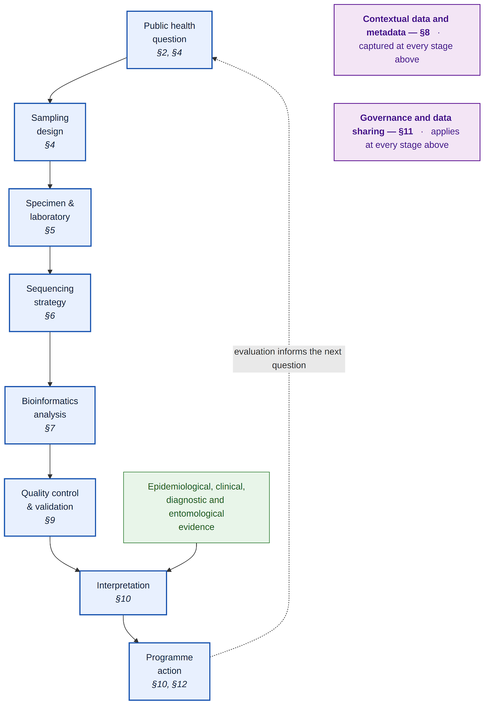

*Figure 2.4: The malaria genomic surveillance pathway from public health question to programme action. Each stage is addressed by the indicated section. The pathway is iterative: programme action and its evaluation generate the next surveillance question. Genomic evidence enters programme decision-making alongside epidemiological, clinical, diagnostic and entomological evidence, and rarely acts on its own.*

> [!NOTE]
> **SECTION 2 · KEY POINTS | Malaria Biological Context and Genomic Implications**
>
> - **•** *Plasmodium* biology shapes analysis: pipelines must handle mixed-species infections, multiple clones, low parasitaemia, and host DNA removal.
>
> - Species differ in host-cell tropism and life cycle. P. falciparum reaches high parasitaemia, while restricted red-cell invasion in other species gives low parasitaemia and a poor signal-to-noise ratio, often requiring enrichment or targeted sequencing.
>
> - Genomic surveillance applications include gene deletions (*pfhrp2/pfhrp3*), drug-resistance markers (*pfk13*, *pfcrt*, *pfmdr1*), haplotypes and polyclonality.
>
> - MOI must be established before variant calling so that clones are not confused with haplotypes.
>
> - Vector insecticide resistance arises through target-site, metabolic, cuticular, behavioural, and physiological mechanisms; a resistance genotype alone does not demonstrate phenotypic resistance or intervention failure.

## **3\. The Tiered Surveillance Model**

### 3.1 Rationale For a Tiered Approach

A tiered model allows countries to implement malaria genomics according to immediate public health needs and available capacity. This model avoids overburdening laboratories with whole-genome sequencing (WGS) when targeted methods are sufficient, while preserving pathways for escalation when higher resolution is required. Recent work has shown that decentralised targeted nanopore sequencing can support local malaria genomic surveillance, including rapid workflows and offline laptop-based analysis in African settings ([Mwenda *et al.*, 2026](https://www.nature.com/articles/s41467-026-72358-z)).

### 3.2 Tier Definitions, Methods and Outputs

A strong national malaria genomics programme should combine routine targeted surveillance with periodic WGS and special investigations.

**Table 3.2: Tiered model for implementing malaria genomic surveillance**

| Tier | Main purpose | Typical methods | Public health outputs | Frequency | Sample source |
| ----- | ----- | ----- | ----- | ----- | ----- |
| **Tier 1: Routine marker surveillance** | Routine monitoring of known resistance, diagnostic escape, species, and selected diversity markers. | Focused amplicon sequencing, multiplexed panels, molecular inversion probes (MIPs), and validated targeted nanopore assays. | Marker frequencies, pfhrp2/3 deletion monitoring, basic MOI, and site-level trends. | Continuously, biannually, or annually. | Sentinel sites |
| **Tier 2: Enhanced population genomic surveillance** | Regional connectivity, population structure, relatedness, importation, and transmission mapping. | Dense MIPs, expanded microhaplotype panels, and selected WGS subsets. | Parasite population structure, relatedness, connectivity, importation risk, and hotspot interpretation. | Desired: active sampling. Accept: annually or semi-annually. | Multiple sites, seasons, and epidemiological strata. |
| **Tier 3: High-resolution investigation** | Outbreak investigation, novel resistance, structural variation, discovery, and reference datasets. | WGS, long-read targeted sequencing, and long-read WGS where appropriate. | Novel marker discovery, detailed relatedness, genomic background of resistance, and structural variants. | Desired: active sampling. Accept: annually or semi-annually. | Specialised research programmes. |

*Note: molecular inversion probes (MIPs), whole-genome sequencing (WGS), and multiplicity of infection (MOI).* Minimum infrastructure requirements by tier are given in [Table 12.2](#table-122-minimum-infrastructure-requirements).

### 3.3 Choosing and Moving Between Tiers

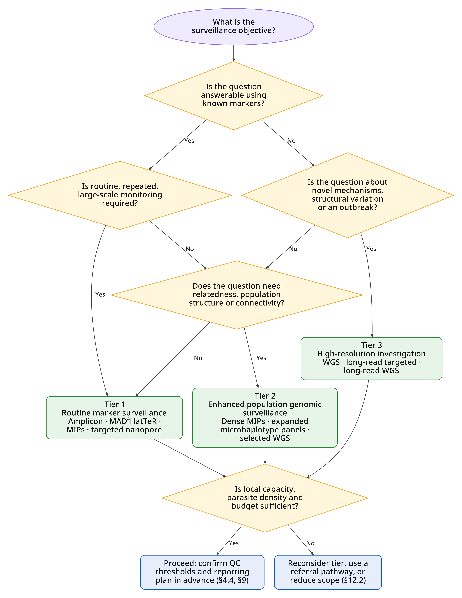

*Figure 3.3: Decision tree for selecting a malaria genomic surveillance tier. Tiers are not a maturity ladder; a programme may operate at different tiers for different objectives simultaneously. Tier definitions and expected outputs are given in [Table 3.2](#table-32-tiered-model-for-implementing-malaria-genomic-surveillance).*

# **Part B – Designing and Delivering Genomic Surveillance**

## **4\. Study Design**

The sequencing method should be selected only after the objective is clear.

### 4.1 Defining the Surveillance Objective

Examples:

* Routine drug-resistance surveillance  
* *pfhrp2/3* deletion monitoring  
* Therapeutic efficacy study genotyping  
* Transmission mapping  
* Importation analysis  
* Vaccine-target monitoring  
* Outbreak investigation  
* Novel marker discovery

### 4.2 Sampling Frame and Representativeness

A public health sequencing study should specify:

* Sentinel sites or districts  
* Transmission settings  
* Age groups  
* Symptomatic or asymptomatic infections  
* Collection season  
* Sample size per site  
* Sampling frequency  
* Inclusion and exclusion criteria  
* Sample type  
* Parasite-density threshold

### 4.3 Planning For Parasite Density

Every sequencing study should collect parasite-density information where possible, such as:

* qPCR cycle-threshold (Ct) value  
* Parasites per microlitre  
* Microscopy parasite density  
* RDT result  
* DNA concentration after extraction

Parasite density should be included in the analysis because sequencing failure may be associated with low parasitaemia and can bias results. Guidance on specimen selection is given in [Section 5.1](#51-specimen-types-and-their-trade-offs), and the effect of parasite density on the choice of sequencing strategy is given in [Section 6.4](#64-cost-turnaround-time-and-analytical-resolution).

### 4.4 Defining Thresholds and The Reporting Plan in Advance

Quality control thresholds should be predefined before sequencing begins. The QC domains and indicators to be specified are given in [Table 9.2](#table-92-qc-documentation-recommendations-for-each-level-in-the-workflow).

Before sequencing begins, define who the results will be reported to:

* National Malaria Control Programme (NMCP)  
* Ministry of Health  
* Public health laboratory leadership  
* Research partners  
* WHO or regional surveillance networks, where appropriate  
* Local sites and districts

A report should translate genomic findings into public health interpretation, not only provide variant tables. The content of those reports is specified in [Section 10.4](#104-reporting-standards) and [Table 10.4](#table-104-minimum-reporting-elements).

## **5\. Specimens and Laboratory Workflow**

Translating genomic technologies into healthcare applications for *P. falciparum* has been severely limited by the technical and logistical difficulties of obtaining high-quality clinical samples from the field ([Oyola *et al.*, 2016](https://doi.org/10.1186/s12936-016-1641-7)). With the majority of malaria-infected individuals living in rural or hard-to-reach areas, sample acquisition is challenging ([Nag *et al.*, 2018](https://doi.org/10.1186/s12936-018-2232-6)). Consequently, malaria genomics must rely on blood-derived samples collected under strict field constraints, utilising a spectrum of sample types that each present distinct trade-offs regarding data quality, analytical bias, and interpretability. These common sample types differ significantly in how much parasite DNA they yield, the degree of human or external DNA contamination present, and how well they support whole-genome or targeted downstream analysis.

### 5.1 Specimen Types and Their Trade-offs

[Table 5.1](#table-51-comprehensive-comparison-of-sample-types-for-malaria-genomics) below provides a comprehensive side-by-side comparison of all sample types, including specific volumes, storage requirements, DNA yield expectations, contamination levels, and key downstream applications.

**Table 5.1: Comprehensive comparison of sample types for malaria genomics**

| Sample Type | Blood/Sample Volume | Field Logistics & Storage | Parasite DNA Yield | Host DNA Contamination | Key Downstream Applications |
| :---: | :---: | :---: | :---: | :---: | :---: |
| **Venous Whole Blood (VWB)** | \>2 mL | Requires phlebotomy, immediate leucocyte depletion, and strict cold chain (-20°C to \-80°C). | Very high | Low (after leucocyte depletion) | High-depth WGS, *de novo* assembly, structural variant analysis. |
| **DBS** | \~50 µL (capillary) | Simple finger-prick; stored at ambient temperature with desiccant. | Low | Extremely high (up to 100:1 host: parasite ratio) | Targeted amplicon sequencing, MIPs, selective whole-genome amplification (sWGA)-based WGS. |
| **Dried Erythrocyte Spot (DES)** | \~50 µL (capillary or venous) | Leucocyte-depleted before spotting; stored at ambient temperature with desiccant. | Low to moderate | Low | Direct WGS without extensive enrichment, copy-number variation (CNV) analysis. |
| **Rapid Diagnostic Test (RDT)** | \~5–15 µL | Routine clinical use, stored at ambient temperature for months. | Very low | High | Retrospective molecular surveillance, drug resistance marker screening (*pfk13*, *pfdhps*). |
| **Saliva & Buccal Swabs** | 1–2 mL | Non-invasive; stable at room temperature with specialised buffers. | Extremely low | Extremely high | Non-invasive molecular diagnostics, high-sensitivity qPCR/ddPCR. |
| **Mosquito Midguts & Salivary Glands** | N/A (single vector) | Dissection of infected vectors, stored in ethanol or frozen. | Low (oocysts/sporozoites) | High (vector DNA) | Transmission biology, amplicon sequencing of diversity and resistance. |
| **Cultured Isolates** | Variable | Continuous *in vitro* culture requires specialised lab infrastructure. | High | Negligible | Assay development, reference genome assembly, drug susceptibility testing. |

### 5.2 Influence of Samples on Downstream Analysis

Sample type and preparation strongly influence whether *Plasmodium* DNA can be successfully sequenced, how much within‑host diversity is captured, and what depth/quality of data is obtained. For instance, a systematic comparison found a 5- to 10-fold higher DNA recovery from VWB than from DBS across extraction methods. Magnetic bead-based extraction from VWB achieved 88–98% recovery, while the same method from DBS yielded only 8–20%. This lower sensitivity is primarily attributable to the limited volume of blood collected on DBS cards and the degradation of parasite DNA during drying and storage ([Holzschuh and Koepfli, 2022](https://doi.org/10.1186/s12936-022-04122-9)).

Additionally, DBS needs much higher parasitaemia (approximately 0.03% parasitaemia or \>1,200 parasites/µL) to reach even 50% genome coverage at a depth of 5×, while VWB achieves deeper, broader coverage at lower parasite levels ([Oyola *et al.*, 2016](https://doi.org/10.1186/s12936-016-1641-7)). Regarding detection of copy number variation (CNV), DBS-derived selective whole-genome amplification (sWGA) data require new bioinformatic methods for CNV genotyping, as the amplification process distorts read-depth signals used for CNV calls, whereas VWB data can use standard read-depth methods ([MalariaGEN, 2023](https://doi.org/10.12688/wellcomeopenres.18681.1)).

Regarding human contamination, DBS samples typically yield a human/parasite DNA ratio that can exceed 100:1, which lowers effective parasite coverage. Mitigation strategies such as enrichment methods by WGS, sWGA, MspJI/McrBC enzymatic digestion, leucocyte depletion, hybrid selection, and NEBNext Microbiome DNA enrichment kit (NMDEK) are crucial. Each method, however, has its own biases ([Oyola *et al.*, 2016](https://doi.org/10.1186/s12936-016-1641-7); [Teyssier *et al.*, 2021](https://doi.org/10.1186/s12936-021-03630-4); [Bakari *et al.*, 2026](https://doi.org/10.1038/s41598-026-46451-8)).

For interpretability, lower data quality from low parasite density and asymptomatic infections (which are common in high-transmission settings) can create a systematic bias towards higher parasite density and symptomatic infections in genomic datasets. Low-input DBS can underestimate the MOI because minority clones drop out stochastically during amplification. Therefore, comparisons of MOI across studies using different sample types must account for this ascertainment bias ([Lapp *et al.*, 2024](https://doi.org/10.1371/journal.pgph.0002361)).

Thus, laboratory workflows (sample type, DNA extraction method, enrichment method, storage conditions, etc.) directly influence sequencing depth, genome coverage, and error profiles. sWGA from DBS distorts read-depth uniformity, biasing CNV calls and requiring specialised bioinformatic pipelines ([MalariaGEN, 2023](https://doi.org/10.12688/wellcomeopenres.18681.1)). Amplicon sequencing of DBS samples with low parasite densities systematically misses minority haplotypes, thereby underestimating MOI and potentially skewing estimates of resistance-allele frequencies ([Lapp *et al.*, 2024](https://doi.org/10.1371/journal.pgph.0002361)). The extraction method alone affects DNA recovery, setting the effective limit of detection (LOD). When sites use different protocols, it makes cross-study comparisons unreliable without correction ([MalariaGEN, 2023](https://doi.org/10.12688/wellcomeopenres.18681.1)).

### 5.3 Nucleic Acid Extraction

The selection of the DNA extraction protocol is a primary determinant of the LOD and downstream sequencing success.

**Table 5.3: DNA extraction methods and performance**

| Method | Recovery from VWB | Recovery from DBS | DNA quality and suitable applications | Reference |
| :---: | :---: | :---: | ----- | ----- |
| **Magnetic bead-based extraction** | 88–98% | 8–20% | Yields pure, good-quality DNA | [Holzschuh and Koepfli, 2022](https://doi.org/10.1186/s12936-022-04122-9) |
| **Spin column extraction  (e.g., QIAamp)** | 16–33% | \~2% | Produces high-purity, high-molecular-weight (HMW) DNA | [Holzschuh and Koepfli, 2022](https://doi.org/10.1186/s12936-022-04122-9) |
| **Tween- Chelex 100** | N/A | 15–21% | Highly efficient for PCR and amplicon sequencing, but unless properly purified, it can introduce chemical inhibitors and fragment DNA, which limits its suitability for long-read library preparation. | [Holzschuh and Koepfli, 2022](https://doi.org/10.1186/s12936-022-04122-9); [Bakari *et al.*, 2026](https://doi.org/10.1038/s41598-026-46451-8) |

### 5.4 Host Depletion and Parasite Enrichment

**Leucocyte Depletion (Cellulose Filtration):** Fresh VWB is passed through cellulose columns (e.g., CF11 or MN2100ff) prior to storage or extraction, which physically capture leucocytes while permitting erythrocytes to pass through. This cost-effective and highly efficient technique diminishes host DNA contamination to minimal levels, facilitating direct whole-genome sequencing (WGS) ([Venkatesan *et al.*, 2012](https://doi.org/10.1186/1475-2875-11-41)). Leucocyte Depletion Cards (LDC), which allow on-card capillary blood filtration in field settings, are one example of recent innovations ([Tierney *et al.*, 2025](https://doi.org/10.1021/acs.analchem.4c06190)).

**Enzymatic Degradation of Methylated DNA:** Enzymes like MspJI or McrBC specifically cleave highly methylated host genomic DNA while preserving the adenine–thymine (AT)-rich, hypomethylated *P. falciparum* genome ([Oyola *et al.*, 2013](https://doi.org/10.1128/jcm.02507-12)). This treatment, prior to amplification, significantly improves genome coverage and reduces host read background ([Teyssier *et al.*, 2021](https://doi.org/10.1186/s12936-021-03630-4); [Shah *et al.*, 2020](https://doi.org/10.1186/s12936-020-03195-8)).

**NEBNext Microbiome DNA Enrichment Kit (NMDEK):** A methyl-CpG-binding domain protein 2 (MBD2) conjugated to the fragment crystallisable (Fc) region of an antibody is used to selectively bind and isolate methylated host DNA from unmethylated parasite DNA. NMDEK efficiently reduces human DNA, thereby shifting human-specific qPCR cycle-threshold (Ct) values by approximately 10 cycles ([Bakari *et al.*, 2026](https://doi.org/10.1038/s41598-026-46451-8)).

**Hybrid Selection (Target Capture):** This method physically extracts parasite DNA from genomic libraries using specially made, biotinylated ribonucleic acid (RNA) or DNA oligonucleotide "baits" complementary to the *P. falciparum* genome ([Melnikov *et al.*, 2011](https://doi.org/10.1186/gb-2011-12-8-r73)). While highly sensitive and capable of reconstructing whole genomes from highly contaminated samples, it is costly and logistically complex.

**Targeted Amplicon Sequencing (AmpSeq):** As an alternative to WGS, AmpSeq targets specific polymorphic or drug-resistance loci (e.g., *pfk13*, *pfdhps*, *pfdhfr*, *pfcrt*, *pfama1*, *pfcsp*). This approach is highly sensitive and robust to host contamination, making it ideal for high-throughput surveillance using DBS or RDTs ([Aranda-Díaz *et al.*, 2025](https://doi.org/10.1038/s41598-025-94716-5)).

**Haplotype Recovery and Minority Clones:** In high-transmission settings, patients are frequently infected with multiple genetically distinct parasite clones (polyclonal infections). The MOI is estimated by detecting these co-existing haplotypes. Low-density samples (\<1.5 genomes/µL) and low sequencing read depth lead to stochastic PCR dropout, systematically underestimating MOI by missing minority clones ([Lapp *et al.*, 2024](https://doi.org/10.1371/journal.pgph.0002361)).

**Analytical Censoring:** To prevent false-positive haplotype calls arising from PCR chimaeras or sequencing errors, strict quality-filtering and censoring criteria must be applied. Optimised censoring criteria can remove up to 83% of false-positive haplotypes while retaining 92% of true-positive minority haplotypes, ensuring accurate estimates of resistance-allele frequencies in populations ([Lapp *et al.*, 2024](https://doi.org/10.1371/journal.pgph.0002361)).

Two related analytical issues arise directly from enrichment and specimen choice. These are addressed under the method-specific quality control in [Section 9.4](#94-method-specific-qc-considerations): haplotype recovery and minority clones, and analytical censoring.

### 5.5 Storage, Transportation, and Degradation

The logistical advantage of DBS in avoiding cold-chain requirements is balanced by the risk of nucleic acid degradation over time following exposure to environmental conditions.

* **Chemistry of Filter Paper:** Standard Whatman 3MM or 903 Protein Saver cards are inexpensive and frequently used. Although they need specific wash procedures during DNA extraction, chemically coated cards, like Whatman FTA, lyse cells upon touch and chemically retain nucleic acids, shielding them from nucleases and environmental deterioration at room temperature ([Jones *et al.*, 2012](https://doi.org/10.1186/1475-2875-11-266)).

* **Temperature and Humidity:** High relative humidity and ambient temperatures (\>37°C) quickly speed up the enzymatic and chemical hydrolysis of DNA on filter sheets. Prolonged storage at ambient temperature, particularly under high temperature or high humidity, can reduce DNA integrity and downstream PCR performance, although it is robust when stored for an extended period of time at −20 °C ([Schwartz *et al.*, 2015](https://doi.org/10.4269/ajtmh.14-0602); [Hwang *et al.*, 2012](https://doi.org/10.1186/1475-2875-11-339)).

* **Mitigation:** DBS cards should be air-dried for at least 1 hour, or until completely dry, while protected from direct sunlight and insects. Once dry, each card should be sealed in an airtight plastic bag with silica-gel desiccant. For long-term storage (\>2 years), DBS should be stored at −20 °C or −80 °C to preserve DNA integrity and PCR sensitivity [(Schwartz *et al.*, 2015](https://doi.org/10.4269/ajtmh.14-0602); [Hwang *et al.*, 2012](https://doi.org/10.1186/1475-2875-11-339)).

Metadata documenting the movement of specimens between collection sites and laboratories is specified in [Section 8.4](#84-capture-points-across-the-workflow).

> [!NOTE]
> **SECTION 5 · KEY POINTS | Specimens and Laboratory Workflow**
>
> - **•** Specimen choice (VWB, DBS, DES, vector samples, or archived material) affects DNA yield, host contamination, degradation risk, and the analyses that can be supported.
>
> - VWB generally provides more parasite DNA, whereas DBS and DES simplify field collection and transport but may yield lower or more variable DNA and require careful interpretation.
>
> - Extraction and pre-sequencing preparation should be selected for the intended application; methods differ in yield, purity, inhibitor carry-over, and suitability for targeted, whole-genome, and long-read sequencing.
>
> - Host DNA depletion or parasite enrichment can improve parasite recovery from low-density samples, but may introduce analytical bias and should therefore be documented and evaluated.
>
> - DBS should be completely dried, protected from heat and humidity, packaged with desiccant, and stored appropriately; collection, transport, processing, storage, and specimen identifiers should remain traceable.

## **6\. Sequencing Strategies**

### 6.1 Principles of Fit-For-Purpose Sequencing

A public health laboratory should not choose a sequencing method simply because it produces the most data. The best method is the one that answers the public health question reliably, affordably, and within a useful timeframe.

**A fit-for-purpose sequencing strategy should consider:**

* **Public Health question:** known marker surveillance, outbreak investigation, importation, treatment failure, *pfhrp2/3* deletion surveillance, or novel discovery.

* **Sample type:** DBS, VWB, DES, leucocyte-depleted VWB, vector samples, or archived material.

* **Parasite density:** low-density infections are more difficult for WGS than for targeted assays.

* **Resolution needed:** single mutation, haplotype, microhaplotype, relatedness, identity-by-descent (IBD), structural variation, or genome-wide discovery.

* **Turnaround time:** urgent local decisions may require targeted nanopore or focused amplicon sequencing.

* **Cost and scalability:** routine surveillance may require hundreds to thousands of samples.

* **Local feasibility:** staff capacity, sequencing platform, supply chain, electricity supply and disruptions, internet, computing, and bioinformatics support.

* **Data use pathway:** results should feed into treatment policy, diagnostic policy, outbreak response, or surveillance reports.

### 6.2 Strategy Profiles

This section describes each sequencing strategy; their comparative strengths, limitations, fit-for-purpose, and the platforms where they are run are described at the end of the section.

#### 6.2.1 Amplicon Sequencing

Amplicon sequencing uses PCR to amplify specific parasite loci before sequencing. It may be performed using Illumina short-read sequencing or ONT long-read sequencing. It is one of the most practical approaches for public health laboratories because it is relatively affordable, sensitive, and compatible with DBSs. Amplicon sequencing can be narrow, targeting one or a few genes, or broad, using multiplexed panels that amplify many genes or microhaplotypes.

*Public Health Application*

Amplicon sequencing is fit for purpose when the laboratory needs to answer focused marker-based questions, such as:

* What is the frequency of *pfk13* mutations associated with artemisinin partial resistance?  
* Are *pfcrt*, *pfmdr1*, *pfdhfr*, or *pfdhps* mutations changing over time?  
* Are *plasmepsin 2/3* copy number changes or piperaquine-resistance markers present?  
* Are *pfhrp2/pfhrp3* deletions increasing in areas relying on HRP2-based RDTs?  
* What is the MOI using *ama1*, *msp1*, *msp2*, or microhaplotypes?  
* Are *csp* haplotypes changing after malaria vaccine deployment?

*Strengths*

Amplicon sequencing provides high depth at targeted loci, which is useful for detecting low-frequency variants in polyclonal infections if the assay and variant-calling thresholds are validated. It is less expensive than WGS, faster to implement, and suitable for DBS samples.

*Limitations*

Amplicon sequencing only detects variation in the regions amplified. It cannot discover unknown resistance mechanisms outside the targeted loci. Primer mismatch can cause allele dropout, and highly diverse parasite populations may require regular primer evaluation.

*Fit-for-purpose use*

Amplicon sequencing is best for routine marker surveillance, especially when the markers are already known and linked to public health decisions.

Image placeholder

#### 6.2.2 MAD4HatTeR Multiplexed Amplicon Panel

Multiplex Amplicons for Drug, Diagnostic, Diversity, and Differentiation Haplotypes using Targeted Resequencing (MAD4HatTeR) is a modular amplicon sequencing panel developed for malaria genomic surveillance and research. The panel targets highly diverse microhaplotypes, drug-resistance markers, diagnostic-resistance markers, potential vaccine targets, and species-informative regions.

*Public Health Application*

The published MAD4HatTeR panel comprises 276 targets, including 165 highly diverse loci for assessing parasite genetic diversity and relatedness and 118 resistance-module loci covering 15 drug-resistance-associated genes, *csp* and other potential vaccine targets, *pfhrp2/pfhrp3* deletions, CNV, and markers for detecting non-falciparum *Plasmodium* species ([Aranda-Díaz *et al.*, 2025](https://doi.org/10.1038/s41598-025-94716-5)).

*Strengths*

MAD4HatTeR is more informative than narrow amplicon sequencing as it covers multiple categories of markers. It is useful for national programmes that want a practical balance between routine marker surveillance and moderate-resolution parasite population genetics. It has also been described as modular and compatible with public health and research applications ([Aranda-Díaz *et al.*, 2025](https://doi.org/10.1038/s41598-025-94716-5)).

*Limitations*

MAD4HatTeR remains a targeted panel. It cannot replace WGS for novel resistance discovery, full genome-wide selection scans, or detailed parasite ancestry analysis. Its performance depends on primer design, sample quality, parasite density, and the strength of the bioinformatics pipeline.

*Fit-for-purpose use*

MAD4HatTeR is appropriate for:

* National malaria molecular surveillance  
* Multi-site sentinel surveillance  
* Drug-resistance monitoring  
* Diagnostic escape monitoring  
* Diversity and relatedness analysis  
* Routine surveillance where WGS is too expensive or impractical

#### 6.2.3 The *Anopheles* Species and *Plasmodium* Panel (ANOSPP)

ANOSPP is a genus-wide multiplexed amplicon sequencing panel designed to characterise *Anopheles* mosquitoes, with species-level assignment, The panel targets up to 62 loci distributed across the *Anopheles* genome, together with two conserved mitochondrial loci from *Plasmodium* ([Makunin *et al.*, 2022](https://doi.org/10.1111/1755-0998.13436)).

*Public Health Applications*

* Species identification and confirmation for entomological surveillance, including specimens that are difficult to resolve morphologically.  
* Detection and species identification of *Plasmodium* in individual mosquitoes.  
* Mapping the spatial and temporal composition of *Anopheles* vector populations.  
* Characterisation of vector population structure and connectivity to support investigations of vector movement and malaria transmission.  
* Linking vector identity to *Plasmodium* carriage to support targeted vector-control planning and evaluation.

*Strengths*

ANOSPP combines mosquito species identification, multilocus information on vector population structure, and *Plasmodium* detection in a single multiplexed assay. Its genus-wide design and multilocus data can provide more information for species assignment and population-structure analysis than a single-marker approach. 

*Limitations*

ANOSPP does not provide a whole-genome assessment or, establish insecticide-resistance mechanisms, parasite load, developmental stage, or infectivity. Species assignment depends on the completeness and quality of the reference index; under-represented or absent taxa may remain unresolved or be assigned with reduced confidence. Assay performance may also be affected by DNA quality, primer-binding variation, and low *Plasmodium* DNA abundance. Population-structure inference depends on representative sampling and appropriate reference populations.

*Fit-for-purpose use*

The workflow is suitable for high-throughput processing of large mosquito collections, and a nondestructive extraction option can allow specimens that produce unexpected results to be returned to for morphological examination ([Makunin *et al.*, 2022](https://doi.org/10.1111/1755-0998.13436)).

#### 6.2.4 Molecular Inversion Probes (MIPs)

MIPs are targeted capture probes that hybridise to parasite DNA, undergo extension and ligation, circularise around the target sequence, and are then amplified and sequenced. MIPs can target drug-resistance markers, neutral single-nucleotide polymorphisms (SNPs), microhaplotypes, and genome-wide SNP panels.

MIPs are highly multiplexable and can be designed to genotype hundreds or thousands of loci across many samples. An early MIP panel targeted major drug-resistance mutations and microsatellites and was applied to 552 *P. falciparum* infections from the Democratic Republic of Congo ([Aydemir *et al.*, 2018](https://doi.org/10.1093/infdis/jiy223)).

Examples of more recent MIP panels include **DR23K**, a 185-probe drug-resistance panel ([Katairo *et al.*, 2025](https://doi.org/10.1186/s12936-025-05441-3)); **IBC2FULL**, which targets 4,264 SNPs using 2,128 MIPs and approximates WGS for relatedness, population structure, MOI, and major selection signals; and IBC2CORE, a smaller 305-MIP subset derived from IBC2FULL for basic population-genomic analyses and MOI estimation ([Niaré *et al.*, 2025](https://doi.org/10.3389/fgene.2025.1526049)).

*Public Health Applications*

* Drug-resistance marker surveillance  
* Large-scale genotyping of DBS samples  
* MOI  
* Parasite population structure  
* IBD and relatedness  
* Importation and connectivity analysis  
* Transmission mapping  
* Approximate selection scans if the panel is dense enough

*Strengths*

MIPs are scalable and cost-effective for large sample sets. They are particularly useful when a public health programme wants more resolution than simple amplicon sequencing but cannot afford WGS for all samples. MIPs are also valuable for polyclonal infections because many MIP workflows can incorporate molecular barcodes or unique molecular identifiers to reduce PCR amplification bias and improve allele-frequency estimation.

*Limitations*

MIPs are limited to predefined targets. If new resistance markers emerge outside the panel, the panel must be updated or supplemented. MIP design and optimisation require technical expertise, and data analysis is more complex than simple single-locus amplicon sequencing.

*Fit-for-purpose use*

MIPs are best for large-scale standardised surveillance where the laboratory needs population-genetic resolution, relatedness analysis, or transmission mapping at lower cost than WGS.

Image placeholder
#### 6.2.5 NOMADS and Targeted Long-Read Nanopore Sequencing

The National Malaria Elimination Centre (NMEC)-Oxford Malaria Amplicon Drug-resistance Sequencing (NOMADS) workflows use Oxford Nanopore Technologies (ONT) sequencing of PCR amplicons from *Plasmodium falciparum*. These approaches are attractive for public health laboratories because MinION devices are portable, sequencing can be performed locally, and results can be generated faster than conventional centralised sequencing.

The original 8-target NOMADS panel (NOMADS8) and 16-target NOMADS panel (NOMADS16) generate approximately 3–4 kb reads across selected genes or genomic regions. NOMADS8 comprises eight targets covering drug-resistance-associated genes and polymorphic markers, while NOMADS16 expands this to 16 targets by adding *pfama1, pfcsp, pfhrp2, pfhrp3, and regions flanking* *pfhrp2/pfhrp3*. The panels cover approximately 28.8 kb and 54.7 kb, respectively ([de Cesare *et al.*, 2024](https://doi.org/10.1038/s41467-024-45688-z)).

The more recent NOMADS Minimal Viable Panel (MVP) was developed as a shorter-amplicon, higher-sensitivity workflow for decentralised surveillance. It targets nine genes using ten amplicons ranging from 604–1,405 bp: *pfama1, pfcrt, pfcsp, pfdhfr, pfdhps, pfhrp2, pfhrp3, pfk13,* and *pfmdr1*, with two amplicons covering *pfmdr1*. The panel supports surveillance of AMDR, *pfhrp2/pfhrp3* deletions, vaccine-target diversity, parasite diversity, and minority variants from DBS samples ([Mwenda *et al.*, 2026](https://doi.org/10.1038/s41467-026-72358-z)).

NOMADS 2 builds on the original NOMADS programme by expanding nanopore sequencing capacity, integrating NOMADS-based assays into routine malaria surveillance, and optimising existing and developing new assays for drug-resistance, diagnostic-escape, and other malaria molecular-surveillance applications ([PATH, 2024](https://www.path.org/our-impact/resources/nomads-2-factsheet/)).

*Public Health application:*

* Rapid detection of drug-resistance markers  
* Monitoring *pfk13* mutations  
* *pfhrp2/3* deletion surveillance  
* Vaccine-target monitoring, especially *csp*  
* Local, decentralised genomic surveillance  
* Reducing reliance on sample export  
* Rapid response to suspected resistance clusters or diagnostic failure

*Strengths*

* Portable sequencing using MinION  
* Faster turnaround than many centralised workflows  
* Lower infrastructure requirements  
* Ability to sequence long amplicons and infer haplotypes  
* Potential for local analysis using laptop-compatible pipelines  
* Useful for endemic-country laboratories

*Limitations*

Nanopore sequencing has historically had lower raw-read accuracy than Illumina sequencing, although consensus sequencing and improved chemistries have improved performance. Variant-calling thresholds, read-depth requirements, deletion calling, and minority-clone detection must be validated before using results for policy decisions. Nanopore approaches are usually targeted, not genome-wide. They are subsequently not ideal for discovering unknown resistance mechanisms or conducting full genome-wide selection analysis.

*Fit-for-purpose use*

NOMADS-like sequencing is best for rapid, decentralised surveillance where portability, local sequencing, and fast reporting are priorities.  
Image placeholder

#### 6.2.6 Selected Long-Read Approaches Beyond NOMADS

Long-read sequencing may also be used for applications beyond targeted NOMADS-style panels.

*Long-read targeted assays*

Long-read targeted assays can sequence full genes or large genomic regions. This is useful when public health laboratories need to know whether mutations occur on the same parasite haplotype or when regions are too complex for short-read interpretation.

*Useful applications include:*

* Full-length *pfk13*, *pfcrt*, or *pfmdr1* haplotypes  
* *pfhrp2/pfhrp3* gene and flanking region analysis  
* *csp* haplotype analysis  
* Copy-number and deletion characterisation  
* Structural variant confirmation

*Long-read WGS*

Long-read WGS is currently less routine for malaria public health surveillance because it requires higher DNA quality and quantity.

It can, however, be useful for:

* Structural variation  
* Genome assembly  
* Subtelomeric gene families  
* CNV  
* Complex loci  
* Resolving haplotypes across long genomic intervals

*Fit-for-purpose use*

Selected long-read approaches are most useful for special investigations, not routine population-level surveillance, unless the workflow is targeted and validated for field samples.

#### 6.2.7 Whole Genome Sequencing

Whole-genome sequencing provides the broadest view of parasite genetic variation. It sequences across the parasite genome and can detect known and novel SNPs, indels, haplotypes, copy number changes, structural variants, and genome-wide signatures of selection.

For *P. falciparum*, WGS can produce very high-resolution data useful for population structure, IBD, relatedness, importation, outbreak investigation, selection scans, and discovery of novel resistance mechanisms. MalariaGEN’s *P. falciparum* Community Project illustrates the value of large-scale WGS datasets for parasite genomic epidemiology and global allele-frequency analysis.

*Public Health Application*

* Discovery of novel resistance mechanisms  
* Investigation of treatment failure where known markers are absent  
* Genome-wide selection scans  
* Fine-scale parasite population structure  
* IBD and relatedness  
* Importation versus local transmission  
* Outbreak investigation  
* Structural variation and copy-number analysis  
* National or regional reference datasets

*Sample Requirements*

A major challenge in malaria WGS is the high proportion of human DNA in clinical samples, especially in low-density infections. For WGS, laboratories often need high-parasitaemia samples, leucocyte-depleted VWB, selective whole genome amplification, hybrid capture, higher sequencing depth, and higher DNA quantity and quality.

sWGA has been used to enrich parasite DNA from DBS and improve WGS success in field-collected samples. WGS typically performs poorly on low-density DBS due to low parasite DNA yield and high host-DNA contamination, unless enrichment or high-quality input DNA is available ([Oyola *et al.*, 2016](https://doi.org/10.1186/s12936-016-1641-7)).

*Strengths*

WGS provides the highest analytical resolution. It is the best approach when the question is not limited to known markers. It allows discovery of novel mutations, genome-wide selection signals, parasite migration, detailed relatedness, and the genomic background of resistance.

*Limitations*

WGS is more expensive, slower, and more bioinformatically demanding than targeted sequencing. It often requires advanced computing, specialised expertise, and more stringent sample quality. It may not be feasible for routine monthly or quarterly national surveillance of large numbers of low-density DBS samples.

*Fit-for-purpose use*

* High-resolution investigations  
* Discovery projects  
* Outbreak or focal transmission studies  
* Novel resistance detection  
* Baseline national genomic datasets  
* Detailed analyses of *pfk13* mutant spread or independent emergence

*Image placeholder (figure not yet uploaded).*

#### 6.2.8 Sequencing Platforms and Library Preparation

**6.2.8.1 Illumina Short-Read Sequencing**

For *P. falciparum* genomics, Illumina systems (such as MiSeq, NextSeq, and NovaSeq) continue to be the most popular technology due to their high throughput and high per-base accuracy. PCR amplification, adapter ligation, and DNA fragmentation are steps in standard library preparation. T7 endonuclease treatment of sWGA-amplified DNA from DBS is used to resolve branched and secondary DNA structures generated during amplification prior to WGS library construction ([Bakari *et al.*, 2026](https://doi.org/10.1038/s41598-026-46451-8)).

*Public health applications*

Surveillance of antimalarial drug-resistance markers, parasite population structure, transmission patterns and genomic diversity.

*Strengths*

High per-base accuracy, high throughput, established laboratory and bioinformatics workflows, and robust detection of SNPs and small indels. Illumina short-read sequencing is widely established for *P. falciparum* genomic surveillance.  
   
*Limitations*

Short reads have limited ability to resolve repetitive and structurally complex genomic regions and some structural variants. Sequencing also generally requires substantial laboratory infrastructure, specialised equipment and bioinformatics capacity.  
   
*Fit for purpose*

* Routine surveillance of known drug-resistance markers.  
* SNP and small-indel detection.  
* Population genomic and transmission analyses require high-quality genome-wide data.  
* Large sample sets requiring high-throughput sequencing.

**6.2.8.2 Oxford Nanopore Technologies (ONT) Long-Read Sequencing**

ONT platforms range from the portable MinION to the higher-throughput PromethION and provide real-time sequencing with long reads (median \>2 kb), enabling resolution of structural variations and repetitive regions that are not accessible with short reads. With \>30× depth and \>90% genome coverage, an optimised ONT-based WGS methodology for *P. falciparum* from DBS and VWB was able to identify differences in *pfmdr1* and *pfgch1* copy variations, with VWB producing greater sequencing depth and genome coverage than DBS ([Bakari *et al.*, 2026](https://doi.org/10.1038/s41598-026-46451-8)).

*Public health applications*

Malaria molecular surveillance, including detection of drug-resistance markers, structural variants and CNV, and characterisation of complex genomic regions.  
   
*Strengths*

Long reads improve resolution of repetitive and structurally complex genomic regions and structural variants. ONT platforms also provide real-time sequencing and portable, scalable instrumentation that can support decentralised surveillance.  
   
*Limitations*

Raw-read accuracy has historically been lower than Illumina short-read sequencing, although it has improved substantially with newer chemistries and basecalling. Performance and genome coverage are also influenced by parasite density, DNA quality, host-DNA contamination and sequencing depth.  
   
*Fit for purpose*

* Detection of structural variants and CNV.  
*  Characterisation of complex or repetitive genomic regions.  
*  Long-range haplotyping and genome assembly.  
*  Rapid or decentralised genomic surveillance where portability and real-time sequencing are advantageous.

**6.2.8.3 ONT Adaptive Sampling**

Real-time enrichment of *Plasmodium* reads during sequencing is made possible by a unique method that rejects human DNA reads utilising ONT's adaptive sampling function. Pre-sequencing enrichment processes are optional with this PCR-free technique, which simplifies laboratory operations while providing high-quality genome data ([De Meulenaere *et al.*, 2024](https://doi.org/10.1128/mbio.01967-23)).

*Public health applications*

Enrichment and sequencing of *Plasmodium* DNA directly from mixed human–parasite samples for genomic surveillance, including detection of drug-resistance and diagnostic-resistance markers and generation of genome-wide data.

*Strengths*

Enables real-time, PCR-free computational enrichment of *Plasmodium* DNA during sequencing, reducing the need for separate pre-sequencing parasite-enrichment procedures while retaining long-read information.

*Limitations*

Enrichment efficiency and resulting genome coverage depend on parasite density, DNA quality, and the proportion of parasites relative to host DNA. Evidence for routine malaria surveillance applications remains less extensive than for established short-read approaches.  
   
*Fit for purpose*

* PCR-free enrichment of *Plasmodium* DNA from mixed human–parasite samples.  
* Genome-wide sequencing where host-DNA contamination would otherwise reduce sequencing efficiency.  
* Rapid, on-site genomic surveillance where minimising additional laboratory enrichment steps is advantageous.  
* Applications requiring long-read information together with real-time enrichment.

### 6.3 Matching Sequencing Strategy to Public Health Question

The choice of sequencing strategy should be guided by the specific public health question being addressed and the level of genomic resolution required. [Table 6.3](#table-63-matching-malaria-sequencing-strategies-to-public-health-questions) summarises the most appropriate sequencing approaches for common malaria surveillance questions, together with alternative strategies and their rationale.

**Table 6.3: Matching malaria sequencing strategies to public health questions**

| Public Health Question | Best Strategy | Alternative Strategy | Rationale |
| ----- | ----- | ----- | ----- |
| **Frequency of known drug-resistance mutations** | Amplicon, MAD4HatTeR, MIPs, NOMADS | WGS for selected samples | Targeted methods are more cost-effective, faster, and sufficient for known markers. |
| **Artemisinin partial resistance surveillance** | *pfk13* amplicon, MAD4HatTeR, NOMADS | WGS for spread/background analysis | Known *pfk13* markers can be monitored directly. |
| **Partner-drug resistance** | Amplicon, MAD4HatTeR, MIPs, NOMADS | WGS | Known markers in *pfcrt*, *pfmdr1*, *pfdhfr*, *pfdhps*, and copy-number regions can be targeted. |
| ***pfhrp2/pfhrp3*** **deletion surveillance** | Validated deletion assay, MAD4HatTeR, NOMADS16 | WGS | Requires careful differentiation of true deletion from poor DNA quality |
| **MOI** | Amplicon microhaplotypes, MAD4HatTeR, MIPs | WGS | Targeted high-depth methods work well in polyclonal infections |
| **Transmission mapping** | Dense MIPs, WGS | MAD4HatTeR if marker density is adequate | IBD and relatedness need many informative markers |
| **Importation versus local transmission** | WGS, dense MIPs | Expanded amplicon panels | Requires population-level relatedness and ancestry information |
| **Outbreak investigation** | WGS | Dense MIPs | WGS provides the strongest evidence for close relatedness. |
| **Novel resistance discovery** | WGS | None equivalent | Targeted methods cannot discover markers outside the panel |
| **Vaccine-target surveillance** | Amplicon, MAD4HatTeR, NOMADS16 | WGS | *csp* and other targets can be sequenced directly. |
| **Rapid decentralised surveillance** | NOMADS-like nanopore | Focused amplicon sequencing | Local sequencing and fast turnaround |
| **Routine national surveillance** | MAD4HatTeR, MIPs, amplicon panels, NOMADS | WGS subset | Balances cost, scale, and actionability |

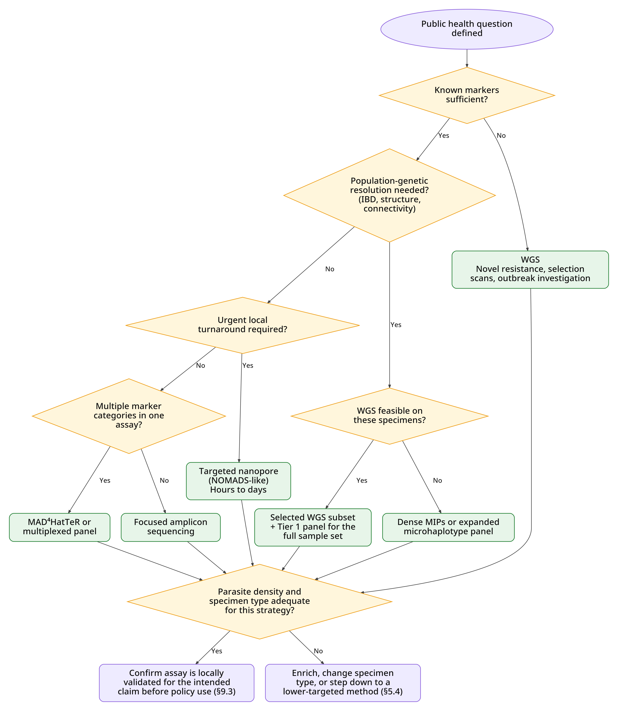
*Figure 6.3: Decision tree for selecting a sequencing strategy. Parasite density and turnaround requirements constrain the choice as strongly as the question itself; a strategy that cannot be delivered on the available specimens is not fit for purpose. See [Table 6.3](#table-63-matching-malaria-sequencing-strategies-to-public-health-questions) for strategy options by question and [Table 6.4c](#table-64c-sequencing-strategies-by-required-analytical-resolution) for resolution requirements.*

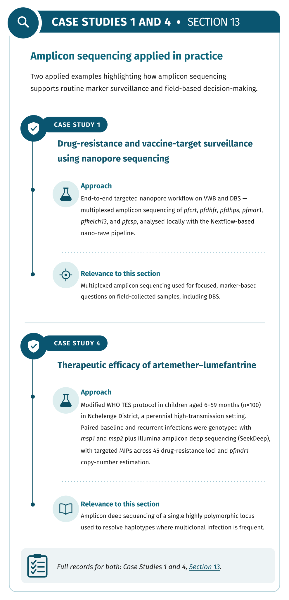

### 6.4 Cost, Turnaround Time, and Analytical Resolution

*Cost*

Sequencing cost varies by country, batch size, reagent access, platform, shipping, controls, repeat testing, and bioinformatics.

**Table 6.4a: Indicative cost by sequencing strategy**

| Rank (lowest to highest cost) | Sequencing Strategy | Approximate Cost per Sample (United States dollars \[USD\]) |
| :---: | ----- | ----- |
| 1 | Small amplicon panels | \$10–20 for targeted amplicons |
| 2 | Multiplexed amplicon panels | \$10–20 for targeted amplicons |
| 3 | MAD4HatTeR or MIPs | \$10–15 for some MIP workflows |
| 4 | Targeted nanopore panels, depending on flow-cell batching | \$20–40 for targeted long reads |
| 5 | WGS | \$100–200+ |
| 6 | Long-read WGS or specialised structural-variant sequencing | \$150–400 |

*Turnaround Time*

**Table 6.4b: Typical turnaround time for malaria sequencing strategies**

| Method | Typical Turnaround | Interpretation |
| ----- | ----- | ----- |
| **Focused amplicon sequencing** | Days to 1–2 weeks | Fast if sequencing access is local or batched frequently |
| **MAD4HatTeR** | Days to weeks | Efficient for batch surveillance |
| **MIPs** | Days to weeks | Good for batches; less ideal for single urgent samples |
| **NOMADS-like nanopore** | Hours to days | Best for rapid local surveillance |
| **WGS** | Weeks to months | Slower due to sample QC, enrichment, sequencing, and analysis |

*Parasite Density*

Parasite density strongly affects sequencing success, so consider the following:

* **High-density symptomatic infections:** suitable for most methods  
* **Low-density infections:** better suited to targeted sequencing than WGS  
* **DBS samples:** convenient but often contain limited parasite DNA  
* WGS from DBS often requires sWGA or other enrichment  
* Long-amplicon nanopore sequencing may require higher parasite density than short amplicons because longer PCR products can fail at low DNA input.

*Analytical resolution*

For urgent public health events, such as suspected *pfhrp2/pfhrp3* deletion clusters or emerging *pfk13* mutations, targeted nanopore or focused amplicon sequencing may provide more actionable results than WGS.

**Table 6.4c: Sequencing strategies by required analytical resolution**

| Resolution Needed | Suitable Strategy |
| ----- | ----- |
| **Known mutation frequency** | Amplicon, MAD4HatTeR, MIPs, NOMADS |
| **Minority variants** | Deep amplicon, MAD4HatTeR, MIPs, validated nanopore |
| **Full-gene haplotypes** | Long-read amplicon, NOMADS-like assays |
| **MOI** | Amplicon microhaplotypes, MAD4HatTeR, MIPs, WGS |
| **IBD and relatedness** | Dense MIPs, WGS |
| **Population structure** | Dense MIPs, WGS |
| **Novel marker discovery** | WGS |
| **Structural variants** | WGS, targeted long reads, long-read WGS |
| **Genome-wide selection** | WGS is best; dense MIPs can approximate selected signals |

*Feasibility in endemic settings*

Targeted nanopore sequencing and multiplexed amplicon panels are particularly attractive for endemic-country laboratories because they can be implemented with less infrastructure than WGS and can support local capacity building.

Feasibility depends on:

* Availability of sequencing instruments  
* Staff training  
* Power and internet stability  
* Reagent supply chain  
* Cold-chain capacity  
* Bioinformatics support  
* Computing infrastructure  
* Data reporting systems  
* Quality assurance  
* National data governance and sample export policies

### 6.5 Practical Recommendations

* **Use targeted sequencing for routine surveillance:** Amplicon sequencing, MAD4HatTeR, MIPs, and NOMADS-like nanopore assays are more practical than WGS for routine surveillance of known resistance and diagnostic markers.

* **Use MAD4HatTeR for integrated surveillance:** MAD4HatTeR is useful when a programme wants one assay covering resistance, diagnostic markers, diversity, microhaplotypes, vaccine targets, and species detection.

* **Use MIPs for scalable population genomic surveillance:** MIPs are appropriate when the programme needs relatedness, MOI, population structure, or IBD-like analyses at lower cost than WGS.

* **Use NOMADS-like nanopore sequencing for rapid local implementation:** Nanopore approaches are especially useful where in-country sequencing, rapid turnaround, and reduced sample export are priorities.

* **Use WGS for discovery and high-resolution investigation:** WGS should be reserved for novel resistance discovery, outbreak investigation, importation analysis, selection scans, and reference datasets.

* **Match the method to parasite density.** Low-density DBS samples are usually better suited to targeted sequencing than WGS unless enrichment is used.

* Do not over-sequence without a decision pathway. Sequencing results should be linked to public health decisions, including treatment policy, RDT policy, targeted response, or further investigation.

* Use a tiered strategy.

> [!NOTE]
> **SECTION 6 · KEY POINTS | Sequencing Strategies**
>
> - Select sequencing methods according to the public health question, specimen type, parasite density, required resolution, turnaround time, cost, local feasibility, and intended data-use pathway. Targeted methods (including amplicon sequencing, MIPs, MAD4HatTeR, and NOMADS-like panels) are generally suited to routine surveillance of known markers, low-density DBS samples, and rapid local decision-making. WGS is most useful for novel marker discovery, outbreak and importation investigations, selection scans, and other high-resolution analyses, but requires stronger DNA input, sequencing capacity, computing, and bioinformatics support. MIPs support scalable population-genomic analyses such as relatedness, identity by descent, and population structure, while long-read targeted approaches can resolve full-gene haplotypes and structural variation. Assay and pipeline performance should be validated for low-density and mixed infections, minority variants, primer mismatch, read depth, and enrichment-related bias before results are used for policy. Do not over-sequence without a decision pathway; results should connect to treatment or diagnostic policy, outbreak response, surveillance escalation, or further investigation.

# **Part C – Analysis, Data and Quality**

## **7\. Bioinformatics Pipelines and Standard Outputs**

### 7.1 Pipeline and Workflow Requirements

*Figure 7.1: Overview of a standard malaria bioinformatics pipeline from raw sequencing reads to public health reporting.*

For bioinformatics outputs to inform malaria control programmes at national and global levels, they must meet several essential criteria:

* The bioinformatic pipeline must generate reproducible and comparable results when rerun under the same defined conditions within the same laboratory and between different laboratories, in the same or different sites, regions, countries, or time, regardless of the technician/operator.

* Results, including their associated confidence, uncertainty, QC metrics, and limitations, must be presented clearly and in a form that is understandable to researchers, epidemiologists, NMCP directors, and other public health officials.

* The analysis should give useful results illustrating the population demographics of *Plasmodium* species, vectors, etc., in the surveyed area. These outputs should support interpretation and help determine whether further investigation or a public health response is warranted. 

* To support long-term reproducibility, the pipeline should be rerunnable by different analysts years later using the same raw sequencing files, sample metadata, reference genomes and databases, and workflow code.

The reproducibility of the results from the pipeline is crucial for studying the malaria population over time because visible population changes over time trigger changes in policy, diagnostics, and treatment strategies. These changes can be long, arduous, and expensive; therefore, the science behind them must be robust.

Bioinformatics pipelines must be adaptable, with all outputs generated computationally and not manually, as manual data manipulation is a common source of error and irreproducible results. Each run of a pipeline must produce the intended output (e.g., allele frequency tables, Binary Alignment Map (BAM) file, QC metrics, Variant Call Format (VCF), etc.) as well as a log file containing pipeline run metadata. The pipeline should also produce non-technical outputs such as summary tables and reports.

The pipeline must have a clear, well-defined use case and plainly declare the topic it is aiming to inform, the geographic area and time span of the study, the assays used, and the expected outputs. For details on the Africa CDC priority-use-case tiers 1–3, see [Section 1.4](#14-global-surveillance-frameworks), [Section 3](#3-the-tiered-surveillance-model), and the Africa CDC malaria genomic surveillance roadmap ([Roadmap for the Implementation of Malaria Genomic Surveillance in Africa – Africa CDC](https://africacdc.org/download/roadmap-for-the-implementation-of-malaria-genomic-surveillance-in-africa/)).

The workflow itself should meet the following requirements:

* **Accepted** workflow languages include: Nextflow (nf-core), Snakemake, Workflow Description Language (WDL), and Common Workflow Language (CWL).

* **Not Accepted:** Shell scripts, graphical user interface (GUI) tools, notebooks and other manually executed workflows.

* The workflow should allow caching and resuming paused or failed runs.

* All configurations and parameters, such as thresholds, reference version, etc., should be in a parameter file and not part of the run code.

* Failed samples should be easy to spot.

* All processes must be run in a container or environment (e.g., Docker, Singularity, or conda) with version-controlled source code.

* Each run of the pipeline must have a machine-readable sequencing manifest file defining how a run should be executed. This file should be added when the dataset is shared or published.

### 7.2 Reference Genomes and Control Strains

The names of the laboratory reference strains used for the positive and negative controls and their expected genotypes must be clearly stated in the pipeline metadata. The controls used should be selected according to the markers or use case being assessed. For instance, a strain with *pfhrp2* deletion and *pfhrp3* deletion must be included in the reference panel if the analysis use case is diagnostic escape via *pfhrp2*/*pfhrp3* deletion.

**Table 7.2: Expected *pfhrp2* and *pfhrp3* detection profiles for selected *P. falciparum* reference strains**

| Reference strain | Key characteristic or use | *pfhrp2* | *pfhrp3* |
| ----- | ----- | :---: | :---: |
| **3D7** | Reference strain; both loci intact | **\+** | **\+** |
| **Dd2** | Chloroquine-resistant; *pfhrp2* deletion; resistance-associated *pfcrt* allele; increased *pfmdr1* copy number | **−** | **\+** |
| **HB3** | *pfhrp3* deletion reference strain | **\+** | **−** |
| **3BD5** | Validated double-deletion control | − | − |
| **7G8** | Brazilian chloroquine-resistant clone; used in resistance studies and genetic crosses | **\+** | \+ |
| **FCR3** | Gambian laboratory-adapted line; used in drug-susceptibility, invasion and cytoadherence studies; verify stock-specific status | **\+** | \+ |

**Key:** \+ \= detected; − \= not detected. 

The reference genome use**d** i**n** the analysis must be clearly stated by accession number and version number; the organism name is insufficient. Accepted database accession numbers include: National Centre for Biotechnology Information (NCBI) RefSeq identifier (ID), PlasmoDB ID, GenDB ID, VectorBase ID.

### 7.3 The AT-rich Genome and Its Analytical Consequences

*P. falciparum* is one of the most AT-rich eukaryotic genomes, with an overall AT content of 80.6%, \~90% in the intron and intergenic regions, and tandem repeats (Gardner *et al.*, 2002; Vembar *et al.*, 2016). This causes uneven coverage of the sample DNA sequences, increased polymerase errors, difficulty in the assembly stage, and PCR dropout. Its repetitive low-complexity regions and the multigene families like *var, rifin, and Pf60 (Bischoff et al., 2000\) also make it difficult* to map to a reference when using short reads and creating new genomes with *de novo* assembly. Specific *de novo* assembly programmes have been developed especially for *Plasmodium* species for this reason. 

It is not recommended to use generic pipelines on *P. falciparum* without thorough knowledge of the caveats. Instead, there are several pipelines and workflows developed specifically for *Plasmodium* analysis (listed in Appendix B) for this purpose.

To ensure that genomic data are comparable across different studies and geographic regions, standardised bioinformatic processing is required.

* **Genome Analysis Toolkit version 4 (GATK4) optimisation:** [The Genome Analysis Toolkit](https://gatk.broadinstitute.org/) (GATK) serves as a standard for variant calling. An optimised GATK4 pipeline specifically designed for the highly AT-skewed (81% AT) *P. falciparum* genome showed markedly enhanced sensitivity for both single-nucleotide polymorphisms (SNPs) (86.6%) and indels (82.2%) compared to the default GATK settings, especially in complex, polyclonal infections ([Niaré *et al.*, 2023](https://doi.org/10.1186/s12936-023-04632-0)).

* **Ploidy Settings:** To accurately find low-frequency resistance mutations, variant callers must be set for variable ploidy since blood-stage malaria parasites are haploid in single-clone infections but show "pseudo-polyploid" profiles in polyclonal infections ([Niaré *et al.*, 2023](https://doi.org/10.1186/s12936-023-04632-0)).

### 7.4 Host and Contaminant Read Removal

*Plasmodium* DNA is often severely masked by host and other organisms' DNA. In clinical samples, this is due to human DNA, especially in non-leucocyte-depleted DBS and VWB. In vectors, contamination is from *Anopheles* DNA, human blood meal, and the *Anopheles* microbiome. This contaminating DNA must first be removed before any analysis is done, even in low-density blood (LDB) samples. Ideally, the reads would be aligned competitively between the *Plasmodium* species and other DNA (e.g., host, other organisms). The reads should align preferentially to the *Plasmodium* reference. All human and blood meal DNA must be removed and discarded and cannot be shared, as this is considered identifiable personal data. The human host DNA read count should be recorded. Vector and other organisms' DNA can be retained and binned separately.

### 7.5 Method-Specific Analytical Paths

The pipeline should branch into different paths depending on the use case, as a single path is not capable of sufficiently performing all forms of analysis without error.

**For targeted amplicon panels (e.g., AmpSeq, MAD4HatTeR):**

* The primer sequences must be trimmed from the raw reads.

* Denoising should be done to remove technical and machine errors, PCR artefacts, and chimaera sequences.

* For panels that cover different use cases (such as genetic diversity, diagnostic escape, and drug resistance), it is important to record the panel module composition, as this can differ across panels and panel revisions.

* Amplicon panels are sensitive at low frequencies; however, this sensitivity is dependent on parasite density and read depth. The analysis report must, therefore, state the read depth achieved for the allele.

Remember that all panels have their own function and purpose with specific amplicon coordinates, primer sequences, and target genes.

**For MIPs:**

* The probe arms and unique molecular identifiers (UMIs) must be trimmed so they are not confused with genetic variations.  
* Deduplication must be done to remove PCR duplicates and form a consensus before genotyping.  
* A QC threshold must be set to filter out errors and artefacts.  
* The report must state the raw read depth separately from the consensus read depth.

**For WGS:**

*P. falciparum* parasites are haploid in their human stage, so treating them as diploids can cause polyclonal infections to be missed. Any heterozygous calls must be treated as evidence of a polyclonal infection and quantified as within-sample alternative allele frequency (WSAF).

WSAF thresholds must be set based on control data results in the lab and sequencing depth, and consistently applied to sample results.

**Low-coverage WGS and sWGA:**

* Low-coverage WGS can be used to estimate population-level allele frequencies and support imputation-based population genetics.  
* sWGA data should not be pooled with WGS data because of the differences in genome sequencing depth and coverage

**Long-read sequencing (ONT):**

* The basecalling model for ONT is specific to the platform and model version, so the basecalling model and version used can affect the results of the analysis and should be recorded.  
* ONT is more prone to errors than short-read sequencers like Illumina.  
* Long reads are capable of spanning repeat regions of DNA in a single amplicon.

Strict minimum thresholds must be set for each analysis result, and there cannot be a single threshold set for all use cases.

**For species identification:**

* Markers and read information used to support species identification should be recorded with each species clearly stated.  
* Report mixed infections with the evidence used to support each species  
* Use controls and a minimum read threshold when detecting non-falciparum infections. As these species have relatively low parasitaemia, it is also possible for their reporting to be false positives and negatives.

### 7.6 Standard Workflow Steps and Declared Outputs

Each step in a workflow or pipeline should emit 1\) machine-readable output data or information for the next step, 2\) machine-readable run metrics for an analysis report (without the run metrics, it can be difficult to debug the workflow if something goes wrong), 3\) a summary report. All standard sequencing file types must align with Global Alliance for Genomics and Health conventions. Ensure you have concise interpretive reports for public health use, full reports for surveillance initiatives, dashboards, or malaria threats platforms (such as the WHO malaria threats map, the Worldwide Antimalarial Resistance Network (WWARN) Molecular Surveyor, and the Mitigating Antimalarial Resistance Consortium (MARC) for Southern and Eastern Africa dashboard) where appropriate. Use standardised language in the results to ease data sharing and minimise drifts in understanding. The workflow must be easily accessible and run unedited, preferably on an offline laptop or cloud backend. In Figure 7.6, each step emits machine-readable data for the next step, machine-readable run metrics for the analysis report, and a human-readable summary.  
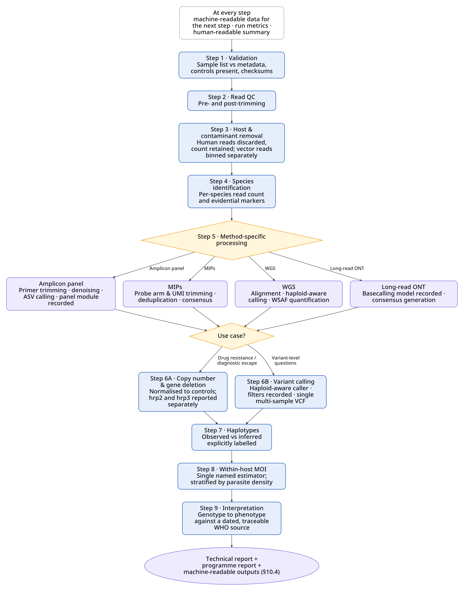

*Figure 7.6: Standard analytical workflow for malaria genomic surveillance, showing method-specific branches and step outputs.*

### 7.7 Workflow Steps

**Step 1: Validation Report**

Validate the sample list against the metadata file before running the pipeline or other processes. The metadata gives time, location, and clinical context to the sequence data. Any samples with no metadata should be disregarded until the metadata is provided.

Make sure required controls are available: positive and negative controls, deletion controls (for *pfhrp2* deletion and *pfhrp3* deletion), MOI controls (including minor clones), and replicate samples. 

Make sure all sample identification accessions are correct (the same in the sample list and metadata file) and have a corresponding sequencing output in sequence and quality-score file format (FASTQ). Record the checksum for each file (this verifies data integrity and exposes data corruption).

*Output:* Validated sample data, validation report (record accepted, rejected, or separated data with justification).

**Step 2: Quality Control Reports**

Run FASTQ quality control before and after trimming reads, recording read count, estimated duplicate reads, read length and distribution, per-base quality, adapter content, and per-base sequence content.

Trim the reads to remove adapters, primers, as well as low-quality reads, recording the parameters for trimming. Combine all sample QC into a single report before and after trimming.

*Output:* Pre- and post-trimming QC reports, trimmed read files.

**Step 3: Host DNA and Other Contamination Removal Report**

Remove and discard all reads from human hosts and vector human blood meals, but record the read count. Other vector-associated DNA can be retained in a separate bin and should also be recorded.

*Output*: Files containing only *Plasmodium* reads, other binned files containing vector reads, and other organism reads.

**Step 4: Species Identification Report**

Assign reads to *Plasmodium* species using a validated reference database and species-specific diagnostic markers. Apply predefined classification thresholds and flag low-confidence, mixed-species, or unresolved assignments.

*Output:* Species-identification report listing detected species, read counts, supporting markers, and classification confidence.

**Step 5: Processing Report**

Apply the appropriate analysis for the use case.

*Output*: Insert size distribution, percentage sequence alignment, depth and coverage at each target locus, number of duplicates. For amplicon-based methods: reads per amplicon, amplicons that pass the minimum depth threshold, number of amplicon sequence variants (ASVs), number of chimaeras.

**Step 6A: Copy Number and Gene Deletion**

This step is needed for antimalarial drug-resistance tracking and diagnostic escape by *pfhrp2/3* use cases. Criteria for copy number and deletion calls are described in MalariaGEN Pf8 ([MalariaGEN, 2025](https://wellcomeopenresearch.org/articles/10-325)) along with a pipeline for detecting gene amplification and *pfhrp2/3* deletion. The samples must be normalised against the controls. A minimum depth threshold must be set and passed by the control loci before deletion calls are made.

Note that an absence of detection is not necessarily evidence of *pfhrp2/3* deletion. If there is a low read count from the sample and no reads align to the locus, *pfhrp2/3* deletion should be labelled as undetermined instead of *pfhrp2/3* deleted. The control loci should be used to determine deletion detection. *pfhrp2* deletion must be reported separately from *pfhrp3* deletion.  
If possible, record the observed flanking regions. Record any evidence of duplication-mediated non-allelic homologous recombination (NAHR) (chromosome 11/13 mediated *pfhrp3* deletion).

*Output: CNV* calls with normalisation strategy, normalised coverage ratio, depth at control loci, and CNV call guideline version.

**Step 6B: Variant Calling**

Use a caller made for haploid organisms or specifically for *Plasmodium*, and allele depth. Ideally, the caller would create a single VCF file across all samples, but if that is not possible, the files can be concatenated. Filter the calls, using the controls for validation, to remove low-confidence calls and false positives, and record all filter expressions. Report only variants within the areas/genes of interest. Identify structural and functional annotations using annotation databases; record the database name and version.

*Output:* A single multi-sample VCF file with per-sample call rates and missingness.

**Step 7: Haplotypes**

Report WSAF or observed microhaplotypes, recording the codons if required by the use case; also report the inferred haplotype and label it as such.

*Output:* Haplotype report with observed and inferred haplotypes clearly labelled. Microhaplotypes can be in Portable Microhaplotype Object (PMO) format.

**Step 8: Within Host MOI**

Estimate and record the MOI from each sample separately using appropriate methods and state which method was used. MOIs that are estimated using different methods cannot be combined for trend analysis ([Siegel *et al.*, 2024](https://doi.org/10.1038/s41467-024-51015-3)).

**Table 7.7: Approach to within-host diversity or MOI estimation**

| Data Type | Approach |
| ----- | ----- |
| Multi-allelic Microhaplotype panels | Bayesian multi-allelic estimator |
| Bi-allelic SNP barcodes | Likelihood estimators, direct estimate with allele frequency |
| WGS | Within-host fixation index (FWS) |

*Output*: Report of MOI estimate, IBD if using WGS samples

**Step 9: Interpretation**

Translate from genotype to phenotype, separately from the other outputs, using a recorded, specific, dated WHO source to translate the markers. The translations MUST always come from a clearly labelled, traceable source and include the wild type.

### 7.8 From Genotype to Reported Phenotype

Interpretation principles for programme use are given in [Section 10.1](#101-principles-of-interpretation), and the signal-to-action framework in [Section 10.3](#103-escalating-genomic-signal-to-programme-action). Reporting requirements are given in [Section 10.4](#104-reporting-standards).

*Figure 7.7: R packages for steps 6–10 of the malaria bioinformatics pipeline*

> [!NOTE]
> **SECTION 7 · KEY POINTS | Bioinformatics Pipelines and Standard Outputs**
>
> - **•** Pipelines must be reproducible and comparable within and between laboratories, re-runnable years later by different analysts, and interpretable by non-specialists.
>
> - Reference strains and reference genomes must be stated by accession and version; generic pipelines should not be used on the AT-rich *P. falciparum* genome without understanding the caveats.
>
> - Host and blood-meal DNA must be removed and discarded as identifiable personal data, with read counts recorded.
>
> - Workflows should branch by use case (amplicon panels, MIPs, WGS, low-coverage/sWGA, long-read, species ID), run in containers under Nextflow, Snakemake, WDL or CWL, and emit machine-readable outputs plus run metrics at every step.
>
> - Standard steps run from sample and metadata validation through QC, host removal, species ID, processing, CNV and deletion calling, variant calling, haplotypes and MOI, to interpretation against a dated, traceable WHO source.

## **8\. Metadata Standards and Interoperability**

### 8.1 Why Harmonised Metadata Matters

Across Africa, malaria surveillance systems are increasingly generating large volumes of epidemiological, laboratory, and sequencing data. Differences in data collection approaches, metadata structures, and reporting standards across Member States and institutions continue to limit interoperability, cross-country analyses, and effective data sharing. Establishing a harmonised minimum metadata framework is, therefore, essential to support coordinated malaria molecular surveillance, improve data quality, and strengthen evidence-based public health decision-making in real time.

Africa CDC and PHA4GE supported the first continental convening in June 2025, in Kampala, Uganda, to highlight the urgent need for agreed data standards, harmonised workflows, and stronger leadership of malaria molecular surveillance (MMS) by national public health institutes (NPHIs) and national malaria control programmes (NMCPs), which to date has largely been research-led. Member States and partners reached consensus on the importance of:

* Establishing a minimum metadata standard for parasites and vectors  
* Ensuring MMS data is accessible and actionable for NMCPs  
* Aligning with WHO thresholds for policy change (e.g., *pfhrp2/3* deletions, TES results)  
* Developing regional frameworks for data sharing and collaborative analysis

Building on this foundation, a workshop was conducted at the Africa CDC Headquarters in Ethiopia to mark a critical next step. For the first time, 14 Member States brought their own MMS parasite data, and 3 Member States brought the vector data. The aim was to work collectively on the development of a standardised metadata and data collection tool. This exercise enabled participants to align country-level outputs with regional requirements and set the stage for creating interoperable data resources. The meeting also defined an implementation roadmap: (i) consolidate data across Member States, (ii) conduct collaborative regional analysis, and (iii) produce a policy brief summarising the regional picture of malaria drug and diagnostic resistance for decision-makers.

This undertaking advances Africa CDC’s strategy to make surveillance a core intervention for malaria elimination and strengthens global health security by embedding MMS within comprehensive public health infrastructures. It directly contributes to the strategic aims of enhancing accessibility to molecular and genomic technologies, fortifying workforce capabilities, and improving data-sharing protocols, while ensuring alignment with the WHO’s Global Technical Strategy for Malaria, PHA4GE data standards, and broader pandemic preparedness frameworks.

All metadata should be linked through unique identifiers (Study ID, Subject ID, Case ID, and Sample ID) and captured using standardised terminologies and controlled vocabularies. Standardised metadata collection and the use of controlled vocabularies facilitate interoperability, reproducibility, and data sharing across surveillance systems, while enabling integration of epidemiological and genomic data for malaria control and elimination efforts ([Griffiths *et al.*, 2022](https://doi.org/10.1093/gigascience/giac003); [Africa CDC, n.d.-b](https://khub.africacdc.org/records/resource?id=16)).

### 8.2 Identifier Hierarchy and Traceability

The malaria genomic surveillance workflow spans the entire sample lifecycle, from population screening and sample collection to genomic analysis and data sharing. Standardised metadata should be collected at each stage to ensure data traceability, interoperability, reproducibility, and integration across surveillance systems.

To ensure complete traceability throughout the workflow, metadata should be linked using a hierarchy of unique identifiers. These identifiers allow specimens, laboratory products, sequencing outputs, and analytical results to be tracked from collection through reporting.

* Study ID – identifies the surveillance project, study, or programme  
* Subject ID – uniquely identifies an individual participant  
* Case ID – uniquely identifies a disease episode or surveillance record  
* Specimen ID – uniquely identifies the collected specimen (e.g., DBS card or whole-blood sample)  
* Extract ID – uniquely identifies the nucleic acid extract generated from a specimen  
* Library ID – uniquely identifies a sequencing library prepared from an extract  
* Run ID – uniquely identifies a sequencing run  
* Analysis ID – uniquely identifies a bioinformatics analysis workflow and resulting dataset  
* Report ID – uniquely identifies a surveillance report, public health assessment, or final analytical output

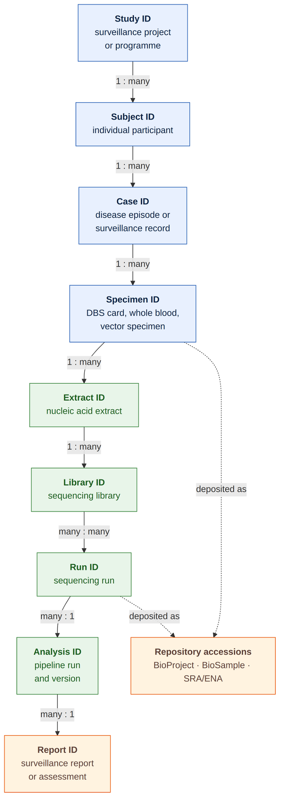

*Figure 8.2: Example identifier hierarchy for malaria genomic surveillance. These identifiers should be linked throughout the workflow to preserve the chain of custody from collection to report, support quality assurance, and enable integration of epidemiological and genomic data. It should allow any result to be traced back to the specimen and forward to its published accession. Specimen collector identifiers are treated as identifying data and are handled under the access rules.*

### 8.3 Minimum Metadata Specification

* Analysis results should be reproducible and transparent, holding up to metadata standards. There are several resources available to help set malaria metadata standards. PHA4GE resources include: Minimal Pathogen-Agnostic Contextual Data Specification, Malaria Community Metadata Standard Workstream. By using the same resources and reaching a language consensus, cross-border tracking is improved.  
* Use a template tool that harmonises and standardises metadata (e.g., DataHarmonizer).  
* Use controlled natural language and ontology terms.  
* Map the report back to International Nucleotide Sequence Database Collaboration (INSDC) fields (European Nucleotide Archive (ENA), NCBI BioSample, and Sequence Read Archive (SRA)).  
* Adopt QC metadata tags.

**Table 8.3: Minimum metadata tags**

| Domain | Field | Requirement |
| ----- | ----- | ----- |
| **Identifiers** | Specimen collector ID | Required, treat as identifying data |
|  | Sample ID | Required |
|  | BioProject accession, SRA accession, BioSample accession | Required for archived files |
| **Geography** | Country (International Organisation for Standardisation \[ISO\] 3166-1), Health facility identifier | Required |
|  | Latitude, Longitude | Optional |
| **Time** | Collection date (ISO 8601\) | Required (month and year) |
| **Host/specimen** | Host species, Age group, Sex, Specimen type (DBS, VWB, vector) | Required (specific age is not needed) |
| **Clinical** | Symptomatic status, Severity, Prior antimalarial use, Travel history (30 days) | Required for TES, recrudescence, importation, connectivity, IBD |
| **Field diagnostic** | RDT type, RDT target antigen, RDT result, Microscopy result, Parasite density or qPCR Ct | Required for diagnostic escape and recommended for other use cases |
| **Sampling design** | Sampling scheme, Enrollment target, Study domain | Required |
| **Purpose** | Purpose of sampling, Purpose of sequencing | Required |
| **Laboratory** | Extraction method, library prep kit, Panel name, Panel composition, Sequencing platform, Sequence run ID | Required |
| **Vector** | Collection method, Morphology, Bloodfed status, Gonotrophic cycle stage, Insecticide exposure, Site intervention history | Required for vector surveillance (insecticide resistance, species composition) |
| **Provenance** | Sequencing manifest ID | Required |

### 8.4 Capture Points Across The Workflow

**Key workflow stages and associated metadata include:**

* **Population screening and sample collection:** Target population, surveillance strategy, diagnostic method (RDT or microscopy), Study ID, Subject ID, Case ID, Sample ID, collection date, collection site, and demographic information.

* **Sample collection:** Specimen type (e.g., DBS or VWB), collection method, collection device, collection location, responsible agency/personnel, and preservation method.

* **Sample processing:** DBS punching, centrifugation, serum/buffy coat/packed RBC separation, storage, and cryopreservation, together with processing dates, laboratory information, storage conditions, and handling procedures.

* **Nucleic acid extraction and quality control:** Extraction protocols, extraction kits, extraction dates, DNA quantification methods, and quality control metrics.

* **Target enrichment and library preparation**: PCR amplification, SNP panels, MIPs, targeted enrichment approaches, target genes/loci, library preparation methods, and barcode/index information.

* **Sequencing:** WGS, targeted sequencing, short-read and long-read amplicon sequencing, including sequencing platform, sequencing chemistry, run information, sequencing date, and read characteristics.

* **Bioinformatics and genomic analysis:** Species identification, genotyping, SNP analysis, drug-resistance marker detection, population genetics analyses, bioinformatics pipelines, software versions, reference genomes, and variant-calling methods.

* **Public health interpretation:** The detected species, genotypes or lineages, drug-resistance markers, transmission clusters, genetic diversity and population structure findings, and their epidemiological significance. Additional metadata may include risk assessments, recommended public health actions, and the responsible analyst, laboratory, or institution performing the interpretation.

* **Reporting and data sharing:** The report identifier, report type, report generation date, reporting institution, intended audience, key findings, recommendations, version history, and approval status; accession identifiers, including BioProject, BioSample, and Sequence Read Archive (SRA) accessions, as well as repository information, data-sharing permissions, access restrictions, data-use agreements, responsible institutions, data release dates, long-term preservation of the data, and archived analytical outputs. Details should also be captured to ensure appropriate governance, interoperability, and long-term accessibility of genomic surveillance resources.

*Note*: Metadata should document movement of specimens between collection sites and laboratories to ensure chain of custody and specimen integrity.

> [!NOTE]
> **SECTION 8 · KEY POINTS | Metadata Standards and Interoperability**
>
> - **•** Differences in collection approaches, metadata structures and reporting standards continue to limit interoperability and cross-country analysis; a harmonised minimum metadata framework is the remedy.
>
> - Africa CDC and PHA4GE convenings in 2025 built consensus on minimum parasite and vector metadata standards, NMCP-usable outputs, alignment with WHO policy thresholds and regional data-sharing frameworks.
>
> - Traceability rests on a hierarchy of identifiers linked end to end.
>
> - Metadata capture points span screening and collection, transport and reception, processing, extraction and QC, enrichment and library preparation, sequencing, bioinformatics, interpretation, reporting and data sharing.
>
> - All metadata should use standardised terminologies and controlled vocabularies so that epidemiological and genomic data can be integrated across systems.

## **9\. Quality Control, Validation, Reporting, and Comparability**

QC, validation, reporting, and comparability should be considered as a single end-to-end quality assurance framework for malaria genomic surveillance. In malaria genomics, data quality is influenced by:

* Sequencing performance  
* Specimen type  
* Parasite density  
* Storage conditions  
* Host DNA contamination  
* Enrichment strategy  
* Assay design  
* Bioinformatics assumptions  
* Within-host complexity

Therefore, QC should assess whether the data are fit for the intended public health use case, rather than applying one universal pass-or-fail threshold across all methods and epidemiological contexts.

The quality framework should cover the full workflow:

* Pre-analytical steps  
* Laboratory processing  
* Sequencing  
* Bioinformatics  
* Interpretation  
* Reporting  
* Data sharing

This is especially important because malaria genomic surveillance may use different sample types, including DBS, VWB, etc., as described in [Section 5.2](#52-influence-of-samples-on-downstream-analysis). The sample types differ in DNA yield, host contamination, and degradation risk, which determine their suitability for WGS, targeted sequencing, copy-number analysis, deletion calling, or haplotype reconstruction. For example, VWB yields more DNA than DBS, and these differences can affect molecular detection, sequencing success, and comparability across studies ([Holzschuh and Koepfli, 2022](https://link.springer.com/article/10.1186/s12936-022-04122-9)).

### 9.1 Core Quality Principles

Malaria genomic surveillance programmes should apply the following quality principles:

* **Traceability:** Every result should be linked to unique identifiers covering the study, subject or case, specimen, extract, library, sequencing run, analysis, and report.

* **Fitness for purpose:** QC thresholds should be defined according to the surveillance objective, such as resistance marker detection, *pfhrp2/3* deletion monitoring, transmission analysis, importation assessment, or WGS-based discovery (see [Section 4](#4-study-design) for more details).

* **Transparency:** Laboratories should document sample type, assay version, sequencing platform, reference genome, software versions, parameters, QC thresholds, and limitations.

* **Reproducibility:** Workflows should be versioned, repeatable, and preferably implemented through structured pipelines or workflow managers where feasible.

* **Comparability:** Outputs should use harmonised terminology, standardised marker nomenclature, and consistent denominator definitions so that results can be aggregated across laboratories, countries, and surveillance networks.

* **Public health interpretability:** QC should support decision-making, not only technical reporting. A result that passes sequencing QC may still be unsuitable for a specific interpretation if marker coverage, parasite density, deletion confidence, or minority variant sensitivity is insufficient.

### 9.2 QC Domains and Indicators

**Table 9.2: QC documentation recommendations for each level in the workflow**

| QC domain | Recommended indicators | Purpose |
| ----- | ----- | ----- |
| **Pre-analytical** | Record specimen type, collection date, collection site, storage condition, transport condition, time from collection to processing, and parasite density or Ct value where available. | Assesses whether the specimen is suitable for the intended assay. |
| **Extraction** | Record the extraction method, extraction batch, DNA concentration, DNA yield, extraction controls, inhibition flags, and host DNA depletion/enrichment method. | Supports interpretation of low-yield or failed samples. |
| **Library/assay** | Record assay type, primer/panel version, target list, barcode/index, library concentration, amplification success, and positive/negative controls. | Detects assay failure, barcode issues, and batch effects. |
| **Sequencing** | Record total reads, reads per sample, read quality, demultiplexing success, depth per target or genome coverage, on-target rate, proportion of parasite reads, and duplication where relevant. | Determines whether sequencing output is adequate. |
| **Bioinformatics** | Record the pipeline name/version, software versions, reference genome, variant caller, parameters, filtering thresholds, missingness, and contamination flags. | Supports reproducibility and reanalysis. |
| **Marker-level** | Record coverage per marker, allele frequency, strand balance where relevant, wildtype/mutant/mixed/missing/indeterminate status, and confidence score. | Supports resistance and diagnostic marker interpretation. |
| **Population- genomic** | Record missing data, relatedness quality, MOI estimate confidence, IBD marker density, and sample representativeness. | Supports transmission and connectivity analyses. |
| **Reporting** | Report denominator definitions, confidence intervals, limitations, report version, audience, and interpretation framework. | Supports comparability and public health use. |

### 9.3 Validation and Benchmarking

Validation should be clearly distinguished from routine QC. Routine QC determines whether a specific sample or run is acceptable. Validation demonstrates that a workflow is fit for routine use before deployment or after major changes.

Validation should be required when a laboratory introduces:

* A new assay  
* New sample type  
* New sequencing chemistry  
* New analysis pipeline  
* New variant caller  
* New panel version  
* New reporting threshold

Validation should include, where feasible:

* Analytical sensitivity and specificity  
* LOD by sample type and parasite density  
* Repeatability within the same run  
* Reproducibility across runs, operators, reagent lots, and laboratories  
* Concordance with comparator methods, such as qPCR, Sanger sequencing, orthogonal amplicon sequencing, WGS, or validated deletion assays  
* Ability to detect mixed infections and minority variants where claimed  
* Performance for low-parasitaemia samples  
* Performance for DBS, VWB, and other intended specimen types  
* Accuracy of deletion, duplication, and copy-number calls where these are reported  
* Performance of bioinformatics pipelines under version-controlled conditions

Validation panels should include:

* Positive and negative controls  
* No-template controls  
* Extraction controls  
* Low-density samples  
* Mixed-clone or mock-mixture materials, where feasible and needed  
* Representative field samples

Amplicon-based haplotype recovery should be validated carefully because low-density samples and low read depth can lead to missed haplotypes, especially minority haplotypes.

For WGS pipelines, validation should include comparison against high-confidence reference datasets and documentation of pipeline parameters. A study by Niaré *et al.* showed that an optimised GATK4 pipeline for *P. falciparum* WGS showed that malaria-specific parameter optimisation can improve SNP and indel sensitivity compared with default settings, highlighting why pipeline validation and versioning are essential ([Niaré *et al.*, 2023](https://link.springer.com/article/10.1186/s12936-023-04632-0)).

### 9.4 Method-Specific QC Considerations

**Amplicon sequencing and multiplexed panels:** QC should focus on amplification success, primer dropout, target-level depth, barcode balance, allele-frequency thresholds, false-positive and negative haplotypes, and mixed infection performance. Minority variant reporting should only be included when the assay has been validated for that purpose.

**MIPs and targeted capture:** QC should include probe performance, target recovery, molecular barcode or unique molecular identifier (UMI) performance where used, missingness by locus, allele balance, and batch effects. Because panels are fixed, panel versioning is critical for comparability.

**NOMADS-like targeted nanopore sequencing:** QC should include read length, target-level coverage, consensus accuracy, deletion-calling confidence, barcode crosstalk, and variant-calling thresholds. Targeted nanopore sequencing has been shown to support flexible, lower-cost genomic surveillance from DBS, including drug-resistance genes, diagnostic antigens, polymorphic markers, and vaccine target genes, but local validation remains necessary before policy use ([de Cesare *et al.*, 2024](https://www.nature.com/articles/s41467-024-45688-z)).

**Whole-genome sequencing:** QC should include genome coverage, callable fraction, parasite read proportion, host contamination read count, mapping quality, duplication, variant quality, and suitability for downstream population genetics analyses. sWGA can improve sequencing from DBS and has been shown to enrich *P. falciparum* DNA from clinical DBS samples, but it may introduce biases that should be documented and considered in interpretation ([Oyola *et al.*, 2016\)](https://link.springer.com/article/10.1186/s12936-016-1641-7).

**Vector genomic surveillance:** QC should include species identification confidence, specimen preservation, DNA quality, sequencing depth, marker coverage, contamination, insecticide resistance marker quality, and comparability between morphological and molecular species identification. Vector genomics should follow the same principles of traceability, versioned analysis, and fit-for-purpose interpretation.

### 9.5 Comparability Across Laboratories and Networks

Comparability should be defined as fit-for-purpose comparability, not necessarily full analytical equivalence. Different laboratories may use different sample types, sequencing platforms, panels, and pipelines. Results can still be comparable if the methods, thresholds, limitations, and denominators are transparent.

To support comparability, surveillance networks should harmonise:

* Minimum metadata fields (see [Section 8](#8-metadata-standards-and-interoperability) for metadata standards)  
* Identifier structures  
* Sample type definitions  
* Assay and panel version naming  
* Marker nomenclature  
* Reference genome versions  
* Variant representation  
* Quality thresholds  
* Reporting categories  
* Denominator definitions  
* Uncertainty reporting  
* Data-sharing formats

Interlaboratory comparability should be supported by shared validation panels, external quality assessment (EQA) where possible, ring trials, replicate testing, and periodic reanalysis of shared datasets. Where methods differ, reports should explicitly state the expected direction of bias. For example, low-density DBS may reduce haplotype recovery, sWGA may affect read depth-based CNV calling, targeted panels cannot detect markers outside their design, and WGS may be biased towards higher parasitaemia samples if low-density samples fail QC.

**Table 9.5: Expected direction of bias by method**

| Method of specimen | Expected direction of bias |
| ----- | ----- |
| **Low-density DBS** | May reduce haplotype recovery |
| **sWGA** | May affect read-depth-based CNV calling |
| **Targeted panels** | Cannot detect markers outside their design |
| **WGS** | May be biased towards higher parasitaemia samples if low-density samples fail QC |

### 9.6 Repository-Ready and Machine-Readable Outputs

Where data sharing is permitted, laboratories should prepare repository-ready outputs. The NCBI SRA model distinguishes STUDY, SAMPLE, EXPERIMENT, and RUN objects, with EXPERIMENT and RUN carrying technical sequencing and file-level information. This structure is useful for malaria genomic surveillance because it mirrors the need to separate study-level context, sample-level metadata, library or sequencing metadata, and raw sequence files ([NCBI, n.d.-b](https://www.ncbi.nlm.nih.gov/sra/docs/submitmeta/)).

Machine-readable outputs should include:

* Sample metadata table  
* QC table  
* Marker table  
* Variant table or VCF, where appropriate  
* Allele-frequency table  
* Analysis provenance file  
* Data dictionary  
* Reporting summary  
* Accession mapping table

BioSample-style attributes and harmonised attribute names should be used where possible, with controlled vocabularies and standardised formats to reduce free text ambiguity ([NCBI, n.d.-a](https://www.ncbi.nlm.nih.gov/biosample/docs/attributes/)).

> [!NOTE]
> **SECTION 9 · KEY POINTS | Quality Control, Validation and Comparability**
>
> - **•** Quality assurance should span the complete workflow from specimen collection and laboratory processing through sequencing, bioinformatics, interpretation, reporting, and data sharing.
>
> - QC thresholds should be fit for the intended public health use case and specimen type, rather than treated as one universal pass-or-fail standard.
>
> - Traceability requires versioned records of specimens, assays and panels, reference genomes, pipelines, parameters, controls, coverage, contamination, missingness, and marker-level confidence.
>
> - Validation is distinct from routine QC and should establish sensitivity, specificity, limits of detection, repeatability, reproducibility, mixed-infection and minority-variant performance, and concordance with comparator methods.
>
> - Method-specific biases and failure modes across amplicon, MIP, nanopore, WGS, and vector workflows must be documented, while terminology and denominators are harmonised for cross-laboratory comparison.

# **Part D – Interpretation, Governance and Implementation**

## **10\. Interpretation and Public Health Action**

Genomic surveillance is most useful when its findings are interpreted in relation to a defined public health question and translated into proportionate programme action. Interpretation should consider the strength of the evidence, the quality and representativeness of the underlying data, and relevant epidemiological, clinical, diagnostic, therapeutic-efficacy, and entomological information.

### 10.1 Principles of Interpretation

The same genomic finding may have different public health implications depending on its evidence level, frequency, spatial distribution, linkage with clinical outcomes, and the local malaria-control context. Reports should therefore distinguish between:

* Validated findings, supported by adequate QC and an established interpretation framework  
* Candidate or emerging signals, requiring confirmation, additional sampling, or TES linkage  
* Indeterminate results, where low parasite density, poor DNA quality, missing targets, mixed infection, or insufficient sampling prevent reliable interpretation

For drug resistance, a low-frequency marker may justify enhanced surveillance or targeted TES but may not be sufficient to support treatment-policy change. For transmission and connectivity, relatedness should be described as evidence compatible with local transmission, importation, or linkage, rather than proof of transmission direction. For diagnostic resistance, failed amplification should not be reported as confirmed *pfhrp2/3* deletion without adequate parasite DNA and successful control-locus results. For TES, molecular classification of recurrence should complement, not replace, standardised clinical and parasitological outcome definitions.

### 10.2 Use Case Pathways From Question to Action

**Table 10.2: Translating malaria genomic surveillance outputs into public health questions and programme actions**

| Priority use case | Core public health question | Main genomic or molecular outputs | Typical public health action |
| ----- | ----- | ----- | ----- |
| **AMDR surveillance** | Are validated resistance markers emerging, increasing, or spreading? | Marker frequencies, resistance haplotypes, copy-number changes, geographic distribution, temporal trends. | Intensify surveillance, prioritise TES, review treatment options, target affected districts. |
| **Transmission and connectivity analysis** | Are cases compatible with local transmission, importation, or connected transmission networks? | Genetic barcodes, relatedness, IBD, population structure, lineage distribution. | Focal investigation, targeted response, cross-border coordination, additional sampling. |
| **Diagnostic escape** | Are infections being missed because of *pfhrp2/3* deletions or other diagnostic limitations? | RDT–PCR or microscopy discordance, *pfhrp2/3* status, flanking-gene control results, antigen confirmation. | Diagnostic-quality investigation, confirmatory testing, review of algorithms, and RDT procurement. |
| **Therapeutic efficacy study** | Do recurrent infections represent recrudescence, reinfection, or possible treatment failure linked to parasite genotype? | Paired baseline–recurrence genotyping, resistance markers, parasite clearance, recurrence classification. | Improved TES interpretation, intensified marker surveillance, follow-up studies, policy review where evidence converges. |

The value of genomic surveillance is substantially enhanced when datasets generated across studies, countries, and surveillance programmes are harmonised into interoperable and comparable regional resources. The value of this information is further enhanced when the data are interpreted at local, cross-country, and regional levels. For example, malaria responses and the underlying parasite populations differ drastically between Southeast Asia and Sub-Saharan Africa. Within Africa, there is further diversification and a range of transmission settings. Data collation frameworks enable integration of genomic surveillance findings with therapeutic efficacy outcomes, epidemiological indicators, malaria burden estimates, transmission intensity metrics, vector control coverage, and existing treatment guidelines.

Such integrated analyses strengthen interpretation by placing genomic findings within their broader public health and operational context. Harmonised datasets also support regional and cross-border analyses, which are increasingly important given the movement of resistant parasite populations across endemic settings. Interoperable approaches aligned with standardised metadata and reporting structures facilitate the aggregation of evidence across laboratories and surveillance systems, while improving the reproducibility and long-term utility of genomic resources.

Interpretation of genomic surveillance outputs should remain closely linked to programmatic decision-making and clearly defined public health objectives. Reporting frameworks should subsequently move beyond technical descriptions of genetic variants towards concise, policy-relevant interpretation. Reports may be tailored to different target audiences, including the WHO Global Malaria Programme (WHO GMP), NMCPs, ministries of health, regional bodies such as the EAC and Southern African Development Community (SADC), or implementation partners involved in malaria control and elimination. Use of harmonised terminology, including classifications defined within the WHO resistance marker compendium and the WHO strategy to respond to AMDR in Africa, supports consistency in interpretation and communication across stakeholders. Genomic findings should ideally be interpreted alongside TES outcomes and clinical indicators of treatment response to strengthen confidence in the public health relevance of emerging markers.

Several high-value use cases illustrate the public health utility of malaria genomic surveillance. Surveillance data provide evidence to support updates to the WHO compendium of resistance-associated markers, including the identification of genetic loci linked to delayed parasite clearance or reduced therapeutic efficacy, such as African-specific genotypes. Genomic evidence can inform prioritisation of markers for inclusion in TES activities and guide surveillance strategies focused on regions at highest risk of resistance emergence or spread. Similarly, genomic surveillance of *pfhrp2/3* deletions may support decisions regarding rapid diagnostic test deployment and procurement strategies. Parasite population genetic analyses and predictive modelling approaches may further support the identification of transmission hotspots, vulnerable border regions, or areas at elevated risk of future emergence of resistance. These analyses can guide targeted interventions, resource allocation, and deployment of optimised treatment and prevention strategies.

Genomic surveillance outputs additionally provide important intelligence for pharmaceutical and product development initiatives. Stakeholders involved in antimalarial drug development, including pharmaceutical partners and product development organisations, require an up-to-date understanding of the evolving resistance landscape to support evaluation of current therapies and prioritisation of future compounds. Likewise, funding agencies and procurement bodies rely on surveillance evidence to support strategic investment decisions and procurement of the most effective antimalarial interventions. Integrating genomic surveillance into broader malaria intelligence platforms strengthens both immediate public health responses and longer-term preparedness and planning.

Effective translation of genomic surveillance data into public health action requires sustained engagement between multiple stakeholder groups. These include national public health institutes, reference laboratories, academic and research institutions, NMCPs, regional surveillance networks, and international technical partners. Additional engagement with organisations such as the Roll Back Malaria Partnership, WHO GMP, Medicines for Malaria Venture (MMV), the Global Fund, and philanthropic funding bodies remains essential to support coordinated surveillance, evidence synthesis, and implementation of policy-relevant recommendations. Importantly, communication products generated by genomic surveillance initiatives should also include accessible outputs such as policy briefs, dashboards, situation reports, and infographics that translate complex genomic data into formats understandable to decision-makers and non-specialist stakeholders.

Ultimately, integrating genomic surveillance into malaria control and elimination programmes strengthens data-driven public health decision-making by enabling earlier detection of emerging threats, more targeted intervention strategies, and improved evidence-based policy development. The ability to move from genomic data generation to actionable public health interpretation represents a critical component of modern malaria surveillance systems and will become increasingly important as endemic countries respond to evolving challenges related to AMDR, diagnostic resistance, and malaria elimination efforts.

### 10.3 Escalating Genomic Signal to Programme Action

**Table 10.3: Genomic surveillance signals and corresponding programmatic actions**

| Genomic Signal | Programmatic Action |
| :---: | :---: |
| First detection of any validated resistance marker in a country or region. | Confirm by other methods; if confirmed, report to WHO or regional network, review TES schedule, expand sampling in the surrounding area. |
| Validated marker detected in multiple sites, or rising across two or more consecutive reporting periods. | Prioritise TES at affected sites, intensify sampling, review partner drug markers, brief the Malaria Technical Advisory Group (MaTAG). |
| Validated markers with clinically confirmed efficacy signal from TES. | Review the formal treatment policy under WHO guidance. |
| False negative HRP2 RDT results by *pfhrp2/3* deletion, meeting WHO threshold criteria in any domain [(WHO, 2024\)](https://www.who.int/publications/i/item/9789240101838). | RDT procurement review per WHO recommendation. |
| Novel or unclassified variant. | Refer for characterisation, report as a variant of unknown significance, continue monitoring. |
| Signal below the minimum determinant call threshold. | Report as insufficient data, increase sampling. |

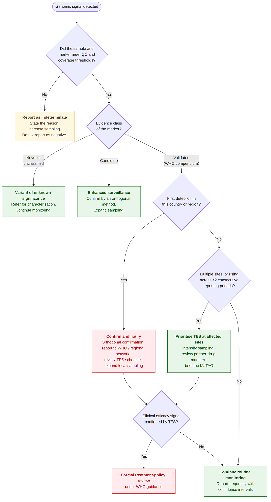
*Figure 10.3: Escalation pathway from a genomic signal to programme action. Escalation depends on the evidence class of the marker, the adequacy of the underlying data, and convergence with clinical and epidemiological evidence. Thresholds for several of these decisions are not yet internationally agreed; see [Section 14.6](#146-interpretation-thresholds) for discussion.*

### 10.4 Reporting Standards

Malaria genomic reports should contain both a technical layer and a public health interpretation layer.

The technical layer should include:

* Study objective  
* Sampling frame and collection period  
* Number of samples collected, received, extracted, sequenced, analysed, passed QC, and excluded  
* Sample types and collection sites  
* Assay, panel, primer scheme, or sequencing strategy  
* Sequencing platform and chemistry  
* Bioinformatics workflow, software versions, reference genome, and parameters.  
* QC thresholds and QC results  
* Marker-level outputs  
* Missingness and indeterminate calls  
* Limitations and data-quality caveats  
* Accession numbers where data are deposited

The public health interpretation layer should include:

* Frequency of validated resistance markers, candidate markers, and emerging markers  
* Frequency of wildtype, mutant, mixed, missing, and indeterminate calls  
* Geographic and temporal distribution of markers  
* *pfhrp2/3* deletion interpretation where applicable  
* Relationship with TES, treatment failure, diagnostic escape, or epidemiological data, where available  
* Public health implications  
* Recommended follow-up actions  
* Confidence level and limitations

For resistance reporting, wild-type results should be reported alongside mutant results because marker prevalence depends on the denominator of interpretable samples. Missing, failed, and indeterminate results should not be silently excluded. The WHO compendium provides a structured reference for prioritising and harmonising molecular markers for AMDR, and WHO notes that marker monitoring and reporting have historically been inconsistent without a unified curated reference list ([WHO, 2025b](https://www.who.int/publications/m/item/compendium-of-molecular-markers-for-antimalarial-drug-resistance)).

**Table 10.4: Minimum reporting elements**

| Layer | Elements |
| ----- | ----- |
| **Study and Sampling** | Study objective; sampling frame; collection dates; sites, districts, and regions; sample type; parasite species tested; parasite density or Ct value; representativeness. |
| **Laboratory and analysis** | Sequencing method; target genes or panel description; bioinformatics workflow, software versions, reference genome, and parameters. |
| **Sample accounting** | Number of samples collected; number extracted; number sequenced; number passing QC; number excluded. |
| **Quality control** | QC threshold; QC results; minority variant thresholds; missingness by locus. |
| **Results** | Marker frequencies with confidence intervals; frequency of wild-type, mutant, mixed, missing, and indeterminate calls; geographic and temporal distribution of markers; MOI or polyclonality assessment, if performed; *pfhrp2/3* deletion interpretation, where applicable. |
| **Interpretation** | Interpretation against WHO or national guidance; relationship with TES; treatment failure; diagnostic performance; or epidemiological data where available; public health implications; confidence level. |
| **Limitations and follow-up** | Limitations and data-quality caveats; recommended follow-up actions; responsible institution and proposed timeline for review. |
| **Data deposition** | Accession numbers where data are deposited. |

*Image placeholder (figure not yet uploaded).*

Image placeholder

*Figure 10.4: Translating malaria genomic surveillance data to public health action, from data generation to collation, reporting and stakeholder engagement.*

> [!NOTE]
> **SECTION 10 · KEY POINTS | Interpretation and Public Health Action**
>
> - **•** The goal is operational integration into surveillance, response and policy pathways.
>
> - Implementation principles: public health question first, modularity, integration, national ownership, reproducibility, sustainability, equity, and adaptability.
>
> - A tiered model lets countries start with targeted workflows and escalate; DBS is the typical sample type across tiers.
>
> - Minimum requirements span sample tracking, metadata tools, storage, contamination-controlled laboratory space, extraction and library preparation capacity, control materials, reproducible workflows, reporting templates and governance procedures.
>
> - A multidisciplinary workforce is needed, with training in both technical and interpretive competencies, and computing scaled to the method .
>
> - Success is measured by whether outputs are timely, interpretable, comparable and used to update or uphold public health actions, and not by samples sequenced.

## **11\. Data Sharing and Governance**

Responsible data sharing can increase the public health value of malaria genomic surveillance by enabling cross-site comparison, regional analysis, reanalysis, and secondary research. Findable, Accessible, Interoperable, and Reusable (FAIR) data should not be equated with unrestricted public release ([Wilkinson *et al.*, 2016](https://doi.org/10.1038/sdata.2016.18)). Access may be open, controlled or restricted depending on the type of data, applicable law, ethics, surveillance authority, consent, programme governance and potential risks.

PHA4GE's Microbial Data-Sharing Accord provides baseline consensus principles for responsible secondary use of sequencing data and is intended to complement, not replace, specific legal agreements, ethics requirements or data sharing agreements [(Griffiths *et al.*, 2024\)](https://doi.org/10.1136/bmjgh-2024-016474).

### 11.1 Principles of Responsible Sharing

Sharing expectations should be established as early as practical rather than negotiated only after analysis is complete. Data sharing plans should promote:

* Public health benefit  
* Lawful and ethical use  
* Appropriate recognition of data generators  
* Equitable participation and benefit  
* Transparent permitted uses  
* Appropriate protection of sensitive information  
* Traceability and versioning  
* Interoperability  
* Timely access where public health action requires it  
* Accountability for onward sharing and secondary use

### 11.2 Access Categories

A practical malaria genomic data-sharing framework should distinguish between access categories according to the sensitivity of the data, governance requirements, and conditions for secondary use. The classification should be determined by the data and governance context, not by sequencing technology alone.

**Table 11.2: Data access categories for malaria genomic data sharing**

| Category | Typical content | Possible access approach |
| :---: | :---: | :---: |
| **Open** | Sequence data and non-sensitive metadata authorised for public release. | public repository/open platform |
| **Controlled access** | Richer contextual datasets, linked epidemiological information, or data requiring approved secondary use conditions. | approved users/data access process |
| **Restricted/sensitive** | Direct identifiers, potentially identifying host information, precise sensitive location data, or human sequence not authorised for sharing. | retained within the authorised environment |
| **Aggregated programme outputs** | District/site summaries, marker prevalence, trends, dashboards, policy briefs. | programme/regional/public dissemination as appropriate |

### 11.3 Ethical, Legal and Surveillance Authority

Before sharing, data generators should establish the lawful and ethical basis under which specimens and data were collected and the purposes for which they may be used. Since these requirements differ between countries and activities, this guidance should not prescribe a universal consent, ownership, or international transfer rule.

Relevant considerations include:

* Whether the activity is research or authorised public health surveillance  
* Applicable ethics approval  
* Consent or waiver requirements  
* National legislation  
* Institutional policy  
* Data use agreements  
* Sample/export agreements  
* Conditions attached to funders or repositories  
* Restrictions on secondary use

### 11.4 Stewardship and National Programme Roles

Malaria genomic surveillance should be integrated with national public health systems, and responsibilities for data stewardship, approval, and communication should be explicitly documented. The guidance should avoid declaring a universal legal “owner” of malaria genomic data. Instead, programmes should identify:

* The data-generating institution(s)  
* The responsible data steward  
* The national programme/national public health institute (NPHI) role  
* Who can authorise release or secondary use  
* Access conditions  
* Responsibility for communicating findings

### 11.5 Sensitive Metadata

Human host sequences are unintentionally generated during sequencing of *Plasmodium*, creating additional ethical and privacy considerations. For routine *Plasmodium* data sharing, contaminating human sequences should be removed before release unless there is an explicit authorised purpose, appropriate ethical/legal basis and corresponding access controls. PHA4GE's Microbial Data-Sharing Accord specifically includes this principle for microbial genomic datasets [(Griffiths *et al.*, 2024\)](https://doi.org/10.1136/bmjgh-2024-016474). The same data minimisation principle should apply to potentially identifying metadata. Exact location, dates, demographic combinations, and travel histories may become identifying when combined, even if a person's name is absent.

### 11.6 Cross-border and Regional Sharing

Regional malaria threats, particularly resistance and parasite connectivity, may require data to be interpreted across national borders. Regional aggregation does not require every underlying person-linked variable to cross borders. Where appropriate, programmes may share de-identified sample-level genomic data, controlled-access metadata or aggregated summaries according to the question and governance arrangements.

Cross-border sharing should be supported through:

* Agreed metadata and terminology  
* Documented access conditions  
* Agreed analytical outputs  
* Clear data generator attribution  
* Procedures for communicating potentially sensitive public health findings  
* National/regional review pathways where required  
* Mechanisms for resolving discrepancies in interpretation

*Image placeholder (figure not yet uploaded).*

### 11.7 Repository Deposition, Data Use Agreements and Controlled Access

Where public or controlled repository deposition is permitted, data should be prepared in repository-compatible formats and linked to appropriate metadata and accession identifiers. For sequence data, INSDC repositories such as NCBI SRA, ENA, and DNA Data Bank of Japan (DDBJ) provide established mechanisms for durable archival and accessioning. NCBI's SRA model explicitly separates study/project, biological sample, sequencing experiment, and run information ([NCBI, n.d.-b](https://www.ncbi.nlm.nih.gov/sra/docs/submitmeta/)). Repository submission should be viewed as one sharing mechanism, not an automatic requirement for every malaria surveillance dataset.

### 11.8 Data Use Agreements and Controlled Access

Where data cannot appropriately be released without restriction, programmes should use controlled-access mechanisms or data use agreements proportionate to the risk and intended use. The PHA4GE Data-Sharing Accord can provide a baseline code of conduct, but it does not replace bespoke legal/data-sharing agreements where those are needed [(Griffiths *et al.*, 2024\)](https://doi.org/10.1136/bmjgh-2024-016474).

Conditions may specify:

* Permitted purpose  
* Duration of access  
* Onward sharing restrictions  
* Security requirements  
* Acknowledgement/attribution  
* Publication communication  
* Return or destruction, where applicable  
* Processes for requesting expanded use

### 11.9 Secondary Use, Attribution and Timing of Release

Secondary analysis can generate substantial additional value from malaria genomic datasets. Data consumers should respect the terms under which data were made available and appropriately acknowledge data-generating programmes and institutions. Where substantial new analyses are planned, early engagement with data generators can improve scientific interpretation, reduce inappropriate conclusions and support equitable participation. Authorship should not be prescribed solely by dataset provision in this guidance. Publication credit should follow applicable journal/contributor standards and the agreed collaboration context.

Data release timing should balance public health urgency, validation, confidentiality, national review requirements and legitimate interests of data-generating programmes. For urgent threats, rapid sharing of validated surveillance information may be necessary before traditional publication timelines. Conversely, premature release of poorly validated findings may cause inappropriate programme responses.

Programmes should define, in advance, where possible:

* Who reviews the results  
* What constitutes a reportable signal  
* Who receives the information  
* What may be publicly released  
* How updated or corrected interpretations will be communicated

### 11.10 Integration and Interoperability

Data integration depends on more than putting files in the same repository. Datasets should be compatible at the level of:

* Identifiers  
* Metadata concepts  
* Assay/panel versioning  
* Marker nomenclature  
* Genomic reference versions  
* Analytical provenance  
* QC categories  
* Denominator definitions and  
* Reporting categories.

[Section 8](#8-metadata-standards-and-interoperability) defines the metadata requirements; [Section 7](#7-bioinformatics-pipelines-and-standard-outputs) defines analytical provenance and outputs; and [Section 9](#9-quality-control-validation-reporting-and-comparability) addresses QC and comparability.

### 11.11 Federated and Distributed Analysis Approaches

Federated or distributed approaches allow some analyses to occur within national or institutional environments while sharing selected summary results or models. These approaches are promising where moving sensitive or very large datasets is undesirable, but they should be presented as emerging options rather than minimum requirements. Their governance, security, reproducibility, and analytical validity should be demonstrated for the intended application before routine adoption.

> [!NOTE]
> **SECTION 11 · KEY POINTS | Data Sharing, Governance and Integration**
>
> - **•** FAIR and interoperable data are not the same as unrestricted public release; access may legitimately be open, controlled or restricted.
>
> - Sharing expectations should be set early rather than negotiated after analysis and should promote public health benefit, lawful use, attribution, equity, transparency, and accountability for onward use.
>
> - The lawful and ethical basis — research versus authorised surveillance, ethics approval, consent, national legislation, data use and export agreements — must be established before sharing.
>
> - Contaminating human sequence should ordinarily be removed before release, and the same minimisation principle applies to potentially identifying metadata such as exact location, dates, demographic combinations and travel history.
>
> - Cross-border sharing needs agreed metadata, documented access conditions, clear attribution and review pathways; repository deposition is one mechanism, not an automatic requirement, and federated analysis remains an emerging option.

## **12\. Implementation in National Public Health Systems**

Implementation of malaria genomics in public health systems should focus on operational integration into surveillance, response, and policy pathways. The goal is not simply to generate sequence data, but to produce timely, interpretable, comparable, and practical information for NMCPs, NPHIs, reference laboratories, ministries of health, and regional surveillance networks.

### 12.1 Implementation Principles

Implementation should be guided by the following principles:

* **Public health question first**: sequencing should be selected only after defining the decision it will support.

* **Modularity**: countries and laboratories should start with targeted, lower-complexity workflows and expand towards higher-resolution approaches as capacity grows.

* **Integration**: genomic data should be linked with epidemiological, diagnostic, therapeutic efficacy, entomological, and programme data.

* **National ownership**: implementation should be anchored in national systems, with clear leadership from NMCPs, NPHIs, or designated reference laboratories.

* **Reproducibility**: laboratory and bioinformatics workflows should be documented, versioned, and auditable.

* **Sustainability**: implementation should include reagent supply, equipment maintenance, workforce development, funding, governance, and data systems.

* **Equity and adaptability**: guidance should be usable across different transmission settings, laboratory capacities, computational environments, and governance models.

### 12.2 Minimum Infrastructure Requirements

The three-tier model is used when implementing malaria genomics: tier 1 routine marker surveillance, tier 2 enhanced population genomic surveillance, and tier 3 high-resolution investigation (see [Section 3](#3-the-tiered-surveillance-model) for more details). For targeted sequencing, infrastructure can be relatively modest if workflows are well validated. For WGS, implementation requires stronger DNA input, higher sequencing capacity, more advanced computing, and specialised bioinformatics expertise.

**Table 12.2: Minimum infrastructure requirements**

| Domain | Required by all tiers |
| ----- | ----- |
| **Sample management** | Sample registration and tracking system; standardised metadata capture tools. |
| **Storage** | Secure, reliable infrastructure to protect against loss, contamination, or corruption. |
| **Laboratory** | Safe and contamination-controlled molecular laboratory space; DNA extraction capacity; PCR or library preparation capacity; positive and negative control materials. |
| **Sequencing** | Access to a validated sequencing platform or referral pathway. |
| **Data and computing** | Data storage and backup; reproducible bioinformatics workflow. |
| **Reporting and governance** | Reporting templates; governance procedures for data access and sharing. |

### 12.3 Computational and data system requirements

At minimum, implementation should include secure storage for raw data, processed data, metadata, QC outputs, and final reports. Data systems should support versioning, access control, audit trails, backup, and linkage between epidemiological and genomic data.

For settings with limited internet connectivity, pipelines and dashboards that can run offline should be considered. The 2026 continental-scale nanopore implementation demonstrated the value of laptop-based, offline bioinformatics dashboards that display mapping and variant calling results in real time ([Mwenda *et al.*, 2026](https://www.nature.com/articles/s41467-026-72358-z)).

Computational requirements should be scaled to the method:

* **Targeted sequencing**: laptop- or workstation-level analysis may be sufficient.  
* **MIPs and expanded panels**: workstation or modest server capacity may be needed.  
* **WGS**: high-performance computing, cloud computing, or regional analysis support may be required.  
* **Regional aggregation**: secure data platforms and harmonised schemas are needed.

### 12.4 Integration into Existing Surveillance Workflows

Genomic surveillance should not operate as a parallel research system. 

It should be connected to existing surveillance pathways, including:

* Sentinel site surveillance  
* TES  
* Routine diagnostic monitoring  
* *pfhrp2/3* deletion surveillance  
* Outbreak or cluster investigations  
* Cross-border surveillance  
* Entomological surveillance  
* Vaccine target monitoring  
* Case management and policy review processes

The operational workflow should define how samples move from collection sites to laboratories, how metadata are transferred, how results are returned, and who is responsible for interpretation.

At each stage, the system should define:

* Turnaround time expectations  
* Rejection criteria  
* Escalation pathways  
* Reporting recipients

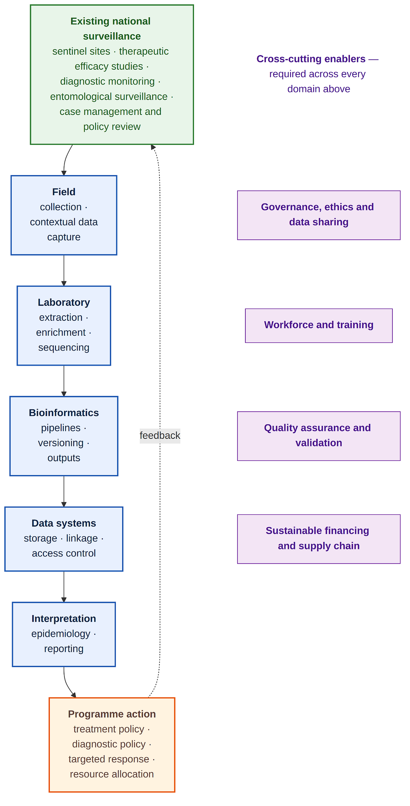

*Figure 12.4: Components of a national malaria genomic surveillance system. The technical domains cannot function without the cross-cutting enablers. Genomic surveillance feeds into existing surveillance streams.*

### 12.5 Workforce and Roles

Implementation requires a multidisciplinary team. Training should cover both technical and interpretive competencies. Laboratory staff should understand good laboratory practice, contamination control, assay limitations, sample tracking, and QC. Bioinformatics staff should understand reproducible pipelines, variant calling, marker interpretation, and data formatting. Programme staff should understand what genomic results can and cannot conclude.

Minimum roles include:

* Field or sentinel site staff for collection and metadata capture  
* Laboratory staff for processing, extraction, library preparation, and sequencing  
* Quality officer or quality focal point  
* Bioinformatician or trained genomic data analyst  
* Data manager or data steward  
* Epidemiologist  
* NMCP or public health interpretation focal point  
* Programme decision-maker responsible for action and feedback

### 12.6 Implementation Pathways by Surveillance Objective

**For routine drug-resistance surveillance**, countries should prioritise validated targeted assays covering locally relevant markers, including *pfk13*, *pfcrt*, *pfmdr1*, *pfdhfr*, *pfdhps*, *plasmepsin 2/3*, and other markers recognised by WHO or national policy frameworks. The WHO compendium should be used as a living reference for marker prioritisation and harmonised interpretation ([WHO, 2025b](https://www.who.int/tools/compendium-of-molecular-markers-for-antimalarial-drug-resistance)).

**For *pfhrp2/3* deletion surveillance**: implementation should include representative sampling, control loci, careful interpretation of low-density samples, and confirmatory testing where results may influence RDT procurement or diagnostic policy.

**For TES-linked genomic surveillance**, genomic workflows should be integrated with therapeutic efficacy study protocols, patient follow-up, treatment outcome data, and recrudescence versus reinfection analysis. Genomic outputs should support interpretation of treatment failure, emerging resistance, and marker prioritisation.

**For transmission and connectivity analysis**, implementation should prioritise appropriate sampling design, sufficient marker density, standardised metadata on collection location and travel history, and careful interpretation in high transmission settings where polyclonal infections are common.

**For vector genomic surveillance,** implementation should be connected to entomological surveillance, insecticide resistance monitoring, vector species identification, intervention coverage, and geospatial risk mapping.

Image placeholder

### 12.7 Governance and Data Sharing in Implementation

Governance requirements are explained in full in [Section 11](#11-data-sharing-and-governance).

For implementation, governance should include clear governance for:

* Ethical approval and consent  
* Use of routine surveillance samples  
* Secondary use of data  
* Sample export or cross-border transfer  
* Data ownership and stewardship  
* National approval of public release  
* Controlled access for sensitive metadata  
* Benefit sharing  
* Return of results to national programmes  
* Publication and authorship principles  
* Community and partner communication, where relevant

Data sharing should follow FAIR-oriented principles while respecting national regulations and programme realities. Repository submissions should be planned early, not after analysis is complete. Where public deposition is appropriate, BioProject, BioSample, SRA, or equivalent accessions should be captured and linked to internal identifiers. NCBI’s data model is useful because it separates study, sample, experiment, and run-level information, which helps preserve traceability and reusability ([NCBI, n.d.-b](https://www.ncbi.nlm.nih.gov/sra/docs/submitmeta/)).

### 12.8 Sustainability and Continuous Improvement

Success should be measured not only by the number of samples sequenced but by whether outputs are timely, interpretable, comparable, and used to update or uphold public health actions. A sustainable malaria genomics programme should include:

* Annual or multi-year budgeting for reagents, consumables, controls, sequencing, data processing, maintenance, data storage, and training  
* Reagent supply chain planning  
* Equipment maintenance and service agreements  
* SOPs and version-controlled protocols  
* EQA or proficiency testing, where possible  
* Change control procedures  
* Periodic review of assay performance  
* Periodic update of marker lists and panel designs  
* Mechanisms for regional data aggregation and collaborative analysis

### 12.9 Implementation Readiness Checklist

A full implementation readiness checklist for public health laboratories, covering laboratory readiness, bioinformatics readiness, and data governance, is given in Appendix C.

> [!NOTE]
> **SECTION 12 · KEY POINTS | Implementation in National Public Health Systems**
>
> - **•** Implementation should begin with a defined public health question and connect genomic surveillance to existing surveillance, response, and policy pathways.
>
> - A tiered, modular approach allows countries to start with targeted routine marker surveillance and expand to higher-resolution methods or WGS as capacity and need increase.
>
> - Minimum readiness includes sample tracking and metadata, a safe molecular laboratory, validated sequencing or referral pathways, secure data storage and backup, reproducible workflows, reporting templates, and governance procedures.
>
> - National ownership and a multidisciplinary workforce are essential; training should cover field, laboratory, quality, bioinformatics, data-management, epidemiological, and interpretive competencies.
>
> - Implementation should integrate relevant objectives, including TES, diagnostic monitoring, pfhrp2/3 deletion surveillance, outbreak investigation, cross-border surveillance, and entomological monitoring, with defined turnaround, rejection, escalation, and reporting pathways.
>
> - Sustainability requires budgeting, supply-chain planning, equipment maintenance, version-controlled procedures, EQA or proficiency testing where possible, change control, and periodic review of assays and marker panels.
>
> - Success should be measured by timely, interpretable, comparable outputs that are used for public health action, not by the number of samples sequenced alone.

## **13\. Case Studies**

Malaria genomic surveillance should be organised around the public health decisions it is intended to support. Its value is not defined by the number of samples sequenced or variants detected, but by whether results provide timely, reliable, and actionable information for NMCPs, National Public Health Institutes, ministries of health, and regional surveillance networks.

Case studies in this section are selected primarily for their demonstrated public health relevance rather than publication date alone. Landmark examples from Viet Nam, Lao People’s Democratic Republic (Lao PDR), Eritrea, and Rwanda remain particularly valuable as they show a clear link between genomic or molecular evidence and programme interpretation. More recent work illustrates that such surveillance can now be implemented in a decentralised manner. For example, the NOMADS-Minimal Viable Panel (MVP) was implemented across six African countries between 2024 and 2025, enabling local sequencing and analysis of *P. falciparum* drug-resistance markers, *pfhrp2/3* deletions, vaccine-target diversity, and minority variants using DBS and laptop-based offline analysis ([Mwenda *et al.*, 2026](https://www.nature.com/articles/s41467-026-72358-z)). Earlier work also showed that targeted nanopore sequencing can generate policy-relevant results from DBS within two to three days at relatively low cost ([de Cesare *et al.*, 2024](https://www.nature.com/articles/s41467-024-45688-z)).

WHO guidance should frame the interpretation of resistance markers and programme response. The [WHO Compendium of Molecular Markers for Antimalarial Drug Resistance](https://www.who.int/tools/compendium-of-molecular-markers-for-antimalarial-drug-resistance) should guide marker selection and evidence classification, while the [WHO Strategy to Respond to Antimalarial Drug Resistance in Africa](https://www.who.int/publications/i/item/9789240060265) provides the broader framework for detection, confirmation, containment, and response.

### 13.1 Case Study 1

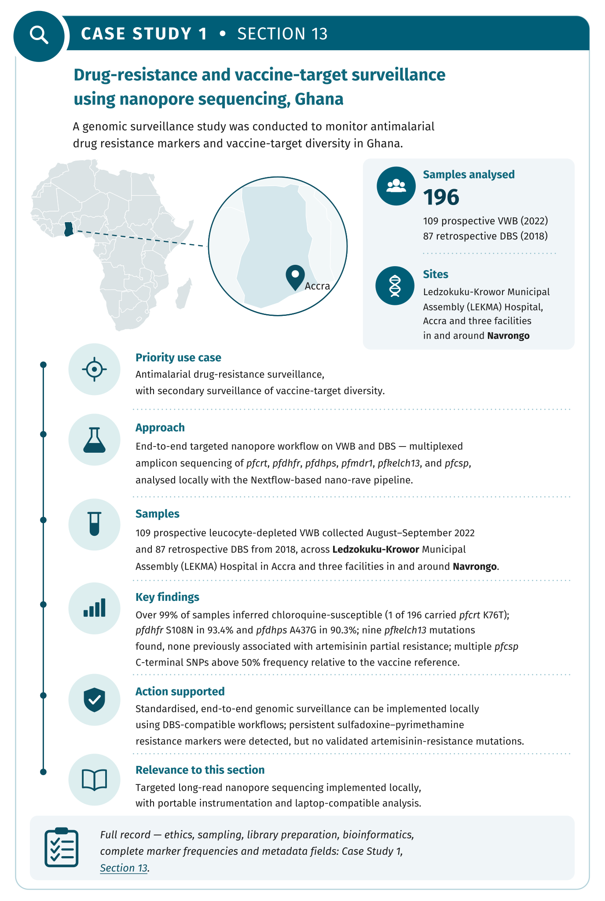

**Drug resistance and vaccine-target surveillance of *Plasmodium falciparum* using nanopore sequencing in Ghana ([Girgis *et al.*, 2023](https://doi.org/10.1038/s41564-023-01516-6))**

**Priority Use Case:** Antimalarial Drug-Resistance Surveillance

**Public Health Case Study:** Antimalarial drug-resistance surveillance, with secondary surveillance of vaccine-target diversity, using an end-to-end targeted nanopore sequencing workflow applied to VWB and DBS samples to monitor key resistance loci and genetic diversity within *pfcsp*.

**Genomic or Molecular Approach:** Multiplexed amplicon nanopore sequencing targeting *pfcrt*, *pfdhfr*, *pfdhps*, *pfmdr1*, *pfk13*, and *pfcsp*, combined with rapid analysis using the locally deployed, Nextflow-based Nanopore Rapid Analysis and Variant Explorer (nano-rave) pipeline. A separate long-range PCR targeting approximately 5 kb of *pfmsp1* was used for selected samples to evaluate the ability of nanopore sequencing to resolve longer, complex, and highly polymorphic regions.

*Ethical Approval*

The Navrongo samples were collected under the Pan-African Malaria Genetic Epidemiology Network (PAMGEN) study. Ethical approval was obtained from the Navrongo Health Research Centre Institutional Review Board (NHRCIRB343). Samples from LEKMA Hospital were collected under the Emerging Genomic Selection and Antimalarial Drug Tolerance (EGSAT) study, with approval from the Ethics Review Committee, University of Ghana (ECBAS030/21–22). Additional approval was granted by the Wellcome Sanger Institute Research Ethics Committee for analysis of the samples. All participants, or their guardians where appropriate, provided informed consent before enrolment.

*Sample Type*

VWB samples (0.5 to 4 mL) or DBS were collected from LEKMA Hospital in Accra and from three facilities in and around Navrongo: two satellite clinics and War Memorial Hospital.

*Sampling Strategy*

Patients who tested positive for at least one *Plasmodium* antigen were recruited with informed consent from the patient or their guardians. 109 prospective VWB samples were collected between August and September 2022, and 87 retrospective DBS samples were collected in 2018 from a larger MalariaGEN collection; both had already undergone QC filtering for Illumina WGS.

*Sequencing Approach*

**PCR**: Multiplex PCR for drug resistance and *csp*, PCR of *msp1*

**Library preparation:** The 109 prospective leucocyte-depleted VWB samples were prepared using the ONT SQK-NBD112.24 native-barcoding kit and sequenced using R10.4 flow cells. The 87 retrospective DBS samples were prepared using the ONT SQK-NBD114.24 native-barcoding kit and sequenced using R10.4.1 flow cells.

*Bioinformatics*

**Sequencing and Basecalling:** ONT MinION and MinKNOW software.

**Analysis:** Custom Nextflow pipeline Nanopore Rapid Analysis and Variant Explorer v1.0.0 (nano-rave), available on GitHub. Minimap2 v2.17 was used to map to the *P. falciparum* 3D7 reference sequences of the amplicon target genes. This reduces computational workload, negating the need for specialised computers. Sequence Alignment/Map (SAM) to Binary Alignment Map (BAM) file conversion with SAMtools v1.15.1. Amplicon coverage data generated using BEDTools v2.29.2. Variant calling and calculating SNP allele frequencies with Medaka v1.4.4, FreeBayes v1.3.5, Clair3 1.0.0. Integrative Genomics Viewer (IGV) tool was used to manually inspect amplicon locus reads. Reference-free consensus sequence generation for *csp* and *msp1* was done with Amplicon\_sorter.

*Bioinformatics Outputs*

**Antimalarial susceptibility:** Over 99% of the samples were susceptible to chloroquine.

**Antimalarial resistance marker frequencies:** More than 99% of the samples were inferred to be chloroquine-susceptible based on the analysed genetic markers. Only one of the 196 samples carried the resistance-associated *pfcrt* K76T substitution. The pyrimethamine resistance-associated *pfdhfr* S108N substitution was present in 93.4% of samples, while the sulfadoxine resistance-associated *pfdhps* A437G substitution was present in 90.3%. 78.1% of the samples had the *pfdhps* haplotypes (**A**/S)**G**KAA. The most common *dhfr* and *dhps* haplotype combinations were *pfdhfr*\-**IRN**I \+ *dhps*\-**AG**KAA (35.7%) or *dhfr*\-**IRN**I \+ *dhps*\-S**G**KAA (30.6%). *pfdhps* A581G and A613S were detected at frequencies of 2.0% and 13.8%, respectively. The *pfmdr1* N86Y substitution was uncommon and was detected in only 3 of 196 samples. In contrast, *pfmdr1* Y184F was present in 70.9% of samples. Nine *pfk13* mutations were identified, including four non-synonymous substitutions: A578S, Q613H, N629Y, and V637I. None had, however, previously been associated with artemisinin partial resistance.

**Antigens and vaccine targets:** Multiple SNPs within the C-terminal region of *pfcsp* occurred at frequencies exceeding 50% relative to the vaccine-reference sequence.

*Metadata*

Sample collection date, collection site, sample type, leucodepletion method, DNA concentration, Sequencing platform and sequencer, library preparation kit, sequencing date, human reads removed, human reads removal method, ONT barcode, sequencing type, ENA (sample, experiment, and run) accession.

*Public Health Interpretation and Action Supported*

This study demonstrates that standardised, end-to-end genomic surveillance can be implemented locally using DBS-compatible workflows. It detected persistent sulfadoxine–pyrimethamine resistance markers, but no validated artemisinin-resistance mutations in the analysed samples.

### 13.2 Case Study 2

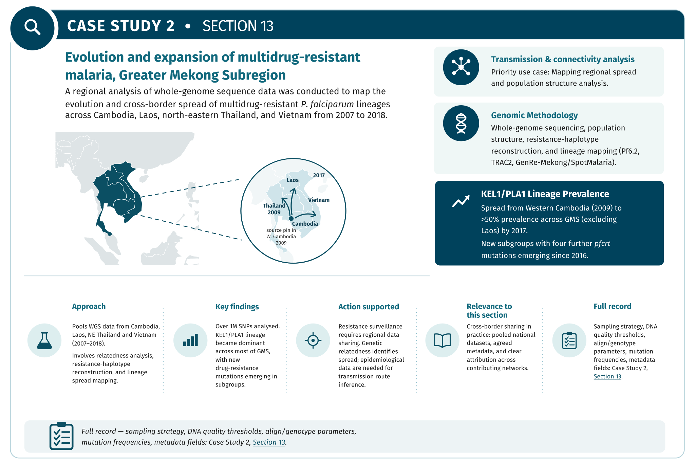

**Evolution and expansion of multidrug-resistant malaria in Southeast Asia: a genomic epidemiology study ([Hamilton *et al.*, 2019](https://doi.org/10.1016/S1473-3099\(19\)30392-5))**

**Priority Use Case:** Transmission and connectivity analysis

**Public Health Case Study:** Regional expansion and diversification of the KEL1/PLA1 multidrug-resistant *P. falciparum* co-lineage in the Greater Mekong Subregion. Genomic analysis documented the expansion of a highly resistant *P. falciparum* lineage across Cambodia and into neighbouring countries.

**Genomic or Molecular Approach:** WGS, population structure, relatedness analysis, resistance-haplotype reconstruction, and mapping of lineage spread.

*Sampling Strategy*

The analysis combined *P. falciparum* genomic data from clinical and surveillance studies conducted across Cambodia, Laos, northeastern Thailand, and Vietnam between 2007 and 2018, including samples from MalariaGEN Pf6.2, TRAC2, and GenRe-Mekong/SpotMalaria. Study-specific eligibility and sampling procedures are described in the respective source publications.

*Sequencing Approach*

Human and parasite DNA quantities were found using real-time quantitative PCR (qPCR). They determined that samples with \>1 μg total DNA and \<60% human DNA contamination were suitable for sequencing.

**PCR**: Selective whole-genome amplification on DBS samples with \>1 μg total DNA.

*Bioinformatics*

**Sequencer**: Illumina Genome Analyser II

**Analysis**: Reads were aligned to the *P. falciparum* 3D7 reference sequence version 2.1.4 using the Burrows–Wheeler Aligner (BWA). SAMtools was used to generate a read pileup file.  
Genotyping was only done on regions with 5X or more coverage. Alleles were removed if they appeared in fewer than two reads or if they appeared in 5% of reads that had a coverage of 50 or more.

*Bioinformatics Outputs*

1,043,334 biallelic SNPs were found in the nuclear genome. In 2009, KEL1/PLA1 was detected in western Cambodia only. By 2017, KEL1/PLA1 was present in over 50% of samples from all tested countries except Laos. Since 2016, new highly related subgroups carrying four new mutations (Thr93Ser, rising to 19·8%; His97Tyr to 11·2%; Phe145Ile to 5·5%; and Ile218Phe to 11·1%) in the *pfcrt* gene have emerged from the KEL1/PLA1 parasites in Cambodia, Laos, and Vietnam.

*Metadata*

Year and location (site, country, latitude, longitude) of sample collection, patient age, whether the patient is a returning traveller, exclusion reason, ENA accession.

*Public Health Interpretation and Action Supported*

KEL1/PLA1 *P. falciparum* first emerged in western Cambodia, but in less than 10 years, it acquired new mutations and other genetic features, diversifying into new subgroups and spreading to neighbouring countries.

The Greater Mekong example showed that resistance surveillance requires regional data sharing and cross-border interpretation. Genetic relatedness identifies patterns compatible with spread, while epidemiological data are required to infer likely transmission routes.

### 13.3 Case Study 3

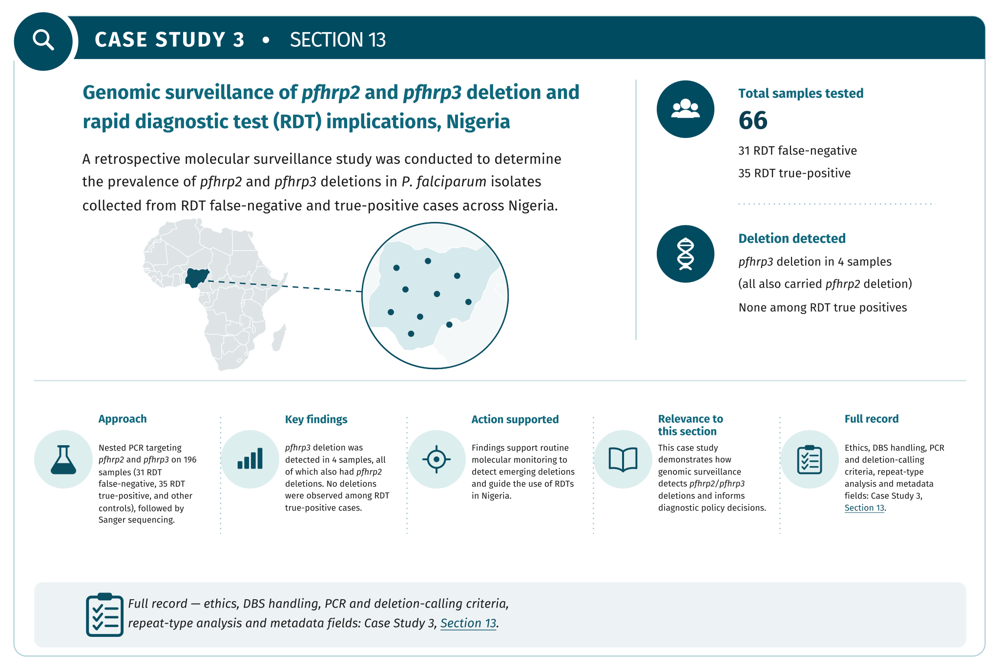

**Genomic surveillance of *pfhrp2* and *pfhrp3* gene deletion in *Plasmodium falciparum* isolates and the implications for rapid diagnostic tests in Nigeria ([Funwei *et al.*, 2019](https://doi.org/10.1016/j.actatropica.2019.05.016))**

*Note: This is a retrospective study with specifically selected samples.*

**Priority Use Case:** Diagnostic Escape

**Public Health Case Study:** Genomic surveillance of *pfhrp2/pfhrp3* deletion. Surveillance work assessed deletions in the genes encoding HRP2 and histidine-rich protein 3 (HRP3) and their implications for HRP2-based RDT performance.

**Genomic or Molecular Approach**: molecular characterisation of *pfhrp2* and *pfhrp3* gene deletion in *P. falciparum* isolates.

*Ethical Approval*

Ethical approval was given by the Ethical Review Committee of the University of Ibadan/University College Hospital. The parents or guardians of volunteers gave informed written or witnessed verbal consent.

*Sample Type*

DBS were collected from a prick on the middle finger onto Whatman 3MM™ filter paper. The filter papers were air-dried in a dust-free environment and stained with 10% fresh Giemsa. The filter papers were sealed in a zip-lock bag with silica gel to prevent DNA degradation.

*Sampling Strategy*

Volunteer patients were sampled from a primary healthcare facility in a rural area, Idi-Ayunre, and a secondary healthcare facility in an urban area, St Mary Catholic Hospital, Eleta, both in Ibadan, Nigeria, from November 2013 to November 2014\. 511 children, 365 from the rural area and 146 from the urban area, aged between 3 and 59 months, were enrolled in the study. All patients presented with a fever or a history of fever within the last 48 hours, ≥37.5 °C, in combination with other inclusion criteria.

*Sequencing Approach*

DNA was extracted from the DBS using the QIAamp DNA Mini kit and stored at −20 °C. PCR: Nested PCR was used to amplify the small-subunit ribosomal RNA (18S rRNA) gene of *P. falciparum* using a primary *Plasmodium* genus-specific primer, then a secondary *P. falciparum* species-specific primer. The *glurp*, *msp-1*, and *msp-2* genes were amplified to confirm the presence of *P. falciparum*. Exon 2 of the *pfhrp2* and *pfhrp3* genes was also amplified on 31 RDT false-negative and 35 RDT true-positive samples (66 total). A case that showed no amplification for PCR targeting *pfhrp2/3*, but showed amplification for *P. falciparum* 18S rRNA and two or more of the *glurp*, *msp-1*, or *msp-2* genes, was deemed a case of *pfhrp2* and *pfhrp3* deletion.

*Bioinformatics*

The PCR products were sequenced at the Institute of Tropical Medicine, Tübingen, Germany, using Sanger sequencing with the BigDye Terminator v. 2.0 cycle sequencing kit. Nucleotide sequence assembly was done with BioEdit, and the amino acid sequences were inferred with the ExPASy translate tool. The amino acid repeats were identified, and differences and the total number of repeats were tested with logistic regression.

*Bioinformatic Output*

Among the 66 samples tested for *pfhrp2* and *pfhrp3* deletions, including three RDT true-positive samples, *pfhrp3* deletions were detected in four of the 66 samples, and no *pfhrp3* deletions were detected in the samples that were RDT true positives. The four *pfhrp3* deletion samples also had *pfhrp2* deletions. Twelve amino-acid repeat types were identified for *pfhrp2*, all of which had previously been identified in other studies, while one of the nine-amino-acid repeat types for *pfhrp3* had not yet been described.

*Metadata*

Year and location of sample collection, patient age.

*Public Health Interpretation and Action Supported*

The Nigerian example supports routine molecular monitoring in West Africa, particularly where RDT–microscopy or RDT–PCR discordance is observed. It should be interpreted as an early-warning surveillance signal and not, alone, as sufficient evidence for a national diagnostic-policy change.

### 13.4 Case Study 4

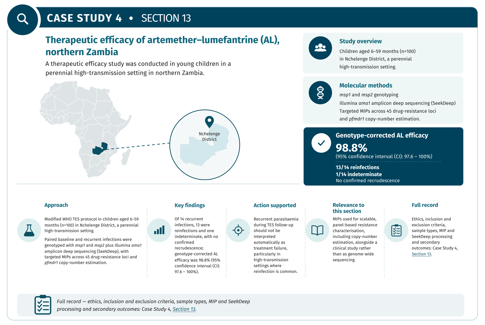

**Therapeutic efficacy of artemether–lumefantrine for uncomplicated *Plasmodium falciparum* malaria in northern Zambia ([Ippolito *et al.*, 2020](https://doi.org/10.4269/ajtmh.20-0852))**

**Priority Use Case:** Therapeutic efficacy study

**Public Health Case Study:** Assessment of artemether–lumefantrine (AL) in a high-transmission setting in Northern Zambia, integrating parasite-clearance measurements with high-resolution molecular genotyping to distinguish recrudescence from reinfection and targeted sequencing of antimalarial drug-resistance loci.

**Genomic or Molecular Approach:** Paired molecular characterisation of initial and recurrent *P. falciparum* infections using conventional *msp1* and *msp2* genotyping together with Illumina amplicon deep sequencing of *ama1* to improve discrimination of parasite haplotypes in a setting with frequent multiclonal infections. Targeted MIPs were additionally used to genotype 45 known and candidate drug-resistance loci and estimate *pfmdr1* copy number from normalised sequencing depth. Bioinformatic processing used SeekDeep for *ama1* haplotype reconstruction and MIPWrangler for MIP read processing and UMI-based correction of PCR and sequencing errors.

*Ethical Approval*

Ethical approval was obtained from the Tropical Diseases Research Centre Ethics Review Committee in Ndola, Zambia. The study was approved by the Zambian Ministry of Health and was retrospectively registered with the Pan African Clinical Trial Registry (PACTR201905783261453).

*Sample Type*

Peripheral blood was collected for serial thick-film microscopy. Paired blood samples from baseline and recurrent infections were used for molecular genotyping and sequencing. DBS were collected for day-7 AL measurement.

*Sampling Strategy*

The study was conducted from December 2014 to July 2015 at a rural health centre in Nchelenge District, Luapula Province, northern Zambia, an area characterised by perennial, high-intensity *P. falciparum* transmission. A modified WHO therapeutic efficacy study protocol was followed. Children aged 6–59 months with uncomplicated *P. falciparum* malaria were enrolled (n=100). Participants received the standard six-dose paediatric AL regimen under direct observation at 0, 8, 24, 36, 48, and 60 hours. The primary endpoint was treatment outcome according to standard WHO therapeutic efficacy definitions, with parasite genotyping used to distinguish recrudescence from reinfection. Secondary outcomes included parasite-clearance half-life, incidence of reinfection, gametocyte carriage and clearance, haemoglobin recovery, and drug-resistance allele frequencies in baseline and recurrent parasites.

**Inclusion criteria included:**

Participants aged 6–59 months with microscopically confirmed *P. falciparum* monoinfection and axillary temperature ≥37.5 °C or a reported history of fever within the preceding 24 hours.

**Exclusion criteria included:**

Participants with severe malaria, severe malnutrition, another febrile illness, selected chronic diseases, known human immunodeficiency virus (HIV) infection, potentially interacting medication, or previous hypersensitivity or adverse reaction to AL were excluded.

*Sequencing Approach*

Targeted MIP sequencing of 45 known and candidate antimalarial drug-resistance loci was performed in parallel to characterise resistance-associated variation and *pfmdr1* copy number.

*Bioinformatics*

Illumina paired-end *ama1* amplicon reads were processed using SeekDeep v2.6.4. Paired-end reads were merged, subjected to sequence-quality filtering, and resolved into unique *ama1* haplotypes within each sample. Only samples with at least 250 reads across replicate PCRs were analysed, and haplotypes were retained when independently detected in both PCR replicates at a within-sample frequency of ≥0.5%. MIP sequencing data targeting 45 known and candidate antimalarial drug-resistance loci were processed using MIPWrangler, incorporating read-quality and length filtering and UMI-based consensus processing to reduce PCR and sequencing errors. *pfmdr1* copy number was estimated from normalised sequence coverage relative to copy-number-stable reference loci, with estimates treated as continuous values because infections could contain multiple parasite clones.

*Bioinformatics Output*

The analysis generated within-sample *ama1* haplotype profiles, which were evaluated together with *msp1* and *msp2* genotypes to compare paired enrolment and recurrent infections and classify recurrence as reinfection, recrudescence, or indeterminate. Of 14 recurrent infections, 13 were classified as reinfections, and one was indeterminate; no confirmed recrudescences were identified. Incorporation of these molecular classifications produced a genotype-corrected AL efficacy of 98.8% (95% CI: 97.6–100%). Targeted MIP analysis additionally generated SNP genotypes across the resistance-marker panel and *pfmdr1* copy-number estimates, allowing molecular resistance profiles to be interpreted alongside the clinical and parasitological TES outcomes.

*Public Health Interpretation and Action Supported*

The study showed that recurrent parasitaemia during TES follow-up should not be interpreted automatically as treatment failure, particularly in high-transmission settings where reinfection is common.

### 13.5 Additional Published Examples

The following case studies illustrate how malaria genomic and molecular results can inform programme interpretation. Each example uses a distinct primary reference and should be read alongside the relevant WHO recommendations.

**Table 13.5: Additional published examples by priority use case**

| Priority use case | Public health case study | Genomic or molecular approach | Public health interpretation and action supported | Key reference(s) |
| ----- | ----- | ----- | ----- | ----- |
| **AMDR surveillance** | Viet Nam: genomic surveillance supporting treatment-policy review. GenRe-Mekong integrated DBS collection into routine health-facility activities and returned Genetic Report Cards to NMCP stakeholders. It identified high frequencies of parasites carrying markers associated with artemisinin and piperaquine resistance, including an early signal in Dak Lak province and expansion of dihydroartemisinin–piperaquine (DHA–PPQ)-resistant parasites in Gia Lai. | Viet Nam: targeted genotyping of *pfk13*, *plasmepsin2/3*, and other resistance markers; geographical mapping; repeated surveillance over consecutive seasons. | GenRe-Mekong findings supported NMCP and Ministry of Health reviews of treatment policy. DHA–PPQ was replaced with artesunate–pyronaridine as frontline therapy in four provinces. | [Jacob *et al.*, 2021](https://doi.org/10.7554/eLife.62997) |
|  | West African relevance: implementation-ready sequencing for TES-linked monitoring. Recent decentralised nanopore approaches provide a practical pathway for generating resistance-marker data from DBS in West African settings, but they should be linked prospectively with standardised TES clinical outcomes before concluding treatment efficacy. | West African implementation: targeted long-amplicon nanopore sequencing of resistance loci from DBS, with local sequencing and analysis capacity. | The recent African decentralised sequencing model illustrates how countries can strengthen prospective TES-linked molecular surveillance, including in West Africa. Molecular detection of a marker should not replace clinical TES endpoints or independently establish treatment failure. | [Mwenda *et al.*, 2026](https://doi.org/10.1038/s41467-026-72358-z) |
| **Transmission and connectivity analysis** | Senegal: nationwide surveillance through NMCP sentinel sites. Genetic surveillance of samples collected across 23 health facilities was used to assess polygenomic infections, clonality, relatedness, movement-compatible patterns, and genomic regions under selection. | Senegal: 24-SNP barcode genotyping for all samples, supported by WGS and IBD analysis on a subset of monogenomic samples. | The Senegal case shows how routine NMCP sentinel surveillance can be linked with genomic data to describe transmission heterogeneity, identify connected parasite networks, and assess which genetic indicators are most informative across transmission settings. | [(Schaffner *et al.*, 2023\)](https://doi.org/10.1038/s41467-023-43087-4) |
| **Diagnostic Escape** | Eritrea: false-negative HRP2-based RDT results associated with *pfhrp2* deletion. Reports of RDT-negative malaria cases prompted a national investigation that assessed both operational and parasite-related causes of diagnostic failure. | Eritrea: comparison of HRP2-based RDTs with microscopy, PCR, antigen testing, and molecular confirmation of *pfhrp2* deletion. | The Eritrea investigation showed that parasites lacking detectable HRP2 can compromise HRP2-based RDT performance. It demonstrates the need to integrate field reports, RDT-quality assessment, microscopy or PCR confirmation, and validated molecular testing before revising diagnostic algorithms. | [(Berhane *et al.*, 2018\)](https://doi.org/10.3201/eid2403.171723) |
| **Therapeutic efficacy study** | Rwanda: *pfk13* R561H associated with delayed parasite clearance. A multicentre TES linked parasite genotype with clinical and parasitological response after treatment. | Rwanda: TES-linked *pfk13* sequencing, standardised clinical follow-up, parasite-clearance measurements, and analysis of recurrent infection. | The Rwanda study strengthened the public health significance of R561H by linking the genotype with delayed clearance. It demonstrates why genomics can identify priority markers and locations, while TES provides the clinical evidence needed to assess treatment implications. | [(Uwimana *et al.*, 2021\)](https://doi.org/10.1016/S1473-3099\(21\)00142-0) |

## **14\. Challenges, Gaps, and Future Directions**

The application of bioinformatics in malaria has rapidly evolved over the years from solely academic research to being used for public health surveillance by NMCPs. Despite these advances, some computational and infrastructural improvements are still needed to optimise bioinformatics for malaria surveillance and eventual eradication.

**Table 14: Summary of unresolved areas**

| Area | Unresolved Issue | Current Implementations | Future Possibilities |
| ----- | ----- | ----- | ----- |
| **Polyclonality and Deconvolution** | Can we calculate and differentiate all clones in a polyclonal infection? | There are stable recommendations in use. | Full deconvolution is still in the research stage. |
| **Low Density and Asymptomatic Infections** | What is a reliable limit for detection? | Validated targeted amplicon procedures in use | WGS is showing usable results |
| **Reference Genome** | There is too much reliance on the 3D7 reference; are there alternatives? | Core genome masking is a validated method for reducing distortion. | Pangenome graphs are being researched. |
| **Non-*falciparum* Infections** | Detailed research on *P. vivax* is also needed | Targeted molecular and genomic methods are available for some non-*falciparum* species, but implementation remains limited and less standardised than for *P. falciparum.* | There are currently no standardised implementations. |
| **Vector Genomic Integration** | Can parasite and vector surveillance be merged? | There are validated protocols for target-site markers. | Integrated parasite and vector genomic surveillance could provide a more comprehensive understanding of transmission, population connectivity, and intervention response. |
| **Thresholds for Interpretations** | What targets trigger policy change? | This is largely undefined and the area that needs the most work. |  |
| **Turnaround Time** | Can results be obtained in time to be implemented? | Technically, there are validated protocols in use, but setbacks remain. | There are unvalidated, usable protocols with fewer challenges. |
| **Data Governance** | How do data sovereignty and open science coexist? | Data-sharing and governance frameworks are increasingly being developed and implemented, although approaches remain heterogeneous across countries and programmes. |  |
| **Point-of-need Sequencing** | Can the sequencing be performed where the samples are taken? | Portable sequencing platforms and targeted assays are increasingly being evaluated and implemented for decentralised and near-real-time genomic surveillance. | Targeted panels are showing promising results with protocols that could be validated. |
| **AI and Predictive Analysis** | Is it possible to get reliable predictions? | Machine learning and predictive approaches are being explored for malaria surveillance and forecasting, but routine programme implementation remains limited. | There are usable protocols for limited supervised forecasting, with more research underway. |

### 14.1 Polyclonality and Deconvolution

Most infections that occur in moderate-to-high transmission areas are mixed-clone infections that short-read sequencing has difficulty distinguishing. There are three different tasks: 1\) confirm whether an infection is polyclonal, 2\) estimate MOI, 3\) reconstruct a genome-wide haplotype for each clone (this is the most difficult to achieve).

**Unresolved Issues:**

* Full deconvolution  
* Lowest detection limit for minor clones  
* Accuracy of the MOI estimation  
* Infections from related clones

**Implementable Recommendations:**

* Clearly state each task separately without confusing them  
* Estimate the lowest detection limit for the minor alleles in your own samples  
* Use only one MOI estimator  
* Use microhaplotypes as the primary diversity indicator  
* Order the MOI estimates by parasite density so they can be compared  
* Use methods designed for polyclonal infection comparison to calculate relatedness

**Future Possibilities:**

* Using long-read sequencing, it is possible to span multiple regions to inform MOI.  
* Deep learning methods for deconvolution

### 14.2 Low Density and Asymptomatic Infections

Asymptomatic infections are important from an epidemiological perspective as they are silent spreaders of malaria while carrying a lower parasite density than symptomatic infections. The low parasite density causes low DNA yield, especially from DBS and RDT-derived samples. If the DNA is insufficient, the sample cannot be used, which leads to the data being skewed towards high-density infections.

**Current Solutions:**

* Targeted amplicon deep sequencing  
* sWGA  
* Leucocyte-depleted blood  
* Other host DNA depletion methods

**Unresolved Issues:**

* Amplification biases introduced by sWGA  
* Low-density samples are more susceptible to assay biases that affect DNA and haplotype recovery  
* There is no agreed standard for reporting density-conditional performance, making comparisons of sensitivity difficult

**Implementable Recommendations:**

* Measure parasite density on all samples used in genomic surveillance  
* Report QC failure stratified by density  
* Determine and publish the workflow density-conditional LOD  
* When possible, use targeted amplicon panels instead of sWGA

**Future Possibilities:**

* Improved sWGA protocols  
* ONT workflows validated at low density  
* Hybrid capture panels  
* Combine enzymatic host depletion with sWGA

### 14.3 Reference Genome

Nearly all *P. falciparum* surveillance maps to the 3D7 lab clone. This causes reference bias, and hypervariable and structural variable regions from short reads are more likely to be unmapped.

**Unresolved Issues:**

* Pangenome references of *P. falciparum* do not exist in an operational form  
* There is no consensus definition of the core genome  
* The significance of *var/rifin* variation for surveillance

**Implementable Recommendations:**

* Adopt an explicit core/accessible region mask  
* Validate aligners and filter parameters against control strains  
* If a region is shown to be structurally variable, use an assay designed for it  
* Archive alignments in compressed reference-oriented alignment map (CRAM) format with a clear reference

**Future Possibilities:**

* Graph-based pangenome reference  
* Pangenome-aware variable callers  
* Long-read assemblies for underrepresented regions  
* Community agreement on core genome standards

### 14.4 Non-*falciparum*, particularly *P. vivax*

Genomic surveillance skews heavily towards *P. falciparum*, while other species are poorly researched in comparison.

***P. vivax*** **Unresolved Issues:**

* Recurrent infections may be recrudescence, reinfections, or a relapse  
* Low densities  
* Chloroquine resistance markers are not settled

**Implementable Recommendations:**

* Make species identification an output of mixed-species reporting  
* Distinguish between *P. ovale curtisi* and *P. ovale wallikeri* when possible  
* For *P. vivax*, have a validated microhaplotype panel for recurrence classification

### 14.5 Vector Genomics Integration

Despite informing interventions that are deployed in the same districts and aiming for the same outcomes, vector and parasite surveillance are usually funded separately, developed and researched separately, and their outputs are usually analysed separately. AMDR, diagnostic detection of parasites, vector-species identification, and insecticide-resistance surveillance are all tier 1 priority use cases for Africa CDC, but these priorities are not often reflected in control programmes.

**Specific Challenges:**

* Members of the *An. gambiae* complex are morphologically indistinguishable but differ in their behaviour and capacity to transmit malaria parasites, requiring species-level identification and appropriately targeted vector-control interventions.  
* Widespread insecticide resistance among major malaria vectors, including *An. gambiae*, *An. coluzzii*, *An. arabiensis*, *An. funestus*, and *An. stephensi*.  
* The spread of the invasive, urban-adapted *An. stephensi*, which can transmit both *P. falciparum* and *P. vivax* and commonly exhibits insecticide resistance.

**Implementable Recommendations:**

* Use a library panel that combines species identification and resistance genotype.  
* Screen for *An. stephensi* in urban and peri-urban areas and import routes and vehicles.  
* Report vector and parasite results in the same geographical and temporal framework.  
* Combine genomic markers with bioassays and consult WHO guidelines on insecticide resistance monitoring.  
* When *An. stephensi* is detected, sequence for ancestry and resistance markers.

*Research Areas with Potential*

A study comparing the midgut of laboratory strains of *An. quadrimaculatus,* insecticide-resistant *An. arabiensis*, insecticide-susceptible *An. arabiensis,* and *An. merus* suggested that insecticide-degrading bacteria in the midgut contributed minimally to *Anopheles* insecticide resistance. It posits the presence and relative abundance of *Microbacterium* in the midgut of *An. quadrimaculatus* and *An. merus* contribute to the low insecticide tolerance of the species. They also found the anti-*Plasmodium* species *Pseudomonas*, *Serratia*, and *Enterobacter* to be more abundant in *An. quadrimaculatus* ([Singh *et al.*, 2022](https://doi.org/10.1038/s41598-022-05437-y)). Future research could investigate methods of increasing anti-*Plasmodium* bacterial species in malaria vector mosquitoes.

### 14.6 Interpretation Thresholds

This is a very important unresolved issue in malaria genomic surveillance because, in most cases, there is no policy-changing threshold for genomic results. For example, no WHO-validated prevalence threshold for *pfk13*, partner-drug resistance markers, vaccine-antigen diversity, MOI transmission indicators, or vector genomics currently triggers a public health response. There is no standard for the minimum number of affirming results required to report a prevalence at a given administrative level, resulting in different interpretations at the same level. On the one hand, this can lead to a premature change in policy, which is very expensive; alternatively, it can cause a delayed reaction to a preventable outbreak.

**What is needed:**

To develop thresholds, the genomic data need to be linked with TES in various settings. It is an appropriate venture for the WHO, regional bodies, product development partners, and other research bodies to prioritise. To prepare, malaria researchers can ensure that the link between genomic and clinical outcome data of TES samples is preserved.

**Implementable recommendation:**

In collaboration with NMCPs and MaTAGs, implement validated protocols with scaled responses depending on research outcomes. See [Section 10.3](#103-escalating-genomic-signal-to-programme-action) and [Table 10.3](#table-103-genomic-surveillance-signals-and-corresponding-programmatic-actions) for examples of a signal-to-action framework.

### 14.7 Computational and Connectivity Constraints

Bioinformatics tools are often deployed in areas with unreliable or no internet connection, unstable electricity, and no cloud computing access. This can make these bioinformatics tools unattainable for some.

**Implementable recommendation:**

* Use laptop-executable sequencing workflows capable of offline analysis  
* Build and test an offline installation method for every pipeline  
* Enable resuming and caching by default  
* Where possible, use targeted amplicon workflows  
* If possible, budget for annual cloud storage  
* Adopt a hub-and-spoke model for laboratory setups where appropriate

### 14.8 Other Gaps in Malaria Genomics

*Turnaround Time*

Data from malaria genomics often arrive too late to inform policy changes. The time between sample collection and report submission needs to be shortened to enable impactful malaria genomic surveillance.

*Lack of Standardisation at the Point of Need for Bioinformatics*

ONT MinION sequencing combined with laptop-based offline analysis and dashboards is now being deployed for different malaria use cases, implemented in the country or region where the samples were collected. This has significantly reduced turnaround time and the cost of surveillance. Some limitations still exist. Notably, long-read sequencing has higher error rates, which are exacerbated by the AT-rich *Plasmodium* genome; minor-allele detection is lower than with short-read platforms; and laboratories need a stable supply chain for reagents and other consumables.

*Standardisation and Benchmarking*

Laboratories working on the same use case produce different result matrices because they use different pipelines, parameters, core genome masks, thresholds, and rules of interpretation. Reports also lack sufficient information to determine the reason for the discrepancy. This leads to data with mixed measurements and biological data with unknown proportions. Malaria genomics also lacks a benchmark dataset, EQA, a core genome mask, a WSAF threshold, and a standard machine-readable format.

*Operational Metadata Standards*

The lack of metadata hinders genomics from having more impactful applications in malaria surveillance. Sample metadata needs to be collected in a usable and scalable way for current and continuous monitoring.

*Data Governance*

The expansion of malaria genomic surveillance creates ongoing challenges around data ownership, sovereignty, access, sharing, and equitable use. Future implementation will require governance frameworks that enable responsible and timely data sharing while respecting national policies, participant interests and country ownership of genomic and associated epidemiological data.

### 14.9 Artificial Intelligence and Predictive Analysis

Artificial intelligence (AI) and Machine Learning (ML) have the potential to be core elements of malaria surveillance with applications in forecasting resistance spread, predicting outbreak risk, and integrating climate and vector data. ML is already being researched for its application in bacterial antimicrobial resistance; with enough data and sufficient training, ML models may be able to predict the emergence and spread of antimalarial drug-resistant parasites using genomic data.

Deep learning algorithms, such as convolutional and recurrent neural networks, could be applicable for detecting low-level parasitaemia from molecular diagnostics and can rapidly parse complex next-generation sequencing (NGS) data blocks. ML regression models could use high-dimensional, multimodal data streams like parasite genomic connectivity maps, patient metadata, human mobility paths, and real-time satellite climate and environmental data (rainfall, vegetation index, temperature) to map transmission hotspots and predict outbreak risks in advance. This would allow NMCPs to deploy vector control intervention protocols, pre-position medical supplies in preparation for an outbreak, and limit the spread of the parasite.

This remains in development and requires further research. Preparations can nevertheless begin for a model capable of deployment for malaria surveillance by generating well-annotated, standard-compliant linked data. Future training data can be built by keeping genomic records with complete metadata and linking them to clinical results with an entomological and environmental context.

**Current state of research**

*Malaria Diagnostics*

ML and AI models are being developed in an attempt to improve malaria diagnostics using patient clinical information and blood smears (Awe *et al.*, 2025; Yang *et al.*, 2020). Research is also underway on applying AI to mid-infrared spectrometry with varying levels of success, up to 90% accuracy on lab-infected low-parasitaemia samples in a controlled environment ([Mshani *et al.*, 2024](https://doi.org/10.1186/s12936-024-05011-z)).

*Vector Surveillance*

At the Ifakara Health Institute in Tanzania and the Institut de Recherche en Sciences de la Santé in Burkina Faso, researchers are using deep learning mid-infrared spectroscopy (DL-MIRS) data of laboratory-reared mosquito cuticle to identify the species and age class of *An. gambiae*, *An. arabiensis*, and *An. coluzzii*. The mosquitoes showed distinct cluster patterns based on species, geographic location, and laboratory, environmental, and genetic variation, with high prediction accuracy for the age range ([Siria *et al.*, 2022](https://doi.org/10.1038/s41467-022-28980-8)).

### 14.10 Prioritising These Recommendations

Recommendations discussed in this section could take months to several years, depending on the current state of genomic capabilities in the country or region. It is not advised to implement all, but rather to do what is possible with the resources available or that can be obtained.

> [!NOTE]
> **SECTION 14 · KEY POINTS | Challenges and Future Directions**
>
> - **•** Polyclonality: confirming polyclonal infection, estimating MOI, and reconstructing genome-wide clone haplotypes are three distinct tasks and should be reported separately; only one MOI estimator should be used per dataset.
>
> - Low-density and asymptomatic infections skew data towards high-density infections; parasite density should be measured on all samples, and QC failure should be reported stratified by density.
>
> - Reliance on the 3D7 reference introduces bias in hypervariable and structurally variable regions; an explicit core/accessible region mask is recommended pending operational pangenome references.
>
> - Non-falciparum species, particularly *P. vivax*, remain underserved, and vector and parasite surveillance are still funded, analysed and reported separately.
>
> - There are no WHO-validated prevalence thresholds that trigger a programmatic response, which risks both premature policy change and delayed reaction.
>
> - Connectivity constraints favour laptop-executable, offline-capable workflows; AI and machine learning remain in development and depend on well-annotated, standard-compliant linked data.
>
> - Other gaps: turnaround time, lack of standardisation and benchmark datasets, operational metadata standards, point-of-need bioinformatics limits, and data governance and sovereignty.

## **15\. Conclusion**

Malaria genomic surveillance used to be limited in endemic countries; however, with increased sequencing capacity, targeted panels, portable platforms, and offline analysis programmes, point-of-need application has increased in recent years.

Now that it has been proven that endemic malaria genomics is possible and supply chains can be secured, the focus needs to shift to establishing thresholds and guidelines before genomics can truly be established for public health surveillance. This document is primarily about providing recommendations for NMCPs.

The document provides five major recommendations:

1. **Analysis that cannot be reproduced cannot be defended.** The results of these analyses are meant to guide and justify budgetary decisions made by NMCPs and other public health officials. When these decisions are questioned, the run parameters, references, input and output data, and interpretation must be clearly stated and reproducible. It is important to have a provenance manifest for this purpose.

2. **Measurement and interpretation must be kept apart.** The rules for interpreting genotype calls and marker classifications change. The definition and reporting thresholds for action are redefined, and new variants are characterised. If measurements and interpretation are kept together, it forces re-analysis whenever there is a guidance change.

3. **Surveillance often misses minor or low-density clones.** There are various reasons why minor clones and low-density infections can be missed, which are discussed above. These are very common reasons and can lead to biases in the results. The reporting guidance in this document advises that a lack of detection be labelled as “undetermined” for this purpose.

4. **Genomic data inform decisions; they do not make them.** Apart from diagnostic escape, there is no defined genomic quantity or threshold set by the WHO. Therefore, it is important not to treat marker prevalence in a sample as if there are set numbers for definitions. The escalation pathway described in [Section 10.3](#103-escalating-genomic-signal-to-programme-action) is a more reliable method of surveillance for decision-making.

5. **Capability is by institution, not individual.** Documentation, personnel training, supply chains, and retained positions are all needed for an institution to be capable of carrying out genomic surveillance. This needs to be at the core of the laboratory in order to retain the genomic capability.

It is worth restating that:

**Full deconvolution of polyclonal infections is unresolved for routine field data.** Although it is possible to detect polyclonal infections and estimate MOI, reconstructing the genome-wide haplotype of each clone is still unattainable for low-density clones from DBS samples.

**Reference bias can be mitigated, but no complete solution currently exists. A pangenome reference could address this issue, but it does not yet exist for Plasmodium.**

**There is a large gap in interpretation thresholds that needs to be closed.** Genotypes need to be linked to clinical outcomes, and TES in many transmission settings is first needed in order to establish genomic prevalence thresholds.

**Non-*falciparum* is largely ignored.** *P. falciparum* infections are beginning to decline in some settings, leading to a relative increase in *P. vivax* infections.

Several requirements are beyond what a single programme is capable of and need to be addressed by WHO, Africa CDC, regional economic communities, product development partners, and funders:

1. **Genomic interpretation thresholds** are developed by linking genotype data with TES outcomes. This would be the most beneficial data for malaria genomic surveillance.

2. A **community benchmark dataset and an external quality assessment scheme** covering the bioinformatics section. It is possible to distribute raw reads to different laboratories and compare their analysis pipelines, parameters, and outputs.

3. A **consensus definition of the core genome**, published openly with version history.

4. **A widely adopted stable malaria-specific metadata standard.**

5. **Operational federated infrastructure**

6. **Financing models that outlast projects**, consumables, service contracts, documentation, and career structure should all be treated as core costs.

Programmes can contribute to the first of these immediately by ensuring that TES samples are genotyped and the linkage between genomic and therapeutic outcomes is preserved.

A malaria genomic surveillance programme that works as this document intends would have a decision outcome attached to each use case; results would arrive within the decision-making window; outputs would be machine-readable and reports automated; and interpretation rules would be versioned. Failed samples should be visible in the report. The analysis, interpretation, and reports are all done in the country. Escalation procedures for detected markers are already in place and have been tested.

This guidance document sets out to ensure that genomic results are trustworthy and comparable in a malaria public health setting across time and countries. Cross-border comparability is only meaningful if the measurements are made the same way and reported honestly, including what they do and do not show.

This is all achievable depending on the institutions, governing bodies, technologies, techniques applied, and investments put into the work.

> [!NOTE]
> **SECTION 15 · KEY POINTS | Conclusion**
>
> - **•** Malaria genomic surveillance is increasingly feasible in endemic settings, but its public health value depends on operational integration and actionable outputs rather than sequencing capacity alone.
>
> - Analyses must be reproducible and supported by provenance records.
>
> - Low-density and polyclonal infections, reference bias, and limited representation of non-falciparum species remain important sources of uncertainty and should be reported transparently.
>
> - Genomic data inform decisions but do not make them; findings should be interpreted alongside TES, clinical, epidemiological, diagnostic, and entomological evidence.
>
> - Regional and global partners should support shared benchmark datasets, external quality assessment, core-genome and metadata standards, and interpretation thresholds linked to clinical and TES outcomes.

# **List of Abbreviations**

| Acronym | Full Term |
| ----- | ----- |
| **ACT** | Artemisinin-based combination therapies |
| **AI** | Artificial Intelligence |
| **AL** | Artemether–Lumefantrine |
| **AMDR** | Antimalarial drug resistance |
| **ANOSPP** | *Anopheles* Species and *Plasmodium* Panel |
| **AT** | Adenine–thymine |
| **BAM** | Binary alignment map format |
| **BWA** | Burrows-Wheeler Aligner |
| **CDC** | Centres for Disease Control and Prevention |
| **CI** | Confidence interval |
| **CNV** | Copy number variation |
| **COI** | Complexity of infection |
| **CRAM** | Compressed reference-oriented alignment map format |
| **Ct** | Cycle threshold |
| **CWL** | Common Workflow Language |
| **DAPC** | Discriminant analysis of principal components |
| **DBS** | Dried blood spot |
| **DDBJ** | DNA Data Bank of Japan |
| **DDT** | Dichlorodiphenyltrichloroethane |
| **DES** | Dried erythrocyte spot |
| **DHA** | Dihydroartemisinin |
| **DL-MIRS** | Deep-learning mid-infrared spectroscopy |
| **DNA** | Deoxyribonucleic acid |
| **DOI** | Digital object identifier |
| **EAC** | East African Community |
| **ENA** | European Nucleotide Archive |
| **EQA** | External quality assessment |
| **FAIR** | Findable, Accessible, Interoperable, and Reusable |
| **FASTQ** | Sequence and quality-score file format |
| **Fc** | Fragment crystallisable region |
| **FST** | Fixation index |
| **FWS** | Within-host fixation index |
| **GATK** | Genome Analysis Toolkit |
| **GMP** | Global Malaria Programme |
| **GPS** | Global Positioning System |
| **GPU** | Graphics processing unit |
| **GTP** | Guanosine triphosphate |
| **GUI** | Graphical user interface |
| **HIV** | Human immunodeficiency virus |
| **HMW** | High molecular weight |
| **HPC** | High-performance computing |
| **IBD** | Identity-by-descent |
| **ID** | Identifier |
| **IGV** | Integrative Genomics Viewer |
| **INSDC** | International Nucleotide Sequence Database Collaboration |
| **IRS** | Indoor residual spraying |
| **ISO** | International Organisation for Standardisation |
| **ITN** | Insecticide-treated net |
| **KEMRI** | Kenya Medical Research Institute |
| **LDB** | Low-density blood sample |
| **LDC** | Leucocyte depletion card |
| **LEKMA** | Ledzokuku–Krowor Municipal Assembly |
| **LOD** | Limit of detection |
| **MAD4HatTeR** | Multiplex Amplicons for Drug, Diagnostic, Diversity, and Differentiation Haplotypes using Targeted Resequencing |
| **MARC** | Mitigating Antimalarial Resistance Consortium |
| **MaTAG** | Malaria Technical Advisory Group |
| **MCMC** | Markov chain Monte Carlo |
| **MIP** | Molecular inversion probe |
| **MIS** | Malaria Indicator Survey |
| **ML** | Machine learning |
| **MMS** | Malaria molecular surveillance |
| **MMV** | Medicines for Malaria Venture |
| **MOI** | Multiplicity of infection |
| **MVP** | Minimal viable panel |
| **NAHR** | Non-allelic homologous recombination |
| **NCBI** | National Centre for Biotechnology Information |
| **NGS** | Next-generation sequencing |
| **NMCP** | National Malaria Control Programme |
| **NMDEK** | NEBNext Microbiome DNA Enrichment Kit |
| **NMEC** | National Malaria Elimination Centre |
| **NMEP** | National Malaria Elimination Programme |
| **NOMADS** | NMEC-Oxford Malaria Amplicon Drug-resistance Sequencing |
| **NPHI** | National Public Health Institute |
| **ONT** | Oxford Nanopore Technologies |
| **PacBio** | Pacific Biosciences |
| **PAMGEN** | Pan-African Malaria Genetic Epidemiology Network |
| **PBO** | Piperonyl butoxide |
| **PCA** | Principal component analysis |
| **PCR** | Polymerase chain reaction |
| **PDR** | People's Democratic Republic |
| **PHA4GE** | Public Health Alliance for Genomic Epidemiology |
| **PMO** | Portable Microhaplotype Object |
| **PPQ** | Piperaquine |
| **QC** | Quality control |
| **qPCR** | Quantitative polymerase chain reaction |
| **RBC** | Red blood cells |
| **RDT** | Rapid diagnostic test |
| **RNA** | Ribonucleic acid |
| **rRNA** | Ribosomal ribonucleic acid |
| **SADC** | Southern African Development Community |
| **SAM** | Sequence Alignment/Map format |
| **SE-Africa** | Southern and Eastern Africa |
| **SNP** | Single-nucleotide polymorphism |
| **SOP** | Standard operating procedure |
| **SRA** | Sequence Read Archive |
| **sWGA** | Selective whole-genome amplification |
| **TES** | Therapeutic efficacy study |
| **TRAC2** | Tracking Artemisinin Resistance Collaboration II |
| **UMI** | Unique molecular identifier |
| **USD** | United States dollars |
| **VCF** | Variant Call Format |
| **VWB** | Venous whole blood |
| **WDL** | Workflow Description Language |
| **WGA** | Whole-genome amplification |
| **WGS** | Whole-genome sequencing |
| **WHO** | World Health Organisation |
| **WSAF** | Within-sample alternative allele frequency |
| **WWARN** | Worldwide Antimalarial Resistance Network |

## **16\. Appendices**

## Appendix A: Glossary

| Gene, protein, or marker | Full name |
| ----- | ----- |
| 18S rRNA gene | Small-subunit ribosomal RNA gene |
| *Glurp* | Glutamate-rich protein |
| HRP2 | Histidine-rich protein 2 |
| HRP3 | Histidine-rich protein 3 |
| KEL1 | Combined multidrug-resistant co-lineage: KEL1 carries *pfk13* C580Y |
| MBD2 | Methyl-CpG-binding domain protein 2 |
| *pfama1* (*ama1*) | Apical membrane antigen 1 |
| *pfcrt* (*crt*) | *Plasmodium falciparum* chloroquine resistance transporter |
| *pfcsp* (*csp*) | Circumsporozoite protein |
| *pfdhfr* | Dihydrofolate reductase |
| *pfdhfr* IRNI haplotype | Composite four-codon *pfdhfr* haplotype |
| *pfdhps* (*dhps*) | Dihydropteroate synthase |
| *pfgch1* (PfGCH1) | guanosine triphosphate (GTP) cyclohydrolase I |
| *pfhrp2* | Gene coding histidine-rich protein 2 |
| *pfhrp3* | Gene coding histidine-rich protein 3 |
| *pfk13 (Kelch 13 protein \[K13\])* | *Plasmodium falciparum* Kelch 13 protein |
| *pfmdr1* (*mdr1*; PfMDR1/PfPgh1) | Multidrug resistance protein 1, also called P-glycoprotein homologue 1 |
| *pfmsp1 (msp1; merozoite surface protein 1 \[*MSP1*\])* | Merozoite surface protein 1 |
| *pfmsp2 (msp2; merozoite surface protein 2 \[*MSP2*\])* | Merozoite surface protein 2 |
| *pfpm2*/*pfpm3* (plasmepsin 2/3) | Plasmepsin II and plasmepsin III |
| *pfpm2*/*pfpm3* amplification | Increased plasmepsin 2/3 copy number |
| PLA1 | Combined multidrug-resistant co-lineage: PLA1 carries *pfpm2/pfpm3* amplification |
| *rif/rifin genes and repetitive interspersed family (*RIFIN*) proteins* | Repetitive interspersed family proteins |
| *var* genes (PfEMP1) | *Plasmodium falciparum* erythrocyte membrane protein 1 |

## Appendix B: Software, Pipelines and R packages

**R Packages for Genomic Surveillance**

| Primary R Package | Analysis Goal | Example Functions\* |
| ----- | ----- | ----- |
| **malariaAtlas** | Downloading, visualising, and modelling global malaria environmental and epidemiological data. | getPR(), getRaster(), autoplot() |
| **DRpower** | Power analysis and sample size calculations for *pfhrp2/3* deletions surveillance. | get\_power\_presence(), get\_sample\_size\_presence() |
| **DEploid-r** | Deconvoluting mixed-strain *Plasmodium* infections and estimating strain frequencies from NGS data. | dEploid(), extractPLAF(), plotWSAFVsPLAFPlotly() |
| **moimix** | Estimating MOI and detecting micro-variants from high-throughput sequencing data. | getMAF(), bafMatrix(), plot.bafMatrix |
| **MOIRE** | Estimating MOI and allele frequencies from polyallelic microhaplotype data. | run\_mcmc(), load\_long\_form\_data() |
| **McCOILR** | Estimating MOI and parasite genetic diversity using Markov Chain Monte Carlo (MCMC). | McCOIL\_proportional(), McCOIL\_categorical() |
| **MLMOI** | Maximum-likelihood estimation of MOI and lineage frequencies from molecular markers. | moimport(), moimle(), moimerge() |
| **isoRelate** | Detecting IBD genomic segments between *Plasmodium* isolates to map transmission networks. | getIBDsegments(), testIBDsharing(), plotIBDclusters() |
| **MIPanalyzer** | Filtering, analysing, and visualising MIP sequencing datasets for malaria. | filter\_overcounts(), inbreeding\_mle(), pca\_wsaf() |
| **FreqEstimationModel** | Estimate population-level frequency of AMDR marker alleles. | FreqEstimationModel(), visualise\_results() |
| **MALECOT** | Bayesian clustering and inference of multi-locus genotypes in malaria parasites to detect population structure. | new\_set(), run\_mcmc(), plot\_structure() |
| **magenta** | Simulation model for tracking the malaria history of individual people, including parasite genetics. | pfpr\_to\_eir\_heuristic(), intervention\_grab() |
| **Pv3Rs** | Relapse, Recrudescence, and Reinfection classification for *Plasmodium vivax* genetic data. | plot\_simplex(), compute\_posterior() |
| **plasmoRUtils** | Access *Plasmodium* databases for quick analysis. | searchMidb(), search\_pm(), searchApidoTFdb() |
| **AnophelesModel** | Modelling vector population dynamics, genetics, and resistance mapping for *Anopheles* mosquitoes. | build\_model\_obj(), def\_host\_params() |
| **adegenet** | Exploration, storage, and handling of genetic data, generic population genetics, principal-component analysis (PCA), and discriminant analysis of principal components (DAPC), which can be applied to vector/parasite clustering. | xvaldapc(), glPca(), loadingplot() |
| **dcifer (Distance for complex infections: fast estimation of relatedness)** | Estimate relatedness or genetic distance between polyclonal infections | getCOI(), matchAfreq() |
| **hierfstat** | Estimation of hierarchical F-statistics to analyse malaria population differentiation across regions. | varcomp.glob(), pairwise.WCfst() |

**\*** Functions may change as the package is updated; check the package documentation for updated functions.

### Useful links

1. [https\://cran.r-project.org/web/packages/malariaAtlas/index.html](https://cran.r-project.org/web/packages/malariaAtlas/index.html)

2. [https\://mrc-ide.github.io/DRpower/](https://mrc-ide.github.io/DRpower/)

3. [https\://github.com/DEploid-dev/DEploid-r](https://github.com/DEploid-dev/DEploid-)

4. [https\://github.com/bahlolab/moimix](https://github.com/bahlolab/moimix)

5. [https\://escholarship.org/content/qt9f1939rb/qt9f1939rb.pdf](https://escholarship.org/content/qt9f1939rb/qt9f1939rb.pdf)

6. [https\://ojwatson.github.io/McCOILR/articles/introduction.html](https://ojwatson.github.io/McCOILR/articles/introduction.html)

7. [https\://cran.r-project.org/web/packages/MLMOI/index.html](https://cran.r-project.org/web/packages/MLMOI/index.html)

8. [https\://github.com/bahlolab/isoRelate](https://github.com/bahlolab/isoRelate)

9. [https\://github.com/mrc-ide/MIPanalyzer](https://github.com/mrc-ide/MIPanalyzer)

10. [https\://github.com/aimeertaylor/FreqEstimationModel](https://github.com/aimeertaylor/FreqEstimationModel)

11. [https\://bobverity.github.io/MALECOT/articles/installation.html](https://bobverity.github.io/MALECOT/articles/installation.html)

12. [https\://ojwatson.github.io/magenta/index.html](https://ojwatson.github.io/magenta/index.html)

13.  ([https\://doi.org/10.1093/bioinformatics/btaf643](https://doi.org/10.1093/bioinformatics/btaf643))

14. [https\://github.com/bahlolab/AmpSeqR](https://github.com/bahlolab/AmpSeqR)

15. [https\://github.com/aimeertaylor/paneljudge](https://github.com/aimeertaylor/paneljudge)

16. [https\://rscholar.com/pkg/pqantimalarials](https://rscholar.com/pkg/pqantimalarials)

17. [https\://rohit-satyam.github.io/plasmoRUtils/](https://rohit-satyam.github.io/plasmoRUtils/)

18. [https\://github.com/SwissTPH/AnophelesModel/tree/main](https://github.com/SwissTPH/AnophelesModel/tree/main)

19. [https\://github.com/thibautjombart/adegenet](https://github.com/thibautjombart/adegenet)

20. [https\://cran.r-project.org/web/packages/hierfstat/vignettes/hierfstat.html](https://cran.r-project.org/web/packages/hierfstat/vignettes/hierfstat.html)

21. [https\://cran.r-project.org/web/packages/dcifer/vignettes/vignetteDcifer.pdf](https://cran.r-project.org/web/packages/dcifer/vignettes/vignetteDcifer.pdf)

## Appendix C: Implementation Readiness Checklist

*Laboratory readiness*

☐ DNA extraction capacity  
☐ DBS processing workflow  
☐ PCR setup and contamination control  
☐ Sequencer availability  
☐ Cold-chain and reagent storage  
☐ Staff training  
☐ Standard operating procedures  
☐ Quality assurance system  
☐ Data analysis capacity  
☐ Result reporting system

*Bioinformatics readiness*

☐ Sample sheet management  
☐ Read demultiplexing  
☐ Quality filtering  
☐ Alignment or amplicon-specific processing  
☐ Variant calling  
☐ Allele-frequency estimation  
☐ Marker interpretation  
☐ QC dashboards  
☐ Automated report generation  
☐ Data storage and backup  
☐ Reproducible pipelines

WGS requires additional capacity for:

☐ Host-read filtering  
☐ Genome alignment  
☐ Variant calling  
☐ Copy number analysis  
☐ IBD analysis  
☐ Population structure  
☐ Selection scans  
☐ High-performance computing  
*Data governance*

Public health genomic data should be managed under clear governance procedures covering:

☐ Ethical approval  
☐ Consent requirements  
☐ Sample export, if applicable  
☐ Data sharing  
☐ Access control  
☐ National ownership  
☐ Reporting obligations  
☐ Benefit sharing  
☐ Return of results to programmes and communities where appropriate

*Minimum Reporting Elements*

☐ Study objective  
☐ Sampling frame  
☐ Collection dates  
☐ Sites, districts, and regions  
☐ Sample type  
☐ Parasite species tested  
☐ Parasite density or Ct value  
☐ Sequencing method  
☐ Target genes or panel description  
☐ Number of samples collected  
☐ Number extracted  
☐ Number sequenced  
☐ Number passing QC  
☐ QC thresholds  
☐ Marker frequencies with confidence intervals  
☐ Minority variant thresholds  
☐ Missingness by locus  
☐ MOI or polyclonality assessment, if performed  
☐ Interpretation against WHO or national guidance  
☐ Public Health implications  
☐ Limitations  
☐ Recommended follow-up actions

## Appendix D: Metadata and Quality Control

Minimum metadata includes:

* Sample ID  
* Site  
* District  
* Region  
* Global Positioning System (GPS) coordinates, if permitted  
* Date of collection  
* Age and sex, if ethically approved  
* Symptomatic/asymptomatic status  
* Diagnostic result  
* Parasite density or Ct value  
* Treatment history, if available  
* Travel history, if importation is being studied  
* Sample type  
* Storage conditions  
* Extraction batch  
* Sequencing batch

Public Health laboratories should predefine:

* Minimum read depth per locus  
* Minimum proportion of targets covered  
* Allele-frequency threshold for calling minority variants  
* Missing-data threshold  
* Sample exclusion criteria  
* Contamination checks  
* Replicate concordance threshold  
* Positive and negative controls  
* Batch-effect monitoring  
* External quality assurance, where possible

## **17\. References**

Adams, K.L., Sawadogo, S.P., Nignan, C., Niang, A., Paton, D.G., Shaw, W.R., South, A., Wang, J., Itoe, M.A., Werling, K. *et al.*, 2021\. Cuticular hydrocarbons are associated with mating success and insecticide resistance in malaria vectors. *Communications Biology*, *4*(1), p.911. doi: [10.1038/s42003-021-02434-1](https://doi.org/10.1038/s42003-021-02434-1).

Africa CDC, 2025\. Roadmap for the implementation of malaria genomic surveillance in Africa. Available at: [https\://africacdc.org/download/roadmap-for-the-implementation-of-malaria-genomic-surveillance-in-africa/](https://africacdc.org/download/roadmap-for-the-implementation-of-malaria-genomic-surveillance-in-africa/) (Accessed: 1 September 2026).

Africa CDC, n.d.-b. Malaria genomic surveillance metadata resource. Available at: [https\://khub.africacdc.org/records/resource?id=16](https://khub.africacdc.org/records/resource?id=16) (Accessed: 1 September 2026).

Aranda-Díaz, A., Neubauer Vickers, E., Murie, K., Palmer, B., Hathaway, N., Gerlovina, I., Boene, S., García-Ulloa, M., Cisteró, P., Katairo, T. *et al.*, 2025\. Sensitive and modular amplicon sequencing of *Plasmodium falciparum* diversity and resistance for research and public health. *Scientific Reports*, *15*(1), p.10737. doi: [10.1038/s41598-025-94716-5](https://doi.org/10.1038/s41598-025-94716-5).

Awe, O.O., Mwangi, P.N., Goudoungou, S.K., Esho, R.V. and Oyejide, O.S., 2025\. Explainable AI for enhanced accuracy in malaria diagnosis using ensemble machine learning models. *BMC Medical Informatics and Decision Making*, *25*(1), p.162. doi: [10.1186/s12911-025-02874-3](https://doi.org/10.1186/s12911-025-02874-3).

Aydemir, O., Janko, M., Hathaway, N.J., Verity, R., Mwandagalirwa, M.K., Tshefu, A.K., Tessema, S.K., Marsh, P.W., Tran, A., Reimonn, T. *et al.*, 2018\. Drug Resistance and Population Structure of *Plasmodium falciparum* Across the Democratic Republic of Congo Using High-Throughput Molecular Inversion Probes. *The Journal of Infectious Diseases*, *218*(6), pp. 946–955. doi: [10.1093/infdis/jiy223](https://doi.org/10.1093/infdis/jiy223).

Bakari, C., Holzschuh, A., Seth, M.D., Madebe, R.A., Pereus, D., Mandara, C.I., Schneeberger, P., Juliano, J.J., Bailey, J.A., Ishengoma, D.S. and Nsanzabana, C., 2026\. Development of an Oxford Nanopore sequencing technology-based whole-genome sequencing method for *Plasmodium falciparum* to support malaria molecular surveillance. *Scientific Reports*, *16*(1), p.24485. doi: [10.1038/s41598-026-46451-8](https://doi.org/10.1038/s41598-026-46451-8).

Beier, J.C., Keating, J., Githure, J.I., Macdonald, M.B., Impoinvil, D.E. and Novak, R.J., 2008\. Integrated vector management for malaria control. *Malaria Journal*, *7*(S1), p.S4. doi: [10.1186/1475-2875-7-s1-s4](https://doi.org/10.1186/1475-2875-7-s1-s4).

Benelli, G., Jeffries, C.L. and Walker, T., 2016\. Biological Control of Mosquito Vectors: Past, Present, and Future. *Insects*, *7*(4), p.52. doi: [10.3390/insects7040052](https://doi.org/10.3390/insects7040052).

Berhane, A., Anderson, K., Mihreteab, S., Gresty, K., Rogier, E., Mohamed, S., Hagos, F., Embaye, G., Chinorumba, A., Zehaie, A. *et al.*, 2018\. Major Threat to Malaria Control Programs by *Plasmodium falciparum* Lacking Histidine-Rich Protein 2, Eritrea. *Emerging Infectious Diseases*, *24*(3), pp. 462–470. doi: [10.3201/eid2403.171723](https://doi.org/10.3201/eid2403.171723).

Bischoff, E., Guillotte, M., Mercereau-Puijalon, O. and Bonnefoy, S., 2000\. A member of the Plasmodium falciparum Pf60 multigene family codes for a nuclear protein expressed by readthrough of an internal stop codon. Molecular Microbiology, 35(5), pp. 1005–1016. doi: 10.1046/j.1365-2958.2000.01788.x.

de Cesare, M., Mwenda, M., Jeffreys, A.E., Chirwa, J., Drakeley, C., Schneider, K., Mambwe, B., Glanz, K., Ntalla, C., Carrasquilla, M. *et al.*, 2024\. Flexible and cost-effective genomic surveillance of *P. falciparum* malaria with targeted nanopore sequencing. *Nature Communications*, *15*(1), p.1413. doi: [10.1038/s41467-024-45688-z](https://doi.org/10.1038/s41467-024-45688-z).

De Meulenaere, K., Cuypers, W.L., Gauglitz, J.M., Guetens, P., Rosanas-Urgell, A., Laukens, K. and Cuypers, B., 2024\. Selective whole-genome sequencing of *Plasmodium* parasites directly from blood samples by nanopore adaptive sampling. *mBio*, *15*(1), p.e01967-23. doi: [10.1128/mbio.01967-23](https://doi.org/10.1128/mbio.01967-23).

Fagbohun, I.K., Idowu, E.T., Otubanjo, O.A. and Awolola, T.S., 2020\. First report of AChE1 (G119S) mutation and multiple resistance mechanisms in *Anopheles gambiae* s.s. in Nigeria. *Scientific Reports*, *10*(1), p.7482. doi: [10.1038/s41598-020-64412-7](https://doi.org/10.1038/s41598-020-64412-7).

Foo, Y.S., White, M.T. and Taylor, A.R., 2025\. Pv3Rs: *Plasmodium vivax* relapse, recrudescence, and reinfection statistical genetic inference. *Bioinformatics*, *42*(1), p.btaf643. doi: [10.1093/bioinformatics/btaf643](https://doi.org/10.1093/bioinformatics/btaf643).

Funwei, R., Nderu, D., Nguetse, C.N., Thomas, B.N., Falade, C.O., Velavan, T.P. and Ojurongbe, O., 2019\. Molecular surveillance of pfhrp2 and pfhrp3 genes deletion in *Plasmodium falciparum* isolates and the implications for rapid diagnostic tests in Nigeria. *Acta Tropica*, *196*, pp. 121–125. doi: [10.1016/j.actatropica.2019.05.016](https://doi.org/10.1016/j.actatropica.2019.05.016).

Gardner, M.J., Hall, N., Fung, E., White, O., Berriman, M., Hyman, R.W., Carlton, J.M., Pain, A., Nelson, K.E., Bowman, S. *et al.*, 2002\. Genome sequence of the human malaria parasite Plasmodium falciparum. Nature, 419(6906), pp. 498–511. doi: 10.1038/nature01097.

Girgis, S.T., Adika, E., Nenyewodey, F.E., Senoo Jnr, D.K., Ngoi, J.M., Bandoh, K., Lorenz, O., van de Steeg, G., Harrott, A.J.R., Nsoh, S. *et al.*, 2023\. Drug resistance and vaccine target surveillance of *Plasmodium falciparum* using nanopore sequencing in Ghana. *Nature Microbiology*, *8*(12), pp. 2365–2377. doi: [10.1038/s41564-023-01516-6](https://doi.org/10.1038/s41564-023-01516-6).

Griffiths, E.J., Timme, R.E., Mendes, C.I., Page, A.J., Alikhan, N-F., Fornika, D., Maguire, F., Campos, J., Park, D., Olawoye, I.B. *et al.*, 2022\. Future-proofing and maximizing the utility of metadata: The PHA4GE SARS-CoV-2 contextual data specification package. *GigaScience*, *11*, p.giac003. doi: [10.1093/gigascience/giac003](https://doi.org/10.1093/gigascience/giac003).

Griffiths, E.J. *et al.*, 2024\. The PHA4GE Microbial Data-Sharing Accord: establishing baseline consensus microbial data-sharing norms to facilitate cross-sectoral collaboration. BMJ Global Health, 9(10), e016474. doi: [10.1136/bmjgh-2024-016474](https://doi.org/10.1136/bmjgh-2024-016474).

Hamilton, W.L., Amato, R., van der Pluijm, R.W., Jacob, C.G., Quang, H.H., Thuy-Nhien, N.T., Hien, T.T., Hongvanthong, B., Chindavongsa, K., Mayxay, M. *et al.*, 2019\. Evolution and expansion of multidrug-resistant malaria in southeast Asia: a genomic epidemiology study. *The Lancet Infectious Diseases*, *19*(9), pp. 943–951. doi: [10.1016/s1473-3099(19)30392-5](https://doi.org/10.1016/s1473-3099\(19\)30392-5).

Hemingway, J., Ranson, H., Magill, A., Kolaczinski, J., Fornadel, C., Gimnig, J., Coetzee, M., Simard, F., Roch, D.K., Hinzoumbe, C.K. *et al.*, 2016\. Averting a malaria disaster: will insecticide resistance derail malaria control? *The Lancet*, *387*(10029), pp. 1785–1788. doi: [10.1016/s0140-6736(15)00417-1](https://doi.org/10.1016/s0140-6736\(15\)00417-1).

Holzschuh, A. and Koepfli, C., 2022\. Tenfold difference in DNA recovery rate: systematic comparison of whole blood vs. dried blood spot sample collection for malaria molecular surveillance. *Malaria Journal*, *21*(1), p.88. doi: [10.1186/s12936-022-04122-9](https://doi.org/10.1186/s12936-022-04122-9).

Hwang, J., Jaroensuk, J., Leimanis, M.L., Russell, B., McGready, R., Day, N., Snounou, G., Nosten, F. and Imwong, M., 2012\. Long-term storage limits PCR-based analyses of malaria parasites in archival dried blood spots. *Malaria Journal*, *11*(1), p.339. doi: [10.1186/1475-2875-11-339](https://doi.org/10.1186/1475-2875-11-339).

Ippolito, M.M., Pringle, J.C., Siame, M., Katowa, B., Aydemir, O., Oluoch, P.O., Huang, L., Aweeka, F.T., Bailey, J.A., Juliano, J.J. *et al.*, 2020\. Therapeutic Efficacy of Artemether–Lumefantrine for Uncomplicated Falciparum Malaria in Northern Zambia. *The American Journal of Tropical Medicine and Hygiene*, *103*(6), pp. 2224–2232. doi: [10.4269/ajtmh.20-0852](https://doi.org/10.4269/ajtmh.20-0852).

Jacob, C.G., Thuy-Nhien, N., Mayxay, M., Maude, R.J., Quang, H.H., Hongvanthong, B., Vanisaveth, V., Ngo Duc, T., Rekol, H., van der Pluijm, R. *et al.*, 2021\. Genetic surveillance in the Greater Mekong subregion and South Asia to support malaria control and elimination. *eLife*, *10*, p.e62997. doi: [10.7554/elife.62997](https://doi.org/10.7554/elife.62997).

Jones, S., Sutherland, C.J., Hermsen, C., Arens, T., Teelen, K., Hallett, R., Corran, P., van der Vegte-Bolmer, M., Sauerwein, R., Drakeley, C.J. and Bousema, T., 2012\. Filter paper collection of *Plasmodium falciparum* mRNA for detecting low-density gametocytes. *Malaria Journal*, *11*(1), p.266. doi: [10.1186/1475-2875-11-266](https://doi.org/10.1186/1475-2875-11-266).

Katairo, T., Asua, V., Nsengimaana, B., Tukwasibwe, S., Semakuba, F.D., Wiringilimaana, I., Kagurusi, B.A., Mwubaha, C., Nakasaanya, J., Garg, S. and Kiyaga, S., 2025\. Performance of molecular inversion probe DR23K and Paragon MAD4HatTeR Amplicon sequencing panels for detection of *Plasmodium falciparum* mutations associated with antimalarial drug resistance. *Malaria Journal*, *24*(1), p.188. doi: [10.1186/s12936-025-05441-3](https://doi.org/10.1186/s12936-025-05441-3).

Kientega, M., Clarkson, C.S., Traoré, N., Hui, T-Y.J., O’Loughlin, S., Millogo, A-A., Epopa, P.S., Yao, F.A., Belem, A.M.G., Brenas, J. *et al.*, 2024\. Whole-genome sequencing of major malaria vectors reveals the evolution of new insecticide resistance variants in a longitudinal study in Burkina Faso. *Malaria Journal*, *23*(1), p.280. doi: [10.1186/s12936-024-05106-7](https://doi.org/10.1186/s12936-024-05106-7).

Lapp, Z., Freedman, E., Huang, K., Markwalter, C.F., Obala, A.A., Prudhomme-O’Meara, W. and Taylor, S.M., 2024\. Analytic optimization of *Plasmodium falciparum* marker gene haplotype recovery from amplicon deep sequencing of complex mixtures. *PLOS Global Public Health*, *4*(5), p.e0002361. doi: [10.1371/journal.pgph.0002361](https://doi.org/10.1371/journal.pgph.0002361).

Li, X., Schuler, M.A. and Berenbaum, M.R., 2007\. Molecular Mechanisms of Metabolic Resistance to Synthetic and Natural Xenobiotics. *Annual Review of Entomology*, *52*(1), pp. 231–253. doi: [10.1146/annurev.ento.51.110104.151104](https://doi.org/10.1146/annurev.ento.51.110104.151104).

Makunin, A., Korlević, P., Park, N., Goodwin, S., Waterhouse, R.M., von Wyschetzki, K., Jacob, C.G., Davies, R., Kwiatkowski, D., St. Laurent, B. *et al.*, 2022\. A targeted amplicon sequencing panel to simultaneously identify mosquito species and *Plasmodium* presence across the entire *Anopheles* genus. *Molecular Ecology Resources*, *22*(1), pp. 28–44. doi: [10.1111/1755-0998.13436](https://doi.org/10.1111/1755-0998.13436).

MalariaGEN, 2025\. Pf8: an open dataset of *Plasmodium falciparum* genome variation in 33,325 worldwide samples. *Wellcome Open Research*, *10*, p.325. doi: [10.12688/wellcomeopenres.24031.1](https://doi.org/10.12688/wellcomeopenres.24031.1).

MalariaGEN, 2023\. Pf7: an open dataset of *Plasmodium falciparum* genome variation in 20,000 worldwide samples. *Wellcome Open Research*, *8*, p.22. doi: [10.12688/wellcomeopenres.18681.1](https://doi.org/10.12688/wellcomeopenres.18681.1).

Melnikov, A., Galinsky, K., Rogov, P., Fennell, T., Van Tyne, D., Russ, C., Daniels, R., Barnes, K.G., Bochicchio, J., Ndiaye, D. *et al.*, 2011\. Hybrid selection for sequencing pathogen genomes from clinical samples. *Genome Biology*, *12*(8), p.R73. doi: [10.1186/gb-2011-12-8-r73](https://doi.org/10.1186/gb-2011-12-8-r73).

Mshani, I.H., Jackson, F.M., Mwanga, R.Y., Kweyamba, P.A., Mwanga, E.P., Tambwe, M.M., Hofer, L.M., Siria, D.J., González-Jiménez, M., Wynne, K. *et al.*, 2024\. Screening of malaria infections in human blood samples with varying parasite densities and anaemic conditions using AI-powered mid-infrared spectroscopy. *Malaria Journal*, *23*(1), p.188. doi: [10.1186/s12936-024-05011-z](https://doi.org/10.1186/s12936-024-05011-z).

Mwenda, M., Mosler, K., Bohmeier, B., Chomba, M., van Loon, W., Mambwe, B., Gaye, A., Olorunfemi, A., Suliman, S., Yanogo, N.J. *et al.*, 2026\. Continental-scale genomic surveillance of *Plasmodium falciparum* malaria across sub-Saharan Africa with rapid nanopore sequencing. *Nature Communications*, *17*(1), p.4218. doi: [10.1038/s41467-026-72358-z](https://doi.org/10.1038/s41467-026-72358-z).

N’Dri, B.P., Wipf, N.C., Saric, J., Fodjo, B.K., Raso, G., Utzinger, J., Müller, P. and Mouhamadou, C.S., 2023\. Species composition and insecticide resistance in malaria vectors in Ellibou, southern Côte d’Ivoire and first finding of *Anopheles arabiensis* in Côte d’Ivoire. *Malaria Journal*, *22*(1), p.93. doi: [10.1186/s12936-023-04456-y](https://doi.org/10.1186/s12936-023-04456-y).

Nag, S., Kofoed, P-E., Ursing, J., Lemvigh, C.K., Allesøe, R.L., Rodrigues, A., Svendsen, C.A., Jensen, J.D., Alifrangis, M., Lund, O. and Aarestrup, F.M., 2018\. Direct whole-genome sequencing of *Plasmodium falciparum* specimens from dried erythrocyte spots. *Malaria Journal*, *17*(1), p.91. doi: [10.1186/s12936-018-2232-6](https://doi.org/10.1186/s12936-018-2232-6).

NCBI, n.d.-a. BioSample attributes. Available at: [https\://www\.ncbi.nlm.nih.gov/biosample/docs/attributes/](https://www.ncbi.nlm.nih.gov/biosample/docs/attributes/) (Accessed: 1 September 2026).

NCBI, n.d.-b. Sequence Read Archive submission metadata. Available at: [https\://www\.ncbi.nlm.nih.gov/sra/docs/submitmeta/](https://www.ncbi.nlm.nih.gov/sra/docs/submitmeta/) (Accessed: 1 September 2026).

Niaré, K., Crudale, R., Fola, A.A., Wernsman Young, N., Asua, V., Conrad, M.D., Gashema, P., Ghansah, A., Hangi, S., Ishengoma, D.S. *et al.*, 2025\. Highly multiplexed molecular inversion probe panel in *Plasmodium falciparum* targeting common SNPs approximates whole-genome sequencing assessments for selection and relatedness. *Frontiers in Genetics*, *16*, p.1526049. doi: [10.3389/fgene.2025.1526049](https://doi.org/10.3389/fgene.2025.1526049).

Niaré, K., Greenhouse, B. and Bailey, J.A., 2023\. An optimized GATK4 pipeline for *Plasmodium falciparum* whole-genome sequencing variant calling and analysis. *Malaria Journal*, *22*(1), p.207. doi: [10.1186/s12936-023-04632-0](https://doi.org/10.1186/s12936-023-04632-0).

Okumu, F., Moore, S.J., Selvaraj, P., Yafin, A.H., Juma, E.O., Shirima, G.G., Majambere, S., Hardy, A., Knols, B.G.J., Msugupakulya, B.J. *et al.*, 2025\. Elevating larval source management as a key strategy for controlling malaria and other vector-borne diseases in Africa. *Parasites & Vectors*, *18*(1), p.45. doi: [10.1186/s13071-024-06621-x](https://doi.org/10.1186/s13071-024-06621-x).

Omoke, D., Impoinvil, L.M., Derilus, D., Okeyo, S., Saizonou, H., Mulder, N., Dada, N., Lenhart, A., Djogbénou, L. and Ochomo, E., 2024\. Whole transcriptomic analysis reveals overexpression of salivary gland and cuticular proteins genes in insecticide-resistant *Anopheles arabiensis* from Western Kenya. *BMC Genomics*, *25*(1), p.313. doi: [10.1186/s12864-024-10182-9](https://doi.org/10.1186/s12864-024-10182-9).

Oyola, S.O., Ariani, C.V., Hamilton, W.L., Kekre, M., Amenga-Etego, L.N., Ghansah, A., Rutledge, G.G., Redmond, S., Manske, M., Jyothi, D. *et al.*, 2016\. Whole genome sequencing of *Plasmodium falciparum* from dried blood spots using selective whole genome amplification. *Malaria Journal*, *15*(1), p.597. doi: [10.1186/s12936-016-1641-7](https://doi.org/10.1186/s12936-016-1641-7).

Oyola, S.O., Gu, Y., Manske, M., Otto, T.D., O'Brien, J., Alcock, D., MacInnis, B., Berriman, M., Newbold, C.I., Kwiatkowski, D.P. *et al.*, 2013\. Efficient Depletion of Host DNA Contamination in Malaria Clinical Sequencing. *Journal of Clinical Microbiology*, *51*(3), pp. 745–751. doi: [10.1128/jcm.02507-12](https://doi.org/10.1128/jcm.02507-12).

PATH, 2024\. NOMADS 2 factsheet. Available at: [https\://www\.path.org/our-impact/resources/nomads-2-factsheet/](https://www.path.org/our-impact/resources/nomads-2-factsheet/) (Accessed: 1 September 2026).

Ranson, H. and Lissenden, N., 2016\. Insecticide Resistance in African *Anopheles* Mosquitoes: A Worsening Situation that Needs Urgent Action to Maintain Malaria Control. *Trends in Parasitology*, *32*(3), pp. 187–196. doi: [10.1016/j.pt.2015.11.010](https://doi.org/10.1016/j.pt.2015.11.010).

Sanou, A., Nelli, L., Guelbéogo, W.M., Cissé, F., Tapsoba, M., Ouédraogo, P., Sagnon, N., Ranson, H., Matthiopoulos, J. and Ferguson, H.M., 2021\. Insecticide resistance and behavioural adaptation as a response to long-lasting insecticidal net deployment in malaria vectors in the Cascades region of Burkina Faso. *Scientific Reports*, *11*(1), p.17569. doi: [10.1038/s41598-021-96759-w](https://doi.org/10.1038/s41598-021-96759-w).

Schaffner, S.F., Badiane, A., Khorgade, A., Ndiop, M., Gomis, J., Wong, W., Ndiaye, Y.D., Diedhiou, Y., Thwing, J., Seck, M.C. *et al.*, 2023\. Malaria surveillance reveals parasite relatedness, signatures of selection, and correlates of transmission across Senegal. *Nature Communications*, *14*(1), p.7268. doi: [10.1038/s41467-023-43087-4](https://doi.org/10.1038/s41467-023-43087-4).

Schwartz, A., Baidjoe, A., Rosenthal, P.J., Dorsey, G., Bousema, T. and Greenhouse, B., 2015\. The Effect of Storage and Extraction Methods on Amplification of *Plasmodium falciparum* DNA from Dried Blood Spots. *The American Journal of Tropical Medicine and Hygiene*, *92*(5), pp. 922–925. doi: [10.4269/ajtmh.14-0602](https://doi.org/10.4269/ajtmh.14-0602).

Shah, Z., Adams, M., Moser, K.A., Shrestha, B., Stucke, E.M., Laufer, M.K., Serre, D., Silva, J.C. and Takala-Harrison, S., 2020\. Optimization of parasite DNA enrichment approaches to generate whole genome sequencing data for *Plasmodium falciparum* from low parasitaemia samples. *Malaria Journal*, *19*(1), p.135. doi: [10.1186/s12936-020-03195-8](https://doi.org/10.1186/s12936-020-03195-8).

Siegel, S.V., Trimarsanto, H., Amato, R., Murie, K., Taylor, A.R., Sutanto, E., Kleinecke, M., Whitton, G., Watson, J.A., Imwong, M. *et al.*, 2024\. Lineage-informative microhaplotypes for recurrence classification and spatio-temporal surveillance of *Plasmodium vivax* malaria parasites. *Nature Communications*, *15*(1), p.6757. doi: [10.1038/s41467-024-51015-3](https://doi.org/10.1038/s41467-024-51015-3).

Singh, A., Allam, M., Kwenda, S., Khumalo, Z.T.H., Ismail, A. and Oliver, S.V., 2022\. The dynamic gut microbiota of zoophilic members of the *Anopheles gambiae* complex (Diptera: Culicidae). *Scientific Reports*, *12*(1), p.1495. doi: [10.1038/s41598-022-05437-y](https://doi.org/10.1038/s41598-022-05437-y).

Siria, D.J., Sanou, R., Mitton, J., Mwanga, E.P., Niang, A., Sare, I., Johnson, P.C.D., Foster, G.M., Belem, A.M.G., Wynne, K. *et al.*, 2022\. Rapid age-grading and species identification of natural mosquitoes for malaria surveillance. *Nature Communications*, *13*(1), p.1501. doi: [10.1038/s41467-022-28980-8](https://doi.org/10.1038/s41467-022-28980-8).

Tang, B., Xu, K., Liu, Y., Zhou, Z., Karthi, S., Yang, H. and Li, C., 2022\. A review of physiological resistance to insecticide stress in Nilaparvata lugens. *3 Biotech*, *12*(3), p.84. doi: [10.1007/s13205-022-03137-y](https://doi.org/10.1007/s13205-022-03137-y).

Teyssier, N.B., Chen, A., Duarte, E.M., Sit, R., Greenhouse, B. and Tessema, S.K., 2021\. Optimization of whole-genome sequencing of *Plasmodium falciparum* from low-density dried blood spot samples. *Malaria Journal*, *20*(1), p.116. doi: [10.1186/s12936-021-03630-4](https://doi.org/10.1186/s12936-021-03630-4).

Tierney, A.J., Prajapati, S.K., Leonetti, A., Fola, A.A., Kwapong, S.S., Baillargeon, K.R., Roberds, A., Stewart, V.A., Amoah, L.E., Bailey, J.A. *et al.*, 2025\. Leukocyte Depletion in Dried Blood Spot Cards Enables Enrichment of Parasite DNA for Improved Sequencing. *Analytical Chemistry*, *97*(18), pp. 9691–9700. doi: [10.1021/acs.analchem.4c06190](https://doi.org/10.1021/acs.analchem.4c06190).

Uwimana, A., Umulisa, N., Venkatesan, M., Svigel, S.S., Zhou, Z., Munyaneza, T., Habimana, R.M., Rucogoza, A., Moriarty, L.F., Sandford, R. *et al.*, 2021\. Association of *Plasmodium falciparum* kelch13 R561H genotypes with delayed parasite clearance in Rwanda: an open-label, single-arm, multicentre, therapeutic efficacy study. *The Lancet Infectious Diseases*, *21*(8), pp. 1120–1128. doi: [10.1016/s1473-3099(21)00142-0](https://doi.org/10.1016/s1473-3099\(21\)00142-0).

Vembar, S.S., Seetin, M., Lambert, C., Nattestad, M., Schatz, M.C., Baybayan, P., Scherf, A. and Smith, M.L., 2016\. Complete telomere-to-telomere *de novo* assembly of the *Plasmodium falciparum* genome through long-read (\>11 kb), single molecule, real-time sequencing. *DNA Research*, *23*(4), pp. 339–351. doi: [10.1093/dnares/dsw022](https://doi.org/10.1093/dnares/dsw022).

Venkatesan, M., Amaratunga, C., Campino, S., Auburn, S., Koch, O., Lim, P., Uk, S., Socheat, D., Kwiatkowski, D.P., Fairhurst, R.M. and Plowe, C.V., 2012\. Using CF11 cellulose columns to inexpensively and effectively remove human DNA from *Plasmodium falciparum*\-infected whole blood samples. *Malaria Journal*, *11*(1), p.41. doi: [10.1186/1475-2875-11-41](https://doi.org/10.1186/1475-2875-11-41).

WHO, 2022a. Manual for monitoring insecticide resistance in mosquito vectors and selecting appropriate interventions. Available at: [https\://www\.who.int/publications/i/item/9789240051089](https://www.who.int/publications/i/item/9789240051089) (Accessed: 1 September 2026).

WHO, 2022b. Strategy to respond to antimalarial drug resistance in Africa. Available at: [https\://www\.who.int/publications/i/item/9789240060265](https://www.who.int/publications/i/item/9789240060265) (Accessed: 1 September 2026).

WHO, 2024\. Response plan to pfhrp2 gene deletions, second edition. Available at: [https\://www\.who.int/publications/i/item/9789240101838](https://www.who.int/publications/i/item/9789240101838) (Accessed: 1 September 2026).

WHO, 2025a. Highlights from the Global Malaria Programme: annual report 2024\. Available at: [https\://www\.who.int/publications/i/item/9789240107908](https://www.who.int/publications/i/item/9789240107908) (Accessed: 1 September 2026).

WHO, 2025b. Compendium of molecular markers for antimalarial drug resistance. Available at: [https\://www\.who.int/tools/compendium-of-molecular-markers-for-antimalarial-drug-resistance](https://www.who.int/tools/compendium-of-molecular-markers-for-antimalarial-drug-resistance) (Accessed: 1 September 2026).

Wilkinson, M.D., Dumontier, M., Aalbersberg, I.J., Appleton, G., Axton, M., Baak, A., Blomberg, N., Boiten, J-W., da Silva Santos, L.B., Bourne, P.E. *et al.*, 2016\. The FAIR Guiding Principles for scientific data management and stewardship. *Scientific Data*, *3*(1), p.160018. doi: [10.1038/sdata.2016.18](https://doi.org/10.1038/sdata.2016.18).

Wondji, C.S., Dabire, R.K., Tukur, Z., Irving, H., Djouaka, R. and Morgan, J.C., 2011\. Identification and distribution of a GABA receptor mutation conferring dieldrin resistance in the malaria vector *Anopheles funestus* in Africa. *Insect Biochemistry and Molecular Biology*, *41*(7), pp. 484–491. doi: [10.1016/j.ibmb.2011.03.012](https://doi.org/10.1016/j.ibmb.2011.03.012).

Yang, F., Poostchi, M., Yu, H., Zhou, Z., Silamut, K., Yu, J., Maude, R.J., Jaeger, S. and Antani, S., 2020\. Deep Learning for Smartphone-Based Malaria Parasite Detection in Thick Blood Smears. *IEEE Journal of Biomedical and Health Informatics*, *24*(5), pp. 1427–1438. doi: [10.1109/jbhi.2019.2939121](https://doi.org/10.1109/jbhi.2019.2939121).

Zalucki, M. and Furlong, M., 2017\. Behavior as a mechanism of insecticide resistance: evaluation of the evidence. *Current Opinion in Insect Science*, *21*, pp. 19–25. doi: [10.1016/j.cois.2017.05.006](https://doi.org/10.1016/j.cois.2017.05.006).

