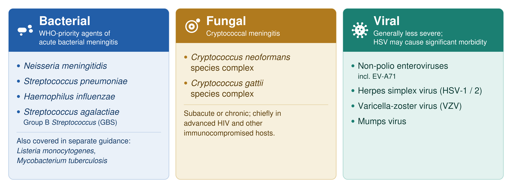
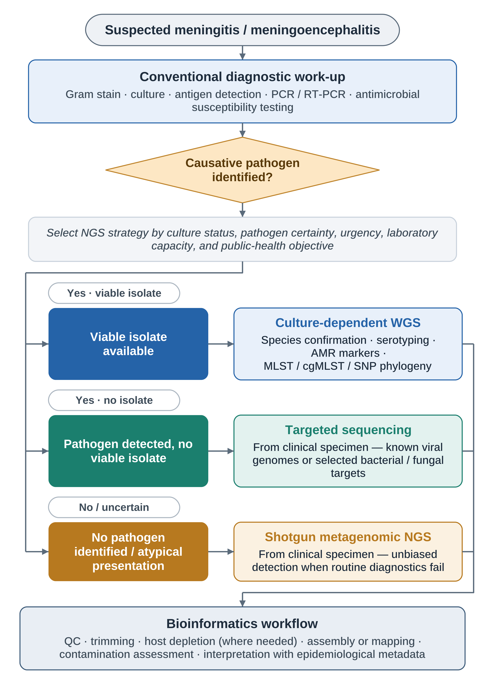
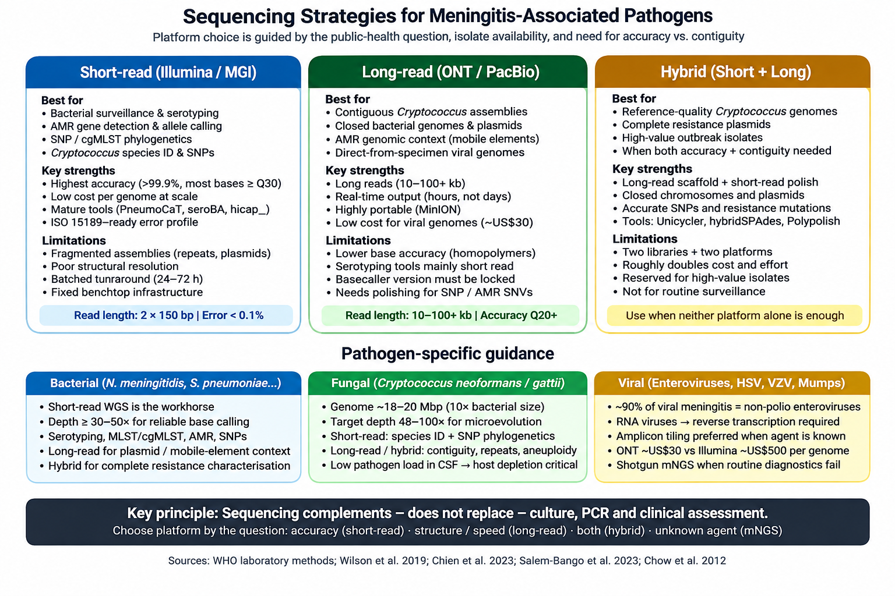
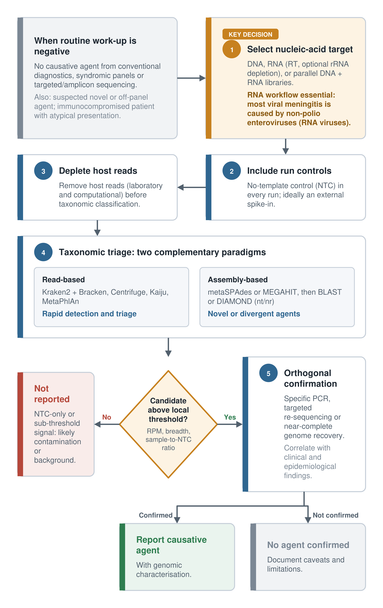

# Bioinformatics Guidance for Genomic Epidemiology of Meningitis-Associated Pathogens in Public Health Laboratories

**Authors:** Lex Leong, Gültekin Ünal, Sarah E. Kidd, Justice Ohene Amofa, Tracey Calvert-Joshua

## Scope of the Guidance

**Figure 1.** Overview of the pathogens, sequencing approaches, bioinformatics analyses and public-health applications covered in this guidance.

This guidance is written for the multidisciplinary and international community that underpin pathogen genomic surveillance. Its primary audience is public health and clinical bioinformaticians, together with the laboratory scientists and microbiologists in reference and public health laboratories who generate and quality-assure the underlying sequence data, and the epidemiologists and surveillance officers who translate genomic results into public health action. The document assumes no single level of prior expertise: it is intended to be accessible to professionals who are new to meningitis-associated pathogen genomics, while remaining a useful reference for experienced analysts. It is likely to be of particular value to national reference laboratories, WHO collaborating centres, and laboratories in high-burden or resource-limited settings (including LMICs) — including those in the sub-Saharan African meningitis belt — that are establishing or expanding genomic surveillance capacity.

The guidance is designed to be used flexibly rather than read end-to-end. Users who are new to genomic analysis can follow the workflows sequentially — from raw-read quality control through assembly, *in silico* serotyping, antimicrobial resistance detection, and phylogenetic interpretation — treating the recommended tools, parameters, and quality thresholds as sensible defaults. Experienced bioinformaticians can instead use the document as a benchmark for harmonizing existing pipelines and for recording tool and reference-database versions in laboratory standard operating procedures, supporting inter-run and inter-laboratory comparability. Because the pathogen-specific sections for bacterial, fungal, and viral agents are largely self-contained, users can navigate directly to the organism relevant to their setting, while the decision trees and tool tables are intended as quick-reference aids at the bench and during analysis.

Throughout, the thresholds, tools, and workflows are offered as practical, evolving recommendations rather than fixed requirements; they should be validated locally and adapted to each laboratory's instruments, specimen types, sequencing volumes, and regulatory environment. Genomic data are intended to complement — not replace — conventional microbiology, clinical assessment, and epidemiological investigation, and should always be interpreted in that broader context. With this scope in mind, the sections that follow begin with the molecular diagnostic foundations on which all sequencing approaches build.

## Abstract

Meningitis remains a major global public health concern because of its rapid clinical progression, high mortality, and potential for long-term neurological sequelae. Conventional diagnostic approaches, including culture, Gram staining, antigen detection, antimicrobial susceptibility testing, and PCR/qPCR, remain essential for case confirmation and clinical management; however, genomic technologies are increasingly important for pathogen characterization, outbreak investigation, antimicrobial resistance detection, and vaccine-impact monitoring. This guidance document was developed through the PHA4GE working group to support public health bioinformaticians and other public health professionals who may have limited prior experience with meningitis-associated pathogen genomics. It provides a practical, step-by-step framework that helps users understand what analyses should be performed, when they are appropriate, and which bioinformatics tools can be used. The document summarizes molecular diagnostic targets and platforms, compares short-read, long-read, and hybrid sequencing strategies, and outlines quality control, host depletion, assembly, mapping, consensus generation, and contamination assessment procedures. It further describes in silico serotyping for key bacterial meningitis pathogens, genomic detection of antimicrobial resistance mechanisms, reference-genome selection, variant calling, cgMLST and SNP-based phylogenetic approaches, and interpretation of genomic data for outbreak detection and transmission investigation. Special considerations are included for *Cryptococcus neoformans/gattii* complex genome analysis, enterovirus sequencing, and metagenomic triage when routine diagnostics fail to identify a causative agent including bacterial invasive pathogens. By integrating laboratory workflows with reproducible bioinformatics pipelines, quality thresholds, validation principles, and data-sharing recommendations, this guidance aims to support standardized, interpretable, and surveillance-ready genomic analyses for meningitis-associated pathogens. The current version of this document will continue to be maintained and updated through the PHA4GE GitHub (https\://github.com/pha4ge/pipeline-resources) repository as methods, tools, and best practices evolve.

## Background and Public Health Relevance

Meningitis is the inflammation of the meninges that protect the brain and spinal cord and poses a significant global public health risk due to its potential for mortality and long-term complications. While both meningitis and encephalitis involve central nervous system inflammation, meningitis affects the meninges, whereas encephalitis targets the brain parenchyma (Melhuish & McGill, 2021; World Health Organization, 2025). Meningitis can be caused by a variety of infectious agents, including bacteria, fungi and viruses. Among these, bacterial meningitis remains the most significant public health concern. The World Health Organization has identified four primary bacterial pathogens as the leading causative agents of acute bacterial meningitis: *Neisseria meningitidis, Streptococcus pneumoniae, Haemophilus influenzae, and Streptococcus agalactiae* (Group B *Streptococcus*) (WHO, 2025). Additional bacterial pathogens associated with meningitis, such as *Listeria monocytogenes* and *Mycobacterium tuberculosis* are discussed in detail in separate Bioinformatics Guidance Documents (see the https\://github.com/pha4ge/pipeline-resources). The main pathogens associated with meningitis are summarized in Figure 2\.

**Figure 2\.** Scope of pathogens covered in this guidance, grouped by aetiological class: the four WHO-priority bacterial agents of acute bacterial meningitis (with *Listeria monocytogenes* and *Mycobacterium tuberculosis* addressed in companion documents), the fungal agents *Cryptococcus neoformans* and *C. gattii*, and the principal viral agents (non-polio enteroviruses including EV-A71, HSV-1/2, VZV, and mumps virus)

Key population risk groups for meningitis include infants (\<1 year old) and young children (\<5 year olds), teenagers (15-24 years old), people in close contact within institutions for example daycares,and universities, immunocompromised individuals (people living with HIV), and in specific regions such as the “meningitis belt” of sub-Saharan Africa (WHO, 2025). Nevertheless, these risk groups are predisposed to infection by different causative pathogens. For example, the “meningitis belt“ of sub-Saharan Africa is at high risk of recurrent epidemics of meningococcal meningitis (meningitis caused by bacterial pathogen *Neisseria meningitidis*) compounded by several health-associated challenges such as hospital access, healthcare and vaccine provision, and malnutrition and inadequate water, sanitation and hygiene. Separately, immunocompromised individuals are most likely at risk of cryptococcal meningitis (meningitis caused by a fungal pathogen, *Cryptococcus neoformans*) through inhalation of air and dust particles containing the fungus. Cryptococcal meningitis causes about 19% of all AIDS-related deaths globally (Rajasingham et al., 2022). 

Conventional microbiological diagnostic approaches — including rapid polymerase chain reaction (PCR)-based genetic detection, microbial culture, and antibiotic susceptibility testing — remain essential for the management of meningitis. The advent of next-generation sequencing (NGS), however, has significantly advanced the characterization of meningitis-causing pathogens. NGS has demonstrated utility in accurately identifying causative agents, evaluating vaccine program efficacy, expediting outbreak detection and surveillance, and guiding targeted treatment through antimicrobial resistance marker characterization (Wilson et al., 2019; Benoit et al., 2024; Hackman et al., 2024). There are currently three approaches of NGS: *(1) shotgun metagenomic sequencing directly from clinical specimens; (2) targeted sequencing of viral genomes or specific bacterial/fungal genes from clinical specimens; and (3) whole-genome sequencing from pure viral, bacterial, or fungal cultures*. Each approach carries distinct advantages and limitations — culture-dependent sequencing is the most cost-effective but time-consuming, whereas shotgun metagenomic sequencing is the most resource-intensive but least biased.

**Figure 3\.** Decision tree for selecting next-generation sequencing approaches for meningitis-associated pathogens. Conventional microbiological and molecular diagnostic methods remain the first-line approach for case confirmation and clinical management. When a viable isolate is available, culture-dependent whole-genome sequencing is preferred for high-resolution pathogen characterization, serotyping, antimicrobial resistance marker detection, and outbreak investigation. When a pathogen is detected but no viable isolate is available, targeted sequencing from clinical material can support genotyping and surveillance, particularly for viral pathogens. When routine diagnostics are negative or an unexpected agent is suspected, shotgun metagenomic sequencing provides an unbiased approach for pathogen detection directly from clinical specimens. All sequencing routes require standardized quality control, contamination assessment, validated bioinformatics workflows, and interpretation in epidemiological context. 

 

## Molecular Diagnostics

Molecular diagnostic methods play a central role in the rapid detection and preliminary characterization of meningitis-associated pathogens, particularly when early clinical decision-making is required or when culture is negative due to prior antimicrobial exposure. Culture, Gram stain, antigen detection, PCR-based assays, and antimicrobial susceptibility testing remain complementary rather than mutually exclusive methods. The WHO/CDC laboratory manual for bacterial meningitis includes PCR for detection and characterization, molecular typing, antimicrobial susceptibility testing, and quality assurance as distinct but connected components of laboratory confirmation and surveillance (WHO & CDC 2011). 

Tables 1 summarise the molecular diagnostic systems currently in use across reference and public-health laboratories for the bacterial, viral, and fungal causative agents of meningitis. The selection criteria for each system depend on local epidemiology, available laboratory infrastructure, turnaround-time requirements, and whether the testing is intended for individual clinical decision-making or for population-level surveillance. Conventional and quantitative nucleic acid amplification (PCR / qPCR / RT-qPCR) remains the reference approach; loop-mediated isothermal amplification (LAMP), syndromic multiplex panels (BioFire FilmArray, QIAstat-Dx), and emerging CRISPR-based platforms (SHERLOCK, DETECTR) extend molecular detection capabilities into resource-limited and point-of-care settings (Check citation).

**Table 1.** Molecular diagnostic methods and genetic targets used for the detection of major bacterial meningitis pathogens and syndromic meningitis/encephalitis panels.

| Pathogen | Method / platform | Genetic target(s) | Performance and operational notes | Reference |
| :---- | :---- | :---- | :---- | :---- |
| *Neisseria meningitidis* | Conventional / multiplex real-time PCR | *ctrA*, *sodC*, *porA*; serogroup-specific genes (*siaD* A/B/C/W/Y/X) | Sensitivity 88–100%; specificity \~99% on CSF; permits genogrouping when culture is negative | Corless et al. (2001); Mothershed et al. (2004); WHO/CDC Manual (Castillo et al., 2011\) |
| *Neisseria meningitidis* | LAMP (loop-mediated isothermal amplification) | *ctrA* and serogroup-specific targets (A, B, C, W, X, Y) | Detects \~10 copies/reaction within 60 min; clinical sensitivity 100% and specificity 99.6% on CSF; isothermal, low-equipment | Lee et al. (2015); Seki et al. (2018) |
| *Streptococcus pneumoniae* | Conventional / multiplex real-time PCR | *lytA*, *ply*, *psaA*; serotype-specific *cps* loci for genomic serotyping | *lytA* qPCR remains the reference target; sensitivity \>95% on CSF; permits serotype prediction without culture | Carvalho et al. (2007); Abdeldaim et al. (2010); WHO/CDC Manual (Castillo et al., 2011\) |
| *Streptococcus pneumoniae* | LAMP | *lytA* | Detection within 30–60 min; comparable analytical sensitivity to qPCR; field-deployable | Seki et al. (2018) |
| *Haemophilus influenzae* | Conventional / multiplex real-time PCR | *hpd* (protein D); serotype-specific *bexA* and capsular loci (a–f) | Sensitivity \>95% on CSF; recommended target for genomic serotyping including non-typeable strains | Wang et al. (2011); WHO/CDC Manual (Castillo et al., 2011\) |
| *Haemophilus influenzae* | LAMP | Capsular loci (a–f) and *bexA* | Serotype-specific isothermal detection; suitable for resource-limited settings | Takano et al. (2017); Seki et al. (2018) |
| *Streptococcus agalactiae* (GBS) | Real-time PCR | *cfb* (CAMP factor), *sip* | Primarily used for neonatal early-onset disease and intrapartum screening; CSF qPCR sensitivity \>90% | Bergseng et al. (2007) |
| *Listeria monocytogenes* | Real-time PCR (often as part of ME panels) | *hly* (listeriolysin O), *prfA* | Adjunct to culture; included in commercial ME panels (BioFire, QIAstat-Dx) | Le Monnier et al. (2011); Leber et al. (2016) |
| *Mycobacterium tuberculosis* | Xpert MTB/RIF and Xpert MTB/RIF Ultra (GeneXpert, automated NAAT) | *rpoB* (rifampicin resistance) plus IS6110 / IS1081 targets in Ultra | Xpert sensitivity 18–59% on CSF (improves with large concentrated volumes); Xpert Ultra \~70%; rapid rifampicin resistance detection; WHO-endorsed as initial test | Nhu et al. (2014); Bahr et al. (2018); Cresswell et al. (2020) |
| Multiple bacterial \+ viral \+ fungal targets | Syndromic multiplex PCR — BioFire FilmArray ME Panel | 14 targets: 6 bacterial (*E. coli* K1, *H. influenzae*, *L. monocytogenes*, *N. meningitidis*, *S. agalactiae*, *S. pneumoniae*), 7 viral, *Cryptococcus neoformans/gattii* | Sample-to-answer \~1 h directly from CSF; bacterial sensitivities \~90–100% vs culture; some false positives reported (esp. *S. pneumoniae*, HSV-1) | Leber et al. (2016); Tansarli & Chapin (2020) |
| Multiple bacterial \+ viral \+ fungal targets | Syndromic multiplex PCR — QIAstat-Dx ME Panel | 15 targets (includes *Mycoplasma pneumoniae*, *S. pyogenes*) on QIAstat-Dx platform | Performance comparable to FilmArray ME; PPA \>90% for most targets in head-to-head studies | Lewinski et al. (2023); Brunet et al. (2024) |

*The table summarizes commonly used PCR-based, isothermal, automated NAAT, and syndromic multiplex platforms; their principal genetic targets; and key diagnostic performance or operational characteristics reported for cerebrospinal fluid testing. CSF, cerebrospinal fluid; LAMP, loop-mediated isothermal amplification; ME, meningitis/encephalitis; NAAT, nucleic acid amplification test.*

## Sequencing Strategies

**Figure 4.** Comparison of short-read, long-read and hybrid sequencing strategies for meningitis-associated pathogens.

The molecular diagnostic methods described above confirm the presence of a meningitis-associated pathogen and, in some cases, predict its genogroup or serotype from one or a few amplified targets — but they interrogate only predefined loci and cannot, on their own, resolve how isolates are related to one another, characterise the full complement of antimicrobial resistance determinants, or detect the antigenic variation relevant to vaccine performance. Sequencing extends the same nucleic-acid–based logic from a handful of targets to the entire genome, and is therefore best understood as a continuation of the diagnostic pathway rather than a replacement for it: culture, PCR/qPCR, and sequencing remain complementary stages of laboratory confirmation and surveillance (WHO, 2011, 2011; Wilson et al., 2019).

Two largely independent decisions define a sequencing strategy. The first is *what is sequenced* — the analytical approach — which follows directly from whether a viable isolate is available and from the public-health question being asked (Figure 3). As introduced above, three approaches are used: (i) whole-genome sequencing (WGS) of a pure bacterial or fungal culture; (ii) targeted or amplicon sequencing of specific genes or whole viral genomes directly from a clinical specimen; and (iii) shotgun metagenomic sequencing directly from the specimen. The second decision is *which platform* generates the data — predominantly short-read (e.g., Illumina) or long-read (e.g., Oxford Nanopore Technologies, ONT), or a hybrid of the two. These two axes are orthogonal: the same meningococcal isolate may be characterised by Illumina WGS for high-accuracy surveillance of circulating vaccine antigens or by portable ONT WGS for rapid, near-patient diagnostic characterisation of capsular type. The remainder of this section first compares the platforms and then details pathogen-specific workflows for bacterial, fungal, and viral agents.

### Short-Read Sequencing (e.g., Illumina Platforms) 

Short-read sequencing is the default, workhorse approach for routine genomic surveillance of the bacterial meningitis pathogens and for any analysis that depends on base-level accuracy. Illumina platforms perform sequencing-by-synthesis — fluorescently labelled nucleotides incorporated one base at a time across millions of clonal clusters and imaged — while related systems (MGI/DNBSEQ) use DNA-nanoball arrays; both generate short paired-end reads (commonly 2 × 150 bp) in which most base calls exceed Q30, a per-base error rate below 0.1%. For meningitis surveillance this accuracy is not an abstract virtue: it is the foundation for the specific outputs the laboratory must produce — reliable base calls to confidently assign serotype or genogroup, and accurate detection of resistance determinants.

The clearest case for short-read sequencing is the WHO-priority bacterial agents — *Neisseria meningitidis*, *Streptococcus pneumoniae*, *Haemophilus influenzae*, and *Streptococcus agalactiae* — whose compact, gene-dense (\~2 Mbp) genomes are recovered almost in their entirety by short reads. From a single cultured isolate this approach delivers capsular genogroup or serotype prediction (the established serotyping tools — PneumoCaT, seroBA, SeroCall, hicap, meningotype — all take short-read FASTQ or short-read assemblies as input), MLST and cgMLST, antimicrobial-resistance determinants (e.g., *pbp1a/2x/2b* and *penA*/*ftsI* alleles, *ermB*, *mefA*, *bla*TEM), the vaccine-antigen variants needed for vaccine-impact monitoring (meningococcal PorA, FetA, factor H–binding protein and genotype to phenotype deductions to assess vaccine coverage), and the high-resolution data that underpin transmission and cluster analysis. Just as decisive operationally, short-read platforms scale to hundreds of isolates per run at a low cost per genome,the natural choice for population-level surveillance,and their mature, well-characterised error profile supports accreditation under recognised standards (e.g., ISO 15189). For *Cryptococcus*, short-read data likewise remain the standard for species identification and SNP-based phylogenetic analysis (Salem-Bango et al., 2023).

What short-read sequencing does *not* provide is structural resolution, and read length is the binding constraint: short reads cannot span long repeats, mobile genetic elements, or large structural variants, so *de novo* assemblies are frequently fragmented into many contigs (Table 2). For the bacterial agents this rarely affects allele- or gene-based typing, but it does limit reconstruction of the genomic *context* of resistance — for example, whether a *bla*TEM-1 gene in *H. influenzae* sits on a plasmid or the chromosome, the complete structure of a resistance plasmid, or rearrangements within a capsule locus. For *Cryptococcus* the limitation is more fundamental: short reads cannot resolve the extensive tandem repeats, aneuploidy, and structural rearrangements characteristic of these \~18–20 Mbp genomes, so contiguous fungal assemblies require long-read or hybrid data.

Operationally, batched turnaround (typically 24–72 h) and fixed benchtop infrastructure make short-read sequencing less suited to the most time-critical single-case investigations and to field deployment during epidemics in the sub-Saharan African meningitis belt, where the real-time, portable output of long-read platforms is advantageous; and direct-from-CSF metagenomic sequencing on these platforms is constrained by the dominance of host nucleic acid (often \>95%, and frequently \>99% in CSF), requiring host depletion or deeper, costlier sequencing. In short, short-read sequencing is the method of choice for isolate-based bacterial and fungal surveillance, serotyping, AMR gene cataloguing, and allelic and SNP-based phylogenetics, while the long-read and hybrid strategies described below take over when structural context, complete plasmids or repeats, or rapid field turnaround are required.

### Long-Read Sequencing (e.g., Oxford Nanopore Technologies) 

Long-read sequencing is the complementary strategy to short reads: it is the method of choice whenever genomic *structure*, a *complete* genome, or *speed at the point of need* matters more than maximal per-base accuracy. On the Oxford Nanopore Technologies (ONT) platform, single DNA or RNA molecules are driven through nanoscale protein pores in a synthetic membrane, and the characteristic disruptions each base causes in the ionic current are computationally translated into sequence; PacBio offers an alternative long-read chemistry (HiFi/circular consensus) that trades portability for very high accuracy. Reads routinely span tens of kilobases, and although per-base accuracy was historically the principal weakness of the technology, current chemistry (R10.4+) together with high-accuracy basecalling (e.g., Dorado SUP) has narrowed the gap substantially, with raw read accuracy now commonly at Q20 or above.

The single strongest case among our pathogens is *Cryptococcus*. Its ~18–20 Mbp genome contains tandem repeats (Chow et al., 2012), aneuploidy and structural rearrangements that can be difficult to resolve using short reads. Long-read or hybrid sequencing is therefore particularly valuable for generating contiguous, chromosome-scale fungal assemblies (Coelho et al., 2024). The competitive per-genome cost of ONT may provide an additional advantage for these comparatively large genomes. For the bacterial agents, the decisive contribution of long reads is structural context rather than typing: long reads can close bacterial genomes into complete, circular contigs and — most importantly for meningitis surveillance — resolve the *genomic context of resistance* that short reads leave ambiguous. This includes determining whether a *bla*TEM-1 gene in *Haemophilus influenzae* is plasmid-borne or chromosomal, reconstructing the full structure of resistance plasmids, and resolving the mobile genetic elements (e.g., the Tn1545/Tn2010 transposons carrying *ermB*, *mefA*, and *tetM* in *Streptococcus pneumoniae*) that disseminate resistance — questions of growing public-health relevance that are taken up in the AMR section. For viral agents, ONT supports amplicon-tiling (ARTIC-style) sequencing of enterovirus genomes directly from clinical specimens at a low cost per sample — reported at roughly US\$30 versus \~US\$500 for an equivalent Illumina run, with comparable consensus accuracy (Chien et al., 2023\) — making it well suited to laboratories scaling viral genomic surveillance under budget constraints.

What long-read data do *not* yet provide as reliably as short reads is base-level certainty, and this is the constraint that should govern its use for our pathogens. For analyses that hinge on individual nucleotides — high-confidence base and allele calling for transmission and cluster analysis, and exact resistance-conferring point mutations (for example in *penA*, the *pbp* genes, or *ftsI*) — residual systematic errors, particularly in homopolymeric tracts, mean that short-read sequencing remains the reference for these use cases; ONT data intended for this purpose should use current chemistry and SUP basecalling, adequate depth, and consensus polishing (e.g., Medaka), or be combined with short reads to generate a “hybrid genome”. A practical corollary is that most established bacterial serotyping tools (PneumoCaT, seroBA, SeroCall, hicap, meningotype) were developed and validated on short-read input, so ONT-only data may not feed directly into these workflows without adaptation. Finally, the rapid evolution of ONT basecalling models is itself a challenge for accredited diagnostic and surveillance laboratories: because the same raw signal can yield different consensus sequences under different models, the basecaller version — and the upstream FAST5/POD5-to-FASTQ step — must be recorded and version-locked in the laboratory SOP to preserve validation and inter-run comparability.

Operationally, long-read sequencing offers what short reads cannot: real-time data generation and a low-capital, highly portable footprint (e.g., the MinION), with an actionable result possible within hours rather than after a batched 24–72 h run. These properties make it particularly valuable for the most time-critical single-case investigations and for field deployment during meningococcal epidemics in the sub-Saharan African meningitis belt. In summary, long-read sequencing is the method of choice for contiguous fungal assemblies, closed bacterial genomes, reconstruction of plasmids, mobile elements, and the genomic context of AMR, rapid outbreak and field turnaround, and direct-from-specimen viral genomes; where the same workflow also demands the highest base-level accuracy, it is best paired with short-read data — the hybrid strategy described next.

### 

### Hybrid Sequencing Approaches 

Hybrid sequencing is the strategy of choice when neither platform alone suffices — when an analysis needs *both* base-level accuracy and structural completeness from the same isolate. Long reads provide the scaffold (closed bacterial chromosomes and plasmids, contiguous fungal assemblies) and short reads either co-assemble with them (Unicycler, hybridSPAdes) or polish the long-read assembly (e.g., Polypolish), correcting the residual homopolymer errors that would otherwise compromise SNP and resistance-mutation calling. 

**Table 2.** Comparison of short-read (Illumina/MGI) and long-read (Oxford Nanopore Technologies) sequencing platforms for the genomic characterisation of meningitis-associated pathogens.

| Feature | Illumina / MGI (Short-read) | Oxford Nanopore (Long-read) |
| :---- | :---- | :---- |
| Accuracy | Highest (\>99.9%); excellent for SNP calling. | Improving (Q20+), but higher raw error rates in homopolymer regions. |
| Assembly | Often fragmented (contigs); struggles with repeats. | Can produce closed, circularized genomes (telomere-to-telomere). |
| Turnaround | 24–72 hours (batching required). | Real-time; results possible within hours (crucial for acute meningitis). |
| Portability | Benchtop/Large scale; fixed infrastructure. | Highly portable (MinION); ideal for field labs  |
| Application | Large-scale surveillance and AMR gene cataloging. | Outbreak tracking, structural variant detection, and metagenomics. |

*The table contrasts the two technologies across five operational dimensions — per-base accuracy, assembly contiguity, turnaround time, portability, and primary public-health application — to support platform selection according to the diagnostic or surveillance question.*

For our pathogens it is most useful in two cases: reference-quality *Cryptococcus* assemblies (e.g., MaSuRCA), where the \~18–20 Mbp genome demands contiguity and accuracy together; and full characterisation of a bacterial isolate in which a complete resistance plasmid or mobile element must be resolved while base-accurate point mutations and base calling are retained. Because it requires two library preparations and two platforms, hybrid sequencing roughly doubles cost and effort, and is best reserved for high-value isolates — reference genomes, complete plasmid characterisation, or selected outbreak strains — rather than routine surveillance. 

**Figure 5\.** Schematics of the Illumina and ONT sequencing procedure. Figure from Hackl, Harbig and Nieselt (2022) and adapted from Shendure et al. (2017).

### Shotgun Metagenomics Sequencing 

When conventional diagnostics, syndromic panels, and targeted/amplicon sequencing all fail to identify a causative agent — for example in culture-negative CSF after prior antimicrobial therapy, in suspected novel or unexpected pathogens, or in immunocompromised patients with atypical presentations — untargeted (shotgun) metagenomic next-generation sequencing (mNGS) directly from the clinical specimen provides a hypothesis-free route to detection, and has demonstrated clinical utility in meningitis and encephalitis of unknown cause (Wilson et al., 2019). Its distinctive value is the ability to interrogate bacteria, fungi, viruses, and parasites in a single assay and to detect agents that lie outside the fixed content of syndromic panels — for instance unexpected or fastidious bacteria, off-panel or divergent viruses, and the free-living amoebae (*Naegleria fowleri*, *Balamuthia mandrillaris*, *Acanthamoeba* spp.) responsible for rare but severe meningoencephalitis. Comprehensive metagenomic assembly and characterisation is beyond the scope of this document; what follows is a minimal framework for taxonomic triage, while the decision logic for reaching this step is summarised in Figure 6\.

One decision must be made before sequencing: the nucleic-acid target. Because the great majority of viral meningitis is caused by RNA viruses (non-polio enteroviruses), a DNA-only library will miss the commonest viral agents entirely; protocols should therefore include a reverse-transcription step and, where the differential spans both DNA and RNA agents, run parallel DNA and RNA libraries. Host depletion (see Quality Filtering and Host Depletion) should precede classification, and for RNA workflows rRNA depletion is also worth considering.

Two complementary analytical paradigms are then used:

* *Read-based taxonomic classification* — rapid assignment of individual reads to taxa; suitable for detection and triage, with modest compute. Common tools: Kraken2 \+ Bracken (k-mer LCA classification with Bayesian re-estimation of abundance), Centrifuge, and Kaiju (translated/protein-level search, more sensitive for divergent viruses and bacteria), alongside marker-gene profilers such as MetaPhlAn (bacteria). Database choice strongly affects both sensitivity and specificity and must be documented.

* *Assembly-based characterisation* — de novo assembly (metaSPAdes, MEGAHIT) followed by classification of contigs (e.g., against NCBI nt/nr with BLAST or DIAMOND); required when the agent is novel or too divergent for read-level matching.

**Interpretation and QC (critical).** A taxonomic hit is not a diagnosis. For any candidate organism, report read counts normalised to depth (e.g., reads per million, RPM), the genome breadth/coverage recovered, and the ratio of sample signal to the no-template control (NTC). Every run should include an NTC — and ideally an external spike-in control — to model reagent and environmental contamination (the "kitome") and laboratory background. Crucially, positivity thresholds are not transferable between laboratories: they must be established locally during validation for the specific protocol, specimen type, and bioinformatic pipeline in use. Candidate agents should be confirmed orthogonally (specific PCR, targeted re-sequencing, or recovery of a near-complete genome) and always correlated with the clinical picture.

**Practical platforms for PHLs.** Integrated, reproducible workflows lower the deployment barrier — e.g., nf-core/taxprofiler (multiple classifiers in parallel under Nextflow), the web-based CZ ID pipeline (free, no local HPC, with built-in background-model statistics), and Galaxy metagenomics workflows. mNGS is best positioned as a reference or second-line diagnostic for the diagnostic odyssey and for outbreaks of unknown aetiology, rather than as a routine surveillance tool.

****

**Figure 6\.** Metagenomic triage pathway for meningitis and encephalitis of unknown aetiology. Untargeted shotgun metagenomic next-generation sequencing (mNGS) is reserved for cases in which conventional microbiology, syndromic multiplex panels, and targeted/amplicon sequencing have all failed to identify a causative agent — typically culture-negative CSF after empirical antimicrobial therapy, suspected novel or off-panel pathogens, or immunocompromised patients with atypical presentations. Before sequencing, the nucleic-acid target is selected: because most viral meningitis is caused by RNA viruses (non-polio enteroviruses), RNA workflows incorporating reverse transcription (RT) are required to capture the commonest viral agents, and parallel DNA and RNA libraries are used when the differential spans both. A no-template control (NTC), and ideally an external spike-in control, is included in every run, and host reads are depleted before taxonomic classification. 

### Bacterial Genome Sequencing 

Bacterial meningitis is typically characterized by acute onset and high mortality if untreated. The most common causative agents include *Neisseria meningitidis*, *Streptococcus pneumoniae*, and *Haemophilus influenzae*, with additional pathogens such as *Listeria monocytogenes* and *Mycobacterium tuberculosis* contributing to specific clinical contexts.

From a genomic perspective, whole genome sequencing (WGS) enables high-resolution characterization of isolates, including serogroup or serotype prediction, identification of virulence determinants (e.g., capsule synthesis loci), and detection of antimicrobial resistance genes. Typing approaches such as MLST, cgMLST, and SNP-based phylogenetics are critical for outbreak detection and transmission tracking. Integration of genomic data with epidemiological metadata is essential to distinguish between sporadic cases and outbreak clusters.

* Accuracy**:** Minimum 30x–50x depth is critical for accurate identification of bases and mutation associated with antimicrobial resistance. PacBio HiFi, is a long-read technology that would be able to produce high base-calling accuracy.   
* Throughput & Scalability: Consider the number of samples and the data required per run. Benchtop machines (e.g., NextSeq, MiniSeq) are suitable for lower throughput, while production-scale instruments are required for massive data generation.  
* Read Length: Longer reads are essential for closing microbial genomes or identifying isoforms, but shorter reads are often sufficient for mapping and counting.  
* Cost Efficiency: Analyze the "cost per answer," not just the cost per gigabase (Gb). This includes reagent costs, maintenance, and the cost of library

### Fungal Genome Sequencing

Fungal meningitis is generally subacute or chronic and primarily affects immunocompromised individuals, particularly those with advanced HIV infection. The *Cryptococcus neoformans* and *Cryptococcus gattii* complexes are the most common causative agents.

Genomic analysis of fungal pathogens presents additional challenges due to larger genome sizes and increased complexity compared to bacteria. Historically, sequencing of fungi has been predominantly focused on species identification, and usually it is through the ribosomal internal transcribed spacer (ITS) region. NGS approaches can be used to identify species, characterize virulence-associated features such as capsule and melanin production, and detect antifungal resistance markers. MLST-based typing schemes are commonly applied for *Cryptococcus* spp. However, low pathogen load and host DNA contamination in cerebrospinal fluid samples may limit sequencing sensitivity and require careful preprocessing and quality control.

Two key considerations in cryptococcal genome sequencing are genome coverage and sequencing platform selection. The cryptococcal genome size ranges from 18 to 20 Mbp — approximately ten times that of a bacterial genome. To accurately detect microevolution and heterozygosity, an average genome-wide depth of coverage between 48x and 100x is recommended (Montoya et al., 2025). However, the high cost of achieving sufficient genome coverage has been a significant barrier to advancing cryptococcal genome sequencing. While Illumina short-read sequencing remains the standard for SNP-based phylogenetic mapping and precise species identification (Salem-Bango et al., 2023), long-read sequencing platforms, such as Oxford Nanopore and PacBio, are better suited for resolving genomic rearrangements, assembling complex structures, and characterizing the massive tandem repeat sequences (Chow  et al., 2012\) that are prevalent in *Cryptococcus* spp.

### Viral Genome Sequencing

Viral meningitis is generally characterized by a less severe clinical course compared to bacterial meningitis; however, certain viruses, such as herpes simplex virus (HSV), may cause significant morbidity. The primary causative agents of viral meningitis include enteroviruses, HSV-1, HSV-2, varicella-zoster virus (VZV), and mumps virus. Notably, approximately 90% of viral meningitis cases are attributable to non-polio enteroviruses (Izadi et al., 2018). Although non-polio enteroviruses are not notifiable diseases at a global scale, human enterovirus 71 remains a significant public health concern due to its potential to cause large outbreaks, particularly among children in the Asia Pacific region (Broad et al., 2026; Gilbert et al., 1988; Izadi et al., 2018; Puenpa et al., 2019). Most viruses implicated in viral meningitis are RNA viruses; thus, viral genomic sequencing protocols should include a reverse transcription step to convert single-stranded RNA to complementary DNA (cDNA).

When standard diagnostic methods do not identify the etiological agent, shotgun metagenomic sequencing should be considered for comprehensive, unbiased pathogen detection and characterization, including the identification of mixed infections or novel viral strains. Where a causative agent can be identified by conventional diagnostic approaches, amplicon-based targeted genomic sequencing is recommended for more efficient allocation of laboratory resources. For instance, genome sequencing of enterovirus 71 can be achieved using overlapping primer pairs to generate three amplicons that span the entire viral genome (Tan et al., 2015). Alternatively, full-length genomes of 22 distinct enterovirus genotypes can be amplified using a nested PCR primer scheme targeting the 5′UTR and 3′UTR regions (Isaacs et al., 2018; Stelzer-Braid et al., 2020).

Given that viral genomic sequencing is performed directly from clinical specimens, it is essential to assess the viral load present, particularly when utilizing amplicon sequencing methodologies. The protocol described by Isaacs et al. (2018) indicates that successful near-full-length genomic sequencing can be achieved with cycle threshold (Ct) values ranging from 15 to 39.3. Similarly, an amplicon-tiling approach demonstrated a 71% success rate with samples exhibiting Ct values between 20.8 and 33.3 (Nguyen et al., 2016). Laboratories should recognize that definitions of low viral load may vary, and it is critical to perform limit-of-detection analyses for any new PCR primer scheme under the specific laboratory conditions and buffer systems in use. In addition, achieving complete genome sequencing in regards to the primer design can also be challenging for enteroviruses due to their high variability and dynamic nature.

Viral genome sequencing may be conducted using either Illumina or Oxford Nanopore Technologies (ONT) sequencing platforms. Recent evidence, such as the study by Chien et al. (2023), highlights the cost-effectiveness of the ONT MinION sequencer for generating complete enterovirus genome sequences. High sequencing costs can present significant barriers to the implementation of a large-scale genomic surveillance within public health laboratories. According to Chien et al., the ONT platform achieved highly accurate enteroviral genome sequences (99.98% accuracy) at an approximate cost of US\$30 per sample, inclusive of all reagents and consumables. In contrast, sequencing with Illumina platforms was reported to be approximately 16 times more expensive, with costs around US\$500 per sample. Laboratories should consider both cost and accuracy when selecting sequencing platforms for genomic surveillance or for outbreak investigation initiatives.

 

## Bioinformatics Considerations

The choice of computing infrastructure should be guided by the volume of sequencing data generated, the complexity of the analyses performed, and the available bioinformatics expertise. High-performance computing (HPC) systems are recommended for large-scale datasets, such as whole-genome sequencing projects or surveillance programs, as they provide the processing power, memory, and storage required for efficient data handling and analysis. In contrast, smaller local computing systems may be sufficient for low-throughput workflows or targeted analyses, particularly in laboratories with limited resources or intermittent sequencing needs.

Alternatively, cloud-based and web-accessible platforms offer flexible alternatives. For example, [Galaxy Community Hub](https://galaxyproject.org/) is an open, user-friendly platform that enables researchers to perform a wide range of bioinformatics analyses without the need for advanced programming skills or dedicated local hardware. Such platforms can support reproducible workflows, facilitate collaboration, and reduce the burden of infrastructure maintenance, although considerations around data security, upload times, and internet accessibility remain important. However, factors such as computational cost, data transfer time, internet connectivity, data security, etc. should be considered when using these platforms. Furthermore, proper training, reliable data storage, technical support and data backup systems are essential to ensure efficient analyses, long-term access and robustness of sequencing data.

Regardless of where computation is performed, reproducibility and portability are best secured through open-source workflow management and software-packaging tools, which also provide the version control that underpins accredited, comparable analyses. 

For analysts who prefer not to run command-line pipelines, several open, web-accessible platforms beyond Galaxy serve public-health pathogen genomics directly: [BIGSdb](https://pubmlst.org/), the open-source software underlying the PubMLST databases and the reference resource for *Neisseria meningitidis* typing; the free [Pathogenwatch](https://pathogen.watch/) platform for serotyping, AMR prediction, and clustering; [Microreact](https://microreact.org/) for interactive visualization of genomic epidemiology; and, for untargeted metagenomic triage, the free, browser-based CZ ID pipeline. Whichever route is chosen, recording tool and reference-database versions in the laboratory standard operating procedure remains essential for inter-run and inter-laboratory comparability. 

Workflow managers such as [Nextflow](https://www.nextflow.io/) and [Snakemake](https://snakemake.readthedocs.io/) encode an entire analysis — tool order, parameters, and dependencies — as a single re-runnable description that produces the same result on a laptop, an HPC cluster, or the cloud. Community-curated, peer-reviewed pipeline collections built on these managers — most notably [nf-core](https://nf-co.re/) (e.g., nf-core/taxprofiler, used later in this document) and pathogen-focused pipelines such as [Bactopia](https://bactopia.github.io/) — let laboratories adopt standardized analyses rather than maintaining bespoke scripts. Reproducibility across machines is further ensured by containerization — Docker, and Singularity/Apptainer for shared HPC environments where root access is restricted — and by community package repositories such as [Bioconda](https://bioconda.github.io/) and conda-forge (with the associated BioContainers), which pin each tool, and ideally each reference-database version, to an exact, documented release. 

### Quality Filtering and Host Depletion

Sequencing data generated from either Illumina short-read or Oxford Nanopore Technologies (ONT) long-read platforms must undergo quality filtering before any downstream analysis is performed. Laboratories are advised to use dedicated quality filtering tools such as FastP or SeqKit for this purpose. FastP supports integrated adapter trimming, quality score filtering, and read length cutoff functionality in a single processing step, and is compatible with both Illumina and ONT data. SeqKit provides complementary utilities for sequence statistics and read filtering, and is particularly useful for generating pre- and post-filtering quality reports that can be retained as part of the laboratory's quality management records.

As a minimum standard, a Phred quality score threshold of Q ≥ 20 and a minimum read length cutoff appropriate to the amplicon design should be applied. These parameters should be defined in the laboratory's standard operating procedure (SOP) and applied consistently across all runs to enable inter-run comparability.

Since viral sequencing is performed directly on clinical specimens — which may include cerebrospinal fluid (CSF), nasopharyngeal swabs, or rectal swabs — removal of host (human) nucleic acid contamination is an essential quality assurance step. This is achieved by mapping sequencing reads against the human reference genome ([GRCh38](https://www.ncbi.nlm.nih.gov/datasets/genome/GCF_000001405.40/)) and retaining only unmapped reads for downstream processing. Minimap2 is recommended for ONT long-read data, while Bowtie2 is recommended for Illumina short-read data. The proportion of reads identified as host-derived should be recorded and reported as a run quality metric. This step is particularly important in clinical specimens with low viral load, where host nucleic acid may constitute the majority of sequencing output. 

### Data Types and Quality Assessment

This section provides a workflow for processing raw whole-genome sequencing data from meningitis-associated bacterial, fungal, and viral pathogens into validated, quality-checked assemblies (or consensus sequences) suitable for downstream serotyping, AMR characterisation, genotyping, and phylogenetic analysis.

**Figure 7\.** Platform-aware quality control and assembly workflow for converting raw sequencing reads from meningitis-associated bacterial, fungal, and viral pathogens into validated, analysis-ready genomes. 

Raw read QC is platform-aware. Short-read (Illumina, MGI) and long-read (Oxford Nanopore Technologies, PacBio HiFi) data have fundamentally different per-base error profiles and require different acceptance thresholds. All tools below operate on FASTQ input; ONT raw signal data (FAST5/POD5) must first be base-called using a current high-accuracy model (e.g., Dorado SUP) before entering this workflow. For viral genomic sequencing — performed directly from clinical specimens — additional host depletion is required at this stage. Reads should be mapped against the appropriate host reference (typically human) using minimap2 or Bowtie2, and unmapped reads carried forward. 

**Table 3:** Recommended tools for raw read QC for quality assessment and quality control

| Software | Platform | Purpose | Key metrics | Example Codes  |
| :---- | :---- | :---- | :---- | :---- |
| FastQC | Illumina, ONT | Per-sample read QC | Per-base Phred, GC content, adapter content, duplication | \$ fastqc sample\_R1.fastq.gz sample\_R2.fastq.gz \-o fastqc\_out/ \-t 4  |
| MultiQC | Illumina, ONT | Cross-sample aggregation | Pass/warn/fail summary, batch comparison | \$ multiqc fastqc\_out/ \-o multiqc\_report/ |
| fastp | Illumina | Adapter trimming, quality filtering, and deduplication | Filtered read count, retained Q30% | fastp \-i R1.fastq.gz \-I R2.fastq.gz \-o R1.trim.fastq.gz \-O R2.trim.fastq.gz \-q 20 \-l 50 \--dedup \-j fastp.json \-h fastp.html |
| Trimmomatic | Illumina | Adapter trimming, sliding-window quality filtering | Surviving paired reads | \$ trimmomatic PE \-threads 4 R1.fastq.gz R2.fastq.gz R1.paired.fastq.gz R1.unpaired.fastq.gz R2.paired.fastq.gz R2.unpaired.fastq.gz ILLUMINACLIP:TruSeq3-PE.fa:2:30:10 SLIDINGWINDOW:4:20 MINLEN:50 |
| NanoPlot | ONT | Long-read QC visualisation | Read N50, median Q, length distribution | \$ NanoPlot \--fastq reads.fastq.gz \-o nanoplot\_out/ \-t 4  |
| NanoFilt / chopper | ONT | Length and quality filtering | Reads retained at Q ≥ 10, length ≥ 1 kbp | \$ gunzip \-c reads.fastq.gz \| chopper \-q 10 \-l 1000 \| gzip \> reads.filt.fastq.gz  |
| Kraken2\* | All | Taxonomic screen for contamination | % reads assigned to expected species | \$ kraken2 \--db k2\_standard \--paired R1.fastq.gz R2.fastq.gz \--report sample.kreport \--output sample.kraken \--threads 4 |

*\*Kraken2 has different sizes/types of databases. The results may vary according to the database being used.*

### Assembly 

Assembler choice is driven by platform and pathogen complexity. For routine bacterial surveillance, short-read *de novo* assembly is the standard. For *Cryptococcus* and other fungal pathogens — with genomes 10× larger than bacterial pathogens and rich in repeats and aneuploidy — long-read or hybrid approaches yield substantially more contiguous assemblies. For viral pathogens, reference-based mapping to generate consensus sequences is preferred when the genotype is known; de novo assembly is reserved for novel agents or metagenomic discovery.

**Table 4.** Recommended *de novo* assembly and reference-mapping strategies for meningitis-associated pathogens, organised by pathogen group and sequencing platform.

| Pathogen group | Platform | Primary assembler | Alternative | Notes |
| :---- | :---- | :---- | :---- | :---- |
| Bacterial (*N. meningitidis*, *S. pneumoniae*, *H. influenzae*) | Illumina | SPAdes (--isolate) | Shovill (wraps SPAdes with trimming and polishing) | k-mer range 21–127; auto-selected by SPAdes |
| Bacterial | ONT | Flye (--nano-hq) | Trycycler (consensus from multiple assemblers) | Polish with Medaka; for hybrid add Polypolish (short reads) |
| Bacterial | Hybrid | Unicycler | hybridSPAdes | Best for resolving repeats and plasmids |
| Fungal (*Cryptococcus* spp.) | Illumina | SPAdes (--careful) | — | Expect fragmented assembly; sufficient for SNP calling |
| Fungal | ONT / PacBio HiFi | Flye (--nano-hq or \--pacbio-hifi) | Canu, hifiasm | Required for resolving tandem repeats, chromosome-scale contiguity |
| Fungal | Hybrid | MaSuRCA | Unicycler (small genomes only) | Recommended for reference-quality fungal assemblies |
| Viral (enterovirus, HSV, VZV, mumps) | Illumina (amplicon) | Reference mapping: BWA-MEM, Bowtie2; consensus: iVar, samtools | De novo: SPAdes (--rnaviral), Trinity | Reference-based preferred when genotype known |
| Viral | ONT (amplicon) | Reference mapping: minimap2; consensus: Medaka, ARTIC fieldbioinformatics | De novo: Flye (--meta), Canu, nextdenovo | ARTIC-style amplicon-tiling workflows |
| Viral (metagenomic) | Illumina or ONT | De novo: SPAdes (--metaviral), MEGAHIT | Reference-based after host depletion | Use for novel or unknown agents |

*For each combination the table lists a primary assembler — or, for viral genomes, a reference-mapping and consensus-generation approach — together with a validated alternative and practical notes on parameters and intended use*

### Assembly and Mapping QC

Following de novo assembly using tools such as SPAdes for short-read data or Flye for long-read data, the quality of the resulting assembly should be systematically evaluated prior to any downstream analysis. QUAST (Quality Assessment Tool for Genome Assemblies) is the recommended tool for this purpose, providing both reference-free and reference-based statistics that collectively characterise the contiguity, correctness, and completeness of a genome assembly (Gurevich et al., 2013; Mikheenko et al., 2018). Key reference-free metrics include the N50 (the contig length at which 50% of the total assembly is covered), the total number of contigs, the largest contig, and the total assembly length; reference-based analysis additionally reports genome fraction (the percentage of the reference covered by aligned contigs), the number of misassemblies, and the rate of mismatches and indels per 100 kbp.

Recommended species-specific thresholds for these metrics, derived from QualiBact (Alikhan et al., qualibact.org), are presented in Table 5\. For the three principal bacterial meningitis pathogens, acceptable assembly size ranges are narrow, reflecting the compact and relatively conserved nature of these genomes; assemblies falling outside these ranges should be flagged for potential contamination, mixed culture, or sequencing artefacts. Maximum contig counts differ substantially by species, and laboratories consistently producing assemblies near or above these upper bounds should review their library preparation or assembly parameters. For *Cryptococcus neoformans* and *C. gattii*, the substantially larger genome (\~18–20 Mbp) and complex repeat landscape necessitate less stringent contig count thresholds (≤ 1,000) and a higher minimum N50 (≥ 200,000 bp); long-read or hybrid sequencing strategies are strongly encouraged for these fungal pathogens to achieve sufficient contiguity. GC content provides an additional quality control signal: systematic deviation from the species-expected range may indicate contamination with extraneous nucleic acid or errors in taxonomic classification, and should prompt re-examination of raw data and species-identification outputs before the assembly is used for public health reporting.

**Table 5:** QUAST assembly metrics (Thresholds derived from Qualibact \- Alikhan et al., qualibact.org)

| Pathogen | Genome size (Mbp) | Max contigs | Min N50 (bp) | GC content (%) | Max contamination (CheckM, %) | Source |
| :---- | :---- | :---- | :---- | :---- | :---- | :---- |
| *Neisseria meningitidis* | 2.03 – 2.40 | ≤ 306 | ≥ 18,778 | \~51.1 – 52.1 | ≤ 2.5 | QualiBact |
| *Streptococcus pneumoniae* | 1.97 – 2.31 | ≤ 215 | ≥ 24,564 | \~39.4 – 39.9 | ≤ 2.7 | QualiBact |
| *Haemophilus influenzae* | 1.75 – 2.10 | ≤ 135 | ≥ 28,978 | \~37.8 – 38.5 | ≤ 2.8 | QualiBact |
| *Cryptococcus* spp. | 18 – 20 | ≤ 1,000 | ≥ 200,000 | \~48.0 – 49.0 | ≤ 5.0 | Literature |

BUSCO and CheckM are not applicable to viral genomes — their compact size, lack of conserved single-copy orthologue panels, and reliance on amplicon-targeted sequencing require a different QC framework. For viral pathogens, QC focuses on three quantities: depth of coverage across the genome, genome fraction recovered (i.e., the proportion of the reference covered at a defined minimum depth), and consensus quality.

For amplicon-targeted enterovirus sequencing, complete genome recovery has been demonstrated with cycle threshold (Ct) values ranging from 15 to 39.3 (Isaacs et al., 2018\) and with a 71% success rate at Ct 20.8–33.3 using amplicon-tiling approaches (Nguyen et al., 2016). Laboratories should perform limit-of-detection analyses for any new PCR primer scheme under their specific buffer and instrument conditions. Primer-design challenges due to enterovirus genome variability mean that complete genome recovery is not always achievable — a partial consensus covering the VP1 region remains informative for genotyping.

Recommended thresholds for viral consensus QC are provided in Table 6\. Minimum depth of 100× ensures reliable variant calling at consensus-level positions; genome fraction ≥ 95% is the standard threshold for inclusion in phylogenetic analyses. Ambiguous bases (N positions) should account for less than 5% of the consensus, and any region with depth below the minimum threshold should be hard-masked as N rather than called from low-confidence reads. Tools for viral consensus QC include samtools depth, mosdepth, BCFtools, and the ARTIC field bioinformatics pipeline (for ONT amplicon data); cross-sample comparison can be performed with MultiQC, which supports samtools and Nextclade output.

**Table 6.** QC Metrics Table

| Metric | Illumina | ONT | Action if failed |
| :---- | :---- | :---- | :---- |
| Phred Q30 | ≥ 80% of bases | n/a | Re-trim with stricter parameters; if persistent, flag library |
| Mean read Q | ≥ 30 | ≥ 10 (Q20 with R10.4+ chemistry) | Re-base-call with current SUP model (ONT) |
| Adapter content | \< 1% post-trim | \< 1% post-trim | Re-run fastp / chopper |
| Read length post-trim | ≥ 100 bp (paired-end) | ≥ 1 kbp (N50) | Library prep review |
| Estimated depth (bacterial) | ≥ 30× | ≥ 40× | Resequence or pool runs (or Hybrid Assembly) |
| Estimated depth (fungal) | ≥ 48× | ≥ 60× | Resequence or pool runs |
| Estimated depth (viral, amplicon) | ≥ 100× across genome | ≥ 100× across genome | Re-amplify or pool (Check individual primer pools) |
| Taxonomic purity (Kraken2) | ≥ 90% reads to expected genus | ≥ 90% reads to expected genus | Reject; possible mixed culture / co-infection |

### Contamination 

For bacterial assemblies, CheckM lineage-specific contamination estimates (Table 5\) provide the primary purity signal. A complementary read-level check using Kraken2 against a reference database (e.g., Standard or PlusPF) ensures that no second species contributes more than 5% of the reads — a threshold that often catches mixed cultures before assembly artefacts appear. For fungal assemblies, where CheckM is not applicable, overage-uniformity checks (e.g., mosdepth per-window depth coefficient of variation) and k-mer–based species verification (e.g., Mash screen against a curated fungal sketch) are recommended.

## Genomic-Inferred Serotyping as a Vaccine Effectiveness Measurement 

Serotyping is a fundamental component of the characterisation of bacterial pathogens responsible for meningitis because the vaccines are mostly derived from polysaccharide capsular targets. Conventional serotyping remains the gold standard and relies on immunological methods such as latex agglutination, Quellung reaction, or slide agglutination. But these methods require maintenance of reference antisera panels, viable culture material, and considerable technical expertise. *In silico* serotyping, performed using WGS data and when concordance has been demonstrated, provides an equivalent or superior level of resolution while eliminating reliance on biological reagents, enabling typing of non-viable or culture-negative specimens, and integrating seamlessly into existing genomic surveillance workflows.

Public health laboratories undertaking WGS-based serotyping should ensure that tool versions, reference database versions, and analytical parameters are documented in the laboratory standard operating procedure (SOP) and applied consistently across all runs to support inter-run and inter-laboratory comparability.

All four bacteria that have been associated with meningitis are classified based on the structure of the bacterial polysaccharide capsule, which is encoded by a dedicated capsule biosynthesis gene locus (referred to as the *cap* locus in *H. influenzae* and *cps* locus in *N. meningitidis*, *S. agalactiae*, and *S. pneumoniae*). *In silico* serotyping tools identify and characterise this locus from *de novo* assemblies or short-read sequencing data (Table 7). In addition to capsule-based serogroup prediction, *N. meningitidis* requires further characterisation through antigen typing, specifically the PorA, fHbp. NHBA and NadA. 

Accurate serotype assignment from genomic data is important for vaccine impact monitoring and to detect potential vaccine-escape variants. However, these *in silico* serotyping tools are also sensitive to input data quality. Unreliable serotypes may be resulted from low genome coverage, highly fragmented or contaminated sequencing data. The following minimum quality thresholds should be confirmed prior to serotyping and recorded in the laboratory's quality management records. For short-read FASTQ inputs, a minimum sequencing depth of ≥ 30× average genome coverage is recommended; read quality filtering and adapter trimming should be performed using FastP or an equivalent tool prior to assembly. For assembly-based tools, assemblies should meet the following criteria: N50 ≥ 20,000 bp; total assembly length within ± 10% of the expected genome size for the relevant species; and fewer than 500 contigs. These thresholds are indicative and may require adjustment based on local sequencing infrastructure and the characteristics of the organism under investigation. 

**Table 7:** Recommended bioinformatics tools for in silico serotyping of bacterial meningitis pathogens

| Pathogen | Tool | Input Format | Purpose | Key Parameters / Example Command |
| :---- | :---- | :---- | :---- | :---- |
| *Haemophilus influenzae* | **hicap** | De novo assembly (FASTA) | Capsule locus typing and serotyping (serotypes a–f; non-typeable) | \# Install pip install hicap   \# Single assembly hicap \--query\_fp assembly.fasta \\   	\--output\_dir hicap\_output/   \# Batch for fasta in assemblies/\*.fasta; do   sample=\$(basename "\$fasta" .fasta)   hicap \--query\_fp "\$fasta" \\     	\--output\_dir hicap\_out/\${sample}/ done |
| *Neisseria meningitidis* | **meningotype** | De novo assembly (FASTA) | Serogroup prediction, Bexsero antigen sequence typingantigen typing, and MLST | \# Install and update database conda install \-c bioconda meningotype meningotype \--updatedb   \# Full typing (serogroup \+ antigens \+ MLST) meningotype \--all assembly.fasta   \# Batch meningotype \--all assemblies/\*.fasta \\   \> meningotype\_results.tsv |
| *Streptococcus agalactiae* | **GBS-Typer-sanger-nf** | Paired-end short-read FASTQ | Serotyping, surface protein profiling, AMR gene detection, and MLST (Nextflow pipeline) | \# Pull pipeline nextflow pull sanger-pathogens/GBS-Typer-sanger-nf   \# Run (Docker) nextflow run sanger-pathogens/GBS-Typer-sanger-nf \\   \--reads 'reads/\*\_{1,2}.fastq.gz' \\   \--output\_dir gbs\_output/ \\   \-profile docker   \# Run (Singularity — HPC) nextflow run sanger-pathogens/GBS-Typer-sanger-nf \\   \--reads 'reads/\*\_{1,2}.fastq.gz' \\   \--output\_dir gbs\_output/ \\   \-profile singularity |
|   | **GBS-SBS** | Short-read FASTQ or de novo assembly (FASTA) | Serotyping via BLAST-based cps locus querying | \# Clone and run on assembly git clone https\://github.com/swainechen/GBS-SBS.git perl GBS-SBS.pl \--fasta assembly.fasta \\             	\--output results.tsv   \# Run on reads perl GBS-SBS.pl \\   \--fastq sample\_R1.fastq.gz sample\_R2.fastq.gz \\   \--output results.tsv |
|   | **GBS-genotyping** | De novo assembly (FASTA) | Serotype and genotype prediction with allele-level detail | \# Create conda environment conda env create \-f environment.yml conda activate gbs-genotyping   \# Run on assembly python gbs\_genotyping.py \\   \--input assembly.fasta \\   \--output gbs\_output/ |
| *Streptococcus pneumoniae* | **SeroCall** | Paired-end short-read FASTQ | Serotyping via k-mer mapping to cps locus reference database | \# Single sample python SeroCall.py sample\_R1.fastq.gz \\                	sample\_R2.fastq.gz \> output.txt   \# Batch for r1 in reads/\*\_R1.fastq.gz; do   r2=\${r1/\_R1./\_R2.}   sample=\$(basename "\$r1" \_R1.fastq.gz)   echo \-n "\${sample}\\t" \>\> batch\_results.txt   python SeroCall.py "\$r1" "\$r2" \>\> batch\_results.txt done |
|   | **GPSC / GPS pipeline** | Paired-end short-read FASTQ or de novo assembly (FASTA) | Assembly QC, serotyping (via PneumoCaT), MLST, and GPSC lineage assignment (Nextflow pipeline) | \# Pull pipeline nextflow pull GlobalPneumoSeq/gps-pipeline   \# Run with FASTQ nextflow run GlobalPneumoSeq/gps-pipeline \\   \--reads 'reads/\*\_{1,2}.fastq.gz' \\   \--output gps\_output/ \\   \-profile singularity   \# Run with assembly nextflow run GlobalPneumoSeq/gps-pipeline \\   \--assemblies assemblies/\*.fasta \\   \--output gps\_output/ \\   \-profile singularity |
|   | **seroba** | Paired-end short-read FASTQ | Serotyping via k-mer database derived from PneumoCaT reference sequences | \# Pull via Docker docker pull sangerpathogens/seroba   \# Create k-mer database (first run only) seroba createDBs database/ 71   \# Single sample seroba runSerotyping database/ \\   sample\_R1.fastq.gz sample\_R2.fastq.gz \\   sample\_output/   \# Summarise all results seroba summary seroba\_output/ \> seroba\_summary.tsv |
|   | **PneumoCaT** | Paired-end short-read FASTQ | Serotyping with decision-tree discrimination of closely related serotypes (e.g. 6A/6B, 19A/19F) | \# Clone and install git clone https\://github.com/phe-bioinformatics/PneumoCaT.git pip install \-r requirements.txt   \# Single sample python PneumoCaT.py \\   \--fastq sample\_R1.fastq.gz sample\_R2.fastq.gz \\   \--output\_directory pneumocat\_output/ \\   \--database database/   \# Batch for r1 in reads/\*\_R1.fastq.gz; do   r2=\${r1/\_R1./\_R2.}   sample=\$(basename "\$r1" \_R1.fastq.gz)   python PneumoCaT.py \--fastq "\$r1" "\$r2" \\ 	\--output\_directory pneumocat\_out/\${sample}/ \\ 	\--database database/ done |

 

## 

## Antimicrobial resistance (AMR) mechanism

Antimicrobial resistance (AMR) is predominantly a concern for the bacterial agents of meningitis, where it directly shapes empirical therapy, chemoprophylaxis, and vaccine-era surveillance. Antifungal resistance is an emerging consideration for the *Cryptococcus neoformans*/*gattii* complex, whereas clinically significant antiviral resistance is comparatively rare and confined to specific scenarios. This section therefore treats the three groups in proportion to their public-health weight — bacterial, then fungal, then viral — and, in keeping with the genomic focus of this document, emphasises the determinants that can be detected from sequence data and the limits of inferring phenotype from genotype.

#### Bacterial resistance

In the bacterial meningitis pathogens, acquired resistance is the principal driver of public-health concern, while intrinsic resistance plays a comparatively minor role. Acquired resistance arises by two genetic routes that frequently co-occur: (i) chromosomal mutation or remodelling of the genes encoding antibiotic targets (vertical inheritance), and (ii) horizontal acquisition of resistance genes carried on plasmids, transposons, and other mobile genetic elements (horizontal gene transfer, HGT). In the naturally transformable species *S. pneumoniae* and *N. meningitidis*, this distinction is blurred by homologous recombination, which assembles *mosaic* target genes from commensal *Streptococcus* and *Neisseria* donors.

Reduced susceptibility to β-lactams is mediated by structural alteration of penicillin-binding proteins — principally PBP1a, PBP2b, and PBP2x — through *mosaic* *pbp1a*, *pbp2b*, and *pbp2x* alleles generated by recombination with viridans-group streptococci, lowering β-lactam affinity (Reinert, 2009). Macrolide resistance is conferred by *ermB* (23S rRNA methylation, the constitutive MLS\_B phenotype) and by *mef(A/E)* efflux (M phenotype), which may co-occur. Further determinants include *tetM* (tetracyclines), *folA*/*folP* (co-trimoxazole), *gyrA*/*parC* QRDR mutations (fluoroquinolones), and *cat* (chloramphenicol).

The dominant β-lactam mechanism is *mosaic penA* encoding an altered PBP2; a recurrent set of substitutions (e.g., F504, A510V, I515V, H541N, I566V) marks reduced penicillin susceptibility (Potts et al., 2021). β-lactamase production (*blaROB-1*, *blaTEM-1*) remains rare but is increasingly reported, sometimes acquired from *Haemophilus*. Fluoroquinolone resistance is driven by *gyrA* QRDR mutations (notably T91I), rifampicin resistance by *rpoB* mutations, azithromycin resistance by *mtr*\-efflux dysregulation (*mtrR*/promoter) and 23S rRNA changes, and sulfonamide resistance by altered *folP*; third-generation cephalosporin resistance remains exceptional. Because *gyrA* and *rpoB* affect the agents used for chemoprophylaxis, their detection has direct public-health relevance.

Two β-lactam mechanisms operate, and genomic surveillance should report both (Tristram et al., 2007). Enzymatic resistance is due to β-lactamase production — predominantly *blaTEM-1*, less commonly *blaROB-1* (the β-lactamase-positive, ampicillin-resistant, BLPAR phenotype). Non-enzymatic resistance results from *ftsI* mutations that alter PBP3 (the β-lactamase-negative, ampicillin-resistant, BLNAR phenotype), with key substitutions including N526K and R517H; isolates combining both mechanisms are termed BLPACR. Because BLNAR is not reversed by β-lactamase inhibitors and is easily missed phenotypically, *ftsI* sequencing is a valuable adjunct.

In addition *S. agalactiae* (GBS), β-lactam resistance remains very rare, and the genomic priority is detection of macrolide/lincosamide determinants (*ermB*, *mefA*, *lsaC*) relevant to intrapartum antibiotic prophylaxis; for *Listeria monocytogenes* and *Mycobacterium tuberculosis*, resistance is addressed in the companion documents (for TB, notably *rpoB*\-based rifampicin resistance, also captured by Xpert MTB/RIF).

**Table 8:** Principal genomically detectable AMR determinants in the bacterial meningitis pathogens.

| Pathogen | Antibiotic class | Principal determinant(s) | Mechanism / phenotype note |
| :---- | :---- | :---- | :---- |
| *S. pneumoniae* | β-lactams | mosaic *pbp1a*, *pbp2b*, *pbp2x* | altered PBP affinity; recombination with commensal streptococci |
|  | Macrolides–lincosamides | *ermB*; *mef(A/E)* | 23S methylation (MLS\_B) / efflux (M) |
|  | Tetracyclines | *tetM* (*tetO*) | ribosomal protection |
|  | Co-trimoxazole | *folA*, *folP* | target mutation (DHFR / DHPS) |
|  | Fluoroquinolones | *gyrA*, *parC* | QRDR mutations |
|  | Chloramphenicol | *cat* | enzymatic inactivation |
| *N. meningitidis* | β-lactams (penicillin) | mosaic *penA* (PBP2); rarely *blaROB-1*/*blaTEM-1* | altered PBP2; β-lactamase rare/emerging |
|  | Fluoroquinolones | *gyrA* (T91I) | QRDR; affects chemoprophylaxis |
|  | Rifampicin | *rpoB* | chemoprophylaxis agent |
|  | Azithromycin | *mtrR*/promoter, 23S rRNA | *mtr* efflux dysregulation |
|  | Sulfonamides | *folP* | altered DHPS |
| *H. influenzae* | β-lactams (enzymatic) | *blaTEM-1* (\> *blaROB-1*) | β-lactamase → BLPAR |
|  | β-lactams (target) | *ftsI* (PBP3; N526K, R517H) | BLNAR; not reversed by inhibitors |
|  | combined | *bla* \+ *ftsI* | BLPACR |
| *S. agalactiae* (GBS) | Macrolides–lincosamides | *ermB*, *mefA*, *lsaC* | relevant to intrapartum antibiotic prophylaxis |

Antimicrobial resistance (AMR) databases, which are regularly updated, contain curated information on resistance genes, chromosomal mutations, and resistance-related proteins. Genomic studies of AMR commonly rely on these databases. Antimicrobial resistance in meningitis relies on major reference databases: AMRFinderPlus, CARD (Comprehensive Antibiotic Resistance Database) and ResFinder. CARD Database is hosted by McMaster University in Canada, AMRFinderPlus by National Center for Biotechnology Information and ResFinder by Centre for Genomic Epidemiology at Technical University of Denmark.

**Table 9:** Main AMR databases

| AMR Database | Tools names | Purpose | Input file |  Documentation  |  Web site  |
| :---- | :---- | :---- | :---- | :---- | :---- |
| NCBI AMRFinderPlus | AMRFinderPlus, abricate, abritAMR | Acquired ARGs, chromosomal mutations | fasta, faa |  [https\://github.com/ncbi/amr/wiki](https://github.com/ncbi/amr/wiki) | [https\://github.com/ncbi/amr/wiki/AMRFinderPlus-database\#availability](https://github.com/ncbi/amr/wiki/AMRFinderPlus-database#availability) |
| CARD | RGI | ARGs, mutation, Antibiotique Resistance Ontology (ARO) | fasta, faa, |  [https\://github.com/arpcard/rgi](https://github.com/arpcard/rgi) |  [https\://card.mcmaster.ca/analyze/rgi](https://card.mcmaster.ca/analyze/rgi)  |
| ResFinder | Resfinder | Acquired ARGs | fastq, fasta |  [https\://github.com/cadms/resfinder](https://github.com/cadms/resfinder) | [https\://github.com/cadms/resfinder/tree/master?tab=readme-ov-file\#databases](https://github.com/cadms/resfinder/tree/master?tab=readme-ov-file#databases) |

 

#### Fungal resistance (*Cryptococcus neoformans*/*gattii*)

Only three antifungal classes are available for the treatment of cryptococcal meningitis — polyenes (amphotericin B), antimetabolites (flucytosine), and azoles (primarily fluconazole) — and resistance to each has a distinct, genomically detectable basis.

*Azoles (fluconazole).* A defining feature of *Cryptococcus* is intrinsic heteroresistance: an adaptive, unstable resistance in which a minor subpopulation survives drug concentrations above the MIC through transient aneuploidy. The first and most frequent event is disomy of chromosome 1 (Chr1), which carries both *ERG11* (the azole target, lanosterol 14-α-demethylase) and *AFR1* (an ABC-transporter efflux pump); their simultaneous duplication raises the fluconazole MIC, and the extra chromosome — together with the resistant phenotype — is lost on drug withdrawal (Stone et al., 2019). Chr1 disomy has been documented directly in CSF and brain tissue during fluconazole therapy and is associated with relapse under monotherapy. Stable resistance can also arise from *ERG11* point mutations and from constitutive azole-efflux overexpression.

*Antimetabolite*s (*Flucytosine).* Resistance maps to the pyrimidine-salvage pathway — *FCY2* (purine–cytosine permease; uptake), *FCY1* (cytosine deaminase), and *FUR1* (uracil phosphoribosyltransferase) — and, distinctively in *Cryptococcus*, to *UXS1*. Flucytosine is mutagenic at moderate concentrations and drives high-frequency, hypermutation-associated resistance, which is why it should not be used as monotherapy (Billmyre et al., 2020).

*Polyenes* (*Amphotericin B).* Clinical resistance is rare; notably, the same Chr1 aneuploidy that raises azole and flucytosine tolerance tends to increase amphotericin B susceptibility, so cross-resistance spanning all three classes is uncommon.

For surveillance, the genomic readouts are therefore of two kinds: single-nucleotide and indel variants in *ERG11*, *FCY1*, *FCY2*, *FUR1*, and *UXS1*; and copy-number/aneuploidy signals (especially Chr1 disomy) recovered from read-depth and CNV analysis (see the fungal QC and variant-calling tools above, e.g. mosdepth and CNVpytor). It must be stressed that fungal genotype-to-phenotype prediction is far less standardised than for bacteria: there is no curated reference database equivalent to CARD or ResFinder, dedicated resources such as MARDy are limited, and phenotypic antifungal susceptibility testing remains the reference standard — particularly because heteroresistance can be missed by standard MIC testing.

## Phylogenetic and Genomic Epidemiology 

Phylogenetic and genomic epidemiological analyses are central to the public health utility of whole-genome sequencing (WGS) for bacterial meningitis surveillance. Beyond species identification and serotyping, WGS enables reconstruction of pathogen population structure, identification of transmission clusters, assessment of outbreak-relatedness, and tracking of public health-concern lineages over time and across geography. This section outlines recommended approaches to genomic epidemiology, with particular attention to core genome multilocus sequence typing (cgMLST), the role of recombination in phylogenetic interpretation, and the selection of appropriate methods for outbreak investigation.

### Core Genome Multilocus Sequence Typing (cgMLST)

Core genome multilocus sequence typing (cgMLST) is a reference-free, gene-level approach to genomic epidemiology that characterises isolates by the allelic variation present across a defined set of core genes (also known as genome loci) (Maiden et al., 2013). cgMLST analysis advantages: 1\. cgMLST does not require a single reference genome for alignment; 2\. cgMLST is portable, stable and backwards compatible across laboratories and computing platforms; 3\. cgMLST is robust to the confounding effects of recombination at the whole-genome level, since individual loci are typed by allele rather than by nucleotide sequence alignment. Pairwise allelic distances between isolates can be used to define genomic clusters and construct minimum spanning trees for epidemiological inference, making cgMLST particularly well-suited for routine public health surveillance and inter-laboratory data sharing the LIN codes

cgMLST can be implemented using chewBBACA, a Python-based suite for schema creation, allele calling, and quality assessment (Silva et al., 2018). chewBBACA operates on *de novo* assembled genomes in FASTA format and assigns allele designations across the species-specific core genome schema, which may encompass approximately 1,200 (*H. influenzae*) to 2,500 loci (*S. pneumoniae*), depending on the schema used. Validated cgMLST schemas for all four pathogens are available through the Chewie-NS online nomenclature server (chewbbaca.online) as well as the EnteroBase and PubMLST databases (Jolley, Bray and Maiden, 2018; Mamede et al., 2021; Dyer et al., 2024). These schemas should be used preferentially over locally derived schemas to ensure inter-laboratory comparability. Allele-calling results are output as a tab-separated allele profile matrix, which can be imported directly into GrapeTree for minimum-spanning tree visualisation or into phylogenetic software for distance-based clustering.

For *Streptococcus pneumoniae* specifically, cgMLST should be considered alongside Global Pneumococcal Sequence Cluster (GPSC) lineage assignment. GPSC is a population-level classification scheme that assigns pneumococcal isolates to globally defined lineages based on their core and accessory genomes. The clustering is largely consistent with the clonal complex framework used in MLST, though CC assignment in a large-scale global collection could result in spurious connections ([https\://pubmed.ncbi.nlm.nih.gov/39196267/](https://pubmed.ncbi.nlm.nih.gov/39196267/)). GPSC designations are assigned by PopPUNK ([https\://pubmed.ncbi.nlm.nih.gov/30679308/](https://pubmed.ncbi.nlm.nih.gov/30679308/)) and GPSC reference database ([https\://www\.pneumogen.net/gps/\#/training\#command-line](https://www.pneumogen.net/gps/#/training#command-line)). It could also be assigned by the GPS pipeline (Global Pneumococcal Sequencing project), which is a nextflow pipeline that takes pair-end raw reads as input and output public health relevant information, including GPSC, in silico serotyping and predict 19 common antimicrobial susceptibilities. GPSC lineage assignment contextualises local isolates within the global pneumococcal population structure, enabling identification of internationally circulating lineages, vaccine-associated lineage dynamics, and AMR-associated clades (Gladstone et al., 2019). Laboratories are encouraged to submit pneumococcal assemblies to the GPS project to support global surveillance and to have GPSC assignment when the genome was classified as NA by the approach.

### Reference Genomes 

The choice of reference genome strain can substantially influence downstream interpretation, particularly for studies involving virulence factors, capsule locus variation, and antimicrobial resistance (AMR) profiling. The reference genome provides the coordinate framework against which all sample reads are aligned; consequently, its relatedness to the study isolates has a direct bearing on the quality of the resulting SNP alignment, the proportion of the genome represented in the core SNP set, and the accuracy of downstream phylogenetic and epidemiological inferences. Careful consideration is necessary for accurate read mapping, variant calling, serotype prediction, and phylogenetic reconstruction. 

For example, substantial *S. pneumoniae* genomic plasticity, driven by recombination, horizontal gene transfer, and capsule switching, means that no single reference genome is universally optimal. Reads originating from genomic regions with low sequence identity to the reference may map poorly or not at all, reducing the effective depth of coverage across these regions. This can result in the masking of positions as low-quality or missing, which may in turn inflate apparent genetic distances between isolates or cause recombination detection tools to flag genuine clonal variation as artefactual. Conversely, reads from accessory genome regions that happen to align non-specifically to distantly related reference loci can introduce spurious SNP calls, generating artefactual SNPs that are not reflective of true genomic variation within the study dataset. 

Published complete reference genomes for *S. pneumoniae* (such as TIGR4, R6, D39, and 19F strain ATCC 700669\) are well-characterised and widely used, but represent specific serotypes and lineages; their suitability for a given study dataset should be evaluated in the context of the local isolate population. The GPSC lineage and MLST sequence type of study isolates, as determined by the GPS pipeline, should be used to identify the most appropriate reference genome prior to SNP-based analysis. 

For public health laboratory outbreak investigations, the following approach to reference genome selection is recommended. As a first step, the sequence type (ST) and, where relevant, the clonal complex (CC) or GPSC lineage of the outbreak isolates should be established using MLST or the GPS pipeline prior to reference genome selection. This allows the closest available reference genome to be identified from public repositories, including NCBI RefSeq, PubMLST, and the GPS project database, based on phylogenetic proximity rather than serotype alone.

Where a high-quality draft or complete genome from within the outbreak cluster is available, for example, from the index case or the earliest collected isolate, this should be used as the primary reference genome for SNP variant calling. Using an intra-cluster reference maximises the proportion of the genome represented in the core SNP alignment, minimises artefactual SNP calls in accessory genome regions, and is particularly advantageous for recombination detection tools such as Gubbins, which require a high-density core SNP alignment to accurately identify recombinant blocks. If no within-cluster genome is available, the publicly available complete genome with the closest MLST ST or clonal complex should be selected from NCBI RefSeq, and its accession number recorded in the laboratory SOP alongside the analysis. The use of a single, consistently applied reference genome across all samples within an investigation is essential for valid pairwise SNP distance comparisons; reference genome switching between samples within the same analysis is not permissible.

**Table 10:** Recommended Reference Genome Selection Approach by Pathogen

| Pathogen | Recommended Reference Genome Approach |
| :---- | :---- |
| *Streptococcus pneumoniae* | Determine GPSC lineage and MLST ST via GPS pipeline prior to reference selection. Use the closest complete reference genome from NCBI RefSeq matching the outbreak ST or GPSC. Prefer an intra-cluster complete or high-quality draft genome where available. Established references (TIGR4, R6, D39, ATCC 700669\) are appropriate only where no closer match is available. |
| *Neisseria meningitidis* | Determine serogroup and clonal complex via meningotype and MLST prior to reference selection. Select a complete reference genome matching the outbreak serogroup and CC from NCBI RefSeq (e.g. MC58 for serogroup B CC32; FAM18 for serogroup C CC11). Use an intra-cluster genome where available. |
| *Streptococcus agalactiae* | Determine serotype and MLST ST prior to reference selection. Select a serotype-concordant complete reference genome from NCBI RefSeq to ensure adequate cps locus alignment coverage. Intra-cluster genomes preferred for protracted outbreak investigations. |
| *Haemophilus influenzae* | Non-typeable isolates (NTHi): Rd KW20 (NC\_000907) is a widely used reference. Encapsulated isolates: select a serotype-concordant reference to maximise cap locus coverage. Determine MLST ST to identify the closest available reference where possible. |

### Recombination and Its Implications for Phylogenetic Analysis

Pathogens that spread via a chain of infections from host to host have more time and conditions to accumulate point mutations and incorporate foreign DNA, resulting in recombination events. These recombination frequencies during prolonged carriage, protracted outbreaks or healthcare-associated transmission events often have direct implications for the choice of phylogenetic methods and the interpretation of SNP-based analyses. Recombination introduces blocks of sequence that are phylogenetically discordant with the clonal frame, and if unaccounted for, can substantially distort branch lengths, collapse or inflate bootstrap support, and produce artifactual clustering in SNP-based phylogenetic trees. Allele based methods were developed specifically to address this. As such, recombination screening is recommended as a standard step prior to tree inference.

Gubbins (Genealogies Unbiased By recomBinations In Nucleotide Sequences) is the recommended tool for this purpose in bacterial meningitis workflows, as it iteratively identifies recombinant regions from whole-genome alignments and generates a recombination-masked SNP alignment suitable for maximum likelihood phylogenetic inference. ClonalFrameML provides an alternative approach based on maximum likelihood estimation of the recombination-to-mutation ratio and is particularly useful when a pre-existing reference-based alignment is available. In both cases, the coordinates of identified recombinant regions should be recorded and reported alongside the phylogenetic output.

Public health laboratories undertaking outbreak phylogenetics should carefully consider whether the additional complexity and computational cost of recombination-masked SNP phylogenetics is warranted, relative to the use of cgMLST-based cluster analysis. For routine surveillance and initial outbreak assessment, cgMLST-based minimum spanning trees generated via GrapeTree provide a robust, recombination-tolerant framework for defining genomic clusters and communicating relatedness to epidemiological teams. SNP-based phylogenetics with recombination masking is most appropriately reserved for dedicated outbreak investigations where high-resolution transmission inference is required.  Laboratories without established recombination screening workflows are encouraged to prioritise gene-level cgMLST analysis for routine use and to engage their national reference laboratory for SNP phylogenetics support in complex outbreak scenarios.

### Phylogenetic Methods for Outbreak Investigation

Prior to phylogenetic analysis, reference-based variant calling is required to generate the whole-genome SNP alignment that serves as input for both recombination screening and tree inference (Refer to Reference Genomes section for the choice of reference genomes for each bacterial pathogens). Snippy is the recommended tool for this step, providing an integrated, rapid workflow for reference-based read mapping and variant calling from paired-end Illumina data. Snippy maps reads against a reference genome using BWA-MEM, performs variant calling using Freebayes, and outputs both per-sample VCF files and a core SNP alignment across all samples (via snippy-core), which can be passed directly to Gubbins or IQ-TREE2. Its speed, ease of use, and direct integration with downstream recombination and phylogenetic tools make it well-suited for public health laboratory workflows.

When SNP-based phylogenetics is performed, following recombination screening and masking, maximum-likelihood methods are recommended as the primary approach for outbreak-level phylogenetic inference. IQ-TREE2 is recommended for maximum likelihood phylogenetic inference, with GTR+G as the appropriate substitution model for whole-genome bacterial SNP alignments and ultrafast bootstrap (1,000 replicates) for branch support estimation. Bayesian time-resolved phylodynamic inference using BEAST2 is not recommended for routine public health outbreak investigation, given its computational demands and the requirement for well-sampled, dated sequence datasets; it should be reserved for dedicated epidemiological investigations undertaken in collaboration with bioinformatics or phylogenetics specialists.

Pairwise SNP distance matrices, generated using SNP-dists from recombination-masked SNP alignments, complement phylogenetic trees for routine cluster investigation and provide an accessible summary of genomic relatedness for infection control and epidemiological teams. Species-specific SNP thresholds for cluster definition are not yet universally standardised for these meningitis pathogens, and laboratories are encouraged to establish local baseline distributions from prospective surveillance data. Phylogenetic tree visualisation could be performed using FigTree or iTOL, with annotations for serotype, GPSC lineage, MLST sequence type, collection date, and geographic origin.

 

**Table 11:** Recommended Bioinformatics Tools and Pipelines for Phylogenetic and Genomic Epidemiological Analysis of Bacterial Meningitis Pathogens

| Analysis Step | Tool | Input | Purpose | Key Parameters / Example Command |
| :---- | :---- | :---- | :---- | :---- |
| **cgMLST Allele Calling** | **chewBBACA BIGSdb** | De novo assemblies (FASTA); validated cgMLST schema | Core genome MLST allele calling across all four priority meningitis pathogens | \# Install via pip pip install chewbbaca   \# Download validated schema (e.g. S. pneumoniae) chewBBACA.py DownloadSchema \\   \-sp 9 \-sc 1 \-o schema\_Spn/   \# Allele calling on assembled genomes chewBBACA.py AlleleCall \\   \-i assemblies/ \-g schema\_Spn/ \\   \-o allele\_calls/ \--cpu \[threads\]   \# Schema species codes: \# S. pneumoniae  \-sp 9 \# N. meningitidis \-sp 13 \# S. agalactiae  \-sp 8 \# H. influenzae  \-sp 6 |
| **GPSC Lineage Assignment (S. pneumoniae only)** | **GPS pipeline (PopPUNK)** | Paired-end FASTQ or de novo assembly (FASTA) | Global Pneumococcal Sequence Cluster (GPSC) lineage assignment and population structure classification for S. pneumoniae | \# Pull pipeline nextflow pull GlobalPneumoSeq/gps-pipeline   \# Run with FASTQ nextflow run GlobalPneumoSeq/gps-pipeline \\   \--reads 'reads/\*\_{1,2}.fastq.gz' \\   \--output gps\_output/ \\   \-profile singularity   \# Run with pre-assembled FASTA nextflow run GlobalPneumoSeq/gps-pipeline \\   \--assemblies assemblies/\*.fasta \\   \--output gps\_output/ \\   \-profile singularity |
| **Reference-Based Variant Calling** | **Snippy** | Paired-end short-read FASTQ \+ reference genome (FASTA) | Integrated reference-based read mapping and variant calling; generates per-sample VCF and core SNP alignment across all samples for downstream recombination screening and phylogenetic inference | \# Install via conda conda install \-c bioconda snippy   \# Single sample snippy \--cpus \[threads\] \\   \--ref reference.fasta \\   \--R1 sample\_R1.fastq.gz \\   \--R2 sample\_R2.fastq.gz \\   \--outdir snippy\_output/sample/   \# Generate core SNP alignment snippy-core \\   \--ref reference.fasta \\   snippy\_out/\*/ \# Output: core.full.aln → input for Gubbins |
| **Recombination Screening and Masking** | **Gubbins** | Whole-genome alignment FASTA (e.g. snippy-core core.full.aln) | Iterative identification and masking of recombinant regions prior to SNP-based phylogenetic inference | \# Install via conda conda install \-c bioconda gubbins   \# Run on snippy-core alignment run\_gubbins.py \\   \--prefix gubbins\_output \\   \--tree-builder iqtree \\   \--threads \[threads\] \\   core.full.aln   \# Recombination-masked output: \# gubbins\_output.filtered\_polymorphic\_sites.fasta \# gubbins\_output.recombination\_predictions.gff   \# Pass masked FASTA to IQ-TREE2 or SNP-dists |
|   | **ClonalFrameML** | Newick tree file \+ SNP alignment FASTA | Maximum likelihood estimation of recombination-to-mutation ratio and recombinant site identification | \# Install via conda conda install \-c bioconda clonalframeml   \# Run with existing tree and alignment ClonalFrameML \\   starting\_tree.nwk \\   snp\_alignment.fasta \\   clonalframe\_output   \# Key output files: \# clonalframe\_output.importation\_status.txt \# (recombinant site coordinates for masking) |
| **Pairwise SNP Distance Matrix** | **SNP-dists** | Recombination-masked SNP alignment FASTA | Rapid pairwise SNP distance matrix generation for outbreak cluster definition and epidemiological reporting | \# Install via conda conda install \-c bioconda snp-dists   \# Generate pairwise distance table snp-dists \\   gubbins\_output.filtered\_polymorphic\_sites.fasta \\   \> snp\_distances.tsv   \# Tab-delimited matrix format snp-dists \-m \\   gubbins\_output.filtered\_polymorphic\_sites.fasta \\   \> snp\_matrix.tsv |
| **Maximum Likelihood Phylogenetic Inference** | **IQ-TREE2** | Recombination-masked SNP alignment FASTA | Maximum likelihood phylogenetic tree inference with automated substitution model selection and ultrafast bootstrap support | \# Install via conda conda install \-c bioconda iqtree   \# Auto model selection \+ ultrafast bootstrap iqtree2 \\   \-s gubbins\_output.filtered\_polymorphic\_sites.fasta \\   \-m TEST \-bb 1000 \\   \-nt \[threads\] \\   \-pre output\_prefix   \# With GTR+G (standard for bacterial WGS) iqtree2 \\   \-s gubbins\_output.filtered\_polymorphic\_sites.fasta \\   \-m GTR+G \-bb 1000 \\   \-nt \[threads\] \\   \-pre output\_prefix |
| **Minimum Spanning Tree / Network Visualisation** | **GrapeTree** | cgMLST allele profile matrix or pairwise SNP distance matrix (TSV) | Minimum spanning tree construction and interactive network visualisation for genomic cluster identification and epidemiological communication | \# Install via pip pip install grapetree   \# From cgMLST allele profile grapetree \\   \--profile allele\_calls/results\_alleles.tsv \\   \--method MSTreeV2 \\   \--output grapetree\_cgmlst.nwk   \# From SNP distance matrix grapetree \\   \--profile snp\_matrix.tsv \\   \--method MSTreeV2 \\   \--output grapetree\_snp.nwk   \# Web interface (no installation required): \# https\://achtman-lab.github.io/GrapeTree/ |
| **Phylogenetic Tree Visualisation** | **FigTree** | Newick or NEXUS tree file | Interactive phylogenetic tree visualisation with branch support annotation, tip labelling, and metadata colouring | \# GUI-based — open tree file directly: figtree output\_prefix.treefile   \# Annotate tips with metadata: \# File \> Import Annotations (TSV format)   \# Colour tips by: serotype, GPSC lineage, \# MLST ST, collection date, geographic origin |
|   | **iTOL (Interactive Tree of Life)** | Newick tree file \+ metadata annotation files | Web-based phylogenetic tree visualisation with layered epidemiological metadata overlays for surveillance reporting | \# Upload tree at: https\://itol.embl.de   \# Prepare annotation files: \# dataset\_colorstrip.txt  (serotype/GPSC) \# dataset\_binary.txt  	(AMR flags) \# dataset\_simplebar.txt   (SNP burden) \# dataset\_symbol.txt  	(outbreak cluster)   \# Metadata TSV format: LABEL\<tab\>VALUE |

***Notes:** PHL \= Public Health Laboratory. cgMLST \= core genome multilocus sequence typing; GPSC \= Global Pneumococcal Sequence Cluster; MLST \= multilocus sequence typing; SNP \= single nucleotide polymorphism; ML \= maximum likelihood; MCMC \= Markov chain Monte Carlo; AMR \= antimicrobial resistance; VCF \= variant call format. All tools listed are freely available as open-source software. The recommended SNP-based phylogenetic workflow for bacterial meningitis pathogens is: Snippy (variant calling and core SNP alignment) → Gubbins (recombination masking) → IQ-TREE2 (ML tree) \+ SNP-dists (pairwise distances). chewBBACA schemas must be downloaded from Chewie-NS (chewbbaca.online) and must not be locally derived for inter-laboratory comparability. Recombination screening is mandatory prior to SNP-based ML inference for N. meningitidis and S. pneumoniae, and strongly recommended for S. agalactiae and H. influenzae in protracted outbreak investigations. cgMLST-based GrapeTree analysis is recommended as the primary tool for routine public health surveillance; SNP-based phylogenetics should be reserved for complex outbreak investigations. Tool and schema versions must be recorded in the laboratory SOP. BEAST2 analyses should be undertaken in collaboration with a national reference laboratory or academic bioinformatics partner. GPS pipeline: github.com/GlobalPneumoSeq/gps-pipeline. GrapeTree web: https\://achtman-lab.github.io/GrapeTree/. Chewie-NS: https\://chewbbaca.online.*

## Key Consideration for Bioinformatics Tools for Fungal Meningitis

The *Cryptococcus neoformans* and *C. gattii* species complexes comprises 7 species and a hybrid, which are also denoted by molecular types and serotypes. Accurate lineage assignment is essential for public health surveillance, as different lineages vary in their geographic distribution, virulence potential, and antifungal susceptibility profiles.

**Table 12:** Overview of lineages within the *C. neoformans* and *gattii* species complexes. (Hagen et al. 2015). Subgroups within molecular types are also documented**.**

| Species complex | Species | Molecular types | Serotype | Distribution |
| :---- | :---- | :---- | :---- | :---- |
| *Cryptococcus neoformans* complex | *Cryptococcus neoformans* (formerly *C. neoformans var. grubii*) | VNI, VNII | A | Global |
|  | *Cryptococcus deneoformans* (formerly *C. neoformans* var. *neoformans*) | VNIV | D | Europe |
|  | *Cryptococcus neoformans* x *deneoformans* hybrid | VNIII | AD | Europe |
| *Cryptococcus gattii* complex | *Cryptococcus gattii* | VGI | B | Global |
|  | *Cryptococcus bacillisporus* | VGIII | B and C | North and South America |
|  | *Cryptococcus decagattii* | VGVI | B | North and South America |
|  | *Cryptococcus deuterogattii* | VGII | B | Australia, western Canada and Pacific Northwest USA |
|  | *Cryptococcus tetragattii* | VGIV | C | India, sub-Saharan Africa |

*Hagen et al. 2015\. Subgroups within molecular types are also documented**.***

Public health laboratories should implement standardised, reproducible workflows to support outbreak investigation, patient management, and national surveillance reporting.

Subtyping of *Cryptococcus* species via multilocus sequence typing (MLST) remains one of the most widely accessible approaches for molecular characterisation of *C. neoformans* and *C. gattii* (Meyer et al., 2009). The seven-locus MLST scheme — encompassing CAP59, GPD1, LAC1, PLB1, SOD1, URA5, and IGS1 — is supported by the PubMLST database and is compatible with Sanger sequencing outputs from diagnostic laboratories. However, MLST provides limited resolution for fine-scale outbreak investigation and does not capture the full genomic diversity of circulating strains. Current MLST workflows continue to rely predominantly on Sanger sequencing rather than next-generation sequencing (NGS), highlighting the need for technological adaptation to improve scalability, throughput, and epidemiological resolution as whole-genome sequencing (WGS) becomes increasingly accessible to public health laboratories.

### Genome Plasticity and Reference Selection

Analysis of *Cryptococcus* genomes presents particular bioinformatics challenges not typically encountered in bacterial WGS workflows. The *Cryptococcus* genome exhibits high plasticity, including features such as aneuploidy, which is the gain or loss of individual chromosomes, and chromosomal inversions. These features can complicate read mapping, variant calling, and phylogenetic interpretation if not accounted for in the bioinformatics pipeline. Public health laboratories should be aware that standard haploid-genome assumptions embedded in many SNP-calling tools may not be appropriate for all *Cryptococcus* isolates, particularly those from chronic infection settings.

Genome restructuring has been documented in *C. neoformans complex* during chronic infection, particularly in patients with HIV co-infection, as reported by Montoya and colleagues (2025). Within individual patients, distinct fungal sublineages may arise and persist simultaneously, a phenomenon known as polyclonal infection, further increasing genomic complexity. These within-host evolutionary dynamics have direct implications for treatment decisions and outbreak investigations, and should be considered when interpreting WGS data from relapse cases or patients with prolonged infection.

Careful selection of appropriate reference genomes is therefore essential for accurate read mapping and variant calling. Where the infecting lineage is known or suspected from prior MLST or epidemiological data, a lineage-specific reference genome should be used. For *C. neoformans*, the H99 reference genome (GCF\_000149245.3; VNI lineage, serotype A) is the most widely used global reference and is appropriate for VNI lineage comparisons. For *C. deneoformans* (VNIV lineage, serotype D), the JEC21 reference genome (GCA\_000091045) should be used. For *C. gattii* complex, lineage-specific references include WM276 (VGI) and R265 (VGII).

For laboratories working with diverse or uncharacterised isolates, a composite pan-*Cryptococcus* reference genome is recommended to enable accurate lineage assignment prior to variant calling (Montoya et al., 2025). Publicly available reference genomes for the major *C. neoformans* and *C. gattii* lineages are accessible through the NCBI Genome database and FungiDB.

A number of integrated bioinformatics pipelines have been developed specifically for, or validated against, fungal WGS data. Public health laboratories are encouraged to adopt established, container-based pipelines wherever possible to ensure reproducibility, ease of deployment, and compatibility with national and international surveillance networks. The following pipelines are recommended for use in the context of *C. neoformans/gattii* complex WGS in a public health laboratory setting.

### Phylogenetic Analysis for Outbreak Investigation

The VNI and VNII lineages of *C. neoformans* are predominantly clonal in structure (Khayhan et al., 2013; Litvintseva et al., 2006), making reference-based SNP phylogenetics well-suited for outbreak investigation and transmission cluster identification within these lineages. Whole-genome SNP analysis of 699 *C. neoformans* isolates from Asia and Africa demonstrated that clinical isolates are concentrated within three highly clonal sub-clades of VNIa (i.e. VNIa-4, VNIa-5, and VNIa-93), which together accounted for 91% of clinical isolates in that study, with evidence of frequent international transmission events between geographically distant locations (Ashton et al., 2019). For public health laboratories in the Asia-Pacific region, sub-clade assignment within VNIa is particularly relevant for contextualising local isolates within global surveillance data.

In contrast, the VNB lineage, found primarily in sub-Saharan Africa and South America, and the *C. gattii* VGII lineage show evidence of recombination, which can distort phylogenetic inferences from standard bifurcating tree methods (Rhodes et al., 2017). The *C. gattii* complex VGII lineage, predominantly responsible for the Vancouver Island and Pacific Northwest outbreaks (Kidd et al., 2004), has been characterised by multiple dispersal events from South America, identified using whole-genome SNP analysis incorporating hundreds to thousands of variant positions across representative genomes (Meyer, 2015). 

SNP alignments should be screened for recombinant regions using tools such as ClonalFrameML and Gubbins, and the positions for these recombinant sites should be masked to prevent artificial inflation of pairwise SNP distances, spurious clustering or phylogenetic branch lengths. This step is particularly important for VNB and *C. gattii* analyses, but should be considered as standard practice across all lineages. Epidemiological SNP thresholds for defining putative transmission clusters in *C. neoformans* are not yet universally standardised, as opposed to bacteria such as *M. tuberculosis*. Within VNIa sub-clades, median pairwise SNP distances to sub-clade reference genomes have been reported in the range of 277–361 SNPs (SD \~44–236), compared with distances of 46,000–48,000 SNPs to the H99 reference genome, indicating that sub-clade-level resolution requires within sub-clade references for meaningful epidemiological inference. Laboratories are encouraged to build local SNP distance baselines from surveillance isolates to inform the interpretation of putative clusters.

Phylogenetic trees should incorporate internationally available contextual sequences retrieved from NCBI GenBank, the European Nucleotide Archive (ENA), or FungiDB to situate local isolates within the global phylogenetic landscape. Contextual sequences should include lineage reference genomes and, where available, sequences from geographically relevant outbreak investigations. Global reference sequence inclusion is particularly important for laboratories in regions with limited baseline genomic data, enabling accurate sub-clade assignment and identification of importation events. Phylogenetic outputs and underlying SNP alignment files should be deposited in publicly accessible repositories, such as NCBI GenBank or the ENA, to support international surveillance and facilitate comparative studies. Where recombination screening indicates predominantly clonal structure, standard maximum likelihood methods using IQ-TREE2 or RAxML-NG with the GTR+G substitution model are appropriate. Bootstrap support of ≥70% (ultrafast bootstrap) or ≥95% (standard bootstrap) is generally considered sufficient to support node topology in public health surveillance contexts.

**Table 13:** Recommended bioinformatics tools and pipelines for *C. neoformans/gatii complex* WGS in public health laboratories

| Analysis Step | Pipeline / Tool | Input Data | Primary Function | Key Parameters / Example Command | Notes for PHL Use |
| :---- | :---- | :---- | :---- | :---- | :---- |
| **Quality Control** | **FastP** | Illumina FASTQ | Adapter trimming, quality filtering, QC reporting | fastp \-i input\_R1.fastq.gz \-I input\_R2.fastq.gz \\   \-o out\_R1.fastq.gz \-O out\_R2.fastq.gz \\   \-q 20 \-l 50 \--thread \[threads\] \\   \-j fastp.json \-h fastp.html | Retain JSON report in QMS records. Apply Q≥20, min length 50 bp as standard. |
|   | **FastQC / MultiQC** | Illumina FASTQ | Per-run sequencing quality metrics and batch QC summary | fastqc \*.fastq.gz \-o fastqc\_output/ \-t \[threads\] multiqc fastqc\_output/ \-o multiqc\_report/ | MultiQC aggregates per-sample QC into a single report. Recommended for batch runs. |
| **Host Depletion** | **Bowtie2 \+ SAMtools** | Illumina FASTQ | Remove human host reads prior to fungal genome analysis | bowtie2 \-x human\_GRCh38 \\   \-1 input\_R1.fastq.gz \-2 input\_R2.fastq.gz \\   \-p \[threads\] \| samtools view \-b \-f 12 \-F 256 \- \| \\   samtools fastq \\   \-1 clean\_R1.fastq \-2 clean\_R2.fastq \- | Essential for CSF or direct clinical specimens. Record % host reads removed as QC metric. |
| **Reference Genome Preparation** | **BWA index / SAMtools faidx** | Reference FASTA | Index lineage-specific or meta-reference genome prior to read mapping | bwa index reference.fasta samtools faidx reference.fasta gatk CreateSequenceDictionary \-R reference.fasta | Select reference matching known or suspected lineage (VNI–VNIV, VGI–VGIV). Meta-reference approach recommended (Montoya et al., 2025). |
| **Read Mapping** | **BWA-MEM** | Illumina FASTQ \+ Reference FASTA | Short-read alignment to fungal reference genome | bwa mem \-t \[threads\] \-R '@RG\\tID:sample\\tSM:sample\\tPL:ILLUMINA' \\   reference.fasta clean\_R1.fastq clean\_R2.fastq \| \\   samtools sort \-o aligned\_sorted.bam && \\   samtools index aligned\_sorted.bam | Include read group tags (-R) for GATK compatibility. Target ≥30× mean coverage for variant calling. |
|   | **Picard MarkDuplicates** | BAM | Mark PCR duplicate reads to reduce variant calling artefacts | picard MarkDuplicates \\   I=aligned\_sorted.bam \\   O=dedup.bam \\   M=metrics.txt | Recommended for amplification-based library preparations. Duplicate rate \>30% may indicate low-quality input DNA. |
| **Variant Calling** | **GATK HaplotypeCaller** | BAM \+ Reference FASTA | SNP and indel variant calling with haplotype-aware approach | gatk HaplotypeCaller \\   \-R reference.fasta \\   \-I dedup.bam \\   \-O variants.g.vcf.gz \\   \-ERC GVCF \--ploidy 1 gatk GenotypeGVCFs \\   \-R reference.fasta \\   \-V variants.g.vcf.gz \\   \-O genotyped.vcf.gz | Use \--ploidy 1 for haploid reference mapping. For aneuploid strains, set ploidy accordingly. GVCF mode enables joint genotyping across samples. |
|   | **SAMtools / bcftools mpileup** | BAM \+ Reference FASTA | Alternative lightweight SNP calling for haploid genomes | samtools mpileup \-aa \-A \-d 0 \-Q 20 \\   \-f reference.fasta dedup.bam \| \\   bcftools call \-m \-v \-Oz \\   \-o variants.vcf.gz bcftools filter \\   \-i 'QUAL\>=30 && DP\>=10' \\   variants.vcf.gz \> filtered.vcf.gz | Suitable for labs without HPC infrastructure. Apply QUAL≥30 and DP≥10 as minimum filters. |
| **Integrated WGS Pipeline** | **PHEnix (UKHSA)** | Illumina FASTQ \+ Reference FASTA | End-to-end SNP calling pipeline: QC → mapping (BWA) → variant calling (GATK or mpileup) → SNP matrix | phenix.py run\_snp\_pipeline \\   \-r1 R1.fastq.gz \-r2 R2.fastq.gz \\   \-r reference.fasta \\   \--sample-name SAMPLE\_ID \\   \--mapper bwa \--variant gatk \\   \--filters min\_depth:10,mq\_score:30   \# Convert VCFs to SNP alignment FASTA: phenix.py vcf2fasta \\   \-d vcf\_directory/ \\   \-o snp\_alignment.fasta \\   \--sample-Ns 0.1 \--Ns 0.05 | Developed by UKHSA for public health pathogen surveillance. Suitable for C. neoformans WGS. Produces SNP alignment FASTA for direct phylogenetic input. Version control essential for reproducibility. |
|   | **mycoSNP-nf (CDC)** | Illumina FASTQ \+ Reference FASTA | Portable Nextflow pipeline for fungal WGS: QC → host depletion → mapping → variant calling → phylogeny | \# Pull and run pipeline: nextflow run CDCgov/mycosnp-nf \\   \-profile singularity \\   \--input samplesheet.csv \\   \--fasta reference.fasta \\   \--outdir results/   \# samplesheet.csv format: \# sample,fastq\_1,fastq\_2 \# SAMPLE1,R1.fastq.gz,R2.fastq.gz | Developed by CDC Mycotic Diseases Branch. Validated for C. auris; applicable to C. neoformans. Containers (Docker/Singularity) ensure reproducibility. Outputs SNP distance matrix and phylogenetic trees. |
|   | **PeGAS** | Assembled FASTA genomes | Post-assembly genomic analysis: AMR profiling, MLST, virulence gene detection, pangenome, QC reporting | \# Install via Conda: conda create \-n pegas \-c bioconda pegas conda activate pegas   \# Run on genome assemblies: pegas \--input genomes/ \\   \--output pegas\_results/ \\   \--threads \[threads\] | Primarily designed for bacteria but applicable to fungal genomes where databases exist. Useful for MLST and AMR gene screening alongside phylogenetic pipelines. Conda-managed for ease of deployment. |
|   | **FungiPhyloGen (stanikae)** | Illumina FASTQ or assembled FASTA | Fungal-specific phylogenomics pipeline: assembly, alignment, phylogenetic tree construction | \# Clone and configure: git clone https\://github.com/stanikae/FungiPhyloGen cd FungiPhyloGen   \# Run with sample manifest: bash FungiPhyloGen.sh \\   \--input samples.txt \\   \--reference reference.fasta \\   \--outdir phylogen\_output/ \\   \--threads \[threads\] | Designed specifically for fungal phylogenomics. Recommended for C. neoformans/gattii complex lineage assignment and outbreak phylogeny. Validate locally before deployment in routine workflows. |
| **Lineage Assignment** | **VCFtools / custom scripts \+ reference lineage panel** | VCF \+ multi-lineage reference panel | Assign isolates to VNI–VNIV or VGI–VGIV lineages based on SNP profiles | \# Filter and compare to lineage reference SNPs: vcftools \--vcf genotyped.vcf.gz \\   \--min-meanDP 10 \\   \--max-missing 0.1 \\   \--recode \--out filtered   \# Calculate pairwise distances: vcftools \--vcf filtered.recode.vcf \\   \--distance-matrix \\   \--out distances | Map against meta-reference (Montoya et al., 2025\) before lineage-specific re-mapping. Hybrid strains (e.g., VNIII/AD) may require specialised reference genomes. |
| **Aneuploidy & Genome Plasticity** | **CNVpytor / mosdepth** | BAM \+ Reference FASTA | Detect copy number variations, aneuploidy, and chromosomal duplications | \# Coverage per window with mosdepth: mosdepth \--by 1000 \\   \--no-abbrev \\   sample dedup.bam   \# CNV detection with CNVpytor: cnvpytor \-root sample.pytor \\   \-rd dedup.bam cnvpytor \-root sample.pytor \\   \-his 1000 \-partition 1000 \\   \-call 1000 \-view 1000 | High genome plasticity in C. neoformans (aneuploidy, chromosomal inversions) complicates standard variant calling. Per-chromosome coverage plots help flag aneuploid samples. Report as supplementary QC. |
| **Hypermutator Detection** | **SnpEff / custom annotation** | VCF \+ Annotated Reference GFF | Annotate variants in DNA mismatch repair genes (MSH2, MSH5, RAD5) to identify hypermutator phenotypes | \# Annotate variants: snpeff ann \\   \-v Cryptococcus\_neoformans \\   genotyped.vcf.gz \> annotated.vcf   \# Extract MMR gene variants: grep \-E 'MSH2\|MSH5\|RAD5' annotated.vcf \\   \> mmr\_variants.vcf   \# Count total SNP burden: bcftools stats filtered.vcf.gz \| \\   grep 'number of SNPs' | Critical in relapse cases and HIV patients. Elevated SNP burden (\>100 SNPs from ancestral) combined with MMR gene mutations indicates hypermutator phenotype. Refer to reference laboratory for confirmatory analysis. |
| **Recombination Screening** | **Gubbins** | SNP alignment FASTA | Interactive algorithm to identify and remove recombination regions from alignments | Run\_gubbins.py \\   \--prefix crypto\_gubbins \\   \--tree-builder iqtree \\   \--iterations 5 \\   \--threads \[threads\] \\   snp\_alignment.fasta |  |
| **Phylogenetic Analysis** | **IQ-TREE2** | SNP alignment FASTA | Maximum likelihood phylogenetic inference with model selection and bootstrap support | iqtree2 \-s snp\_alignment.fasta \\   \-m TEST \-bb 1000 \\   \-nt \[threads\] \\   \-pre crypto\_phylogeny | Preferred method for outbreak cluster analysis. GTR+G model commonly selected for fungal SNP alignments. Include global reference sequences for contextualisation. |
|   | **RAxML-NG** | SNP alignment FASTA | Maximum likelihood inference optimised for large SNP datasets | raxml-ng \--all \\   \--msa snp\_alignment.fasta \\   \--model GTR+G \\   \--bs-trees 1000 \\   \--threads \[threads\] \\   \--prefix crypto\_raxml | Suitable for large outbreak datasets. Faster than IQ-TREE for very large alignments. Both tools are complementary — cross-validate topology when results differ. |
|   | **SNP-dists** | SNP alignment FASTA | Pairwise SNP distance matrix for cluster investigation | snp-dists snp\_alignment.fasta \> snp\_distances.tsv | Rapid pairwise distance calculation. Useful for defining outbreak clusters alongside phylogenetic trees. Define epidemiological SNP thresholds based on local surveillance data. |

## Key Consideration for Bioinformatics Tools for Viral Meningitis

The bioinformatics analysis of shotgun metagenomic sequencing data for viral meningitis is outside the scope of this guidance document. The primary focus here is therefore on the application of bioinformatics tools for amplicon-targeted next-generation sequencing (NGS) within a public health laboratory setting. This document specifically addresses enterovirus A71 (EV-A71), given its public health significance as a causative agent of large HFMD outbreaks in children, with the potential to cause viral meningitis and other severe neurological complications, including brainstem encephalitis and acute flaccid paralysis. Public health laboratories undertaking sequencing-based surveillance of EV-A71 should ensure that bioinformatics workflows are validated, documented, and reproducible to support outbreak response and reporting.

**Table 14:**  Viral consensus and assembly QC thresholds (amplicon-targeted sequencing)

| Pathogen | Reference genome size | Min mean depth | Min genome fraction | Min consensus quality | Source / notes |
| :---- | :---- | :---- | :---- | :---- | :---- |
| Enterovirus (EV-A71, CV-A6/10/16) | \~7.4 kbp | ≥ 100× | ≥ 95% of reference | ≥ Q30 at 100× depth | Tan et al. (2015); Nguyen et al. (2016); Stelzer-Braid et al. (2020) |
| Herpes simplex virus 1/2 (HSV-1/2) | \~152 kbp | ≥ 50× | ≥ 95% of reference | ≥ Q30 at 100× depth | Genome size and complexity require deeper coverage |
| Varicella-zoster virus (VZV) | \~125 kbp | ≥ 50× | ≥ 95% of reference | ≥ Q30 at 100× depth | Large dsDNA virus |
| Mumps virus | \~15 kbp | ≥ 100× | ≥ 95% of reference | ≥ Q30 at 100× depth | ssRNA(-); reverse transcription required |

For viral consensus sequences, contamination presents as unexpected mapping to non-target references in the read pool, or as ambiguous (mixed) base calls at consensus positions; both should be flagged for review and may indicate co-infection or library cross-contamination.

### Reference-Based Mapping and Consensus Sequence Generation

Following quality control, trimmed and host-depleted reads should be mapped to reference sequences using a reference-based alignment approach. For routine public health surveillance, this approach is preferred over *de novo* assembly due to its lower computational requirements and greater suitability for laboratories operating without high-performance computing infrastructure.

Consensus sequence generation is recommended by aligning reads against a curated panel of concatenated reference genomes representing the major circulating Enterovirus A serotypes. For example, concatenated genomes consisting of CV-A10 (HQ728262), CV-A6 (JN582001), CV-A16 (JX481738), EV-A71 genogroup B5 (DQ341363), and EV-A71 genogroup C4 (AB550338) were deployed Nguyen and colleagues (2016)  for their phylodynamics study. Where the circulating genotype is known from prior surveillance data, alignment against a locally generated, complete reference genome may also improve mapping efficiency and consensus accuracy (Stelzer-Braid et al., 2020). Alignment may be performed using BWA-MEM or Minimap2, followed by consensus calling using iVar (for Illumina data) or Medaka (for ONT data).

A minimum depth-of-coverage threshold should be defined in the laboratory SOP, typically ≥ 20× is preferred for public health reporting. Genomic positions falling below this threshold should be masked with ambiguity characters ("N") rather than called, to prevent the introduction of erroneous sequence into downstream analyses or submitted records. The percentage genome coverage at the defined depth threshold should be reported for each specimen and used as a quality gate prior to phylogenetic analysis. Consensus sequences meeting quality criteria should be deposited in publicly accessible sequence repositories such as NCBI GenBank to support national and international surveillance efforts.

### Genotyping and Phylogenetic Analysis

Genotyping remains a core component of enterovirus surveillance in the public health laboratory context, providing a standardised framework for classifying circulating strains and comparing findings with national and regional surveillance networks. For EV-A71, genotyping has conventionally been based on nucleotide sequences of the VP1 capsid protein-coding region, enabling classification into genogroups (A–G) and subgenogroups (e.g., B1–B5, C1–C5). This approach retains value for rapid classification when only partial genome data are available, or for compatibility with historical surveillance datasets.

With the increasing availability of next-generation sequencing platforms in public health laboratories, phylogenetic analysis can offer substantially greater resolution for outbreak detection, cluster identification, and transmission investigation. Prior to phylogenetic inference, multiple sequence alignments should be constructed using MAFFT or MUSCLE, incorporating contextual reference sequences retrieved from public repositories such as NCBI GenBank or the NCBI Virus database. Alignment quality should be reviewed and, where necessary, poorly aligned or hypervariable regions masked to reduce phylogenetic noise.

Nguyen and colleagues (2016) demonstrated phylogenetic inference using the neighbour-joining method with the Hasegawa-Kishino-Yano (HKY) substitution model and 1,000 bootstrap replicates. The neighbour-joining method is an approach that remains computationally efficient and accessible for laboratories without dedicated bioinformatics support. For laboratories with greater analytical capacity, maximum likelihood (ML) methods implemented in IQ-TREE or RAxML-NG provide improved statistical rigour, including automated substitution model selection and bootstrap support estimation (Kumar et al., 2026; Xiao et al., 2022). Where time-resolved phylogenetics are required, Bayesian evolutionary analysis using BEAST may be applied to estimate the timing of strain introductions or reconstruct transmission chains during an outbreak. However, this approach is computationally intensive and is typically reserved for dedicated epidemiological investigations rather than routine surveillance.

Phylogenetic outputs should be interpreted in conjunction with epidemiological data, including case demographics, specimen collection dates, and geographic information, to support public health decision-making. Laboratories are encouraged to establish linkages with national reference laboratories and international networks, such as the [European Non Polio Enterovirus Network (ENPEN)](https://escv.eu/european-non-polio-enterovirus-network-enpen/) and [Asia Pacific Network for Enterovirus Surveillance](https://enterovirus.nhri.edu.tw/tavi-strengthens-regional-vaccine-collaboration-at-2025-international-conference/), to contextualise local findings within broader regional phylogenies.

**Table 15.** Recommended bioinformatics tools for viral meningitis genomic analysis

| Analysis Step | Tool | Primary Function | Key Parameters / Example Command |
| :---- | :---- | :---- | :---- |
| **Quality Filtering** | **FastP** | Adapter trimming, quality filtering, read length cutoff | fastp \-i input\_R1.fastq.gz \-I input\_R2.fastq.gz \\   \-o out\_R1.fastq.gz \-O out\_R2.fastq.gz \\   \-q 20 \-l 50 \--thread \[threads\] \\   \-j fastp.json \-h fastp.html |
|   | **FastP** | Adapter trimming and quality filtering for long reads | fastp \-i input.fastq.gz \-o out.fastq.gz \\   \-q 8 \-l 200 \--disable\_adapter\_trimming \\   \--thread \[threads\] |
|   | **SeqKit** | Sequence statistics and QC reporting | seqkit stats \-a input.fastq.gz |
| **Host Depletion** | **Bowtie2** | Short-read alignment to human reference genome (GRCh38) for host read removal | bowtie2 \-x human\_reference \\   \-1 input\_R1.fastq.gz \-2 input\_R2.fastq.gz \\   \-p \[threads\] \| samtools view \-b \-f 12 \-F 256 \- \| \\   samtools fastq \-1 cleaned\_R1.fastq \\   \-2 cleaned\_R2.fastq \- |
|   | **Minimap2** | Long-read alignment to human reference genome for host read removal | minimap2 \-ax map-ont \-t \[threads\] \\   human\_reference.fa input\_reads.fastq.gz \| \\   samtools view \-b \-f 4 \- \| \\   samtools fastq \- \> cleaned\_reads.fastq |
| **Reference-Based Mapping** | **BWA-MEM** | Short-read alignment to viral reference genome | bwa mem \-t \[threads\] viral\_reference.fa \\   input\_R1.fastq.gz input\_R2.fastq.gz \| \\   samtools sort \-o aligned\_sorted.bam && \\   samtools index aligned\_sorted.bam |
|   | **Minimap2** | Long-read alignment to viral reference genome | minimap2 \-ax map-ont \-t \[threads\] \\   viral\_reference.fa cleaned\_reads.fastq.gz \| \\   samtools sort \-o aligned\_sorted.bam && \\   samtools index aligned\_sorted.bam |
| **Consensus Calling** | **iVar** | Primer trimming, variant calling, consensus generation | ivar trim \-i aligned\_sorted.bam \\   \-b primers.bed \-p trimmed \-q 20 \-m 50 samtools mpileup \-aa \-A \-d 0 \-Q 0 trimmed.bam \| \\   ivar consensus \-p consensus \-q 20 \-t 0.75 \-m 10 |
|   | **Medaka** | Variant calling and consensus polishing for ONT data | medaka\_consensus \-i cleaned\_reads.fastq \\   \-d viral\_reference.fa \-o medaka\_output \\   \-t \[threads\] \-m r941\_min\_high\_g360 |
| **Multiple Sequence Alignment** | **MAFFT** | Multiple sequence alignment for phylogenetic input | mafft \--auto \--thread \[threads\] \\   input\_sequences.fasta \> aligned\_sequences.fasta |
|   | **MUSCLE** | Alternative multiple sequence alignment | muscle \-align input\_sequences.fasta \\   \-output aligned\_sequences.fasta \\   \-threads \[threads\] |
| **Phylogenetic Analysis** | **IQ-TREE** | Maximum likelihood phylogenetic inference with model selection | iqtree2 \-s aligned\_sequences.fasta \\   \-m TEST \-bb 1000 \-nt \[threads\] \\   \-pre output\_prefix |
|   | **RAxML-NG** | Maximum likelihood inference for large datasets | raxml-ng \--all \--msa aligned\_sequences.fasta \\   \--model GTR+G \--bs-trees 1000 \\   \--threads \[threads\] \--prefix output\_prefix |
|   | **BEAST** | Bayesian time-resolved phylodynamic analysis | beast \-threads \[threads\] \-beagle input.xml (Configure XML via BEAUti GUI prior to run) |
| **Phylogenetic Visualisation** | **FigTree** | Interactive phylogenetic tree visualisation and annotation | GUI-based. Open .treefile or .tree output from IQ-TREE or BEAST directly. |
|   | **iTOL** | Web-based tree visualisation with metadata overlay | Upload tree file at itol.embl.de Annotate using metadata template files. |

## Bioinformatics Infrastructure Considerations 

### Infrastructure group guidances

[**https\://github.com/pha4ge/infrastructure-resources/blob/main/docs/tiers\_table.md**](https://github.com/pha4ge/infrastructure-resources/blob/main/docs/tiers_table.md)  
[**https\://verixiv.org/articles/3-64/v1**](https://verixiv.org/articles/3-64/v1)

Meningitis genomic surveillance is multimodal: a single laboratory may simultaneously process bacterial WGS, fungal WGS, viral amplicon data, and — occasionally — shotgun metagenomics, each with different compute, memory, and storage demands. Infrastructure should be planned around the most demanding routine workload, with a clear escalation path for occasional heavy tasks (metagenomics, long-read basecalling, large phylogenies).

### Compute tiers

**Local workstation (≈8–16 cores, 32–64 GB RAM):** adequate for amplicon/viral consensus workflows, single-genome bacterial assembly and typing, and small batches. Suitable for field/decentralised settings.

**Institutional HPC / cluster:** required for routine WGS surveillance at scale, batch assembly, large core-genome alignments, and phylogenetics across hundreds–thousands of isolates.

**Cloud / web platforms:** on-demand scaling without capital expenditure — Galaxy, commercial clouds (AWS/Azure/GCP), and managed environments (e.g., Terra). CZ ID and Pathogenwatch/PubMLST offload analysis entirely to hosted services.

**Hybrid models** (local routine \+ cloud burst) are often the most cost-effective for variable workloads.

### Workload-specific bottlenecks

**Long-read basecalling:** ONT high-/super-accuracy basecalling (Dorado SUP) is GPU-bound; a suitable GPU (or cloud GPU instance) is effectively mandatory if generating ONT data in-house, and is often the single largest infrastructure decision.

**Metagenomic classification:** Kraken2 with a standard/large database holds the index in RAM (tens to \>100 GB depending on the DB); insufficient memory is the usual failure point. Size RAM around the intended DB, or use memory-mapped/cloud options.

**Fungal assembly:** *Cryptococcus* genomes (\~18–20 Mbp, repeat-rich, sometimes aneuploid) need more memory and longer runtimes than bacterial assemblies; long-read/hybrid approaches add basecalling/polishing.

**Bacterial assembly:** SPAdes-class assembly of a single isolate typically fits within a workstation (≈8–32 GB RAM).

**Storage and data management.** Raw signal (POD5/FAST5) and FASTQ volumes accumulate quickly; define a tiered retention and backup policy (retain raw reads in line with surveillance/accreditation requirements, archive to INSDC/SRA, keep working assemblies and a documented analysis directory). Use redundant backup and integrity checks (checksums).

**Reproducibility and portability (core to PHL standardisation).** Adopt workflow managers (Nextflow/nf-core, Snakemake) with containerised tools (Docker, or Singularity/Apptainer on shared HPC) and pinned software/database versions managed via Conda/mamba and version control (Git). Container-based community pipelines (the per-pathogen pipelines referenced throughout this document, nf-core workflows, CDC/UKHSA pipelines) maximise portability and inter-laboratory comparability.

**Governance, connectivity, and workforce.** Clinical specimens carry patient-derived (including human host) sequence — apply data-protection controls, especially for cloud processing, and remove/segregate host reads. In low-connectivity settings (relevant to the meningitis belt), prioritise portable, offline-capable workflows (MinION \+ laptop with locally cached databases). Sustainable surveillance depends as much on trained bioinformaticians, documented SOPs, technical support, and validated pipelines as on hardware.

**Table 16.** Indicative compute requirements by workflow.

| Workflow | Typical minimum compute | Recommended | Key bottleneck |
| :---- | ----- | :---- | :---- |
| Viral amplicon → consensus | Workstation, 8 cores / 16 GB | Workstation / small cluster | Throughput at batch scale |
| Bacterial WGS (assembly \+ typing) | Workstation, 8–16 cores / 32 GB | HPC for batches | RAM for assembly; cores for batches |
| Fungal WGS (*Cryptococcus*) | Workstation, 16 cores / 64 GB | HPC; GPU if ONT | Genome size/repeats; ONT basecalling |
| Shotgun metagenomics | Cluster, large-memory node | HPC / cloud | RAM for classifier database |
| ONT basecalling (SUP) | GPU workstation | GPU node / cloud GPU | GPU availability |

## Use Case

### Bioinformatics Approach for Outbreak Investigation based on the Kent Invasive Meningococcal Disease 2026 Outbreak

The following describes the bioinformatics workflow that would be applicable to characterise the outbreak strain and contextualise it within the broader meningococcal genomic landscape. This is based on the approach UKHSA used for the Kent IMD 2026 outbreak. This workflow is intended to guide laboratories undertaking WGS-based IMD outbreak investigations and should be read alongside the broader bioinformatics guidance in this document.

### Used Sequencing Strategy

In the UK, meningococcal disease is notifiable and identified organisms are sent to the reference laboratory for WGS (Illumina). For the Kent outbreak, WGS was performed on the first culture-confirmed isolate, 5 others became available a week into the outbreak. A hybrid assembly approach was used, combining short-read Illumina sequencing with long-read Oxford Nanopore Technology (ONT) sequencing. This is to generate a complete, closed reference genome of the outbreak strain.

In this outbreak, only 6 of 21 cases had a positive culture, the others were identified by PCR. In UK practice, \~50%IMD diagnoses are made by PCR on clinical specimens rather than by culture. Therefore, public health laboratories should have a validated workflow for culture-based WGS and, also other PCR-based typing (capsular antigens and PorA, fHbp, NHBA, NadAsubtyping for *N. meningitidis*) to provide essential complementary information when WGS is not feasible. 

### Quality Control and Assembly

Prior to assembly and downstream analysis, sequencing reads should undergo quality filtering as described in the quality control section of this guidance. For the hybrid assembly approach:

•  Illumina paired-end reads: quality-filtered using FastP (minimum Q20, minimum read length 50 bp); adapter trimming applied

•  ONT long reads: quality-filtered using FastP or NanoFilt (minimum Q8, minimum length 1,000 bp for ONT)

•  Assembly: Unicycler (hybrid mode) or Trycycler (ONT-first, Illumina-polished) are recommended for hybrid assemblies of N. meningitidis

•  Assembly QC: CheckM or QUAST to assess genome completeness, contamination, and contig statistics prior to annotation

The complete hybrid assembly for the Kent outbreak was made publicly available in the European Nucleotide Archive (ENA) within two days of culture confirmation (ENA Accession: ERS29506616), demonstrating the importance of rapid data sharing for international surveillance.

### Sequence Typing and Lineage Assignment 

The UKHSA genomic characterisation of the Kent outbreak strain used a hierarchical typing framework, moving from broad lineage classification to fine-scale genomic cluster identification, using the PubMLST platform to contextualise the genome amongst 48,000 global collection of which 5000 were from the UK disease surveillance since 2010\. Public health laboratories should apply the same framework when investigating IMD cases. For *N. meningitidis*, the genome assembly, draft or complete, can be uploaded directly onto the PubMLST website ([pubmlst.org/neisseria](http://pubmlst.org/neisseria)) for serogroup, MLST, PorA, and FetA subtyping, Bexsero Antigen Sequence Typing and MenDeVAR Index. The outbreak strain was typed as Serogroup B (MenB), with a sequence type (ST)-485, from clonal complex 41/44. Its PorA typing was P1.12–1,16–183, and FetA typing was F1-5.  Vaccine antigens were fHbp peptide 4, NHBA peptide 2 and NadA peptide absent. Separately, other typing tools such as meningotype can be used to determine similar subtyping. 18 PCR cases from the outbreak had subtype P1.12–1,16–183, while three had indeterminate subtyping due to low bacterial loads. 

### Core Genome MLST and LIN Code Framework 

The UKHSA applied core genome MLST (cgMLST) to characterise the outbreak and its relationship to other globally circulating *N. meningitidis*. The Life Identification Number (LIN) code framework (Parfitt et al., 2026), implemented within PubMLST, provides a hierarchical classification system based on cgMLST allelic similarity at 13 progressively stringent thresholds. LIN codes enable rapid, scalable cluster identification, where the more thresholds two sequences share, the more closely related they are.

The outbreak genome was assigned the unique LIN code 6\_0\_0\_0\_1\_27\_4\_18\_0\_0\_0\_0\_0 (1,422 genes), which was not present in any other publicly available sequence at the time of reporting. Four other genomes from the outbreak shared the same LIN code, and one had a single-gene difference. The 33 sequences sharing the broader LIN code group (6\_0\_0\_0\_1\_27\_4; 67 allele threshold) were predominantly from UK cases and represented the closest known genomic relatives of the outbreak strain. For the Kent outbreak, comparison of the outbreak genome with its two most closely related sequences within LIN code group 6\_0\_0\_0\_1\_27\_4 identified approximately 92 allelic differences. This suggests a high level of divergence consistent with an independently evolved sub-lineage from a common ancestor. Public health laboratories wishing to apply this framework should submit genome sequences to PubMLST (pubmlst.org/neisseria) to receive automated cgMLST and LIN code assignments, this can be done in public or private databases. UKHSA shared the genome on ENA and PubMLST 2 days after sequencing. 

In parallel with cgMLST, SNP-based phylogenetic analysis at whole-genome resolution would enable fine-scale genetic differences between cases from an ongoing outbreak and other sporadic cases with the same sequence type. However, due to its unique LIN code and very tight epidemiological findings, SNP-based phylogenetic analysis for the Kent outbreak is not necessarily warranted.

## Public health consideration

Determining whether temporally clustered cases represent a genuine outbreak or the coincidental occurrence of sporadic disease is a joint genomic–epidemiological judgement, and genomic data should never be interpreted in isolation. Genomically near-indistinguishable isolates raise the hypothesis of a common source or a recent transmission chain, but confirmation requires an epidemiological link in time, place, or exposure; conversely, isolates that are epidemiologically linked yet genomically distinct effectively exclude a single source. This integration is especially important for the meningitis pathogens because several are highly clonal: during meningococcal epidemic seasons in the sub-Saharan African meningitis belt, a single epidemic lineage may dominate transmission for months, so that genomic similarity between cases is expected and, on its own, is a weak discriminator of discrete clusters. For this reason — and because relatedness cut-offs remain pathogen-specific and are not yet internationally standardised — this document does not prescribe fixed cgMLST allele or SNP thresholds for outbreak definition; clusters should instead be delineated from pathogen-appropriate phylogenetic context interpreted alongside epidemiological data, with the background diversity of the endemic population taken into account.

In practice, cluster detection is a bidirectional workflow between the reference laboratory and the public health team. The laboratory may flag a candidate cluster when isolates that are closely related on routine genomic surveillance also coincide in time and place, and pass this signal to epidemiologists for field investigation — case interviews, identification of shared exposure settings, and contact tracing — after which a joint assessment determines whether enhanced surveillance or intervention is warranted. The flow also runs in the opposite direction: an epidemiologically suspected outbreak (for example, several invasive cases in a daycare, military barracks, correctional facility, neonatal unit, or following a mass gathering such as the Hajj) should prompt a request to the laboratory to sequence all incident and, where available, archived isolates, to apply higher-resolution typing, and to characterise capsule and vaccine-antigen loci where vaccine-preventability is in question. The metadata required scales with this purpose: a minimum (required-tier) dataset — specimen and case identifiers, collection date, facility-level geolocation, pathogen, serotype/serogroup, and core quality metrics — is sufficient to detect and report routine surveillance signals, whereas outbreak investigation draws on the advanced (suggested/optional) variables of the tiered model set out below, including exposure history, vaccination status, travel, immune status, and contact-network information that make a genomic cluster epidemiologically interpretable.

Sharing sequence data together with structured metadata — promptly and in interoperable form — is what allows clusters to be recognised across laboratories and jurisdictions, including the international transmission characteristic of meningococcal disease associated with mass gatherings. Three complementary categories of repository support this: pathogen-specific platforms that pair curated typing schemes with shared databases (notably PubMLST/BIGSdb for *Neisseria* and *Haemophilus*, and the Global Pneumococcal Sequencing tools with Pathogenwatch for pneumococcus); the generic INSDC nucleotide archives (ENA, NCBI, DDBJ) for raw reads and assemblies with their linked sample and study (BioSample/BioProject) records; and visualisation platforms such as Microreact and Nextstrain that make genomic epidemiology interpretable for public health users. The utility of every one of these resources is determined by metadata quality: the controlled vocabularies, ontology-aligned terms, and structured picklists adopted at the workshop are precisely what render shared data FAIR (Findable, Accessible, Interoperable, Reusable) and machine-readable, rather than a collection of incompatible local formats. Sharing should nonetheless remain consistent with the data-governance principles set out in the metadata framework below — identifiable information held in restricted-access datasets, and geolocation reported at facility rather than residential level — so that the benefits of open genomic surveillance are realised without compromising patient confidentiality or national data sovereignty. 

### Metadata Standard: Development of a Harmonized Metadata Standard for Meningitis Genomic Surveillance: Outcomes from a PHA4GE Multi-Stakeholder Workshop (04–07 May 2026):

The workshop on meningitis and related pathogen surveillance, conducted during the Standards Stakeholders Meeting (04–07 May 2026). The meeting brought together multidisciplinary stakeholders to develop a harmonized, pathogen-agnostic metadata standard to support consistent genomic epidemiology and public health reporting across diverse settings. Participants agreed on establishing a core dataset capturing essential patient, specimen, laboratory, and bioinformatics information, with pathogen-specific extensions applied where necessary. In order to strike a compromise between minimal interoperability requirements and flexibility for low-resource contexts, a tiered structure that distinguished between required, suggested, and optional variables was put forth. In order to decrease data heterogeneity, enhance data quality, and enable machine-readable outputs, a strong emphasis was placed on the usage of picklists, controlled vocabularies, and ontology-aligned terms. Standardized demographic and clinical case data, geolocation connected to medical facilities rather than residential identifiers to protect privacy, comprehensive specimen collection and transport metadata, diagnostic testing workflows, antimicrobial susceptibility results, and sequencing and bioinformatics parameters with related quality control metrics are some of the important metadata domains.  

**Figure 8.** Overview of the Harmonized Metadata Standard for Meningitis Genomic Surveillance: Core Metadata Domains, Key Target Variables, and Tiered Variable Allocation Framework

### Specimen Identity and Specimen Metadata:

 

* Standardized specimen metadata is essential for surveillance, outbreak response, interoperability, and data sharing across systems.  
* Unique identifiers (patient, case, and specimen IDs) are required to enable reliable linkage across laboratories and surveillance platforms.  
* Core metadata should capture specimen type, collection and receipt dates, and purpose of sampling (diagnosis, surveillance, outbreak, or research).  
* Standardized collection methods and transport media are important; dry tubes are preferred for PCR, while TI media is used when transport time is prolonged.  
* Key pre-analytical and contextual data (e.g., transport conditions and facility-level geolocation) should be captured while maintaining patient confidentiality.  
* Use of controlled vocabularies, clear mandatory/optional fields, and FAIR principles ensures consistency, usability, and global interoperability.

### Diagnostics and Laboratory Testing:

* Diagnostic workflows should integrate both pathogen-specific and pathogen-agnostic approaches with standardized reporting across settings.  
* Laboratory testing covers key categories including microscopy, biochemistry, antigen detection, culture, molecular diagnostics, and AST.  
* Core diagnostic variables include microscopy results (e.g., Gram stain, cell counts), biochemical markers (CSF/serum glucose, protein, lactate, chloride), and qPCR CT values.  
* Organism identification and molecular testing should use standardized methods and controlled pick lists for pathogens, serotypes, and serogroups.  
* AST reporting must align with CLSI/EUCAST standards and include methods, MIC values, resistance phenotypes, and antimicrobial agents tested.  
* Strong emphasis was placed on reducing duplication, improving consistency through clear definitions, and ensuring robust data quality control and system compatibility.

### Bioinformatics and Genomics:

* Bioinformatics plays a key role in pathogen characterization, surveillance, outbreak detection, AMR monitoring, and vaccine development.  
* Standardized sequencing metadata should capture extraction methods, QC measures, sequencing date, laboratory, platform, approach, and library preparation kits.  
* Sequencing approaches include WGS, metagenomics, hybrid capture, amplicon-based sequencing, and Sanger sequencing, with standardized read type and length definitions.  
* Key bioinformatics quality metrics include reads, coverage (depth and breadth), GC content, contigs, N50/L50, and mapped reads.  
* Assembly workflows should distinguish de novo and reference-based methods, with standardized reporting of software and versions for reproducibility.  
* Genomic data should include AMR genes, virulence factors, MLST/cgMLST, and serotyping, supported by controlled vocabularies, ontology mapping, and FAIR principles for interoperable public health use.

### Serotyping, Serogrouping, and Gene Pick Lists:

* Standardized serotyping and serogrouping variables were included to improve pathogen characterization, surveillance, outbreak detection, and vaccine monitoring.  
* Pick lists were developed for pathogen-specific serotypes, serogroups, virulence genes, and antimicrobial resistance (AMR) genes to ensure harmonized reporting and interoperability.  
* The group emphasized the importance of controlled vocabularies and ontology-aligned gene lists to support consistency across laboratories and bioinformatics pipelines.  
* Serotyping variables were designed to support both phenotypic and bioinformatics-based identification approaches.  
* “Other” free-text options were included where necessary to accommodate emerging or uncommon serotypes and genes.

### Toward a Pathogen-Agnostic, Tiered Metadata Framework to Enable Interoperable, Ethical, and Actionable Public Health Genomics

In order to promote ethical governance and responsible data sharing, it is also emphasized the significance of dividing identifiable patient information into restricted datasets. Adoption and scalability were shown to depend on alignment with current frameworks, particularly regional initiatives like Africa CDC guidelines. The use of controlled vocabularies, ontology alignment, and structured picklists directly supports interoperability and machine-readability, while the tiered variable design enhances accessibility for laboratories with varying resource levels. 

From a future perspective, the framework is intended to evolve into a scalable, community-driven standard that can be extended beyond meningitis to other priority pathogens. Further development will focus on implementation pathways, tool integration, and alignment with continental and global data governance initiatives to support sustainable adoption and real-world public health impact. 

## Validation 

Validation and external quality assessment are what allow a laboratory to demonstrate that its genomic outputs (i.e. serotype and serogroup predictions, antimicrobial-resistance determinants, and typing assignments) are accurate, reproducible, and, crucially, comparable with those of other laboratories worldwide and stable over time. For genomic surveillance, validation has two distinct dimensions that should be addressed separately: analytical (wet-lab) validation of the sequencing assay itself, and bioinformatic (dry-lab) validation of the analysis pipeline. A particular advantage of *in silico* methods is that the bioinformatic component can be assessed independently of the wet laboratory through data-only exercises, in which a shared set of characterised sequence files is distributed and each laboratory's pipeline is scored against the expected result, thereby isolating tool, database, and parameter effects from sequencing performance. Wherever a conventional reference method exists, genomic predictions should additionally be benchmarked against it: the concordance between *in silico* and phenotypic serotyping or serogrouping (Quellung, latex or slide agglutination) is the primary measure of fitness for vaccine-impact reporting, and discordant results should prompt investigation of both data quality and pipeline configuration. External quality assessment (EQA) and proficiency-testing schemes provide the formal, periodic mechanism for this comparison and are coordinated internationally by public health agencies and reference-laboratory networks. This includes the WHO Invasive Bacterial Vaccine-Preventable Diseases (IB-VPD) surveillance network with its global and regional reference laboratories, the US CDC, and ECDC external quality assessments for invasive bacterial diseases, alongside academic reference centres and curated community databases such as PubMLST, Barnap and TYGS. Regular participation, with documented tool and reference-database versions and recorded EQA performance, both underpins accreditation under recognised standards (e.g., ISO 15189\) and ensures that serotype and resistance data reported by different laboratories can be meaningfully aggregated for global surveillance.

## Conclusion

This guidance has set out a practical, end-to-end framework for the genomic epidemiology of meningitis-associated pathogens, spanning the bacterial, fungal, and viral agents that a public health laboratory may encounter. Building on the conventional microbiological and molecular diagnostics that remain the foundation of case confirmation, it has traced the analytical pathway from platform selection and raw-read quality control through assembly, contamination assessment, in silico serotyping, antimicrobial-resistance detection, and phylogenetic interpretation, closing with the metadata standards, data-sharing practices, and validation principles that make genomic results comparable and actionable across laboratories and jurisdictions.

Several principles recur across every section and should be read as the document's central message. Genomic data complement — but never replace — culture, clinical assessment, and epidemiological investigation, and are only interpretable in that broader context; a taxonomic hit, a serotype prediction, or a resistance determinant is a hypothesis to be confirmed, not a diagnosis in itself. Reproducibility and portability, secured through workflow managers, containerisation, and documented tool and reference-database versions, are what allow an analysis performed on a laptop in one laboratory to be trusted and reproduced in another. And because thresholds, tools, and cluster definitions remain pathogen-specific and are not yet internationally standardised, the recommendations offered here are sensible defaults to be validated locally and adapted to each laboratory's specimens, instruments, sequencing volumes, and regulatory environment — including the portable, offline-capable configurations suited to high-burden, low-connectivity settings such as the sub-Saharan African meningitis belt.

The methods, tools, and best practices described here will continue to evolve, and this document is intended as a living resource rather than a fixed standard. It will be maintained and updated through the PHA4GE GitHub repository [https\://github.com/pha4ge/pipeline-resources](https://github.com/pha4ge/pipeline-resources)) as sequencing chemistries, basecalling models, curated databases, and community pipelines mature. By pairing laboratory workflows with reproducible bioinformatics, defined quality thresholds, and harmonised, FAIR-aligned metadata, this guidance aims to support standardised, interpretable, and surveillance-ready genomic analyses — strengthening the detection, characterisation, and control of meningitis-associated pathogens worldwide.

## References

1\. Abdeldaim GMK, Strålin K, Korsgaard J, Blomberg J, Welinder-Olsson C, Herrmann B. Multiplex quantitative PCR for detection of lower respiratory tract infection and meningitis caused by Streptococcus pneumoniae, Haemophilus influenzae and Neisseria meningitidis. BMC Microbiology. 2010;10:310. doi:10.1186/1471-2180-10-310

2\. Alikhan NF, et al. QualiBact: species-resolved genome assembly quality benchmarking for bacteria \[software\]. Available from: https\://qualibact.org \| https\://github.com/happykhan/qualibact

3\. Andrews S. FastQC: a quality control tool for high throughput sequence data \[software\]. Babraham Bioinformatics; 2010\. Available from: http\://www\.bioinformatics.babraham.ac.uk/projects/fastqc/

4\. Ashton PM, Thanh LT, Trieu PH, Van Anh D, Trinh NM, Beardsley J, et al. Three phylogenetic groups have driven the recent population expansion of Cryptococcus neoformans. Nature Communications. 2019;10(1):2035. doi:10.1038/s41467-019-10092-5

5\. Bahr NC, Nuwagira E, Evans EE, Cresswell FV, Bystrom PV, Byamukama A, et al. Diagnostic accuracy of Xpert MTB/RIF Ultra for tuberculous meningitis in HIV-infected adults: a prospective cohort study. The Lancet Infectious Diseases. 2018;18(1):68–75. doi:10.1016/S1473-3099(17)30474-7

6\. Benoit P, Brazer N, de Lorenzi-Tognon M, Kelly E, Servellita V, Oseguera M, et al. Seven-year performance of a clinical metagenomic next-generation sequencing test for diagnosis of central nervous system infections. Nature Medicine. 2024;30(12):3522–3533. doi:10.1038/s41591-024-03275-1

7\. Bergseng H, Bevanger L, Rygg M, Bergh K. Real-time PCR targeting the sip gene for detection of group B Streptococcus colonization in pregnant women at delivery. Journal of Medical Microbiology. 2007;56(2):223–228. doi:10.1099/jmm.0.46731-0

8\. Bessaud M, Sadeuh-Mba SA, Joffret ML, Razafindratsimandresy R, Polston P, Volle R, et al. Whole genome sequencing of Enterovirus species C isolates by high-throughput sequencing: development of generic primers. Frontiers in Microbiology. 2016;7:1294. doi:10.3389/fmicb.2016.01294

9\. Billmyre RB, Applen Clancey S, Li LX, Doering TL, Heitman J. 5-fluorocytosine resistance is associated with hypermutation and alterations in capsule biosynthesis in Cryptococcus. Nature Communications. 2020;11(1):127. doi:10.1038/s41467-019-13890-z

10\. Bolger AM, Lohse M, Usadel B. Trimmomatic: a flexible trimmer for Illumina sequence data. Bioinformatics. 2014;30(15):2114–2120. doi:10.1093/bioinformatics/btu170

11\. Broad J, Zombori L, Bravo Queipo-de-Llano B, Bamford A, Best T, Cohen J, et al. Outcomes in children with enterovirus meningitis in London, England: a retrospective multicenter cohort study, 2013–2023. Open Forum Infectious Diseases. 2026;13(3):ofag112. doi:10.1093/ofid/ofag112

12\. Carvalho MGS, Tondella ML, McCaustland K, Weidlich L, McGee L, Mayer LW, et al. Evaluation and improvement of real-time PCR assays targeting lytA, ply, and psaA genes for detection of pneumococcal DNA. Journal of Clinical Microbiology. 2007;45(8):2460–2466. doi:10.1128/JCM.02498-06

13\. Chen S, Zhou Y, Chen Y, Gu J. fastp: an ultra-fast all-in-one FASTQ preprocessor. Bioinformatics. 2018;34(17):i884–i890. doi:10.1093/bioinformatics/bty560

14\. Chien YS, Chen FJ, Wu HC, Lin CH, Chang WC, Perera D, et al. Cost-effective complete genome sequencing using the MinION platform for identification of recombinant enteroviruses. Microbiology Spectrum. 2023;11(6):e02507-23. doi:10.1128/spectrum.02507-23

15\. Chow EWL, Morrow CA, Djordjevic JT, Wood IA, Fraser JA. Microevolution of Cryptococcus neoformans driven by massive tandem gene amplification. Molecular Biology and Evolution. 2012;29(8):1987–2000. doi:10.1093/molbev/mss066

16\. Coelho MA, et al. Comparative genomics of the closely related fungal genera Cryptococcus and Kwoniella reveals karyotype dynamics and suggests evolutionary mechanisms of pathogenesis. PLOS Biology. 2024;22(6):e3002682. doi:10.1371/journal.pbio.3002682

17\. Corless CE, Guiver M, Borrow R, Edwards-Jones V, Fox AJ, Kaczmarski EB. Simultaneous detection of Neisseria meningitidis, Haemophilus influenzae, and Streptococcus pneumoniae in suspected cases of meningitis and septicemia using real-time PCR. Journal of Clinical Microbiology. 2001;39(4):1553–1558. doi:10.1128/JCM.39.4.1553-1558.2001
18\. Cresswell FV, Tugume L, Bahr NC, Kwizera R, Bangdiwala AS, Musubire AK, et al. Xpert MTB/RIF Ultra for the diagnosis of HIV-associated tuberculous meningitis: a prospective validation study. The Lancet Infectious Diseases. 2020;20(3):308–317. doi:10.1016/S1473-3099(19)30550-X
19\. De Coster W, D'Hert S, Schultz DT, Cruts M, Van Broeckhoven C. NanoPack: visualizing and processing long-read sequencing data. Bioinformatics. 2018;34(15):2666–2669. doi:10.1093/bioinformatics/bty149
20\. Desjardins CA, Giamberardino C, Sykes SM, Yu CH, Tenor JL, Chen Y, et al. Population genomics and the evolution of virulence in the fungal pathogen Cryptococcus neoformans. Genome Research. 2017;27(7):1207–1219. doi:10.1101/gr.218727.116
21\. Dyer NP, Päuker B, Baxter L, Gupta A, Bunk B, Overmann J, et al. EnteroBase in 2025: exploring the genomic epidemiology of bacterial pathogens. Nucleic Acids Research. 2025;53(D1):D757–D762. doi:10.1093/nar/gkae902
22\. Ewels P, Magnusson M, Lundin S, Käller M. MultiQC: summarize analysis results for multiple tools and samples in a single report. Bioinformatics. 2016;32(19):3047–3048. doi:10.1093/bioinformatics/btw354
23\. Farrer RA, Chang M, Davis MJ, et al. A new lineage of Cryptococcus gattii (VGV) discovered in the central Zambezian Miombo woodlands. mBio. 2019;10(4):e02005-19. doi:10.1128/mBio.02005-19
24\. Gilbert GL, Dickson KE, Waters MJ, Kennett ML, Land SA, Sneddon M. Outbreak of enterovirus 71 infection in Victoria, Australia, with a high incidence of neurologic involvement. Pediatric Infectious Disease Journal. 1988;7(7):484–487. doi:10.1097/00006454-198807000-00007
25\. Gladstone RA, Lo SW, Lees JA, Croucher NJ, van Tonder AJ, Corander J, et al. International genomic definition of pneumococcal lineages, to contextualise disease, antibiotic resistance and vaccine impact. EBioMedicine. 2019;43:338–346. doi:10.1016/j.ebiom.2019.04.021
26\. Gurevich A, Saveliev V, Vyahhi N, Tesler G. QUAST: quality assessment tool for genome assemblies. Bioinformatics. 2013;29(8):1072–1075. doi:10.1093/bioinformatics/btt086
27\. Hackl ST, Harbig TA, Nieselt K. Technical report on best practices for hybrid and long read de novo assembly of bacterial genomes utilizing Illumina and Oxford Nanopore Technologies reads. bioRxiv \[Preprint\]. 2022\. doi:10.1101/2022.10.25.513682
28\. Hackman J, Hibberd ML, Swarthout TD, Hinds J, Ashall J, Sheppard C, et al. Evaluating methods for identifying and quantifying Streptococcus pneumoniae co-colonization using next-generation sequencing data. Microbiology Spectrum. 2024;12(12):e03643-23. doi:10.1128/spectrum.03643-23
29\. Hagen F, Khayhan K, Theelen B, Kolecka A, Polacheck I, Sionov E, et al. Recognition of seven species in the Cryptococcus gattii/Cryptococcus neoformans species complex. Fungal Genetics and Biology. 2015;78:16–48. doi:10.1016/j.fgb.2015.02.009
30\. Isaacs SR, Kim KW, Cheng JX, Bull RA, Stelzer-Braid S, Luciani F, et al. Amplification and next generation sequencing of near full-length human enteroviruses for identification and characterisation from clinical samples. Scientific Reports. 2018;8:11889. doi:10.1038/s41598-018-30322-y
31\. Izadi A, Rahbarimanesh AA, Mojtahedi Y, Mojtahedi SY. Prevalence of enterovirus meningitis in children: report from a tertiary center. Maedica (Bucharest). 2018;13(3):213–216. doi:10.26574/maedica.2018.13.3.213
32\. Jolley KA, Bray JE, Maiden MCJ. Open-access bacterial population genomics: BIGSdb software, the PubMLST.org website and their applications. Wellcome Open Research. 2018;3:124. doi:10.12688/wellcomeopenres.14826.1
33\. Khayhan K, Hagen F, Pan W, Simwami S, Fisher MC, Wahyuningsih R, et al. Geographically structured populations of Cryptococcus neoformans variety grubii in Asia correlate with HIV status and show a clonal population structure. PLoS ONE. 2013;8(9):e72222. doi:10.1371/journal.pone.0072222
34\. Kidd SE, Hagen F, Tscharke RL, Huynh M, Bartlett KH, Fyfe M, et al. A rare genotype of Cryptococcus gattii caused the cryptococcosis outbreak on Vancouver Island (British Columbia, Canada). Proceedings of the National Academy of Sciences of the United States of America. 2004;101(49):17258–17263. doi:10.1073/pnas.0402981101
35\. Le Monnier A, Abachin E, Beretti JL, Berche P, Kayal S. Diagnosis of Listeria monocytogenes meningoencephalitis by real-time PCR for the hly gene. Journal of Clinical Microbiology. 2011;49(11):3917–3923. doi:10.1128/JCM.01072-11
36\. Leber AL, Everhart K, Balada-Llasat JM, Cullison J, Daly J, Holt S, et al. Multicenter evaluation of BioFire FilmArray Meningitis/Encephalitis Panel for detection of bacteria, viruses, and yeast in cerebrospinal fluid specimens. Journal of Clinical Microbiology. 2016;54(9):2251–2261. doi:10.1128/JCM.00730-16
37\. Lee D, Kim EJ, Kilgore PE, Kim SA, Takahashi H, Ohnishi M, et al. Clinical evaluation of a loop-mediated isothermal amplification (LAMP) assay for rapid detection of Neisseria meningitidis in cerebrospinal fluid. PLoS ONE. 2015;10(4):e0122922. doi:10.1371/journal.pone.0122922
38\. Lewinski MA, Alby K, Babady NE, Butler-Wu SM, Bard JD, Greninger AL, et al. Exploring the utility of multiplex infectious disease panel testing for diagnosis of infection in different body sites: a joint report of the Association for Molecular Pathology, American Society for Microbiology, Infectious Diseases Society of America, and Pan American Society for Clinical Virology. Journal of Molecular Diagnostics. 2023;25(12):857–875. doi:10.1016/j.jmoldx.2023.08.005
39\. Litvintseva AP, Thakur R, Vilgalys R, Mitchell TG. Multilocus sequence typing reveals three genetic subpopulations of Cryptococcus neoformans var. grubii (serotype A), including a unique population in Botswana. Genetics. 2006;172(4):2223–2238. doi:10.1534/genetics.105.046672
40\. Maiden MCJ, Jansen van Rensburg MJ, Bray JE, Earle SG, Ford SA, Jolley KA, et al. MLST revisited: the gene-by-gene approach to bacterial genomics. Nature Reviews Microbiology. 2013;11(10):728–736. doi:10.1038/nrmicro3093
41\. Mamede R, Vila-Cerqueira P, Silva M, Carriço JA, Ramirez M. Chewie Nomenclature Server (chewie-NS): a deployable nomenclature server for easy sharing of core and whole genome MLST schemas. Nucleic Acids Research. 2021;49(D1):D660–D666. doi:10.1093/nar/gkaa889
42\. Manni M, Berkeley MR, Seppey M, Simão FA, Zdobnov EM. BUSCO update: novel and streamlined workflows along with broader and deeper phylogenetic coverage for scoring of eukaryotic, prokaryotic, and viral genomes. Molecular Biology and Evolution. 2021;38(10):4647–4654. doi:10.1093/molbev/msab199
43\. McHale TC, Boulware DR, Kasibante J, Ssebambulidde K, Skipper CP, Abassi M. Diagnosis and management of cryptococcal meningitis in HIV-infected adults. Clinical Microbiology Reviews. 2023;36(4):e00156-22. doi:10.1128/cmr.00156-22
44\. Melhuish A, McGill F. Viral meningitis and encephalitis. Medicine. 2021;49(11):675–680. doi:10.1016/j.mpmed.2021.08.004
45\. Meyer W, Aanensen DM, Boekhout T, Cogliati M, Diaz MR, Esposto MC, et al. Consensus multi-locus sequence typing scheme for Cryptococcus neoformans and Cryptococcus gattii. Medical Mycology. 2009;47(6):561–570. doi:10.1080/13693780902953886
46\. Meyer W. Cryptococcus gattii in the age of whole-genome sequencing. mBio. 2015;6(6):e01761-15. doi:10.1128/mBio.01761-15
47\. Mikheenko A, Prjibelski A, Saveliev V, Antipov D, Gurevich A. Versatile genome assembly evaluation with QUAST-LG. Bioinformatics. 2018;34(13):i142–i150. doi:10.1093/bioinformatics/bty266
48\. Montoya MC, Wilhoit K, Murray D, Perfect JR, Magwene PM. Genome restructuring and lineage diversification of Cryptococcus neoformans during chronic infection of human hosts. Cell Reports. 2025;44(8):116103. doi:10.1016/j.celrep.2025.116103
49\. Mothershed EA, Sacchi CT, Whitney AM, Barnett GA, Ajello GW, Schmink S, et al. Use of real-time PCR to resolve slide agglutination discrepancies in serogroup identification of Neisseria meningitidis. Journal of Clinical Microbiology. 2004;42(1):320–328. doi:10.1128/JCM.42.1.320-328.2004
50\. Nguyen AT, Tran TT, Hoang VTM, Nghiem NM, Le NNT, Le TTM, et al. Development and evaluation of a non-ribosomal random PCR and next-generation sequencing based assay for detection and sequencing of hand, foot and mouth disease pathogens. Virology Journal. 2016;13:125. doi:10.1186/s12985-016-0580-9
51\. Nhu NTQ, Heemskerk D, Thu DDA, Chau TTH, Mai NTH, Nghia HDT, et al. Evaluation of GeneXpert MTB/RIF for diagnosis of tuberculous meningitis. Journal of Clinical Microbiology. 2014;52(1):226–233. doi:10.1128/JCM.01834-13
52\. Parfitt KM, et al. A Life Identification Number Barcoding (LIN Code) System for Neisseria meningitidis: high resolution multi-level typing of meningococci. bioRxiv \[Preprint\]. 2026\. doi:10.64898/2026.03.03.708563
53\. Potts CC, Rodriguez-Rivera LD, Retchless AC, Hu F, Marjuki H, Blain AE, et al. Antimicrobial susceptibility survey of invasive Neisseria meningitidis, United States 2012-2016. Journal of Infectious Diseases. 2022;225(11):1871–1875. doi:10.1093/infdis/jiac046
54\. Puenpa J, Wanlapakorn N, Vongpunsawad S, Poovorawan Y. The history of enterovirus A71 outbreaks and molecular epidemiology in the Asia-Pacific region. Journal of Biomedical Science. 2019;26(1):75. doi:10.1186/s12929-019-0573-2
55\. Rajasingham R, Govender NP, Jordan A, et al. The global burden of HIV-associated cryptococcal infection in adults in 2020: a modelling analysis. The Lancet Infectious Diseases. 2022;22(12):1748–1755. doi:10.1016/S1473-3099(22)00499-6
56\. Reinert RR. The antimicrobial resistance profile of Streptococcus pneumoniae. Clinical Microbiology and Infection. 2009;15(Suppl 3):7–11. doi:10.1111/j.1469-0691.2009.02724.x
57\. Rhodes J, Desjardins CA, Sykes SM, Beale MA, Vanhove M, Sakthikumar S, et al. Tracing genetic exchange and biogeography of Cryptococcus neoformans var. grubii at the global population level. Genetics. 2017;207(1):327–346. doi:10.1534/genetics.117.203836
58\. Rouphael NG, Stephens DS. Neisseria meningitidis: biology, microbiology, and epidemiology. Methods in Molecular Biology. 2012;799:1–20. doi:10.1007/978-1-61779-346-2\_1
59\. Salem-Bango Z, Price TK, Chan JL, Chandrasekaran S, Garner OB, Yang S. Fungal whole-genome sequencing for species identification: from test development to clinical utilization. Journal of Fungi. 2023;9(2):183. doi:10.3390/jof9020183
60\. Seki M, Kilgore PE, Kim EJ, Ohnishi M, Hayakawa S, Kim DW. Loop-mediated isothermal amplification methods for diagnosis of bacterial meningitis. Frontiers in Pediatrics. 2018;6:57. doi:10.3389/fped.2018.00057
61\. Shendure J, Balasubramanian S, Church GM, Gilbert W, Rogers J, Schloss JA, et al. DNA sequencing at 40: past, present and future. Nature. 2017;550(7676):345–353. doi:10.1038/nature24286
62\. Silva M, Machado MP, Silva DN, Rossi M, Moran-Gilad J, Santos S, et al. chewBBACA: a complete suite for gene-by-gene schema creation and strain identification. Microbial Genomics. 2018;4(3):e000166. doi:10.1099/mgen.0.000166
63\. Simão FA, Waterhouse RM, Ioannidis P, Kriventseva EV, Zdobnov EM. BUSCO: assessing genome assembly and annotation completeness with single-copy orthologs. Bioinformatics. 2015;31(19):3210–3212. doi:10.1093/bioinformatics/btv351
64\. Stelzer-Braid S, Wynn M, Chatoor R, Scotch M, Ramachandran V, Teoh HL, et al. Next generation sequencing of human enterovirus strains from an outbreak of enterovirus A71 shows applicability to outbreak investigations. Journal of Clinical Virology. 2020;122:104216. doi:10.1016/j.jcv.2019.104216
65\. Stone NRH, Rhodes J, Fisher MC, Mfinanga S, Kivuyo S, Rugemalila J, et al. Dynamic ploidy changes drive fluconazole resistance in human cryptococcal meningitis. Journal of Clinical Investigation. 2019;129(3):999–1014. doi:10.1172/JCI124516
66\. Takano C, Seki M, Kim DW, Kilgore PE, Fuwa K, Takahashi K, et al. Molecular serotype-specific identification of non-type b Haemophilus influenzae by loop-mediated isothermal amplification. Frontiers in Microbiology. 2017;8:1877. doi:10.3389/fmicb.2017.01877
67\. Tan CYQ, Ninove L, Gaudart J, Nougairede A, Zandotti C, Thirion-Perrier L, et al. A retrospective overview of enterovirus infection diagnosis and molecular epidemiology in the public hospitals of Marseille, France (1985–2005). PLoS ONE. 2011;6(3):e18022. doi:10.1371/journal.pone.0018022
68\. Tan LV, Tuyen NTK, Thanh TT, Ngan TT, Van HMT, Sabanathan S, et al. A generic assay for whole-genome amplification and deep sequencing of enterovirus A71. Journal of Virological Methods. 2015;215-216:30–36. doi:10.1016/j.jviromet.2015.02.011
69\. Tansarli GS, Chapin KC. Diagnostic test accuracy of the BioFire FilmArray meningitis/encephalitis panel: a systematic review and meta-analysis. Clinical Microbiology and Infection. 2020;26(3):281–290. doi:10.1016/j.cmi.2019.11.016
70\. Tristram S, Jacobs MR, Appelbaum PC. Antimicrobial resistance in Haemophilus influenzae. Clinical Microbiology Reviews. 2007;20(2):368–389. doi:10.1128/CMR.00040-06
71\. Wang X, Mair R, Hatcher C, Theodore MJ, Edmond K, Wu HM, et al. Detection of bacterial pathogens in Mongolia meningitis surveillance with a new real-time PCR assay to detect Haemophilus influenzae. International Journal of Medical Microbiology. 2011;301(4):303–309. doi:10.1016/j.ijmm.2010.11.004
72\. Wilson MR, Sample HA, Zorn KC, Arevalo S, Yu G, Neuhaus J, et al. Clinical metagenomic sequencing for diagnosis of meningitis and encephalitis. New England Journal of Medicine. 2019;380(24):2327–2340. doi:10.1056/NEJMoa1803396
73\. Wood DE, Lu J, Langmead B. Improved metagenomic analysis with Kraken 2\. Genome Biology. 2019;20:257. doi:10.1186/s13059-019-1891-0
74\. World Health Organization, Centers for Disease Control and Prevention. Laboratory methods for the diagnosis of meningitis caused by Neisseria meningitidis, Streptococcus pneumoniae, and Haemophilus influenzae: WHO manual, 2nd ed. Geneva: World Health Organization; 2011\. (WHO/IVB.11.09). Available from: https\://www\.who.int/publications/i/item/laboratory-methods-for-the-diagnosis-of-meningitis-caused-by-neisseria-meningitidis-streptococcus-pneumoniae-and-haemophilus-influenzae
75\. World Health Organization. Meningitis \[fact sheet\]. Geneva: World Health Organization; 2025\. Available from: https\://www\.who.int/news-room/fact-sheets/detail/meningitis

76\. Castillo D, Harcourt B, Hatcher C, Jackson M, Katz L, Mair R, et al. Laboratory Methods for the Diagnosis of Meningitis Caused by *Neisseria meningitidis*, *Streptococcus pneumoniae*, and *Haemophilus influenzae*: WHO Manual. 2nd ed. World Health Organization and Centers for Disease Control and Prevention; 2011. WHO/IVB/11.09. Available from: https://stacks.cdc.gov/view/cdc/11632
